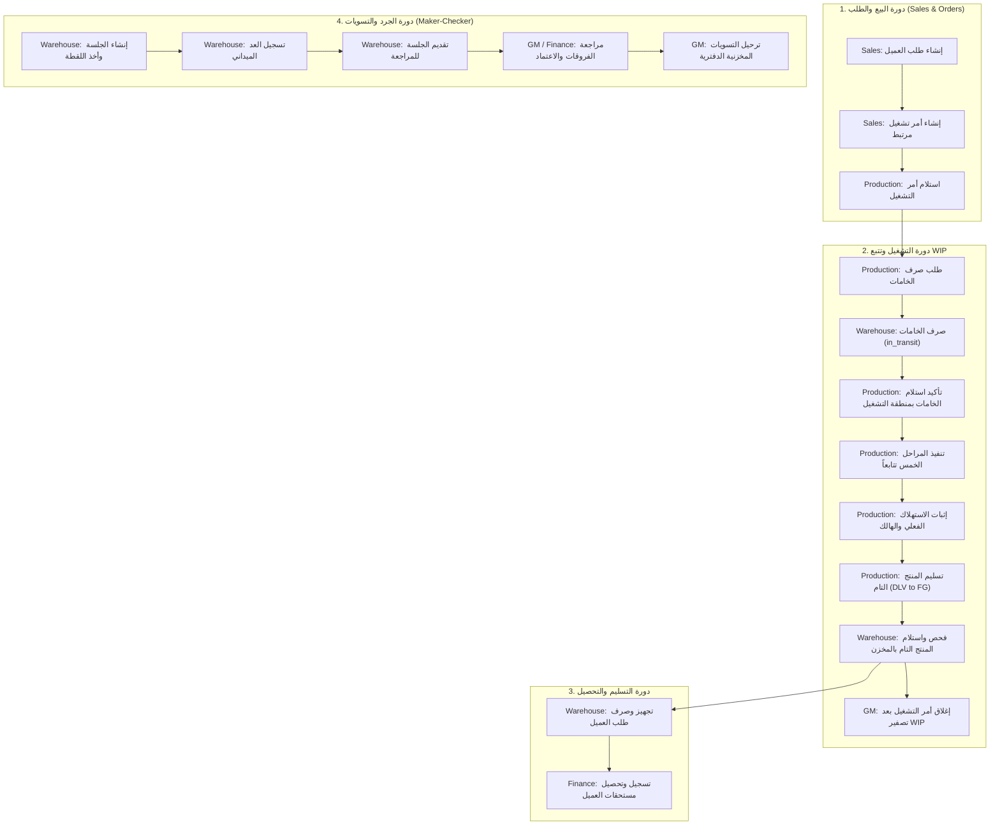

# وثيقة تدقيق المسؤوليات والصلاحيات وهندسة التفويض
**Qema ERP — Responsibility & Authorization Architecture Audit**
*فصل الصلاحيات، مصفوفة المسؤوليات التشغيلية، وسجل ثغرات التفويض والبيانات*

---

## 1. الملخص التنفيذي (Executive Summary)

بناءً على التكليف الهندسي لمهمة **TASK 01 — QEMA ERP RESPONSIBILITY & AUTHORIZATION DISCOVERY**، تم إجراء فحص معماري شامل وميداني لكامل الكود المصدري لنظام Qema ERP (في كل من الـ Backend والـ Frontend ونماذج قاعدة البيانات وملفات التوثيق السابقة)، دون تشغيل أي اختبارات آلية ودون تعديل أي كود تنفيذي أو إجراء أي migrations.

### نتائج الفحص بالأرقام:
- **إجمالي مسارات الـ API المفحوصة (Endpoints Audited):** **108 مسارًا** عبر 10 وحدات خادمية (`auth`, `catalog`, `customers`, `finance`, `health`, `inventory`, `payroll`, `production`, `ready`, `reports`).
- **المسارات المحمية بصلاحيات تفويض RBAC محددة:** **103 مسارات**.
- **المسارات المقتصرة على التحقق من هوية المستخدم فقط دون صلاحية دور:** **مسار واحد** (`GET /api/v1/auth/me`).
- **المسارات المفتوحة للعامة بحكم طبيعتها:** **4 مسارات** (`/health`, `/ready`, `/auth/config`, `/auth/local-login`).
- **إجمالي الجداول المسجلة في قاعدة البيانات:** **51 جدولاً**.
- **الأدوار المعرفة فعلياً في النظام:** **3 أدوار مؤقتة فقط** (`general_manager`, `warehouse_manager`, `finance_manager`).

---

## 2. الوضع الحالي (Current State)

### 2.1 الأدوار المعرفة فعلياً في الكود
تم فحص `apps/api/app/core/permissions.py` و `apps/api/app/api/v1/endpoints/auth.py` و `apps/web/src/features/auth/AuthContext.tsx`. الأدوار المعرفة هي:
1. `general_manager` (المدير العام)
2. `warehouse_manager` (أمين المخزن)
3. `finance_manager` (مدير المالية)

> [!CAUTION]
> **غياب أدوار تشغيلية محورية:**
> - دور **`production_manager` (مدير الإنتاج / قائد التشغيل)** **غير معرف نهائياً** في مصفوفة الصلاحيات الخادمية أو جداول الأدوار أو واجهة الدخول.
> - دور **`sales` (المبيعات / إدارة العملاء)** **غير معرف نهائياً**.
> - نتيجة لذلك، يضطر النظام حالياً إلى إسناد جميع مهام الإنتاج اليومية (إنشاء الأوامر، المراحل، الهالك، الإغلاق) وجميع مهام المبيعات (العملاء، الطلبات) إلى **المدير العام حصراً**!

### 2.2 طريقة تسجيل الدخول وإدارة الجلسات و LOCAL DEV MODE
1. **المصادقة الإنتاجية (Production Auth):**
   - تعتمد على **Supabase Auth JWT**.
   - خوارزميات التوقيع المسموحة غير المتماثلة: `RS256`, `ES256` عبر خادم مفاتيح `JWKS`.
   - فحص صارم للادعاءات: `iss`, `aud`, `exp`, `sub` بمبدأ الإغلاق الآمن عند الفشل (`Fail-Closed`).
2. **المصادقة المحلية (Local Dev Mode):**
   - مسار خادمي مخصص: `POST /api/v1/auth/local-login`.
   - محمي بشرط: `DEV_AUTH_ENABLED=true` وتواجد البيئة في `development` أو `testing`.
   - يقبل دوراً من قائمة بيضاء صارمة (`ALLOWED_LOCAL_ROLES = {"general_manager", "warehouse_manager", "finance_manager"}`).
   - يصدر توكن JWT متماثل موقّع بـ `HS256` باستخدام `LOCAL_JWT_SECRET`.
   - يوفر هويات اصطناعية مستقلة ومستقرة لكل دور لدعم اختبارات Maker-Checker:
     - `general_manager`: `dev-user-00000000-0000-0000-0000-000000000001` (`dev@qemma.local`)
     - `warehouse_manager`: `dev-user-00000000-0000-0000-0000-000000000002` (`wh@qemma.local`)
     - `finance_manager`: `dev-user-00000000-0000-0000-0000-000000000003` (`fin@qemma.local`)
3. **إدارة الجلسات في الواجهة (Frontend Session Management):**
   - تُدار عبر `AuthContext.tsx`.
   - يحفظ توكن التطوير في `localStorage` بمفتاح `qemma_local_dev_token`.
   - يتيح التبديل السريع بين الأدوار الثلاثة محلياً عبر نافذة `SignInModal.tsx`.

### 2.3 ملفات RBAC والتفويض الحالية
- **الخادم الخلفي (Backend):**
  - `apps/api/app/core/permissions.py`: يعرف الثوابت، مصفوفة الصلاحيات `ROLE_PERMISSIONS_MAP`، ودوال التبعيات `require_permission` و `require_any_role` و `get_user_roles`.
  - `apps/api/app/modules/identity/models.py`: يعرف الجداول العلائقية `roles`, `permissions`, `role_permissions`, `user_roles`.
- **الواجهة الأمامية (Frontend):**
  - `apps/web/src/features/auth/AuthContext.tsx`: يحتوي على نسخة موازية متطابقة من مصفوفة الصلاحيات `ROLE_PERMISSIONS_MAP` ودالة `hasPermission(permissionCode)`.

---

## 3. مصفوفة الصلاحيات المستهدفة (Target Role Matrix)

تحدد هذه المصفوفة توزيع الصلاحيات التشغيلية الصارمة وفق مبدأ **الحد الأدنى من الصلاحيات (Least Privilege)** وفصل الإدارة العليا عن التشغيل التنفيذي:

| القسم / الوحدة | الإجراء | General Manager | Warehouse Manager | Production Leader | Finance Manager | Sales (مقترح) |
| :--- | :--- | :---: | :---: | :---: | :---: | :---: |
| **المستخدمون والصلاحيات** | عرض وتعديل الأدوار | **Approve / Post** | Deny | Deny | Deny | Deny |
| **دليل الأصناف (Catalog)** | إنشاء مسودة صنف / تعديل | View | **Create / Submit** | View | View | View |
| | اعتماد الصنف أو طلب التعديل | **Approve / Reject** | Deny | Deny | Deny | Deny |
| | تعطيل / إعادة تفعيل صنف | **Approve / Execute** | Deny | Deny | Deny | Deny |
| **مخزن الخامات** | استلام توريدات الموردين | View | **Execute / Post** | Deny | View | Deny |
| | صرف خامات لأمر تشغيل | View | **Execute / Post** | Deny | Deny | Deny |
| | التحويل بين المخازن | View | **Create / Execute** | Deny | Deny | Deny |
| **الجرد والتسويات** | إنشاء جلسة جرد والعد الميداني | View | **Create / Submit** | Deny | View | Deny |
| | مراجعة واعتماد فروقات الجرد | **Review / Approve** | Deny | Deny | Review (مالي) | Deny |
| | ترحيل قيود التسوية المخزنية | **Approve / Post** | Deny | Deny | Deny | Deny |
| **التشغيل والإنتاج** | إنشاء قوالب التشغيل (BOM) | Review / Approve | View | **Create / Submit** | Deny | Deny |
| | إنشاء أمر تشغيل مرتبط بطلب | View | View | **Create / Submit** | Deny | **Create** |
| | تأكيد استلام الخامات بـ WIP | View | Deny | **Execute** | Deny | Deny |
| | تنفيذ مراحل الإنتاج الـ 5 | View | Deny | **Execute** | Deny | Deny |
| | إثبات استهلاك الخامات والهالك | View | Deny | **Execute / Submit** | Deny | Deny |
| | تسليم المنتج التام للمخزن | View | **Review / Approve** | **Submit / Execute** | Deny | Deny |
| | إغلاق أمر التشغيل وتسوية WIP | **Review / Approve** | View | Submit | View | Deny |
| **العملاء والطلبات** | تسجيل وتعديل بيانات عميل | View | Deny | Deny | View | **Create / Execute** |
| | إنشاء طلب بيع للعميل | View | View | Deny | View | **Create / Submit** |
| | صرف وتسليم بضاعة للعميل | View | **Execute / Post** | Deny | Deny | View |
| | تسجيل مرتجع من العميل | View | **Execute / Submit** | Deny | View | View |
| **المالية والخزينة** | إثبات المقبوضات والتحصيلات | View | Deny | Deny | **Execute / Post** | View |
| | إنشاء مستند صرف / مصروف يومي | View | Deny | Deny | **Create / Submit** | Deny |
| | اعتماد مستندات الصرف والعهد | **Review / Approve** | Deny | Deny | Deny (إذا كان منشئاً) | Deny |
| | فواتير الموردين والمدفوعات | View | View (كميات فقط) | Deny | **Execute / Post** | Deny |
| | إعداد ومراجعة كشوف الرواتب | View | Deny | Deny | **Create / Review** | Deny |
| | اعتماد وصرف الرواتب النهائية | **Approve / Post** | Deny | Deny | Execute (صرف الخزينة) | Deny |

---

## 4. خريطة انتقال المعاملات (Workflow Transitions & Ownership)

---

## 5. سجل ثغرات التفويض المكتشفة (Authorization Gaps)

تم اكتشاف ثغرات وتعارضات حقيقية في الكود الحالي:

### الثغرة الحرجـة 1: تعارض صلاحيات كشف الرواتب (Payroll Permission Mismatch)
- **الموقع:** `apps/api/app/api/v1/endpoints/payroll.py` (جميع المسارات العشرة، الأسطر: 43، 65، 96، 128، 149، 182، 204، 226، 296، 352).
- **التوصيف:** جميع مسارات الرواتب (الموظفين، الحضور، الفترات، الحساب، الصرف) تتطلب صلاحية `finance:manage`.
- **الخلل:** في `permissions.py` السطر 103، تم منح مدير المالية صلاحية `finance:payroll:manage` وليس `finance:manage`!
- **الأثر التشغيلي:** **مدير المالية محظور تماماً (403 Forbidden)** من فتح كشوف الرواتب أو احتساب أجور العمال، وتقتصر الإدارة حصراً على المدير العام!

### الثغرة الحرجة 2: غياب Maker-Checker عن المستندات النقدية (Cash Documents Self-Approval)
- **الموقع:** `apps/api/app/api/v1/endpoints/finance.py` (السطور 80-95) و `apps/api/app/modules/finance/service.py` (السطر 48 وما بعده).
- **التوصيف:** مسار إنشاء المستند النقدي `POST /api/v1/finance/cash-documents` ومسار اتخاذ القرار `POST /api/v1/finance/cash-documents/{document_id}/decision` كلاهما محمي بنفس الصلاحية `finance:cash:manage`.
- **الخلل:** دالة `decide_cash_document` لا تفحص `if document.created_by == user_id`.
- **الأثر التشغيلي:** يمكن لمدير المالية أن ينشئ سند صرف أو سلفة لنفسه ثم يعتمدها فوراً ويخصم رصيد الخزينة دون رقيب!

### الثغرة 3: إسناد مهام التشغيل الميداني للمدير العام فقط
- **الموقع:** `apps/api/app/api/v1/endpoints/production.py`.
- **التوصيف:** مسارات تحريك مراحل الإنتاج (`/stages/{stage_name}`) وتراجعها (`/rollback`) وإثبات العيوب (`/defects`) وإضافة الخامات (`/materials`) تتطلب حصراً `production:stages:manage` أو `production:orders:manage`.
- **الخلل:** هذه الصلاحيات ممنوحة فقط لـ `general_manager`؛ قائد التشغيل الميداني لا يملك صلاحية لإثبات إنهاء مرحلة القص أو الكي أو الكبسولة.

### الثغرة 4: إسناد مهام المبيعات اليومية للمدير العام فقط
- **الموقع:** `apps/api/app/api/v1/endpoints/customers.py`.
- **التوصيف:** إنشاء عميل وتعديله وإنشاء طلبات البيع تتطلب حصراً `customers:manage`، وهي ممنوحة فقط للمدير العام.

### الثغرة 5: غياب مسارات إدارة المستخدمين والأدوار (Admin Endpoints Void)
- **الموقع:** `apps/api/app/api/v1/router.py`.
- **التوصيف:** بالرغم من وجود جداول `roles` و `user_roles` و `permissions` في قاعدة البيانات، لا يوجد أي endpoint في الـ API يتيح للمدير العام عرض المستخدمين، أو إسناد دور، أو سحب صلاحية!

---

## 6. ثغرات تسرب البيانات عبر الأقسام (Data Access Gaps)

1. **انعدام الحماية على شاشات الواجهة (Frontend Route Protection Void):**
   - في `apps/web/src/App.tsx` (السطور 570-713)، باستثناء شاشات `StocktakeView` و `FinancialReportsView`، **جميع الشاشات الأخرى تفتح لأي مستخدم بدون أي فحص للصلاحيات!**
   - شاشة الخزنة `TreasuryView`، المصروفات `ExpensesView`، والعهد `CustodyView` يمكن لأمين المخزن فتحها ورؤية أرصدة الخزائن النقدية!
2. **تسرب أسعار التوريد لأمين المخزن:**
   - مسار `GET /api/v1/finance/supplier-invoices` يتطلب صلاحية `suppliers:view`، وهي ممنوحة لأمين المخزن لتمكينه من مطابقة التوريدات.
   - لكن المسار يعيد تفاصيل الأسعار الدفترية `unit_price`، `invoice_total`، `paid_total`، و `balance_due`. أمين المخزن يحتاج رؤية الأصناف والكميات الموردة فقط لمطابقتها فحصاً، ولا يجوز كشف شروط الأسعار والمديونيات له.
3. **تسرب مديونيات العملاء لأمين المخزن أثناء التسليم:**
   - في شاشة العملاء `CustomerAccountPage.tsx`، يظهر رصيد مديونية العميل وإجمالي المسدد والمتبقي، في حين أن دور المخزن يقتصر على سند التسليم الفعلي والتعبئة.
4. **لوحة التشغيل التنفيذية (OperationsBoard):**
   - تعرض مؤشرات السيولة والخزنة والتدفقات النقدية إلى جانب مراحل الإنتاج ودفعات التصنيع، وتظهر حالياً لجميع الأدوار دون حجب المؤشرات المالية عن أمين المخزن أو قائد الإنتاج.

---

## 7. مصفوفة الصانع والمعتمد (Maker-Checker Matrix)

| المعاملة الدفترية | المنشئ (Maker) | المراجع (Reviewer) | المعتمد النهائي (Approver / Poster) | قاعدة المنع البرمجية المطلوبة |
| :--- | :--- | :--- | :--- | :--- |
| **اعتماد صنف بالدليل** | أمين المخزن (`inventory:manage`) | — | المدير العام (`catalog:item:approve`) | `submitted_by != approver_id` (مطبقة حالياً بنجاح) |
| **تعديل صنف بالدليل** | أمين المخزن (`catalog:item:create`) | — | المدير العام (`catalog:item:approve`) | `submitted_by != approver_id` (مطبقة حالياً بنجاح) |
| **سند صرف نقدي / عهدة** | مدير المالية (`finance:cash:create`) | — | المدير العام (`finance:cash:approve`) | منع اعتماد المنشئ لنفسه (`created_by != approver_id`) |
| **جلسة الجرد والتسوية** | أمين المخزن (`inventory:stocktake:create`) | مدير المالية (`inventory:stocktake:review`) | المدير العام (`inventory:stocktake:post`) | منع من قام بالعد أو أنشأ الجلسة من اعتماد الترحيل الدفتري |
| **صرف خامات للتشغيل** | قائد الإنتاج (طلب الصرف) | — | أمين المخزن (تأكيد الخصم والصرف) | المنفذ جهتان مختلفتان مع توثيق الطرفين |
| **استلام منتج تام بالخزائن** | قائد الإنتاج (تسليم) | — | أمين المخزن (فحص واستلام وتأكيد) | المنفذ جهتان مختلفتان مع توثيق الطرفين |
| **كشف الرواتب الشهري** | مدير المالية (`finance:payroll:calculate`) | — | المدير العام (`finance:payroll:disburse`) | المنشئ مدير المالية والمعتمد المدير العام |

---

## 8. ربط سجل الجودة والملاحظات السابقة (QA Mapping)

| بند الجودة السابق | الوحدة المتأثرة | السبب الجذري الفعلي | حالة المعالجة الحالية | المطلوب في مرحلة الهيكلة |
| :--- | :--- | :--- | :---: | :--- |
| **ثغرة الرصيد السالب تحت التزامن** | `production / customers` | تنافس طلبي تسليم متزامنين على نفس رصيد المخزن | `RESOLVED` (قفل `CatalogItem` داخل المعاملة) | الإبقاء على الحماية وعدم إضعاف الـ Transaction |
| **تجاوز مرتجع العميل للمسلم** | `customers` | غياب التحقق التراكمي للكميات المرتجعة | `RESOLVED` (قفل `CustomerDelivery` والتحقق التراكمي) | ربط المرتجعات بصلاحية فحص الجودة المخزنية |
| **إغلاق أمر التشغيل برصيد WIP متبقٍ** | `production` | إغلاق الأمر بنص وصفي دون تسوية القيود | `RESOLVED` (رفض الإغلاق بـ 409 إذا كان رصيد WIP > 0) | إتاحة مسار تسوية صريح لقائد الإنتاج قبل الإغلاق |
| **انتحال الأدوار في التطوير** | `auth` | قبول أدوار عشوائية محلياً دون تدقيق خادمي | `RESOLVED` (قائمة بيضاء صارمة وهويات منفصلة) | إضافة دور `production_manager` للقائمة البيضاء |
| **عزل دفعات WIP** | `inventory` | تداخل أرصدة الخامات بين أوامر التشغيل | `RESOLVED` (عزل بـ `bucket_reference = order:{id}`) | حصر حق الاستهلاك في قائد التشغيل المسند له الأمر |
| **تعطل صفحة الرواتب لمدير المالية** | `payroll` | خطأ فادح في مطابقة كود الصلاحية المطلوبة | **مؤكدة (UNRESOLVED)** | تصحيح كود الصلاحية في `payroll.py` إلى `finance:payroll:manage` |
| **اعتماد المستندات النقدية الذاتي** | `finance` | غياب فحص Maker-Checker داخل `decide_cash_document` | **مؤكدة (UNRESOLVED)** | إضافة شرط خادمي صريح يمنع اعتماد المنشئ لمستنده |

---

## 9. خطة التنفيذ المقترحة (Implementation Plan)

تقسم الخطة إلى 5 حزم عمل صغيرة مرتبة بحسب الاعتماديات الهندسية:

### الحزمة 1: إصلاح ثغرات التفويض الخادمية الحرجة (Backend RBAC Fixes)
1. تصحيح صلاحيات `apps/api/app/api/v1/endpoints/payroll.py` لاستخدام `finance:payroll:manage` بدلاً من `finance:manage` لتمكين مدير المالية.
2. إضافة فحص Maker-Checker في `decide_cash_document` لمنع المنشئ من اعتماد مستنده النقدي بنفسه.
3. تعريف دور `production_manager` في `permissions.py` ونقل صلاحيات `production:stages:manage` و `production:orders:manage` إليه.

### الحزمة 2: تنظيف تسرب البيانات في الـ API (Data Masking & Projections)
1. تعديل مسار `GET /api/v1/finance/supplier-invoices` ليعيد نموذجاً محجوب الأسعار (Read Without Prices) إذا كان المستدعي أمين مخزن (`warehouse_manager`).
2. حجب أرصدة مديونيات العملاء في شاشات التسليم المخزني.

### الحزمة 3: حماية مسارات الواجهة الأمامية (Frontend Route & View Guards)
1. تطبيق حظر عرض الشاشات المالية (`TreasuryView`, `ExpensesView`, `CustodyView`) في `App.tsx` عند غياب صلاحيات `finance:cash:view` أو `finance:manage`.
2. حجب وإظهار أزرار المراحل والإغلاق في `ProductionOrdersView` و `OrderDetailModal` بناءً على صلاحيات المستخدم الفعلي.
3. حجب أزرار الاعتماد في `ItemDetailDrawer` إلا لمن يملك صلاحية `catalog:item:approve`.

### الحزمة 4: إضافة دور مدير الإنتاج لواجهة التطوير والاختبار المحلي
1. إضافة `production_manager` إلى `ALLOWED_LOCAL_ROLES` في `auth.py`.
2. إنشاء هوية اصطناعية رابعة `dev-user-00000000-0000-0000-0000-000000000004` (`prod@qemma.local`).
3. تحديث خيارات التبديل في `SignInModal.tsx`.

### الحزمة 5: مسارات إدارة المستخدمين والأدوار للمدير العام (User Management APIs)
1. إنشاء endpoints محمية للمدير العام (`GET /api/v1/users`, `POST /api/v1/users/{id}/roles`).
2. توثيق كافة التغييرات وإصدار تقرير الجاهزية.

---

## 10. تقييم أثر ترحيل البيانات (Migration Impact Analysis)

- **هل نحتاج Alembic Migration جديدة الآن؟**
  - **لا حاجة فورية لتغيير بنية الجداول الأساسية**: جداول `roles` و `permissions` و `role_permissions` و `user_roles` مبنية وموجودة بالفعل في قاعدة البيانات.
  - **الاحتياج مقتصر على ترحيل بيانات وصلاحيات (Data Seed / Permission Migration)**:
    - إدراج سجل دور `production_manager` في جدول `roles`.
    - إدراج وتعيين الصلاحيات الجديدة في جدول `role_permissions`.
  - **تعديلات مستقبلية محتملة (غير منفذة الآن)**:
    - إضافة جدول تدقيق عام للأحداث `audit_logs` أو أعمدة `assigned_to_user_id` كـ Foreign Key بدلاً من النصوص الحرة.

---

## 11. القرارات المصنعية المفتوحة (Factory-Owned Open Decisions)

النقاط التالية تمثل خيارات تشغيلية تملكها إدارة المصنع ولا يجوز حسمها فردياً من واقع الكود:
1. **صلاحية إنشاء قوالب التشغيل (BOM):** هل يعدها مدير الإنتاج ويعتمدها المدير العام، أم يضعها المدير العام بنفسه؟
2. **حدود اعتماد المصروفات اليومية:** ما هو سقف المبلغ الذي يستطيع مدير المالية صرفه مباشرة، وما هو الحد المالي الذي يستوجب توقيع المدير العام؟
3. **سياسة إسناد أوامر التشغيل:** هل تسند الدفعة لمدير الإنتاج العام أم لخط إنتاج أو مشرف صالة محدد؟
4. **رؤية أسعار الخامات لأمين المخزن:** هل يوافق المصنع على حجب أسعار الشراء عن أمين المخزن تماماً والاكتفاء بمطابقة أذون الإضافة ككميات وأصناف؟
5. **المبيعات وإدارة العملاء:** هل يستحدث دور ممثل مبيعات (`sales`)، أم يستمر المدير العام في إدخال طلبيات كبار العملاء بنفسه في المرحلة التجريبية؟

