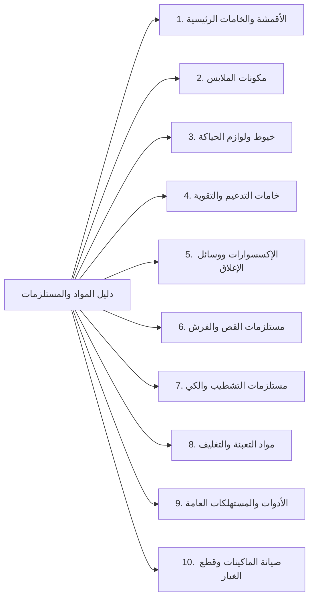

# وثيقة التصنيف النهائي لمخزن الخامات والبيانات المرجعية
**Qema ERP — Phase 3.1: Final Taxonomy & Reference Data Specifications**

---

## 1. الغرض والمبادئ المعمارية الحاكمة

تهدف هذه الوثيقة إلى اعتماد المواصفات الهندسية النهائية لنظام تصنيف خامات ومستلزمات الإنتاج، والإكسسوارات، ومواد التعبئة والتغليف، وقطع غيار الصيانة في مصنع القمة للملابس، ليكون نظاماً موحداً ومرناً يخدم خطوط إنتاج متعددة (جلابيات رجالي، جلابيات مغربي، شروال، ثياب عربية، ملابس أطفال، وأي خطوط مستقبلية).

### المبادئ الحاكمة:
1. **التصنيف يصف المادة فيزيائياً وليس الموديل النهائي (`Inventory Category ≠ Product Type`):** الصنف يصنف بماهيته المادية المستقلة دون ربطه قسراً بموديل محدد.
2. **استقلالية المحاور التصنيفية الخمسة:**
   - النوع التشغيلي العام (`item_type`).
   - التصنيف الهرمي الشجري (`category_id` & `item_categories`).
   - المواصفات والخصائص الفنية (`attributes: JSONB`).
   - وسوم الصلاحية العامة للتطبيقات (`application_lines` & `catalog_item_usages`).
   - وحدة القياس والتخزين المعتمدة (`unit_id` & `units`).
3. **حماية التوافقية ومنع الانحدار (Zero Regression):** حماية دورة المنتجات التامة (`FG-VAR-*`)، وجدول الوحدات القائم (`units`)، ودفتر المخزون (`StockLedgerEntry`)، وفواتير الموردين، وقوالب الإنتاج القائمة 100%.
4. **حظر التخمين في التحويلات:** الالتزام الصارم بنفس وحدة الصنف المعتمدة (`unit_id`) في الشراء والتخزين والاستهلاك.

---

## 2. توثيق قيم `item_type` ومصفوفة التوافقية (Compatibility Matrix)

### 2.1 فحص الكود وقاعدة البيانات لقيم `item_type`
كشف التدقيق الميداني لقاعدة البيانات وكود الباك إند والفرونت إند:
- **في قاعدة البيانات:** عمود `catalog_items.item_type` معرّف كـ `String(64)` **وليس Enum مغلق أو CheckConstraint**. ويحتوي حالياً على قيمة واحدة فعلية: `finished_garment` (15 صنفاً لمنتجات تامة).
- **في الباك إند واختبارات الـ API:** تظهر القيم: `finished_garment`، `raw_material`، `fabric`.
- **في واجهة المستخدم (`MachineryView.tsx`):** تظهر القيم: `maintenance_supply`، `reusable_tool`.
- **في وثائق المتطلبات:** تظهر قيمة `packaging`.

### 2.2 مصفوفة التوافقية بين `item_type` والفئات العشر (Compatibility Matrix)

| الفئة الرئيسية (Category) | `raw_material` | `fabric` | `packaging` | `reusable_tool` | `maintenance_supply` | `finished_garment` |
| :--- | :---: | :---: | :---: | :---: | :---: | :---: |
| **1. الأقمشة والخامات الرئيسية (`FABRICS_MAIN`)** | ✅ أساسي | ✅ أساسي | ❌ | ❌ | ❌ | ❌ |
| **2. مكونات الملابس (`GARMENT_COMPONENTS`)** | ✅ أساسي | ⚠️ مكونات قماش | ❌ | ❌ | ❌ | ❌ |
| **3. خيوط ولوازم الحياكة (`SEWING_SUPPLIES`)** | ✅ أساسي | ❌ | ❌ | ❌ | ❌ | ❌ |
| **4. خامات التدعيم والتقوية (`INTERLINING_REINFORCEMENT`)** | ✅ أساسي | ⚠️ رولات فازلين | ❌ | ❌ | ❌ | ❌ |
| **5. الإكسسوارات ووسائل الإغلاق (`TRIMS_FASTENERS`)** | ✅ أساسي | ❌ | ❌ | ❌ | ❌ | ❌ |
| **6. مستلزمات القص والفرش (`CUTTING_SUPPLIES`)** | ⚠️ مستهلكات قص | ❌ | ❌ | ✅ أدوات وأثقال | ❌ | ❌ |
| **7. مستلزمات التشطيب والكي (`FINISHING_PRESSING`)** | ⚠️ كي وتنظيف | ❌ | ⚠️ أكياس تلبيس | ❌ | ❌ | ❌ |
| **8. مواد التعبئة والتغليف (`PACKAGING_MATERIALS`)** | ❌ | ❌ | ✅ أساسي | ❌ | ❌ | ❌ |
| **9. الأدوات والمستهلكات العامة (`TOOLS_CONSUMABLES`)** | ❌ | ❌ | ❌ | ✅ أدوات مستديمة | ⚠️ مفكات وعدد | ❌ |
| **10. صيانة الماكينات وقطع الغيار (`MACHINERY_MAINTENANCE`)** | ❌ | ❌ | ❌ | ⚠️ عيار ومفاتيح | ✅ أساسي | ❌ |
| **خارج الشجرة (المنتجات التامة `FG-VAR-*`)** | ❌ | ❌ | ❌ | ❌ | ❌ | ✅ `category_id = NULL` |

> **قاعدة المرونة المعمارية:**  
> لا يفرض النظام قيد CheckConstraint يربط `item_type` بفئة واحدة قسراً في قاعدة البيانات، لضمان عدم إعاقة أي تركيبة تشغيلية مشروعة (مثل أدوات القص أو مستلزمات التعبئة والتنظيف)، مع الإبقاء على `category_id = NULL` للأصناف ذات `item_type = 'finished_garment'`.

---

## 3. شجرة الفئات العشر النهائية المعتمدة (Final Category Taxonomy)



1. **`FABRICS_MAIN` (الأقمشة والخامات الرئيسية):**
   - الفئات الفرعية: `FAB_MAIN` (أقمشة أساسية)، `FAB_CONTRAST` (أقمشة تطعيم وتباين)، `FAB_LINING` (بطانات).
2. **`GARMENT_COMPONENTS` (مكونات الملابس):**
   - الفئات الفرعية: `CMP_CUFFS` (أساور)، `CMP_COLLARS_MANDARIN` (أنصاف ياقات)، `CMP_COLLARS_FULL` (ياقات كاملة)، `CMP_POCKETS` (جيوب)، `CMP_PLACKETS` (مردات وفتحات أكمام/صدر).
3. **`SEWING_SUPPLIES` (خيوط ولوازم الحياكة):**
   - الفئات الفرعية: `SEW_THREAD_SEWING` (خيوط حياكة)، `SEW_THREAD_OVERLOCK` (خيوط أوفر)، `SEW_THREAD_EMBROIDERY` (خيوط تطريز).
4. **`INTERLINING_REINFORCEMENT` (خامات التدعيم والتقوية):**
   - الفئات الفرعية: `INT_ROLLS` (أثواب حشو لاصق)، `INT_PRECUT` (حشوات مقصوصة للمرد والياقات)، `INT_STIFFENERS` (مقويات خاصة).
5. **`TRIMS_FASTENERS` (الإكسسوارات ووسائل الإغلاق):**
   - الفئات الفرعية: `TRM_BUTTONS` (أزرار)، `TRM_SNAPS` (كباسين)، `TRM_HOOKS` (شناكل وأقفال)، `TRM_ZIPPERS` (سوست)، `TRM_CORDS_RIBBONS` (أحزمة وشرائط).
6. **`CUTTING_SUPPLIES` (مستلزمات القص والفرش):**
   - الفئات الفرعية: `CUT_NUMBERING` (بكر ترقيم الراقات)، `CUT_PAPER` (ورق باترون وفرش)، `CUT_MARKING` (طباشير وأقلام تعليم).
7. **`FINISHING_PRESSING` (مستلزمات التشطيب والكي):**
   - الفئات الفرعية: `FIN_IRONING_COVERS` (أغطية وتلبيسات الكي)، `FIN_CHEMICALS` (مزيلات بقع وتثبيت مظهر).
8. **`PACKAGING_MATERIALS` (مواد التعبئة والتغليف):**
   - الفئات الفرعية: `PKG_BAGS` (أكياس فردية)، `PKG_BOXES` (علب عرض كرتونية)، `PKG_CARTONS` (كراتين شحن وتجميع)، `PKG_COLLAR_SUPPORTS` (دعامات وأطواق ياقات)، `PKG_LABELS_TAGS` (تيكت وبطاقات)، `PKG_TAPES_TIES` (سلوتيب وأسلاك غلق).
9. **`TOOLS_CONSUMABLES` (الأدوات والمستهلكات العامة):**
   - الفئات الفرعية: `TOL_CUTTING` (مقصات وقصاصات يدوية)، `TOL_MEASURING` (مازورات ومساطر)، `TOL_HAND_TOOLS` (عدد يدوية ومفكات).
10. **`MACHINERY_MAINTENANCE` (صيانة الماكينات وقطع الغيار):**
    - الفئات الفرعية: `MNT_NEEDLES` (إبر ماكينات)، `MNT_HOOKS_LOOPERS` (كروشيهات ومكوكات)، `MNT_KNIVES_BLADES` (سكاكين وشفرات)، `MNT_FEET_PLATES` (دواسات وبلاكات)، `MNT_LUBRICANTS` (زيوت وشحوم)، `MNT_PARTS_ELECTRICAL` (مواتير وسيور).

---

## 4. تصميم خصائص ومواصفات الأصناف (JSONB Attribute Validation)

### 4.1 القواعد المعيارية للتحقق من السمات:
1. **السمات اختيارية كقاعدة عامة (`Optional by Default`):** يُسمح بإنشاء الصنف بكائن فارغ `{}` أو بيانات جزئية دون رفض النظام له، تيسيراً لإدخال الشحنات العاجلة.
2. **التحقق من القيم الإيجابية للأبعاد (`Strict Positive Dimensions`):** أي مقياس فيزيائي يتم إدخاله يجب أن يكون رقماً موجباً أكبر من الصفر قطيعاً (`width_cm > 0`, `length_cm > 0`, `diameter_mm > 0`, `weight_gsm > 0`).
3. **دعم المقاسات الرقمية والحرفية والنصية:** دعم `size_numeric: int`، `size_letter: str`، و `size_raw: str`.
4. **الفصل بين وزن النسيج والكمية المخزنية:** سمة `weight_gsm` (جرام/م2) في الأقمشة هي مواصفة نوعية للنسيج ومستقلة تماماً عن رصيد المخزون المسجل بوحدة المخزن (متر أو كجم).

### 4.2 قوالب الخصائص التخصصية:
- **قطع غيار الصيانة (`MACHINERY_MAINTENANCE`):**
  - `part_number`: كود القطعة المصنعي.
  - `compatible_machines`: قائمة نصية بالماكينات المتوافقة (`list[str]`) لدعم توافق القطعة الواحدة مع ماكينات متعددة (مثل: `["Juki DDL-8700", "Siruba 747K", "Jack A4"]`).
- **وسائل الإغلاق المنفصلة:**
  - أزرار (`TRM_BUTTONS`): مقاس اللين (`button_size_ligne`: 18L, 24L, 32L)، عدد الثقوب (`holes_count`: 2, 4)، المادة، التشطيب، حفر شعار خاص.
  - كباسين (`TRM_SNAPS`): قطر الكبسولة بالملليمتر (`snap_diameter_mm > 0` إلزامي)، نوع الكبسولة (بروز، حلقة، زنبرك)، المادة، لون الطلاء.
  - شناكل (`TRM_HOOKS`): نوع الشنكل (بنطلون، سترة، جلابية)، المادة، العرض بالملليمتر (`width_mm > 0`).

---

## 5. خطوط وتطبيقات الإنتاج مقابل قوالب الإنتاج (Applications vs BOM)

> ### [!IMPORTANT]
> 1. جدول `catalog_item_usages` وسوم للصلاحية العامة (General Applicability Tags) فقط، لتسهيل تصفية الخامات المناسبة للموديل في الواجهة.
> 2. **قالب الإنتاج (BOM: `ProductionTemplateLine`) وأمر التشغيل (`ProductionOrderMaterial`) هو المرجع الحصري الوحيد** الذي يحدد أصناف وكميات الخامات المطلوبة لتصنيع الدفعة.
> 3. **وسوم التطبيقات لا تضيف خامات تلقائياً لأمر الإنتاج.**
> 4. لا تعديل على منطق احتساب المواد النسبي (`calculate_proportional_materials`) أو حركة الصرف المخزني.

---

## 6. وحدات القياس وحد النقص (Units & Reorder Level)

1. **وحدة المخزون والحركة الحصرية:** `catalog_items.unit_id` المربوط بجدول `units` القائم هو الوحدة الحاكمة لحركات دفتر الأستاذ (`StockLedgerEntry`).
2. **إلزامية التطابق وحظر التحويل التلقائي:** تلتزم المشتريات (فواتير الموردين)، واستلام البضاعة، وأوامر التشغيل، والصرف، بنفس وحدة الصنف المعتمدة؛ ولا توجد تحويلات آلية تخمينية.
3. **وحدة حد النقص:** حقل `reorder_level` يُقاس بنفس وحدة الصنف المعتمدة (`unit_id`).
4. **تعطيل تنبيه النقص:** تعيين `reorder_level = 0` يعني تعطيل التنبيه التلقائي لهذا الصنف.
5. **حظر افتراض محتوى ثابت للعبوة:** لا يُفترض برمجياً أن التوب 50 متراً أو الكرتونة 100 قطعة، وتضبط الكميات بناءً على القياس المباشر للشحنة.

---

## 7. حالات التصنيف وحماية المنتجات التامة (Classification Statuses)

يُقيد عمود `classification_status` في `catalog_items` بالقيم الأربع التالية:
1. **`confirmed` (معتمد):** صنف تم تدقيق فئته ومواصفاته واعتماده رسمياً.
2. **`suggested` (مقترح):** صنف مسودة تم إدخاله مبدئياً بانتظار الاعتماد.
3. **`needs_review` (يحتاج مراجعة):** صنف غير محسوم المواصفات؛ وهي الحالة الافتراضية لأي خامة جديدة غير مصنفة.
4. **`not_applicable` (غير منطبق):** خاص بمنتجات الملابس التامة الصنع (`FG-VAR-*`).

### تحديث خطة `get_or_create_finished_goods_item`:
تحديد حالة `classification_status = 'not_applicable'` صراحة وبشكل قطعي عند إنشاء أي منتج تام جديد:
```python
new_item = CatalogItem(
    id=str(uuid.uuid4()),
    code=canonical_code,
    name_ar=item_name_ar,
    item_type="finished_garment",
    unit_id=piece_unit.id,
    is_consumable=False,
    is_active=True,
    classification_status="not_applicable",  # صراحة لمنع الاعتماد على أي Default عام
)
```

---

## 8. سلامة قاعدة البيانات ودورة الحياة (Lifecycle & Referential Integrity)

1. **منع حذف الفئات المستخدمة:** قيد `catalog_items.category_id REFERENCES item_categories(id) ON DELETE RESTRICT`.
2. **منع حذف الفئات ذات الفروع:** قيد `item_categories.parent_id REFERENCES item_categories(id) ON DELETE RESTRICT`.
3. **منع الحلقات في شجرة الفئات:** فحص برمجي استعلامي متكرر (Recursive CTE) يمنع جعل الفئة أباً لنفسها أو لأحد فروعها التابعة.
4. **سياسة التعطيل:** عند تعطيل فئة رئيسية (`is_active = False`)، يُمنع اختيارها لاختيار أصناف جديدة، مع بقاء كافة الروابط التاريخية دون إخفاء.
5. **منع حذف الأصناف المرتبطة بالحركات:** قيد `ON DELETE RESTRICT` مفروض ومحفوظ لكافة حركات المخزون والمشتريات والـ BOM، ويقتصر الإيقاف على `is_active = False`.
6. **حظر إعادة التعيين التلقائي:** لا يتم نقل الأصناف آلياً لأي فئة أخرى عند تعطيل فئتها.
