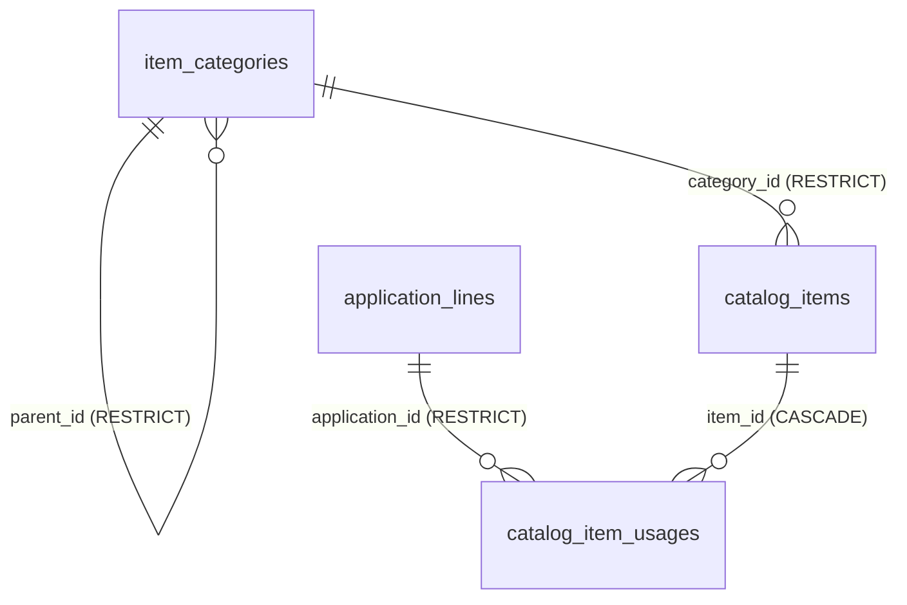

# خطة تنفيذ ترحيل شجرة تصنيف الخامات والبيانات المرجعية (Migration 0011)
**Qema ERP — Phase 3.1: Detailed Implementation & Migration Plan**

---

## 1. المقدمة ونطاق العمل الهندسي

تحدد هذه الوثيقة الخطة التنفيذية المعمارية الدقيقة لتطبيق المرحلة 3.1 داخل مستودع **Qema ERP** عبر كتابة ترحيل **Migration 0011** دون المساس بأي من الوظائف القائمة، وبالتوافق المطلق مع دورات الإنتاج والمبيعات والمخازن.

### الضوابط الصارمة الحاكمة للتنفيذ:
- **حظر المساس بالبيانات التاريخية والأصول القائمة:**
  - الإبقاء على دلالة واسم `catalog_items.unit_id` وجدول `units` القائم.
  - الإبقاء على قيم وعمود `catalog_items.item_type`.
  - الإبقاء على محدد هوية المنتجات التامة `FG-VAR-*` وأصنافها الـ 15 الحالية.
  - الحفاظ التام على دفتر أستاذ المخزون `StockLedgerEntry` وأرصدة المخازن الحالية.
  - الحفاظ التام على فواتير الموردين وقوالب الإنتاج (`BOM`).
- **حظر التحويل التلقائي التخميني:** لا تحويلات ثابتة بين الأثواب والكراتين والأمتار.

---

## 2. ملخص نتائج الفحص الميداني ومصفوفة التوافقية (Compatibility Matrix)

### 2.1 نتائج الفحص الفعلي لمستودع الكود:
- **في قاعدة البيانات:** جدول `units` موجود ويحتوي على وحدة `piece`؛ وجدول `catalog_items` يحتوي على 15 صنفاً بنوع `item_type = 'finished_garment'`. عمود `item_type` معرف كـ `String(64)` حر وليس Enum مغلق في قاعدة البيانات.
- **في الباك إند:** استخدام `finished_garment`, `raw_material`, `fabric`.
- **في الفرونت إند:** استخدام `maintenance_supply`, `reusable_tool`.

### 2.2 مصفوفة التوافقية بين `item_type` والفئات العشر:

| الفئة الرئيسية (Category) | `raw_material` | `fabric` | `packaging` | `reusable_tool` | `maintenance_supply` | `finished_garment` |
| :--- | :---: | :---: | :---: | :---: | :---: | :---: |
| **1. الأقمشة والخامات الرئيسية (`FABRICS_MAIN`)** | ✅ أساسي | ✅ أساسي | ❌ | ❌ | ❌ | ❌ |
| **2. مكونات الملابس (`GARMENT_COMPONENTS`)** | ✅ أساسي | ⚠️ مكونات مقصوصة | ❌ | ❌ | ❌ | ❌ |
| **3. خيوط ولوازم الحياكة (`SEWING_SUPPLIES`)** | ✅ أساسي | ❌ | ❌ | ❌ | ❌ | ❌ |
| **4. خامات التدعيم والتقوية (`INTERLINING_REINFORCEMENT`)** | ✅ أساسي | ⚠️ رولات فازلين | ❌ | ❌ | ❌ | ❌ |
| **5. الإكسسوارات ووسائل الإغلاق (`TRIMS_FASTENERS`)** | ✅ أساسي | ❌ | ❌ | ❌ | ❌ | ❌ |
| **6. مستلزمات القص والفرش (`CUTTING_SUPPLIES`)** | ⚠️ مستهلكات قص | ❌ | ❌ | ✅ أدوات وأثقال | ❌ | ❌ |
| **7. مستلزمات التشطيب والكي (`FINISHING_PRESSING`)** | ⚠️ كي وتنظيف | ❌ | ⚠️ أكياس تلبيس | ❌ | ❌ | ❌ |
| **8. مواد التعبئة والتغليف (`PACKAGING_MATERIALS`)** | ❌ | ❌ | ✅ أساسي | ❌ | ❌ | ❌ |
| **9. الأدوات والمستهلكات العامة (`TOOLS_CONSUMABLES`)** | ❌ | ❌ | ❌ | ✅ أدوات مستديمة | ⚠️ مفكات وعدد | ❌ |
| **10. صيانة الماكينات وقطع الغيار (`MACHINERY_MAINTENANCE`)** | ❌ | ❌ | ❌ | ⚠️ عيار ومفاتيح | ✅ أساسي | ❌ |
| **خارج الشجرة (المنتجات التامة `FG-VAR-*`)** | ❌ | ❌ | ❌ | ❌ | ❌ | ✅ `category_id = NULL` |

---

## 3. الخطة التفصيلية لترحيل قاعدة البيانات (Migration 0011 Plan)

### 3.1 معرّف الترحيل وملفه المقترح:
- **اسم الملف:** `apps/api/alembic/versions/0011_production_materials_taxonomy.py`
- **الترحيل السابق (Down-revision):** `0010_finished_goods_unification_and_returns` (أو آخر ترحيل نشط في المسار).

### 3.2 الجداول الجديدة (New Tables):



#### أ. جدول فئات الأصناف (`item_categories`):
- `id`: `String(36)`, Primary Key (UUID).
- `code`: `String(32)`, Unique Constraint (`uq_item_categories_code`), Index (`ix_item_categories_code`), Non-nullable.
- `name_ar`: `String(128)`, Non-nullable.
- `name_en`: `String(128)`, Nullable.
- `parent_id`: `String(36)`, ForeignKey to `item_categories.id`, `ondelete="RESTRICT"`, Nullable.
- `description`: `Text`, Non-nullable, Default `''`.
- `is_active`: `Boolean`, Non-nullable, Default `True`.
- `sort_order`: `Integer`, Non-nullable, Default `0`.
- `created_at`: `DateTime(timezone=True)`, Non-nullable, Server Default `func.now()`.

#### ب. جدول خطوط الإنتاج والتطبيقات المرجعية (`application_lines`):
- `id`: `String(36)`, Primary Key (UUID).
- `code`: `String(32)`, Unique Constraint (`uq_application_lines_code`), Index (`ix_application_lines_code`), Non-nullable.
- `name_ar`: `String(128)`, Non-nullable.
- `name_en`: `String(128)`, Nullable.
- `description`: `Text`, Non-nullable, Default `''`.
- `is_active`: `Boolean`, Non-nullable, Default `True`.
- `sort_order`: `Integer`, Non-nullable, Default `0`.
- `created_at`: `DateTime(timezone=True)`, Non-nullable, Server Default `func.now()`.

#### ج. جدول وسوم استخدام الأصناف (`catalog_item_usages`):
- `item_id`: `String(36)`, ForeignKey to `catalog_items.id`, `ondelete="CASCADE"`, Non-nullable.
- `application_id`: `String(36)`, ForeignKey to `application_lines.id`, `ondelete="RESTRICT"`, Non-nullable.
- `created_at`: `DateTime(timezone=True)`, Non-nullable, Server Default `func.now()`.
- **المفتاح الأساسي المركب:** `PrimaryKeyConstraint("item_id", "application_id", name="pk_catalog_item_usages")`.

---

### 3.3 الأعمدة المضافة لجدول `catalog_items`:

1. **`category_id`:**
   - النوع: `String(36)`, Nullable.
   - القيد: `ForeignKeyConstraint(["category_id"], ["item_categories.id"], name="fk_catalog_items_category_id", ondelete="RESTRICT")`.
   - الفهرس: `CREATE INDEX ix_catalog_items_category_id ON catalog_items(category_id);`.
2. **`classification_status`:**
   - النوع: `String(32)`, Non-nullable.
   - القيمة الافتراضية للترحيل: `server_default="needs_review"`.
   - قيد التحقق (CheckConstraint):  
     `CheckConstraint("classification_status IN ('confirmed', 'suggested', 'needs_review', 'not_applicable')", name="ck_catalog_items_classification_status")`.
3. **`attributes`:**
   - النوع: `JSONB`, Non-nullable, `server_default="{}"`.
   - الفهرس: `CREATE INDEX ix_catalog_items_attributes_gin ON catalog_items USING GIN (attributes);`.
4. **`reorder_level`:**
   - النوع: `Numeric(12, 3)`, Non-nullable, `server_default="0"`.
   - قيد التحقق (CheckConstraint):  
     `CheckConstraint("reorder_level >= 0", name="ck_catalog_items_reorder_level_nonnegative")`.

---

### 3.4 معالجة أصناف المنتجات التامة القائمة والمستقبلية (Finished Goods Strategy):
- **في نفس الترحيل 0011 (Data Migration Step):**  
  تنفيذ أمر تحديث صريح للأصناف الـ 15 القائمة:
  ```sql
  UPDATE catalog_items
  SET classification_status = 'not_applicable'
  WHERE item_type = 'finished_garment';
  ```
- **في كود التطبيق المستقبلي (`service.py`):**  
  تحديث دالة `get_or_create_finished_goods_item` لتمرير `classification_status="not_applicable"` صراحة، مما يمنع اعتمادها على أي Default عام قد يصنفها خطأً كـ `needs_review`.

---

### 3.5 بذر البيانات المرجعية الأساسية (Seed Data in Migration):
1. **الفئات العشر وفروعها الأساسية:** إدخال أكواد وأسماء الفئات العشر الرئيسية وفروعها الـ 30.
2. **خطوط التطبيق الستة:** إدخال خطوط التطبيق المرجعية (`GENERAL`, `JALABIYA`, `MOROCCAN_JALABIYA`, `SHERWAL`, `THOBE_ARABI`, `BOYS_CLOTHING`).
3. **استكمال وحدات القياس بجدول `units` القائم:**  
   التحقق وإضافة الوحدات الفيزيائية التكميلية القياسية فقط في حال عدم وجودها (`meter`, `kilogram`, `gram`, `roll`, `box`, `pack`, `carton`, `pair`) مع الإبقاء التام على وحدة `piece` الحالية ومفتاحها.

---

### 3.6 استراتيجية التراجع الآمن (Rollback Strategy):
في دالة `downgrade()`:
1. حذف الفهارس: `ix_catalog_items_attributes_gin`, `ix_catalog_items_category_id`.
2. حذف القيود والأعمدة من `catalog_items`:
   - `ALTER TABLE catalog_items DROP CONSTRAINT ck_catalog_items_classification_status;`
   - `ALTER TABLE catalog_items DROP CONSTRAINT ck_catalog_items_reorder_level_nonnegative;`
   - `ALTER TABLE catalog_items DROP CONSTRAINT fk_catalog_items_category_id;`
   - `ALTER TABLE catalog_items DROP COLUMN reorder_level, DROP COLUMN attributes, DROP COLUMN classification_status, DROP COLUMN category_id;`
3. حذف الجداول التابعة بالترتيب المعاكس:
   - `DROP TABLE catalog_item_usages;`
   - `DROP TABLE application_lines;`
   - `DROP TABLE item_categories;`
4. **عدم المساس نهائياً** بجدول `units`، أو بيانات الأصناف الأساسية، أو دفتر حركات المخزون `StockLedgerEntry`.

---

## 4. خطة الاختبارات والتحقق الشاملة (Testing & Verification Plan)

بعد كتابة الترحيل وقبل أي دمج، سيتم تشغيل حزمة اختبارات تكامل آلية تغطي:

1. **اختبارات المنتجات التامة والمرتجعات (`test_finished_goods_lifecycle.py`):**
   - التحقق من أن اكتمال أمر التشغيل يولد صنف تام بحالة `classification_status = 'not_applicable'` و `category_id = NULL`.
   - التحقق من أن تسليم العميل يخصم الرصيد بنجاح دون أي خطأ.
   - التحقق من أن مرتجع تسليم العميل (`CustomerDeliveryReturn`) يعيد الرصيد دون أدنى تعارض.
2. **اختبارات المشتريات وفواتير الموردين (`test_finance.py`):**
   - التحقق من أن إنشاء فاتورة مورد يتحقق من مطابقة `unit_id` التامة للصنف.
   - التحقق من أن تأكيد الاستلام يرحل الكمية لدفتر أستاذ المخزون بنفس `unit_id`.
3. **اختبارات أوامر الإنتاج والخامات (`test_production.py`):**
   - التحقق من أن احتساب مواد الـ BOM وقفل خامات أمر التشغيل يعمل بنفس الكفاءة.
4. **اختبارات قيود السلامة المرجعية (Database Integrity Tests):**
   - محاولة حذف فئة رئيسية تتبعها فئات فرعية ➔ التحقق من رفض قاعدة البيانات بـ `IntegrityError` (`ON DELETE RESTRICT`).
   - محاولة حذف فئة مسجل تحتها صنف ➔ التحقق من الرفض بـ `RESTRICT`.
   - محاولة إسناد حلقة مفرغة في `parent_id` ➔ التحقق من رفض السيرفر قبل الكتابة.
   - التحقق من تعيين `reorder_level = 0` وأنه لا يطلق تنبيهات نقص كاذبة.

---

## 5. قائمة الملفات المتوقع تعديلها عند بدء التنفيذ البرمجي

| مسار الملف | نوع التعديل المتوقع | الغرض من التعديل |
| :--- | :---: | :--- |
| `apps/api/alembic/versions/0011_production_materials_taxonomy.py` | ملف جديد | سكريبت Alembic Migration لإنشاء الجداول والأعمدة وبذر البيانات. |
| `apps/api/app/modules/production/models.py` | تعديل | إضافة كلاسات `ItemCategory`, `ApplicationLine`, `CatalogItemUsage` وتحديث أعمدة `CatalogItem`. |
| `apps/api/app/modules/production/schemas.py` | تعديل | إضافة مخططات Pydantic لقراءة وإنشاء الفئات والتطبيقات والسمات. |
| `apps/api/app/modules/production/service.py` | تعديل | تعديل دالة `get_or_create_finished_goods_item` لتعيين `classification_status="not_applicable"`. |
| `apps/api/app/api/v1/endpoints/inventory.py` | تعديل | إضافة Endpoints لتصفح الفئات ودعم الفلترة بـ `category_id` في قائمة الأصناف. |
| `apps/api/tests/test_materials_taxonomy.py` | ملف جديد | اختبارات الوحدة والتكامل للتحقق من القيود، والتصنيفات، وفهارس الـ JSONB. |

---

## 6. المسائل التشغيلية المعلقة لدى إدارة المصنع

1. **استيفاء عينات مصطلحات الورشة الإحدى عشرة (DEC-01):** توفير صور وعينات للمصطلحات المعلقة لحسم مواصفاتها في المرحلة 3.2.
2. **اعتماد الفئات العشر خطياً:** موافقة مدير المصنع على مسميات الفئات العشر الرئيسية.
3. **سياسة استلام المشتريات المجزأة (DEC-02):** حسم سندات الاستلام المتعددة للمشتريات (GRN) في مرحلة تطوير دورة الموردين.

---

## 7. القرار المعماري النهائي للتقرير (Final Verdict)

> ### **القرار النهائي:**
> ### **`READY FOR MIGRATION IMPLEMENTATION`**
> *(جاهز لاعتماد وبدء كتابة ترحيل Migration 0011)*

**تأكيد نهائي:**  
- تم التحقق من سلامة كافة المسارات المتقاطعة مع دورات الإنتاج والمالية والمخازن.  
- **تم التوقف التام دون إجراء أي تعديل على كود المشروع أو ترحيلات قاعدة البيانات في هذه المهمة.**
