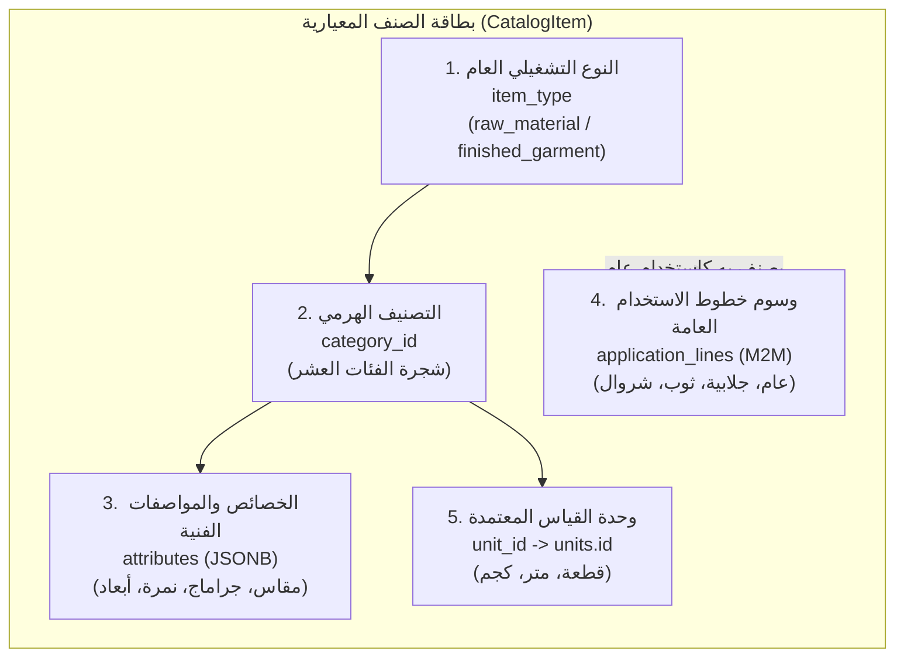
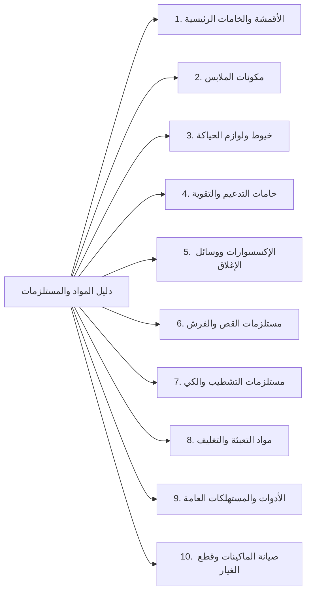
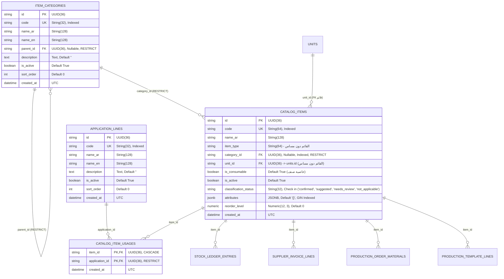

# وثيقة التصميم المعماري لشجرة التصنيفات والبيانات المرجعية لمخزن الخامات (المعدلة)
**Qema ERP — Phase 3.1: Final Taxonomy & Reference Data Design**

---

## 1. الغرض والمبادئ الحاكمة (Purpose & Architecture Principles)

تهدف هذه الوثيقة إلى وضع التصميم الهندسي النهائي والجاهز للتنفيذ لنظام تصنيف خامات ومستلزمات التصنيع، والإكسسوارات، وقطع الغيار، ومواد التعبئة والتغليف داخل نظام **Qema ERP**.

تم تصميم المنظومة لخدمة **مصنع ملابس عام ومتعدد خطوط الإنتاج** (جلابيات رجالي، جلابيات مغربي، شروال، ثياب عربية/خليجية، ملابس أولادي، وأي خطوط إنتاج مستقبلية)، وفق المبادئ الحاكمة التالية:

1. **التصنيف المخزني يصف طبيعة المادة فيزيائياً وليس نوع المنتج النهائي (`Inventory Category ≠ Product Type`):**
   - الصنف يصنف بحسب ماهيته (مثل: أساور، أزرار، خيوط، قماش) وليس بحسب كونه "جلابية" أو "ثوب".
   - الصنف الواحد يمكن أن يخدم خط إنتاج واحد، أو عدة خطوط، أو يكون استخداماً عاماً دون تكرار سجله في قاعدة البيانات.
2. **استقلالية المفاهيم التصنيفية الخمسة (The 5 Independent Classification Axes):**
   - الفصل التام بين: النوع التشغيلي (`item_type`)، التصنيف الهرمي (`category_id`)، المواصفات الفنية (`attributes`)، مجالات الاستخدام والتطبيقات (`application_lines`)، ووحدة القياس والتخزين (`unit_id`).
3. **حظر التأثير الرجعي وحماية الأصول القائمة (Zero Regression Guarantee):**
   - الحفاظ التام على هوية المنتجات التامة المعيارية (`FG-VAR-*`)، وجدول وحدات القياس القائم (`units`)، ودفتر أستاذ المخزون التراكمي الملحق (`StockLedgerEntry`)، وأرصدة المخازن الحالية، وعلاقات فواتير الموردين، وقوالب الإنتاج.
4. **حظر التخمين في التحويلات أو الأسعار:**
   - لا تحويل آلي بين وحدات القياس (مثل رول إلى متر، أو علبة إلى قطعة)؛ وتلتزم المشتريات والمخازن والصرف بذات وحدة الصنف المعتمدة (`unit_id`) حتى اعتماد ميزة تحويل مستقلة.
   - لا أسعار أو تكاليف تقديرية؛ الأسعار تستمد حصراً من فواتير الموردين المعتمدة.

---

## 2. الفصل المعماري بين المفاهيم الخمسة (Separate Classification Concepts)

لإزالة أي خلط مفاهيمي وضمان التوافق التام مع الكود القائم في المستودع، يحدد التصميم بدقة دور كل مفهوم من المفاهيم الخمسة:



### 2.1 النوع التشغيلي العام (`item_type`)
- **دوره:** تحديد المعاملة التشغيلية والمحاسبية العليا للصنف في دورة حياة النظام.
- **القيم الحالية في قاعدة البيانات والكود:**
  - `finished_garment`: منتج ملبوس تام الصنع يباع للعملاء، يخزن في `finished_goods`، ويتولد عبر الـ Resolver المعياري (`FG-VAR-*`).
  - `raw_material`: خامات تصنيع ومستلزمات إنتاج تورد وتصرف لأوامر التشغيل.
  - `packaging`: مواد تغليف تستهلك في مرحلة التعبئة.
  - `reusable_tool`: أدوات وعدد قابلة لإعادة الاستخدام (`is_consumable = False`) كالمقصات والباترونات.
  - `maintenance_supply`: قطع غيار ومستلزمات صيانة الماكينات.
- **علاقته بالتصنيف الجديد:** **لا يتم استبدال أو حذف `item_type`**؛ بل يظل العمود الحاكم لمنطق الأعمال وسير العمليات (Workflows) وحسابات الرصيد المتاح للبيع. التصنيف الهرمي الجديد (`category_id`) يعمل كطبقة تكميلية دقيقة تنظم الأصناف داخلياً دون كسر استعلامات الـ API القائمة.

### 2.2 التصنيف الهرمي (`category_id` & `item_categories`)
- **دوره:** الهيكل الشجري الثنائي (فئة رئيسية -> فئة فرعية) لتنظيم دليل المواد في المخازن، وتوجيه فلاتر الواجهة، وتحديد السمات الفنية المتوقعة.

### 2.3 السمات والمواصفات الفنية (`attributes`)
- **دوره:** حقل مرن `JSONB` يحتوي على المقاييس والمواصفات الفيزيائية للصنف (مثل: العرض بالسنتيمتر، الجراماج جم/م2، النمرة، المقاس، الماكينات المتوافقة) والتي تختلف باختلاف الفئة.

### 2.4 وسوم وخطوط الاستخدام العامة (`application_lines` & `catalog_item_usages`)
- **دوره:** علاقة متعدد إلى متعدد (`Many-to-Many`) تعبر عن **الصلاحية العامة للاستخدام (General Applicability Tags)** دون تكرار سجل الصنف في المخزن، ودون أن تفرض خامات تلقائياً على أمر الإنتاج.

### 2.5 وحدة القياس والتخزين المعتمدة (`unit_id`)
- **دوره:** المفتاح الأجنبي القائم في جدول `catalog_items.unit_id` المرتبط بجدول `units.id`.
- **الواقع البرمجي المحقق:** جدول `units` موجود بالفعل في المستودع (`apps/api/app/modules/production/models.py:35`)، وتلتزم المشتريات والمخزن وأمر التشغيل بنفس الوحدة دون أي تحويل تلقائي.

---

## 3. شجرة الفئات العشر النهائية المعتمدة (Final Category Taxonomy)

التزاماً بالقرار المعماري، تم اعتماد **الفئات العشر الرئيسية كاملة ومنفصلة** مع تعريف دقيق لكل منها:



---

### 1. الأقمشة والخامات الرئيسية (Fabrics & Main Materials)
- **الكود المستقر (Code):** `FABRICS_MAIN`
- **الاسم العربي:** الأقمشة والخامات الرئيسية
- **الاسم الإنجليزي:** Fabrics & Main Materials
- **الغرض والنطاق:** يشمل جميع أنواع المنسوجات وأقمشة التريكو والأقمشة المحاكة التي تشكل الجسم الأساسي للملابس أو بطاناتها الداخلية أو تطعيمات التباين.
- **الفئات الفرعية المقترحة (Subcategories):**
  - `FAB_MAIN` — أقمشة أساسية (Main Shell Fabrics)
  - `FAB_CONTRAST` — أقمشة تطعيم وتباين (Contrast/Trim Fabrics)
  - `FAB_LINING` — بطانات الملابس والجيوب (Linings & Pocketing)
- **توقع السمات:** تركيب الألياف (`composition`)، العرض بالسنتيمتر (`width_cm` > 0 إلزامي)، وزن المتر المربع (`weight_gsm` > 0 اختياري)، كود اللون، نوع النسج، الرسمة.
- **توضيح معماري هام:** سمة `weight_gsm` هي مواصفة فيزيائية للنسيج (جرام لكل متر مربع)، وهي **مستقلة تماماً** عن كمية المخزون التي تقاس بالمتر أو الكيلوجرام.

---

### 2. مكونات الملابس (Garment Components)
- **الكود المستقر (Code):** `GARMENT_COMPONENTS`
- **الاسم العربي:** مكونات الملابس
- **الاسم الإنجليزي:** Garment Components
- **الغرض والنطاق:** أجزاء ومقاطع الملابس المقصوصة والمجهزة مسبقاً (سواء كانت مصنعة داخلياً بنصف تصنيع أو مشتراة جاهزة) لتركيبها المباشر في خطوط التجميع.
- **الفئات الفرعية المقترحة (Subcategories):**
  - `CMP_CUFFS` — أساور وكفوف (Cuffs)
  - `CMP_COLLARS_MANDARIN` — أنصاف ياقات قائمة (Mandarin/Band Collars)
  - `CMP_COLLARS_FULL` — ياقات كاملة مطوية (Full/Turn-down Collars)
  - `CMP_POCKETS` — جيوب مجهزة (Pockets)
  - `CMP_PLACKETS` — مردات وفتحات أكمام/صدر (Plackets & Facings)
- **توقع السمات:** المقاس الرقمي (`size_numeric` مثل 56، 58)، أو الحرفي (`size_letter` مثل S, M, L, XL)، أو النصي المزدوج (`size_raw`)، قصة الإسورة (`cut_style`: عدل، دوران، مشطورة)، الفئة المستهدفة (`audience`: رجالي، أولادي، محير).

---

### 3. خيوط ولوازم الحياكة (Sewing Supplies)
- **الكود المستقر (Code):** `SEWING_SUPPLIES`
- **الاسم العربي:** خيوط ولوازم الحياكة
- **الاسم الإنجليزي:** Sewing Supplies
- **الغرض والنطاق:** المواد المستهلكة في الحياكة، الدرز، السراجة، والأوفرلوك.
- **الفئات الفرعية المقترحة (Subcategories):**
  - `SEW_THREAD_SEWING` — خيوط حياكة عادية (Spun Polyester Threads)
  - `SEW_THREAD_OVERLOCK` — خيوط ماكينات أوفرلوك وسلسلة (Overlock/Looper Threads)
  - `SEW_THREAD_EMBROIDERY` — خيوط تطريز (Embroidery Threads)
- **توقع السمات:** نمرة الخيط (`ticket_count` مثل 40/2 أو 120)، كود اللون، طول اللفة/الكونة بالمتر (`length_meters` > 0)، مادة الخيط.

---

### 4. خامات التدعيم والتقوية (Interlining & Reinforcement)
- **الكود المستقر (Code):** `INTERLINING_REINFORCEMENT`
- **الاسم العربي:** خامات التدعيم والتقوية
- **الاسم الإنجليزي:** Interlining & Reinforcement
- **الغرض والنطاق:** أقمشة الحشو اللاصقة وغير اللاصقة، والفازلين، وبطانات التقوية للياقات والأساور ومردات الصدر.
- **الفئات الفرعية المقترحة (Subcategories):**
  - `INT_ROLLS` — أثواب ورولات حشو لاصق (Fusible Interlining Rolls)
  - `INT_PRECUT` — حشوات مقصوصة ومجهزة للمرد والياقات (Pre-cut Interlinings & Plackets)
  - `INT_STIFFENERS` — مقويات خاصة للياقات والأساور (Collar/Cuff Stiffeners)
- **توقع السمات:** الجراماج (`weight_gsm` > 0)، العرض بالسنتيمتر (`width_cm` > 0)، نوع اللاصق (وجه، وجهين، غير لاصق)، اللون.

---

### 5. الإكسسوارات ووسائل الإغلاق (Trims & Fasteners)
- **الكود المستقر (Code):** `TRIMS_FASTENERS`
- **الاسم العربي:** الإكسسوارات ووسائل الإغلاق
- **الاسم الإنجليزي:** Trims & Fasteners
- **الغرض والنطاق:** الملحقات التكميلية الوظيفية المستخدمة في قفل وفتح وتزيين الملابس.
- **الفئات الفرعية المقترحة مع قوالب خصائص منفصلة (Separate Attribute Schemas):**
  1. `TRM_BUTTONS` — أزرار ملابس:
     - السمات: مقاس الخط/اللين (`button_size_ligne` مثل 18L, 24L, 32L)، عدد الثقوب (`holes_count`: 2, 4)، المادة (`material`: بوليستر، صدف، معدن)، التشطيب (`finish`: مط، لامع)، محفور بشعار خاص (`is_custom_engraved`: bool).
  2. `TRM_SNAPS` — كباسين ومثبتات ضغط:
     - السمات: قطر الكبسولة بالملليمتر (`snap_diameter_mm` > 0 إلزامي)، نوع الكبسولة (`snap_type`: بروز، حلقة ring snap، زنبرك spring snap)، المادة، لون الطلاء.
  3. `TRM_HOOKS` — شناكل وأقفال جلابية وبنطلون:
     - السمات: نوع الشنكل (`hook_type`: شنكل بنطلون، كلبس سترة، شنكل جلابية)، المادة، العرض بالملليمتر (`width_mm` > 0).
  4. `TRM_ZIPPERS` — سوست وإغلاقات سحابية (نوع السحاب، الطول بالسنتيمتر > 0، الخامة).
  5. `TRM_CORDS_RIBBONS` — أحزمة، شرائط، وحبال شد للشروال والملابس الرياضية.

---

### 6. مستلزمات القص والفرش (Cutting Supplies)
- **الكود المستقر (Code):** `CUTTING_SUPPLIES`
- **الاسم العربي:** مستلزمات القص والفرش
- **الاسم الإنجليزي:** Cutting Supplies
- **الغرض والنطاق:** المواد المساعدة في صالة القص لتجهيز الفرشات، رسم الماركر، وترقيم طبقات القماش.
- **الفئات الفرعية المقترحة (Subcategories):**
  - `CUT_NUMBERING` — أشرطة وبكر ماكينات الترقيم (Numbering Tapes & Rolls)
  - `CUT_PAPER` — ورق رسم الباترون وفرش القص (Marker & Underlay Papers)
  - `CUT_MARKING` — طباشير وأقلام تعليم الأقمشة (Tailor Chalks & Markers)
- **التمييز في القابلية للاستهلاك (`is_consumable`):**
  - مواد مستهلكة تنفد بالاستخدام (`is_consumable = True`): رول ورق فرش القص، بكر الترقيم، الطباشير.
  - أدوات مستديمة معاد استخدامها (`is_consumable = False`): أثقال تثبيت القماش على الطاولة، مساطر الحديد.

---

### 7. مستلزمات التشطيب والكي (Finishing & Pressing Supplies)
- **الكود المستقر (Code):** `FINISHING_PRESSING`
- **الاسم العربي:** مستلزمات التشطيب والكي
- **الاسم الإنجليزي:** Finishing & Pressing Supplies
- **الفئات الفرعية المقترحة (Subcategories):**
  - `FIN_IRONING_COVERS` — أغطية وتلبيسات ومواد عزل الكي (Pressing Covers & Pads)
  - `FIN_CHEMICALS` — سوائل تنظيف البقع وتثبيت المظهر (Spot Removers & Cleaners)
- **السمات:** مقاومة الحرارة، الحجم، نوع السائل.

---

### 8. مواد التعبئة والتغليف (Packaging Materials)
- **الكود المستقر (Code):** `PACKAGING_MATERIALS`
- **الاسم العربي:** مواد التعبئة والتغليف
- **الاسم الإنجليزي:** Packaging Materials
- **الفئات الفرعية المقترحة (Subcategories):**
  - `PKG_BAGS` — أكياس التعبئة الفردية (Poly Bags & Sleeves)
  - `PKG_BOXES` — علب العرض الكرتونية والعلب الفاخرة (Presentation Boxes)
  - `PKG_CARTONS` — كراتين التجميع والشحن (Shipping & Master Cartons)
  - `PKG_COLLAR_SUPPORTS` — دعامات وأطواق حفظ الياقات (Collar Supports & Bands)
  - `PKG_LABELS_TAGS` — بطاقات الماركة وتيكت الغسيل والأسعار (Brand Labels & Hang Tags)
  - `PKG_TAPES_TIES` — لواصق التعبئة وأسلاك الغلق (Packaging Tapes & Twist Ties)
- **تنبيه منهجي:** تصنيف دعامات الياقة وأسلاك الغلق تحت هذه الفئة لا يعني افتراض مواصفاتها الكيميائية أو مقاساتها مسبقاً دون عينة فيزيائية.

---

### 9. الأدوات والمستهلكات العامة (Tools & General Consumables)
- **الكود المستقر (Code):** `TOOLS_CONSUMABLES`
- **الاسم العربي:** الأدوات والمستهلكات العامة
- **الاسم الإنجليزي:** Tools & General Consumables
- **الغرض والنطاق:** العدد اليدوية، الأدوات المساعدة الصغيرة، والمستهلكات المشتركة بين ورش المصنع.
- **الفئات الفرعية المقترحة (Subcategories):**
  - `TOL_CUTTING` — مقصات وقصاصات يدوية (Manual Shears & Snips)
  - `TOL_MEASURING` — أدوات القياس والرسم (Measuring Tapes & Rulers)
  - `TOL_HAND_TOOLS` — عدد يدوية ومفكات ضبط (Hand Tools & Adjusters)
- **التمييز الصارم في القابلية للاستهلاك (`is_consumable` كخاصية صنف وليست مشتقة من الفئة):**
  - **أدوات وعدد مستديمة (`is_consumable = False`):** مقصات الترزي اليدوية، المازورات المعدنية، مفكات الضبط. تسجل كأصول وعهدة غير مستهلكة.
  - **مستهلكات عامة تنفد (`is_consumable = True`):** شفرات القص البديلة، فتاقات الخياطة البلاستيكية، بطاريات أجهزة القياس.

---

### 10. صيانة الماكينات وقطع الغيار (Machinery Maintenance & Spare Parts)
- **الكود المستقر (Code):** `MACHINERY_MAINTENANCE`
- **الاسم العربي:** صيانة الماكينات وقطع الغيار
- **الاسم الإنجليزي:** Machinery Maintenance & Spare Parts
- **الفئات الفرعية المقترحة (Subcategories):**
  - `MNT_NEEDLES` — إبر الماكينات (Machine Needles)
  - `MNT_HOOKS_LOOPERS` — كروشيهات ومكوكات (Hooks, Loopers & Bobbins)
  - `MNT_KNIVES_BLADES` — سكاكين وشفرات الماكينات (Knives & Trimming Blades)
  - `MNT_FEET_PLATES` — دواسات وبلاكات وتغذية (Presser Feet & Throat Plates)
  - `MNT_LUBRICANTS` — زيوت وشحوم الماكينات (Machine Oils & Lubricants)
  - `MNT_PARTS_ELECTRICAL` — مواتير وسيور وقطع كهربائية (Motors, Belts & Electronics)
- **توقع السمات ودعم توافق الماكينات المتعددة:**
  - `part_number`: كود القطعة المصنعي (Part Number).
  - `compatible_machines`: قائمة نصية بالماكينات المتوافقة (`list[str]` مثل: `["Juki DDL-8700", "Siruba 747K", "Jack A4"]`) لدعم توافق القطعة الواحدة مع ماكينات متعددة.
- **التمييز في القابلية للاستهلاك (`is_consumable`):**
  - مستهلك دوري ينفد (`is_consumable = True`): زيوت التزييت، إبر الماكينات، شفرات القواطع.
  - عدد ضبط مستديمة (`is_consumable = False`): مفاتيح ضبط توقيت الكروشيه (Timing Gauges)، فتاحات البلاك.

---

## 4. تصميم خصائص ومواصفات الأصناف (Item Attributes Design)

### 4.1 ضوابط ومحددات التحقق من السمات (Attribute Validation Rules)

1. **السمات اختيارية كقاعدة عامة (Optional by Default):**
   - لتفادي تعطيل أمين المخزن أو إعاقة تسجيل الشحنات المستعجلة، **تعتبر كافة حقول السمات اختيارية (`Optional`) افتراضياً** ما لم يثبت مسوغ تشغيلي قاطع (مثل: العرض بالسنتيمتر للأقمشة).
2. **التحقق من القيم الإيجابية للأبعاد (Strict Positive Dimension Validation):**
   - أي بُعد يتم إدخاله يجب أن يكون رقماً موجباً أكبر قطيعاً من الصفر:
     - `width_cm > 0`
     - `length_cm > 0`
     - `diameter_mm > 0`
     - `weight_gsm > 0`
3. **دعم المقاسات الرقمية والحرفية والنصية:**
   - يدعم النظام كلاً من: `size_numeric: int` (مثل 56، 58، 60)، و `size_letter: str` (مثل S, M, L, XL)، و `size_raw: str` للأبعاد المركبة.
4. **التعامل مع السمات غير المعروفة أو المؤقتة (Handling Unknown Attributes):**
   - يُسمح بترك حقل `attributes` فارغاً ككائن فارغ `{}` أو ببيانات جزئية أثناء فترات الإنشاء الأولي أو حالة `suggested` أو `needs_review` دون أن يرفض السيرفر تسجيل الصنف.

---

## 5. خطوط وتطبيقات الإنتاج المرجعية مقابل قوالب الإنتاج (Applications vs BOM)

لإزالة أي لبس بين التصنيف العام وقوائم مواد التشغيل، يحدد التصميم المرجعية بوضوح:

> ### [!IMPORTANT]
> **الفصل الصارم بين وسوم التطبيقات (Application Tags) وجداول الـ BOM:**
> 1. جدول `catalog_item_usages` يعبر عن **الصلاحية العامة أو وسوم التصنيف (General Applicability Tags)**؛ أي بيان أن هذا الصنف مناسب للاستخدام في "الجلابية" أو "الشروال".
> 2. **قالب الإنتاج (BOM: `ProductionTemplateLine`) وأمر التشغيل (`ProductionOrderMaterial`) هو المرجع الحصري الوحيد** الذي يحدد الخامات الدقيقة وكميات الاستهلاك المحسوبة لكل موديل ودفعة إنتاج.
> 3. **وسوم التطبيقات لا تضيف خامات تلقائياً لأي أمر تشغيل.**
> 4. **لا تغيير على الإطلاق في منطق احتساب المواد (`calculate_proportional_materials`) أو منطق صرف الخامات القائم.**

---

## 6. البيانات المرجعية لوحدات القياس (Units of Measure Architecture)

### 6.1 تقييم النموذج الفعلي لوحدات القياس في المستودع
كشف الفحص الميداني لقاعدة البيانات والكود أن جدول `units` موجود بالفعل ويعمل بنجاح:
- **الموديل القائم:** `Unit(Base)` في [`apps/api/app/modules/production/models.py:35`](file:///d:/Qema%20Project/apps/api/app/modules/production/models.py#L35).
- **أعمدة الجدول الفعلي:**
  - `id: String(36)` — المفتاح الأساسي (UUID).
  - `code: String(32)` — كود الوحدة الفريد والمفهرس (`piece`).
  - `name_ar: String(64)` — الاسم العربي للوحدة (`قطعة`).
- **العلاقات المفروضة:** `catalog_items.unit_id` مفتاح أجنبي يربط بـ `units.id`.

### 6.2 إلزامية تطابق الوحدة وحظر التحويل التلقائي
أظهر تدقيق المسارات البرمجية في المستودع:
1. **في المشتريات:** مسار إنشاء فاتورة المورد [`apps/api/app/api/v1/endpoints/finance.py:177`](file:///d:/Qema%20Project/apps/api/app/api/v1/endpoints/finance.py#L177) يفحص بصرامة:
   ```python
   if not item or not item.is_active or item.unit_id != line.unit_id:
       raise HTTPException(422, "أحد أصناف الفاتورة غير نشط أو وحدة القياس لا تطابق الصنف.")
   ```
2. **في قوالب وتصنيع الإنتاج:** مسارات `calculate_proportional_materials` و `add_material_to_draft_order` في [`apps/api/app/modules/production/service.py:193`](file:///d:/Qema%20Project/apps/api/app/modules/production/service.py#L193) تفرض مطابقة قطعية بين `catalog_item.unit_id` ووحدة خامات الأمر.
3. **في دفتر أستاذ المخزون:** يسجل `StockLedgerEntry.unit_id` بنفس وحدة الصنف المعتمدة.

### 6.3 القرارات المعمارية المعتمدة لوحدات القياس
1. **الإبقاء على دلالة `unit_id` كما هي وعدم إعادة تسميتها إلى `primary_unit_id`** لعدم وجود أي مسوغ تشغيلي يبرر كسر الأعمدة الحالية.
2. **حظر إدخال تحويلات تلقائية بين الشراء والتخزين والاستهلاك** في هذه المرحلة؛ ويجب أن تستخدم فواتير الشراء، وأرصدة المخزون، وأوامر الصرف نفس الوحدة المعتمدة للصنف (`CatalogItem.unit_id`).
3. **عدم إنشاء جدول وحدات قياس بديل أو مكرر**؛ بل يتم استخدام جدول `units` القائم مع إمكانية إضافة عمود `name_en: String(64)` اختياري في ترحيلات لاحقة لدعم ثنائية اللغة.

---

## 7. حالات التصنيف وحماية المنتجات التامة (Classification Statuses & FG Protection)

### 7.1 تعريف حالات التصنيف الأربع المعتمدة (`classification_status`)
يُقيد عمود `classification_status` في جدول `catalog_items` بالقيم الأربع التالية حصراً:
1. **`confirmed` (معتمد):** صنف خامات تم تدقيق مواصفاته وتصنيفه الهرمي واعتماده رسمياً للتشغيل والشراء.
2. **`suggested` (مقترح):** صنف تم إدخاله مبدئياً أو اقتراحه آلياً وبانتظار مراجعة واعتماد مسؤول المخازن أو الإنتاج.
3. **`needs_review` (يحتاج مراجعة):** صنف يحمل غموضاً في الاسم أو مواصفات ناقصة أو مصطلح ورشة غير محسوم يتطلب فحص عينة فيزيائية.
4. **`not_applicable` (غير منطبق):** مخصص لأصناف المنتجات التامة (`item_type = 'finished_garment'`) الناتجة عن أوامر الإنتاج (`FG-VAR-*`).

### 7.2 حماية المنتجات التامة المعيارية (`FG-VAR-*`)
- المنتجات التامة الناتجة عن انتهاء التصنيع يتم توليدها عبر دالة `get_or_create_finished_goods_item` في [`service.py:887`](file:///d:/Qema%20Project/apps/api/app/modules/production/service.py#L887).
- **تبقى المنتجات التامة خارج دورة عمل تصنيف الخامات كلياً؛** وتُمنح حالة `classification_status = 'not_applicable'` (أو تترك قيمتها الافتراضية محايدة دون فرض مراجعة الخامات عليها).
- **يُحظر تماماً إعطاء حالة `needs_review` للمنتجات التامة القائمة أو الجديدة بشكل افتراضي.**

---

## 8. سلامة قاعدة البيانات وقواعد دورة الحياة الآمنة (Database Integrity & Lifecycle Rules)

لمنع حدوث أخطاء سلامة مرجعية في قاعدة البيانات، تُعتمد القيود الصارمة التالية:

1. **حذف الفئات (`Category Deletion`):**
   - استخدام قيد `ON DELETE RESTRICT` لعمود `catalog_items.category_id`.
   - يُمنع حذف أي فئة تحتوي على أصناف مسجلة تحتها.
2. **العلاقة الهرمية بين الفئات (`Parent-Child Categories`):**
   - قيد `parent_id REFERENCES item_categories(id) ON DELETE RESTRICT`.
   - يُمنع حذف أي فئة رئيسية ما دامت تتبعها فئات فرعية.
3. **منع الحلقات التكرارية للفئات (`Cycle Prevention`):**
   - التحقق برمجياً عبر استعلام متكرر (Recursive CTE) يمنع تعيين `parent_id` لأي فئة ليكون هو نفسه الفئة ذاتها أو أحد الفروع التابعة لها.
4. **إلغاء تنشيط الفئات الحاوية لفروع نشطة (`Deactivation Rules`):**
   - عند إلغاء تنشيط فئة رئيسية (`is_active = False`)، يُمنع اختيارها لاختيار أصناف جديدة، وتظل الأصناف التاريخية التابعة لها محتفظة بروابطها المرجعية.
5. **حذف تطبيقات الإنتاج (`Applications Deletion`):**
   - استخدام قيد `UniqueConstraint("item_id", "application_id", name="uq_catalog_item_application")` في جدول الوسوم لمنع تكرار الربط، وقيد `ON DELETE CASCADE` على الجدول الوسيط عند إزالة وسم غير مستخدم.
6. **حذف بطاقات الأصناف المرتبطة بحركات (`Catalog Items Deletion`):**
   - يُحظر الحذف الفيزيائي التام (`Hard Delete`) لأي صنف يمتلك قيوداً في دفتر الأستاذ (`StockLedgerEntry`)، أو فواتير الموردين (`SupplierInvoiceLine`)، أو قوالب الإنتاج (`ProductionTemplateLine`).
   - الإيقاف يتم حصراً عبر الإيقاف المنطقي (`is_active = False`).
7. **حظر قواعد إعادة التعيين التلقائي (No Automatic Reassignment):**
   - يُحظر نقل الأصناف آلياً إلى فئة عامة أو عشوائية عند إيقاف فئتها، بل يلزم تدخل يدوي صريح من مدير النظام.

---

## 9. معمارية الفهرسة والأداء والبحث (Indexing & Search Realities)

### 9.1 التقييم الدقيق للفهارس المقترحة
لتفادي الادعاءات غير الدقيقة حول أداء الفهارس، يتم تحديد السلوك الفعلي لمحرك PostgreSQL:
1. **فهرس الفئة (`idx_catalog_items_category_id`):** فهرس `B-tree` قياسي لتسريع التصفية حسب الفئة.
2. **فهرس الكود والاسم (`uq_catalog_items_code` & `idx_catalog_items_name`):** فهارس `B-tree` تضمن التفرد والبحث بالبادئة.
3. **فهرس `GIN` لحقل `attributes` (`idx_catalog_items_attributes_gin`):**
   - يسرّع الاستعلامات التي تستخدم معاملات الاحتواء والتطابق لمفاتيح محددة: `@>`, `?`, `?|`, `?&`.
   - **تصحيح هندسي هام:** فهرس `GIN` **لا يضمن تجنب المسح الشامل (Full Table Scan) في كل الحالات**؛ فالاستعلامات التي تعتمد مجالات غير متساوية (Range queries مثل `> 150`) أو مقارنات نصية جزئية تتطلب فهارس تعبيرية محددة (`Expression Indexes`) أو إضافة ملحق `btree_gin`.
4. **مبدأ البساطة والقياس (Keep Initial Implementation Simple and Measurable):**
   - الاكتفاء في المرحلة الأولى بفهرس `B-tree` للفئات، وفهرس `GIN` العام للـ `attributes`.
   - عدم إنشاء فهارس تعبيرية معقدة إلا بعد قياس أنماط الاستعلام الفعلية وأداء الخادم في بيئة التشغيل.

---

## 10. التصميم الهيكلي المقترح لقاعدة البيانات (Proposed Database Design)



---

## 11. تدقيق التوافق المعماري والمخزني (Inventory Compatibility Audit)

| المكون البرمجي المفحوص | الكود الحالي ودوره في النظام | أثر التصميم المقترح | التقييم المعماري وسلامة المسار |
| :--- | :--- | :--- | :---: |
| **محدد هوية المنتج التام المعياري**<br>[`service.py#L860`](file:///d:/Qema%20Project/apps/api/app/modules/production/service.py#L860) | يستعلم بـ `item_type == 'finished_garment'` ويولد `FG-VAR-{variant_id}` تلقائياً. | يحتفظ بـ `item_type == 'finished_garment'` بالكامل؛ وتُمنح بطاقته `classification_status = 'not_applicable'` دون فرض مراجعة خامات. | `آمن 100% (No Impact)` |
| **جدول وحدات القياس القائم**<br>[`models.py#L35`](file:///d:/Qema%20Project/apps/api/app/modules/production/models.py#L35) | جدول `units` بقيم `piece` يرتبط بـ `catalog_items.unit_id`. | الاحتفاظ باسم العمود `unit_id` ونفس العلاقات المفروضة دون إنشاء جدول بديل أو تحويلات تخمينية. | `آمن 100% (No Impact)` |
| **دفتر حركات المخزون والرصيد**<br>[`endpoints/inventory.py#L17`](file:///d:/Qema%20Project/apps/api/app/api/v1/endpoints/inventory.py#L17) | يحسب الرصيد بجمع `StockLedgerEntry.quantity` مجمعاً بـ `item_id`. | لا تغيير نهائياً في هيكل `StockLedgerEntry`؛ حساب الرصيد وتاريخ القيود يظل مرتبطاً بـ `item_id` كما هو. | `آمن 100% (No Impact)` |
| **فواتير الموردين والاستلام**<br>[`endpoints/finance.py#L175`](file:///d:/Qema%20Project/apps/api/app/api/v1/endpoints/finance.py#L175) | يفحص نشاط `CatalogItem` ومطابقة `unit_id` التامة. | تظل بنود الفواتير ملزمة بمطابقة `unit_id`؛ والتصنيف الجديد يعزز البحث والاختيار دون تغيير المنطق الخلفي. | `آمن 100% (No Impact)` |
| **صرف الخامات لأمر التشغيل**<br>[`service.py#L340`](file:///d:/Qema%20Project/apps/api/app/modules/production/service.py#L340) | يفحص رصيد كل صنف في `main_raw_materials` وينشئ `WarehouseTransfer`. | يعتمد كلياً على `item_id`؛ قفل الخامات وفحص النقص يعمل بنفس الكفاءة والدقة. | `آمن 100% (No Impact)` |
| **شاشة ماكينات التشغيل**<br>[`MachineryView.tsx#L15`](file:///d:/Qema%20Project/apps/web/src/features/inventory/MachineryView.tsx#L15) | تصفّي بـ `item_type === 'maintenance_supply' \|\| item_type === 'reusable_tool'`. | بقاء `item_type` يضمن استمرار الشاشة في عرض مستلزمات الصيانة دون أي خلل، مع إمكانية فرزها لاحقاً بالفئة العاشرة. | `آمن 100% (No Impact)` |

---

## 12. الخلاصة والقرار النهائي للتصميم (Final Verdict)

> ### **القرار النهائي للتصميم:** **`READY FOR IMPLEMENTATION REVIEW`**
>
> تم تصحيح كافة النقاط المعمارية وتأكيد التوافق التام مع البنية البرمجية القائمة لمستودع Qema ERP.  
> **هذا التصميم وثائقي وهندسي فقط، والتنفيذ البرمجي ليس معتمداً بعد، ولم يتم إنشاء ترحيل قاعدة البيانات Migration 0011.**