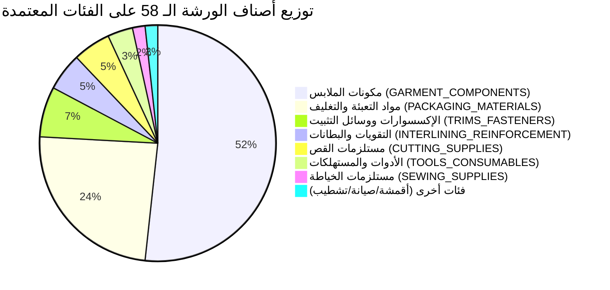

# تقرير جاهزية استيراد دليل خامات ومستلزمات المصنع (Import Readiness Report)
## Qema ERP — Phase 3.4: Workshop Materials Catalog Preparation & Controlled Import

**تاريخ الإعداد:** 31 أكتوبر 2026  
**المشروع:** نظام تخطيط موارد المؤسسات لمصنع القمة للملابس (Qema ERP)  
**المرحلة:** Phase 3.4 — Workshop Materials Catalog Preparation & Controlled Import  
**معد التقرير:** مهندس ومحلل نظم أول — Qema ERP Core Team  
**القرار النهائي للجدارة (Readiness Verdict):**  
**`PARTIALLY READY — FACTORY CLARIFICATION REQUIRED`** (جاهز جزئياً — بانتظار استيفاء استفسارات المصنع الإلزامية)  

---

## 1. الملخص التنفيذي والأهداف (Executive Summary)

تُمثل المرحلة **Phase 3.4** حجر الزاوية في بناء "دليل أصناف المواد الخام والمستلزمات" لمصنع القمة للملابس. بعد اكتمال تصميم شجرة التصنيفات المعتمدة (Phase 3.1 عبر Migration 0011)، وتطوير واجهات برمجة التطبيقات الخلفية (Phase 3.2 APIs)، وبناء واجهة المستخدم المتخصصة باللغة العربية (Phase 3.3 Frontend)، كان لزاماً الانتقال من البنية الهندسية النظرية إلى **تنقيح وتوحيد ومواءمة وتدقيق البيانات الواقعية للورشة**.

### المبدأ الحاكم:
> [!IMPORTANT]
> **"لا تحول أي تخمين إلى حقيقة تشغيلية"**  
> إن دليل الأصناف ليس مجرد جدول نصوص في قاعدة البيانات، بل هو الأساس الهيكلي الذي تُبنى عليه عمليات الشراء (Purchasing)، وأستاذ حركة المخازن (Stock Ledger)، وتكلفة أمر الإنتاج المباشرة (Job Order Costing)، وبطاقات شجرة المنتج (BOM)، وأذون الصرف للمراحل التشغيلية. أي تسرع في استيراد بيانات مشوبة بالغموض سيؤدي إلى تراكم أرصدة وهمية وتشويه تكلفة المنتج التام.

لذا، تم إجراء تدقيق معمق لجميع الأصناف الـ 58 المستخرجة من ورش وقاعات المصنع، ومطابقتها مع التصنيفات العشر المعتمدة ووحدات القياس التسع، وتوليد مسودة رئيسية شاملة، وقائمة أسئلة فنية موجهة لإدارة المصنع، ومعاينة قابلة للفرز بترميز Excel UTF-8.

---

## 2. الإحصائيات الشاملة ومؤشرات الجودة (Catalog Reconciliation Metrics)

### أ. الحالة العامة للأصناف المستخرجة:
- **إجمالي الأصناف المستهدفة بالمراجعة:** **58 صنفاً** (تم استخراجها كاملة بنسبة 100% من المسودات الأصلية لـ Phase 3).
- **الأصناف المفقودة أو التي تعذر العثور عليها:** **0 صنف** (لا يوجد أي بند مفقود).
- **الأصناف التي تم اختراعها أو افتراضها من خارج مسودة المصنع:** **0 صنف** (التزام صارم بحظر توليد أصناف من خارج الواقع).

### ب. توزيع الأصناف حسب حالة الاعتماد (Classification Status):
| حالة الاعتماد (Classification Status) | العدد | النسبة المئوية | الدلالة الهندسية والتشغيلية |
| :--- | :---: | :---: | :--- |
| **`confirmed` (معتمد لغوياً وهيكلياً)** | **36** | **62.1%** | أصناف ذات مدلول صناعي قاطع ومحدد الفئة والنوع والوحدة، وتنتظر فقط تثبيت القياس الدقيق أو مواصفة التوريد من المصنع. |
| **`suggested` (مقترح ويحتاج تثبيت مواصفة)** | **4** | **6.9%** | أصناف واضحة الوظيفة والتصنيف، لكنها تحتمل توصيفاً تفصيلياً إضافياً في الخامة أو التطبيق (مثل مشابك التعبئة، ودعامات الياقة الورقية والبلاستيكية، وحزام تثبيت الياقة). |
| **`needs_review` (قيد المراجعة الإلزامية)** | **18** | **31.0%** | أصناف تتضمن غموضاً تشغيلياً أو لغوياً أو محاسبياً قاطعاً، ويُحظر استيرادها إلى قاعدة البيانات قبل الحصول على رد رسمي من المصنع. |
| **`not_applicable` (غير قابل للتطبيق)** | **0** | **0.0%** | لا توجد أصناف خارج نطاق تشغيل المصنع ضمن القائمة الأصلية. |
| **الإجمالي العام** | **58** | **100.0%** | **اكتمال تام لمسودة المراجعة** |

---

## 3. التوزيع الهيكلي للأصناف على شجرة التصنيفات المعتمدة

تم تسكين جميع الأصناف الـ 58 ضمن الفئات العشر المعتمدة في Migration 0011 دون الحاجة إلى إنشاء أي فئات إضافية:



### التفصيل العددي للفئات:
1. **`GARMENT_COMPONENTS` (مكونات الملابس المجهزة):** **30 صنفاً** (51.7% من إجمالي الدليل).
   - وتشمل: 10 مقاسات وموديلات أساور كم، 7 ياقات رجالي (نصف وياقة كاملة)، 5 مقاسات جيوب مجهزة، 5 ياقات أولادي محيط 32-39، 3 أشرطة باتليك فتحات الأكمام.
2. **`PACKAGING_MATERIALS` (مواد التعبئة والتغليف):** **14 صنفاً** (24.1%).
   - وتشمل: كراتين الشحن الكبيرة والداخلية، علب القلم الفاخرة للجلابية (رجالي وأولادي)، أكياس بولي، أشرطة لاصقة (شفاف، ألوان، سلوتيب)، دعامات الياقة الورقية والبلاستيكية، أسلاك الربط المعدنية المغلفة (متليك).
3. **`TRIMS_FASTENERS` (الإكسسوارات ومثبتات الإغلاق):** **4 أصناف** (6.9%).
   - كباسين الضغط، قفل جلابية، مشابك التعبئة، وحزام الوسط (في حال اعتماده كإكسسوار موديل).
4. **`INTERLINING_REINFORCEMENT` (التقويات والبطانات اللاصقة):** **3 أصناف** (5.2%).
   - توب حشو فازلين رول، ضريبات مرد صدر رجالي، ضريبات مرد صدر أولادي.
5. **`CUTTING_SUPPLIES` (مستلزمات صالة القص):** **3 أصناف** (5.2%).
   - شريط سنان ترقيم راقات، ضربة ورق، بكر مينو لترقيم الراقات.
6. **`TOOLS_CONSUMABLES` (الأدوات ومعدات التشغيل):** **صنفان** (3.4%).
   - مقص ترزي يدوي من الصلب (`is_consumable = False`)، وقصاصات تنظيف الخيط الزنبركية (`needs_review` محاسبياً).
7. **`SEWING_SUPPLIES` (مستلزمات الحياكة):** **صنف واحد** (1.7%).
   - خيط حياكة بوليستر 40/2 الأساسي.
8. **فئات خالية مؤقتاً:** فئات (`FABRICS_MAIN`، `FINISHING_PRESSING`، `MACHINERY_MAINTENANCE`) لم تُدرج منها بنود في هذه المسودة؛ نظراً لأن فواتير الأقمشة الخام الأساسية وقطع غيار الماكينات تُدار حالياً عبر سجلات مستقلة سيتم دمجها في مرحلة تالية.

---

## 4. تحليل التشابه والمتغيرات والمقاسات (Duplicate & Variant Analysis)

أظهر الفحص الدقيق للأصناف الـ 58 وجود مجموعات متعددة من المتغيرات (Variants) التي ترتبط بصنف قياسي واحد مع اختلاف المقاس أو الشكل الهندسي أو الجمهور المستهدف:

### أ. مصفوفة الأساور (10 أصناف):
- الأصناف: `أساور 22`، `أساور 23`، `أساور 23 دوران`، `أساور 24`، `أساور 24 مشطورة`، `أساور 25`، `أساور 25 مشطورة`، `أساور 26`، `أساور 26 مشطورة`، `أساور 27`.
- **التحليل الفني:** هذه ليست أصنافاً مكررة؛ بل أشكال قص مختلفة تماماً لمحيط المعصم:
  - المقاسات الرقمية تمثل محيط الإسورة بالسنتيمتر (22 للأولادي، 23-25 للرجالي القياسي، 26-27 للمقاسات الخاصة والواسعة).
  - النهايات الهندسية: **مستقيمة (Straight)** للمظهر الكلاسيكي، **دوران (Round)** للحواف الناعمة، **مشطورة (Mitered 45°)** للمظهر الرسمي.
- **التوصية:** الإبقاء على كل مقاس ونهاية كصنف مستقل (`Stock Keeping Unit - SKU`)؛ لأن استهلاك القماش وقالب القص والكي لكل منها يختلف في الورشة، مع ربطها جميعاً بالتصنيف الفرعي `CMP_CUFFS`.

### ب. مصفوفة الياقات الرجالي والأولادي (12 صنفاً):
- **نصف ياقة (Mandarin / Band Collar):** المقاسات (M, L, X, 2XL) — ياقة قائمة شريطية لا تطوى للجلابية العربي والمغربي.
- **ياقة كاملة (Full Turn-down Collar):** المقاسات (M, L, X) — ياقة قميص مقلوبة برجل ياقة وقلاب.
- **ياقة أولادي (Boys Collars):** المقاسات (32, 34, 36, 38, 39) بالسنتيمتر لمحيط العنق.
- **التحليل الفني:** مقاسات حقيقية متباينة تناسب تدرج الباترونات (Grading). يجب عدم دمجها في صنف واحد عام يسمى "ياقة"؛ لأن عامل التجميع يسحب مقاس الياقة المطابق لمقاس الثوب في أمر التشغيل.

### ج. أشرطة اللصق والتغليف (3 أصناف):
- الأصناف: `لزق ص`، `لزق ألوان`، `لزق شفاف كبير`.
- **التحليل الفني:** وظائف متباينة:
  - `لزق شفاف كبير`: شريط عريض (5 سم / 2 بوصة) لغلق كراتين الشحن الخارجية.
  - `لزق ألوان`: شريط ملون بعرض 2 سم لتمييز درجات الفرز والورديات والعيوب أثناء التشطيب.
  - `لزق ص`: شريط رفيع (1.5 سم) لغلق أكياس الملابس الفردية.
- **التوصية:** لا يوجد تكرار، ولكن يجب اعتماد مسميات فيزيائية دقيقة بدلاً من لفظ "لزق ص" المبهم.

### د. أسلاك الربط المعدنية "متليك" (3 أصناف):
- الأصناف: `متليك كيس`، `متليك كبير`، `متليك طويل 10ك`.
- **تحذير التكرار والخلط:** هناك احتمال قوي لأن يكون "متليك كبير" و"متليك كيس" صنفاً واحداً بمسميين، أو اختلافاً في الطول فقط. كما أن "متليك طويل 10ك" قد يكون عبوة تحتوي على أحد الصنفين.
- **التوصية:** تعليق الأصناف الثلاثة تحت `needs_review` حتى معاينة كراتين التوريد في المخزن.

---

## 5. مقترح سياسة تكويد الأصناف (Proposed Item Coding Policy)

تجنباً للفوضى الرقمية، وتأكيداً على حظر استخدام أكواد المنتجات التامة `FG-VAR-*` للمواد الخام والمستلزمات، نقترح تطبيق السياسة التكويدية المهيكلة التالية المكونة من ثلاثة مقاطع:

$$\text{Item Code} = \text{[Category Prefix]} - \text{[Subtype]} - \text{[Specification/Size]}$$

### جدول البادئات المقترحة (Prefix Hierarchy):

| الفئة الرئيسية | بادئة الكود المقترحة | أمثلة تطبيقية من واقع مسودة المصنع |
| :--- | :---: | :--- |
| مكونات الملابس | `CMP-` | `CMP-CUF-STR-24` (إسورة 24 سم مستقيمة)<br>`CMP-CUF-MIT-25` (إسورة 25 سم مشطورة)<br>`CMP-COL-MND-L` (نصف ياقة مقاس L)<br>`CMP-COL-FUL-M` (ياقة كاملة مقاس M)<br>`CMP-PCK-PRE-12` (جيب مجهز 12 سم)<br>`CMP-PLK-SLV-SML` (باتليك كم صغير) |
| مواد التعبئة والتغليف | `PKG-` | `PKG-BOX-PEN-MEN` (علبة القلم رجالي)<br>`PKG-CTN-MST-5PLY` (كرتون كبير ماستر)<br>`PKG-BAG-JLB-PP` (أكياس جلابية بولي)<br>`PKG-TAP-CLR-50MM` (لزق شفاف كبير 50 مم)<br>`PKG-TIE-MTL-BAG` (متليك كيس) |
| الإكسسوارات والمثبتات | `TRM-` | `TRM-SNP-PRS-12MM` (كباسين ضغط 12 مم)<br>`TRM-HOK-JLB-MET` (قفل جلابية معدني)<br>`TRM-CLP-PKG-PLS` (مشبك طية بلاستيك) |
| التقويات والبطانات | `INT-` | `INT-FUS-ROL-90GSM` (توب حشو فازلين رول)<br>`INT-PLK-MEN-PRE` (ضريبات حشو رجالي) |
| مستلزمات القص | `CUT-` | `CUT-TAP-PLY-NUM` (شريط سنان ترقيم)<br>`CUT-PPR-UND-160` (ضربة ورق فرش 160 سم)<br>`CUT-LBL-MTO-22X12` (بكر ملصقات ميتو) |
| الأدوات ومعدات الورشة | `TOL-` | `TOL-SHR-TLR-10IN` (مقص يدوي ترزي 10 بوصة)<br>`TOL-SNP-THD-SPR` (قصاصات خيط زنبركية) |
| مستلزمات الخياطة | `SEW-` | `SEW-THD-SPN-40X2` (خيط حياكة بوليستر 40/2) |

> [!NOTE]
> هذا التكويد مقترح للتنظيم والاعتماد ولا يتم توليد أكواد فعلية في قاعدة البيانات إلا بعد الموافقة النهائية من صاحب المشروع.

---

## 6. مراجعة التوافق مع معمارية النظام وAPIs الحالية (Architecture Compatibility)

تمت مطابقة متطلبات الأصناف الـ 58 مع قدرات النظام الحالية في Backend وFrontend:

| المكون المعماري | الوضع الفعلي في قاعدة البيانات والـ API | مدى التوافق مع الأصناف الـ 58 | القيود والملاحظات الفنية |
| :--- | :--- | :---: | :--- |
| **جدول التصنيفات (`item_categories`)** | 10 فئات رئيسية، 39 فئة فرعية مفعلة في Migration 0011 | **متوافق 100%** | كافة الأصناف الـ 58 وجدت لها فئات فرعية مطابقة تماماً دون أي تعديل هيكلي. |
| **جدول الوحدات (`units`)** | 9 وحدات معتمدة (`piece`, `meter`, `kg`, `gram`, `roll`, `box`, `pack`, `carton`, `pair`) | **متوافق 100%** | تغطي كافة احتياجات الأصناف المقترحة دون الحاجة لأي وحدة جديدة. يمنع منعاً باتاً إنشاء أي تحويل ضمني بين الوحدات. |
| **نوع الصنف (`item_type`)** | يدعم الأنواع: `accessory`, `packaging`, `fabric`, `reusable_tool`, `maintenance_supply`, `raw_material` | **متوافق 100%** | تم تسكين جميع الأصناف على الأنواع المقابلة لها دون المساس بنطاق `finished_garment`. |
| **المواصفات الفنية (`attributes`)** | عمود من نوع `JSONB` في جدول `catalog_items` | **متوافق 100%** | يسمح بتخزين خصائص كل صنف بمرونة تامة (مثل العرض، الطول، السماكة، اللون، الماركة) دون تكرار أعمدة فارغة. |
| **خطوط الاستخدام (`catalog_item_usages`)** | جدول ربط يدعم خطوط الإنتاج الستة كوسوم تنظيمية | **متوافق 100%** | تم تحديد خطوط الإنتاج لكل صنف لتسهيل الفلترة في الواجهة دون التأثير على قواعد الـ BOM. |
| **واجهات البرمجة (`/api/v1/catalog/*`)** | واجهات استعلام وإضافة وتعديل متكاملة ومحمية بالصلاحيات | **متوافق 100%** | جاهزة لاستقبال عمليات الاستيراد المبرمجة بعد اعتماد البيانات رسمياً. |

---

## 7. المخاطر التشغيلية والمحاسبية الواجب تجنبها (Operational & Financial Hazards)

أظهر التدقيق ضرورة توخي الحذر الشديد من أربعة مخاطر محتملة:

1. **خطر ازدواجية التكلفة (Double Costing Hazard) في "الضريبات":**
   - إذا تم تسجيل "ضريبات رجالي" كخامة مشتراة خارجية وهي في الواقع تُقص في صالة القص من "توب الحشو"، فسيتم احتساب تكلفتها مرتين: مرة عند شراء ثوب الفازلين ومرة أخرى كصنف مستقل على أمر التشغيل.
2. **خطر تشويه الذمم العمالية وأصول الورشة في "القصاصات":**
   - تسجيل القصاصات كمستهلك (`is_consumable = True`) وهي تعامل كعهدة مستردة يهدر أموال المصنع، بينما تسجيلها كأداة معمرة (`is_consumable = False`) وهي تُهلك شهرياً يراكم عهداً وهمية غير قابلة للتسوية على عمال الإنتاج.
3. **خطر الخلط بين تكلفة الموديل وتكلفة التعبئة في "حزام وسط":**
   - الخلط بين إكسسوار الموديل وشريط التعبئة يؤدي إلى تشويه تكلفة تصنيع الجلابية (BOM Manufacturing Cost) مقارنة بتكلفة مواد التغليف.
4. **خطر التفاوت المخزني الكارثي في "متليك 10ك":**
   - تسجيل وحدة الصنف كقطعة بينما هو عبوة 10 آلاف قطعة، أو العكس، كفيل بتدمير أستاذ المخزن وإحداث فروقات جرد بمئات الآلاف من الجنيهات.

---

## 8. قرار الجدارة النهائي والتوصيات (Final Verdict & Actionable Next Steps)

بناءً على المراجعة الشاملة لجميع معطيات الورشة، وبموجب الضوابط المنهجية المعتمدة في مشروع Qema ERP:

### القرار المعتمد (Readiness Verdict):
```
══════════════════════════════════════════════════════════════════
  VERDICT: PARTIALLY READY — FACTORY CLARIFICATION REQUIRED
══════════════════════════════════════════════════════════════════
```

> [!CAUTION]
> **حظر الاستيراد الآلي:**  
> **يُحظر تماماً تنفيذ أي عملية استيراد لقاعدة البيانات أو إنشاء أصناف فعلية في جدول `catalog_items` في الوقت الحالي.**  
> قائمة الأصناف الـ 58 جاهزة بنسبة 69% من الناحية النظرية، لكن وجود 18 صنفاً معلقاً (31%) يتضمن قرارات مالية وهندسية لا يجوز للنظام تخمينها بالنيابة عن إدارة المصنع.

### خارطة الطريق للمرحلة التالية (Next Steps Roadmap):
1. **توزيع وثيقة الأسئلة الميدانية:** تسليم وثيقة `docs/WORKSHOP_MATERIALS_REVIEW_QUESTIONS_AR.md` إلى إدارة المصنع ومسؤولي صالات القص والتجميع والتشطيب والمخازن لتدوين الإجابات المعتمدة وجمع العينات الفيزيائية العشر المطلوبة.
2. **استلام التوقيعات واعتماد المسميات:** بعد ورود الإجابات، يتم تحديث حالات الأصناف المعلقة الـ 18 من `needs_review` إلى `confirmed`.
3. **اعتماد سياسة التكويد:** عرض مقترح التكويد الثلاثي `[PREFIX]-[SUBTYPE]-[SPEC]` على صاحب المشروع للموافقة النهائية.
4. **الانتقال إلى Phase 3.5 (Controlled Seed & Import):** فور استلام الموافقة الكتابية الصريحة، يتم بناء وتشغيل سكربت استيراد آمن ومحمي (`Controlled Import Script`) يقوم بإدخال الأصناف الـ 58 دفعة واحدة مع تسجيل تدقيق كامل (`Audit Trail`) دون أي خطأ مخزني أو تعارض مع المعمارية الحالية.

