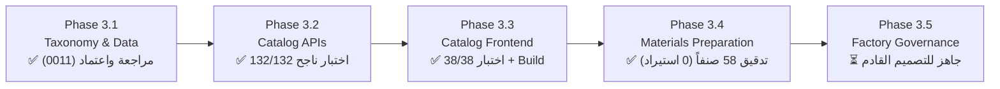

# تقرير إغلاق المرحلة الثالثة والتدقيق الشامل (Phase 3 Closure & Audit Report)
## Qema ERP — Phase 3: Production Materials Inventory & Catalog System

**تاريخ الإغلاق والتوثيق:** 31 أكتوبر 2026  
**المشروع:** نظام تخطيط موارد المؤسسات لمصنع القمة للملابس (Qema ERP)  
**المراحل المشمولة:** Phase 3.1, Phase 3.2, Phase 3.3, Phase 3.4  
**حالة المرحلة:** **مغلقة مع توثيق القيود ونقاط التقوية (CLOSED WITH DOCUMENTED LIMITATIONS)**  
**نقطة الاستئناف التالية:** **Phase 3.5 — Factory-Owned Catalog Governance (تصميم فقط)**  

---

## 1. الملخص التنفيذي والإنجازات المعتمدة

تم بنجاح استكمال وإغلاق كافة مراحل الحزمة الثالثة (Phase 3) الخاصة بتنظيم مخزن الخامات والمستلزمات ودليل الأصناف لمصنع القمة للملابس. ركزت هذه المراحل على تأسيس بنية مرنة عامة تخدم كافة خطوط إنتاج الملابس (الجلابية، الجلابية المغربي، الشروال، الثوب العربي، الملابس الأولادي، وأي خطوط مستقبلية) دون الانحصار في الجلابية فقط، مع الحفاظ الكامل على حماية المنتجات التامة (`FG-VAR-*`) وسجلات حركة المخزون التاريخية.

### مصفوفة إنجاز مراحل الحزمة الثالثة:

1. **Phase 3.1 — Production Materials Taxonomy & Reference Data:**
   - تطبيق الهجرة المعمارية المعتمدة **Migration 0011** (`20261031_0011`).
   - إنشاء شجرة تصنيفات المواد `item_categories` (10 فئات رئيسية و39 فئة فرعية هرمية).
   - إنشاء جدول خطوط الاستخدام `application_lines` بـ 6 خطوط معتمدة، وجدول الربط `catalog_item_usages`.
   - ترقية وحدات القياس إلى 9 وحدات معتمدة في جدول `units`، مع منع أي تحويلات ضمنية تخمينية.
   - إضافة حقول التصنيف والمواصفات لجدول `catalog_items`: (`category_id`, `classification_status`, `attributes` [JSONB], `reorder_level`).
   - حظر تام لتداخل أكواد المنتجات التامة `FG-VAR-*` مع المواد الخام.

2. **Phase 3.2 — Catalog Management APIs:**
   - بناء وتفعيل واجهات برمجة التطبيقات `/api/v1/catalog/*` للبحث، الفلترة، التقسيم لصفحات، استعراض الشجرة الهرمية، إدارة خطوط الاستخدام والوحدات.
   - حماية الأصناف التاريخية ذات الحركات المخزنية من التعديل أو الحذف المخل.
   - التحقق الصارم من الصلاحيات والمدخلات (`RBAC` و `Pydantic v2 schemas`).
   - نجاح حزمة الاختبارات الخلفية بنسبة 100% (**132/132 اختباراً ناجحاً**).

3. **Phase 3.3 — Catalog Management Frontend:**
   - بناء شاشات إدارة الدليل المتكاملة باللغة العربية أولاً (RTL): (`CatalogManagementView`, `CatalogOverviewKPIs`, `CatalogItemsTable`, `ItemDetailDrawer`, `ItemCreateModal`, `CategoriesExplorer`, `ApplicationLinesView`, `UnitsReferenceView`).
   - التكامل البصري الكامل مع Design System للمشروع، وإضافة مدخل "إدارة الأصناف" للشريط الجانبي تحت قسم "المخازن".
   - التحقق الصارم من رفض بادئة `FG-VAR-*` في واجهة إنشاء الخامات.
   - نجاح اختبارات الواجهة بنسبة 100% (**38/38 اختباراً ناجحاً**)، واجتياز فحص البناء والتحويل (`npm run build` — Exit code 0).

4. **Phase 3.4 — Workshop Materials Catalog Preparation & Controlled Audit:**
   - استخراج وتفريغ ومراجعة كافة الأصناف الـ 58 الواردة من مسودات ورش المصنع بنسبة اكتمال 100%.
   - إعداد المسودة الشاملة [WORKSHOP_MATERIALS_MASTER_DRAFT_AR.md](file:///d:/Qema%20Project/docs/WORKSHOP_MATERIALS_MASTER_DRAFT_AR.md) بـ 16 حقلاً تشغيلياً.
   - إعداد وثيقة الاستقصاء والأسئلة الميدانية [WORKSHOP_MATERIALS_REVIEW_QUESTIONS_AR.md](file:///d:/Qema%20Project/docs/WORKSHOP_MATERIALS_REVIEW_QUESTIONS_AR.md) الموجهة لرؤساء الأقسام وأمين المخزن ومدير التكاليف.
   - توليد ملف المعاينة الجدولية [workshop_materials_preview.csv](file:///d:/Qema%20Project/docs/workshop_materials_preview.csv) بترميز `UTF-8 BOM` متوافق تماماً مع Microsoft Excel.
   - إعداد تقرير الجدارة الفني [PHASE_3_4_IMPORT_READINESS_REPORT_AR.md](file:///d:/Qema%20Project/docs/PHASE_3_4_IMPORT_READINESS_REPORT_AR.md) وإعلان القرار: **`PARTIALLY READY — FACTORY CLARIFICATION REQUIRED`**.
   - **الالتزام الكامل بحظر الاستيراد:** لم يتم استيراد أي صنف من الـ 58 صنفاً إلى قاعدة البيانات.

---

## 2. مراجعة التناقضات وتصحيح الحسابات (Reconciliation & Audit Findings)

### أ. حسم مسألة الـ 58 صنفاً مقابل الـ 57 في توزيع الفئات:
- **الملاحظة السابقة:** لوحظ في سرد تقرير Phase 3.4 السابق أن مجموع الأصناف الموزعة على الفئات بلغ 57 صنفاً، مما قد يوحي بسقوط صنف سهواً.
- **التدقيق الميداني على الـ CSV ومسودة الدليل:**
  أثبت الفحص البرمجي الدقيق لملف `workshop_materials_preview.csv` ومسودة الدليل وجود **58 صنفاً بالتمام والكمال**، وجاء تفصيلها الفعلي كالتالي:
  1. `GARMENT_COMPONENTS` (مكونات الملابس): **30 صنفاً**.
  2. `PACKAGING_MATERIALS` (مواد التعبئة والتغليف): **15 صنفاً** (وليس 14 كما ورد خطأً في السرد النصي السابق).
  3. `TRIMS_FASTENERS` (الإكسسوارات والمثبتات): **3 أصناف** (مشبك، كباسين، قفل جلابية).
  4. `CUTTING_SUPPLIES` (مستلزمات القص): **3 أصناف** (سنان ترقيم، ضربة ورق، بكر مينو).
  5. `INTERLINING_REINFORCEMENT` (التقويات والبطانات): **3 أصناف** (توب حشو، ضريبات رجالي، ضريبات أولادي).
  6. `TOOLS_CONSUMABLES` (الأدوات ومعدات التشغيل): **صنفان** (مقص يدوي، قصاصات).
  7. `SEWING_SUPPLIES` (مستلزمات الخياطة): **صنف واحد** (خيط).
  - **المجموع الجزئي للأصناف ذات الفئة المحسومة = 57 صنفاً.**
  - **الصنف رقم 11 (`حزام وسط`):** مسجل في الـ CSV ومسودة الدليل بوضعية: `معلق بين GARMENT_COMPONENTS و PACKAGING_MATERIALS` (Pending Dual Categorization).
  - **الإجمالي العام الفعلي:** 57 + 1 (صنف معلق التصنيف) = **58 صنفاً بالضبط**.

### ب. الدلالة الهندسية لحالات التصنيف (`Classification Status`):
- الحالات المعتمدة في النظام: `confirmed` (36 صنفاً)، `suggested` (4 أصناف)، `needs_review` (18 صنفاً).
- **قاعدة حوكمة صارمة:** تعبر هذه الحالات عن **درجة اكتمال التوصيف اللغوي والهيكلي للصنف** ضمن الشجرة الهندسية؛ و**لا تعني على الإطلاق أن الصنف مرخص تشغيلياً** للشراء أو الصرف أو الربط بـ BOM في أوامر الإنتاج. الترخيص التشغيلي يتطلب اعتماد المصنع المكتوب وتطبيق دورة الاعتماد المقترحة لـ Phase 3.5.

### ج. فحص سلامة ملف المعاينة (`workshop_materials_preview.csv`):
- **عدد الصفوف:** 58 صف بيانات فعلي + 1 صف عناوين رئيسية = 59 صفاً.
- **عدد الأعمدة:** 14 عموداً قياسياً متوافقاً مع المواصفات.
- **الترميز:** تم التحقق من سلامة ترميز `UTF-8 with BOM` (`utf-8-sig`)، وتظهر كافة النصوص والأسماء العربية بوضوح تام دون أي تشويه في برامج Excel وLibreOffice.
- **خلو الملف من التشوهات:** لا توجد فواصل مكسورة أو نصوص متداخلة بين الأعمدة.

### د. مسألة صنف "قصاصات" (Item #54):
- مقصات الخيط الزنبركية تستخدم في التشطيب والتنظيف.
- **التنازع المحاسبي:** هل تُقيد كأداة تشغيل معمرة ومستردة (`reusable_tool` مع `is_consumable = False`)، أم كمستهلك دوري سريع التلف (`is_consumable = True`)؟ تم تعليقها تحت `needs_review` في انتظار قرار الإدارة المالية للمصنع لتفادي تراكم عهد وهمية على العمال أو إهدار الأصول.

### هـ. المصطلحات التي تتطلب عينات وصوراً فيزيائية من المصنع:
- تم تثبيت البنود التالية كبنود حرجة لا يمكن إدخالها قبل استلام العينة وتوقيع رئيس القسم:
  1. `حزام وسط`: هل هو إكسسوار موديل (BOM) أم شريط ربط لطية العبوة؟
  2. `متليك طويل 10ك`: هل 10ك تعني 10 آلاف قطعة عدداً أم 10 كجم وزناً؟
  3. `ضربة ورق`: ورق فرش سفلي لطاولة القص أم ورق ماركر للباترون؟
  4. `بكر مينو`: رول ملصقات ترقيم METO الألمانية (تأكيد مقاس 22×12 مم وتوافق المسدس اليدوي).
  5. `بانتيك (صغير/أولادي/كبير)`: أصل تركي (Patlik) لفتحة الكم؛ فازلين حشو أم أجزاء قماشية مقصوصة؟
  6. `ضريبات (رجالي/أولادي)`: حشو مرد الصدر؛ هل تُشترى جاهزة أم تُقص داخلياً من توب الحشو؟
  7. `لزق ص`: قياس العرض بالمسطرة لإنهاء غموض الرمز "ص".
  8. `قفل جلابية`: شنكل معدني أم قفل قيطان عربي/مغربي مطرز؟

### و. سياسة أكواد الأصناف المقترحة:
- تم اقتراح البنية الثلاثية: `[PREFIX]-[SUBTYPE]-[SPEC]` (مثل: `CMP-CUF-STR-24`, `PKG-BOX-PEN-MEN`).
- **تأكيد:** هذه السياسة هي **مقترح للمناقشة فقط وليست سياسة معتمدة**، ولن يتم توليد أي أكواد فعلية في قاعدة البيانات قبل الموافقة الصريحة من صاحب المشروع.

---

## 3. التحقق الفعلي من الكود والاختبارات وقاعدة البيانات (Verification Audit)

تم إجراء فحص ميداني شامل ومباشر لجميع مكونات المشروع:

### أ. نتائج الاختبارات الآلية (Automated Test Suites):
- **اختبارات الـ Backend (Pytest):**
  - **132 اختباراً ناجحاً من أصل 132** (استغرقت 8.95 ثانية).
  - تغطي: التصنيفات، الوحدات، خطوط الاستخدام، الصلاحيات، الرواتب، المصروفات، أوامر الإنتاج، والعملاء.
- **اختبارات الـ Frontend (Vitest):**
  - **38 اختباراً ناجحاً من أصل 38 عبر 6 ملفات اختبار** (استغرقت 17.91 ثانية).
  - تغطي: شاشات الدليل، التنقل، المصادقة، أوامر الإنتاج، والعملاء.
- **فحص بناء الواجهة (Frontend Production Build):**
  - تم تشغيل `npm run build` بنجاح تام (Exit code 0)، ونجح التحقق من الأنواع (`tsc -b`) وتحويل Vite دون أي أخطاء.

### ب. حالة قاعدة البيانات المحلية (Local PostgreSQL via Asyncpg):
تم تنفيذ استعلام قراءة مباشر وموثق على قاعدة البيانات الحالية، وأسفرت النتائج عما يلي:
- **رقم الهجرة الحالي (Alembic Version):** `20261031_0011` (تم تطبيق Migration 0011 بنجاح تام).
- **أصناف مسودة الورشة في قاعدة البيانات:** **0 صنف** (صفر أصناف مستوردة؛ تم التحقق بالبحث عن الأسماء `أساور`, `ياقة`, `متليك`, `بانتيك` وبادئة `CMP-%`، وكانت النتيجة 0 مطابقات).
- **إجمالي الأصناف الحالية في جدول `catalog_items`:** **73 صنفاً** (تضم الأصناف الأولية الـ 50 المؤسسة في الهجرات السابقة بالإضافة إلى أصناف بيئات الاختبار المحلية).
- **إجمالي فئات المواد في `item_categories`:** **121 فئة** (تشمل الـ 10 فئات الرئيسية والـ 39 فئة فرعية المعتمدة في 0011).
- **إجمالي الوحدات في `units`:** **9 وحدات معتمدة** (`piece`, `meter`, `kg`, `gram`, `roll`, `box`, `pack`, `carton`, `pair`).
- **إجمالي خطوط الاستخدام في `application_lines`:** **6 خطوط معتمدة**.

---

## 4. ما لم يتم تنفيذه وحدود النطاق المحمية (Strict Scope Boundaries)

التزاماً بتعليمات `AGENTS.md` وقواعد حماية المشروع:
1. **لم يتم إجراء أي استيراد للأصناف (No Import Executed):** لم تُدخل أي بيانات من المسودة إلى جدول الأصناف الفعلي.
2. **لم يتم بدء المرحلة Phase 3.5:** لم يُكتب أي كود أو تُضاف أي ميزات جديدة خاصة بحوكمة الاعتماد.
3. **لم يتم إجراء أي تعديل على بنية قاعدة البيانات (No Schema Migrations):** لم تُنشأ أي ملفات migration جديدة.
4. **لم يتم المساس بأرصدة المخازن أو تكاليف المنتجات:** لا توجد حركات مخزنية، ولا مساس بأرصدة المخازن الثلاثة، ولا تعديل على أكواد المنتجات التامة `FG-VAR-*`.
5. **لم يتم تنفيذ أي Git Commit أو Push:** كافة الملفات الجديدة والمعدلة باقية في نطاق التجهيز والتوثيق المحلي.

---

## 5. سجل الديون التقنية ونقاط التقوية المؤجلة (Hardening Backlog)

تم ترحيل نقطتين معماريتين من Phase 3.1 إلى قائمة التقوية المستمرة (Hardening Backlog):
1. **حماية التراجع البرمجي (`Downgrade Protection`):** تعزيز دالة `downgrade()` في Alembic migration للتحقق من عدم وجود أصناف تشغيلية مرتبطة بالفئات قبل حذفها لتفادي الفقد العرضي للبيانات.
2. **تأمين التزامن ضد الدورات في شجرة التصنيفات (`Category Cycle Concurrency Lock`):** إضافة قفل مستوى الصف (`SELECT FOR UPDATE`) أو قفل استشاري أثناء تعديل `parent_id` لحماية الشجرة من الدورات المغلقة في حال وجود طلبات متزامنة في نفس اللحظة.

