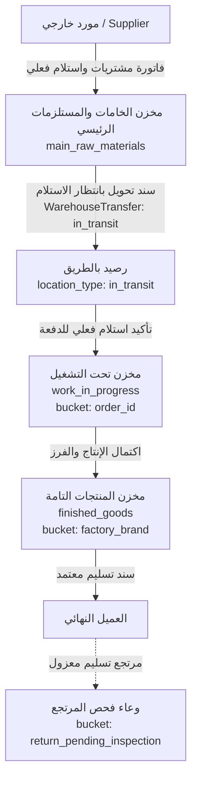
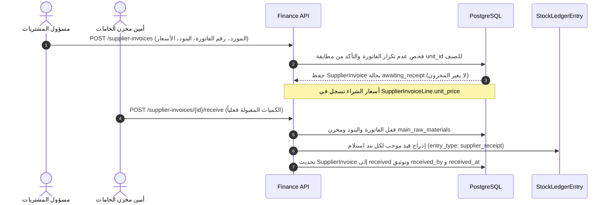
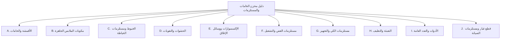
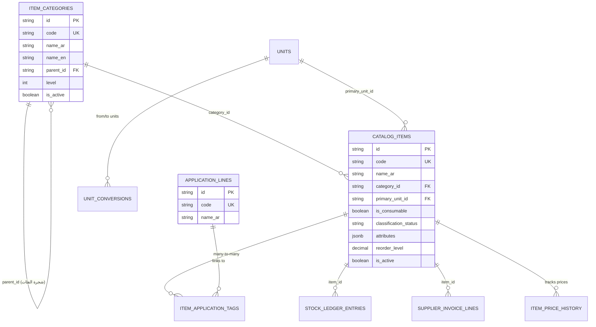
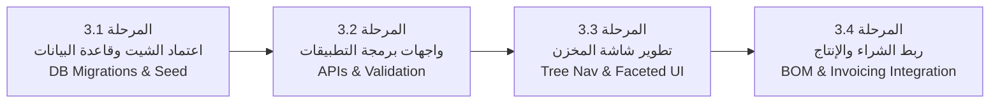

# تقرير الفحص المعماري والاستكشافي لمخزن الخامات والمستلزمات
**Qema ERP — Phase 3: Production Materials Inventory Organization**
*Discovery & Architecture Audit Report*

---

## 1. Executive Summary (الملخص التنفيذي)

بناءً على التكليف الهندسي لمصنع **Qema ERP** باعتباره مصنع ملابس متعدد المنتجات (جلابيات، جلابيات مغربي، شروال، ثياب عربية، ومنتجات أخرى مستقبلية)، تم إنجاز مرحلة **الفحص المعماري والاستكشافي الشامل (Discovery & Architecture Audit)** لمخزن الخامات والمستلزمات دون إجراء أي تعديل على الكود أو قاعدة البيانات أو إنشاء ترحيلات أو حركات مخزنية.

### أبرز نتائج الفحص المعماري:
1. **طبيعة المخزن الحالي:** النظام يمتلك هيكل مخازن ثلاثي تشغيلي (`main_raw_materials`، `work_in_progress`، `finished_goods`). مخزن الخامات والمستلزمات في الكود مهيأ لاستقبال المواد من فواتير الموردين وصرفها لأوامر التشغيل، لكن جدول الأصناف في قاعدة البيانات الحية يحتوي حالياً على **15 صنفاً فقط وجميعها منتجات تامة (`finished_garment`)** نشأت أثناء فحص واختبار المرحلة الثانية، بينما **لا يوجد أي صنف خامات أو مستلزمات مسجل فعلياً في قاعدة البيانات**.
2. **فحص قائمة الـ 58 صنفاً المبدئية:** جميع الأسماء الـ 58 الواردة من صور مسودة المصنع نتيجتها في قاعدة البيانات هي **`Not Found`**؛ وهي مسودة أولية لأسماء دارجة في ورش الملابس المصرية (أساور بمقاسات وقصات مختلفة، ياقات، جيوب، لواصق، أدوات، ومواد تعبئة). لم يتم اختراع أي رصيد أو وحدة قياس أو كود لها التزاماً بالضوابط.
3. **فصل التصنيف المخزني عن نوع المنتج (Inventory Category ≠ Product Type):** النموذج الحالي في جدول `catalog_items` يدمج طبيعة الصنف في عمود نصي واحد `item_type` (`fabric`, `accessory`, `finished_garment`, `maintenance_supply`, `reusable_tool`, `packaging`)، دون وجود جدول فئات (`Category`) أو تصنيفات فرعية (`Subcategory`) أو سمات مواصفات (`Attributes`) أو وسوم استخدام للمنتجات (`Usage / Application`).
4. **تدفق الشراء والاستلام الفعلي:** مسار فواتير الموردين بالـ Backend يربط الشراء بالأصناف المعيارية ويشترط استلاماً فعلياً في `main_raw_materials` لإنشاء قيود دفتر المخزون، لكن دورة المشتريات تفتقر حالياً للاستلام الجزئي التراكمي وتعتمد وحدة قياس وحيدة للصنف دون جدول معاملات تحويل وحدات.
5. **توصية الجاهزية الهندسية:** **`READY WITH OPEN DECISIONS` (جاهز للتنفيذ مع قرارات تشغيلية مفتوحة)**، حيث تم وضع التصميم المعماري البديل بالكامل، وتحديد المخاطر، ورسم خطة انتقال تدريجية تحافظ على التوافق الرجعي 100%.

---

## 2. Current Inventory Architecture (البنية الحالية للمخازن)

يعتمد نظام Qema ERP على بنية تشغيلية قائمة على دفتر الأستاذ التراكمي الملحق فقط (`Append-Only Stock Ledger`) موزعة على ثلاثة مخازن تشغيلية رئيسية:



### خصائص المخازن في قاعدة البيانات الحالية:
1. **المخزن الرئيسي (`main_raw_materials`):** يستقبل الخامات ومستلزمات الإنتاج ومواد التعبئة وقطع الغيار عبر سندات استلام فواتير الموردين (`supplier_receipt`).
2. **مخزن تحت التشغيل (`work_in_progress`):** يستقبل المواد المصروفة لأمر تشغيل محدد، وتُعزل كمياته في الوعاء `bucket_reference = f"order:{order.id}"`.
3. **مخزن المنتجات التامة (`finished_goods`):** يستقبل مخرجات أوامر التشغيل المقبولة فقط، ولا يسمح بتسليم بضاعة سالبة، ويعزل مرتجعات العملاء عن رصيد البيع.

---

## 3. Current Database Models and Relationships (النماذج الحالية والعلاقات)

تم فحص نماذج البيانات عبر ملفات [`apps/api/app/modules/production/models.py`](file:///d:/Qema%20Project/apps/api/app/modules/production/models.py) و [`apps/api/app/modules/finance/models.py`](file:///d:/Qema%20Project/apps/api/app/modules/finance/models.py):

### 3.1 جدول دليل الأصناف (`catalog_items`)
| العمود | النوع | القيود | الوصف والدور الحالي |
| :--- | :--- | :--- | :--- |
| `id` | `String(36)` | PK | المعرف الفريد للصنف (UUID). |
| `code` | `String(64)` | Unique, Indexed | كود الصنف أو الباركود الداخلي. |
| `name_ar` | `String(128)` | Not Null | الاسم العربي للصنف. |
| `item_type` | `String(64)` | Not Null | نص حر يحدد النوع (مثل: `fabric`, `accessory`, `finished_garment`). |
| `unit_id` | `String(36)` | FK -> `units.id` | وحدة القياس الأساسية للصنف. |
| `is_consumable` | `Boolean` | Default: True | `True` للمواد المستهلكة، و`False` للأدوات والمقصات والباترونات. |
| `is_active` | `Boolean` | Default: True | حالة الصنف (نشط / موقوف لمنع الحذف). |
| `created_at` | `DateTime(UTC)` | Not Null | تاريخ ووقت إنشاء بطاقة الصنف. |

**أوجه القصور الحالية في الموديل:**
- لا يوجد جدول أو عمود للفئة (`Category`) أو الفئة الفرعية (`Subcategory`).
- لا توجد حقول لمواصفات الخامة (اللون، العرض، الجراماج، نوع القص، القياس).
- لا توجد حقول لوسوم الاستخدام والربط بخطوط الإنتاج (`Usage`).
- لا توجد حقول أسعار الشراء أو متوسط التكلفة أو حدود الطلب الأدنى والأقصى.

### 3.2 جدول وحدات القياس (`units`)
- الأعمدة: `id`, `code` (مثل `piece`, `meter`), `name_ar` (مثل "قطعة"، "متر").
- القصور: لا يوجد جدول وسيط لتحويل الوحدات (`unit_conversions`) ولا دعم لوحدة شراء تختلف عن وحدة التخزين.

### 3.3 جدول دفتر أستاذ المخزون (`stock_ledger_entries`)
- الأعمدة: `id`, `item_id`, `unit_id`, `warehouse_id`, `location_type` (`warehouse`, `in_transit`, `discrepancy`), `bucket_reference`, `quantity` (Float), `reference_doc_type`, `reference_doc_id`, `transfer_line_id`, `entry_type`, `created_at`, `created_by`.
- يتم حساب الرصيد دائماً بعملية تجميع حية: `SUM(quantity)` لضمان النزاهة التاريخية المطلقة.

---

## 4. Existing Inventory Items and Categories (الأصناف والفئات الحالية)

أظهر الفحص البرمجي المباشر لقاعدة البيانات الحية (`qemma_erp_dev` عبر جلسة `AsyncSessionLocal`) النتائج الحقيقية التالية:

```
Total catalog items found in PostgreSQL: 15
Item Type breakdown:
  - finished_garment: 15 items (جميعها منتجات تامة بأكواد FG-VAR- نشأت في Phase 2)
  - fabric / raw_material: 0 items
  - accessory: 0 items
  - packaging: 0 items
  - maintenance_supply / tool: 0 items
```

**النتيجة المؤكدة:** لا توجد حالياً أي خامة أو مستلزم أو مادة تعبئة أو قطعة غيار مسجلة فعلياً في قاعدة البيانات. النظام خاوٍ تماماً من أصناف المواد التشغيلية وجاهز لاستقبال التصنيف المعماري الجديد بدون مخاطر ترحيل بيانات قديمة متضاربة.

---

## 5. Existing Units of Measure (وحدات القياس الحالية)

أظهر فحص جدول `units` في قاعدة البيانات:
- الوحدة الوحيدة المسجلة حالياً هي: `Code: piece` | `Name: قطعة` (UUID: `2e555348-9eb4-4620-938c-27ed1ab72b92`).

### الوحدات الفعلية التي يتطلبها مصنع الملابس:
1. **قطعة (`piece`):** للأزرار، الكباسين، الأساور، الياقات، الجيوب، العلب، الكراتين، الأكياس، والمقصات.
2. **متر طولي (`meter`):** للأقمشة المنسوجة، شرائط الساتان، أشرطة الترقيم، اللواصق، والحشو اللاصق.
3. **كيلوجرام (`kilogram`):** لأقمشة التريكو/القطن الدائري، بكر الخيوط بالوزن، وهالك القص.
4. **بكرة / كوان (`spool` / `cone`):** لخيوط الحياكة (بكرة 5000 متر أو كوان أوفر).
5. **توب / رول (`roll`):** لأثواب القماش الكبيرة ورولات الفازلين/الحشو.
6. **دستة / باكت (`dozen` / `pack`):** لتجميع الأساور (دستة 12 زوج) أو الياقات أو الإبر.
7. **كرتونة (`box` / `carton`):** للعلب الكرتونية وحزم التعبئة المجمعة.

---

## 6. Purchasing and Receiving Flow (تدفق المشتريات والاستلام)

تم تتبع مسار فواتير الموردين في [`apps/api/app/api/v1/endpoints/finance.py`](file:///d:/Qema%20Project/apps/api/app/api/v1/endpoints/finance.py#L160-L240):



### ملاحظات ونقاط القصور في تدفق الشراء:
1. **استلام دفعة واحدة فقط:** المسار الحالي يغير حالة الفاتورة بالكامل إلى `received` في أول استلام، ولا يدعم حالياً الاستلام الجزئي التراكمي على تواريخ مختلفة (Partial Multi-date Receipts).
2. **الاعتماد على مخزن ثابت:** الاستلام يوجه قسرياً إلى `Warehouse.code == "main_raw_materials"`.
3. **غياب تاريخ حركة الأسعار:** سعر الشراء مسجل في بنود الفواتير فقط، ولا يوجد جدول مخصص لتتبع تطور سعر شراء الصنف (`item_price_history`) أو استخراج متوسط التكلفة المرجح (WAC) تلقائياً.

---

## 7. Production Materials Flow (تدفق مواد الإنتاج والصرف)

تم تتبع مسار صرف واستلام الخامات لأمر التشغيل في [`apps/api/app/modules/production/service.py`](file:///d:/Qema%20Project/apps/api/app/modules/production/service.py#L305-L420):

1. **الخطة التقديرية (BOM):** قوالب الإنتاج (`production_templates`) تحدد الكمية المعيارية لكل صنف (`quantity_per_reference`).
2. **فحص كفاية الرصيد قبل الصرف (Shortage Check):** دالة `dispatch_order_materials` تستعلم لحظياً عن رصيد كل صنف في `main_raw_materials`، وإذا كان الرصيد غير كافٍ، تمنع الصرف وترفع `HTTP 409 Conflict` بقائمة الأصناف والعجز.
3. **الصرف والتحويل (Transfer Out):** ينشأ مستند `WarehouseTransfer` برقم فريد، وتُخصم الكميات من المخزن الرئيسي وتدخل في وعاء `in_transit`.
4. **الاستلام في مخزن تحت التشغيل (Transfer In):** أمين مخزن تحت التشغيل يؤكد استلام المواد فعلياً بطلب `confirm_warehouse_receipt`؛ فتخصم من `in_transit` وتضاف إلى `work_in_progress` مرتبطة بالدفعة المحددة.
5. **تسجيل الفروقات (Discrepancy):** أي نقص أو تلف أثناء النقل يُعزل في قيد `location_type = 'discrepancy'` ولا يُفقد أثره.

---

## 8. Current Frontend Inventory UX (فحص شاشات الواجهة الحالية)

تم فحص الشاشات المتعلقة بالمخازن والمشتريات في الواجهة:

| الشاشة | المسار البرمجي | الحالة الحالية وما ينقصها |
| :--- | :--- | :--- |
| **مخزن الخامات الرئيسي** | [`MainWarehouseView.tsx`](file:///d:/Qema%20Project/apps/web/src/features/inventory/MainWarehouseView.tsx) | - تعرض الأصناف بجدول مسطح بسيط (كود، اسم، نوع، وحدة، رصيد).<br>- **ينقصها:** شجرة تصنيفات (Categories)، تصنيفات فرعية، وسوم الاستخدام، فلاتر الخصائص (مقاس، لون، خامة)، بطاقة تفاصيل الصنف، وتاريخ الأسعار. |
| **الماكينات ومعدات التشغيل** | [`MachineryView.tsx`](file:///d:/Qema%20Project/apps/web/src/features/inventory/MachineryView.tsx) | - تعرض واجهة شفافة تنبه بأن جداول الماكينات مؤجلة للمرحلة 4، وتعرض مستلزمات الصيانة المسجلة في الكتالوج.<br>- **ينقصها:** ربط قطع الغيار بالمخزن الرئيسي بصورة رسمية. |
| **مخزن المنتجات التامة** | [`FinishedGoodsView.tsx`](file:///d:/Qema%20Project/apps/web/src/features/inventory/FinishedGoodsView.tsx) | - شاشة متكاملة تعتمد الأصناف المعيارية الموحدة `FG-VAR-` ومفحوصة بالكامل. |
| **الموردون وفواتير الخامات** | [`SupplierPurchasingView.tsx`](file:///d:/Qema%20Project/apps/web/src/features/finance/SupplierPurchasingView.tsx) | - تتيح إضافة موردين، وفواتير موردين، واستلام الفاتورة، وسداد الدفعات.<br>- **ينقصها:** البحث المتقدم عن الأصناف داخل الفاتورة، وعرض آخر سعر شراء للصنف عند إضافته للبند. |

---

## 9. Proposed Taxonomy (التصنيف المقترح للمراجعة والتقييم)

تطبيقاً للمبدأ التجاري الحاكم: **التصنيف المخزني يصف طبيعة الصنف ذاته، وليس نوع المنتج النهائي الذي يدخل فيه**.

تمت مراجعة المجموعات العشر المقترحة (A إلى J)، وتقييمها هندسياً وتشغيلياً على أرض مصنع الملابس:



### تقييم الفئات الرئيسية وتوصيات الدمج والفصل:
1. **A. Fabrics & Materials (الأقمشة والخامات):**
   - **التقييم:** فئة أساسية وممتازة.
   - **الفئات الفرعية المعتمدة:** أقمشة أساسية (Main Fabrics)، أقمشة تطعيم وتباين (Contrast/Trim Fabrics)، بطانات (Linings).
2. **B. Garment Components (مكونات الملابس الجاهزة):**
   - **التقييم:** فئة جوهرية تفصل الأجزاء المقصوصة والمجهزة عن الخامات الخام.
   - **الفئات الفرعية:** أساور وكفوف (Cuffs)، ياقات وأنصاف ياقات (Collars)، جيوب مجهزة (Pockets)، أجزاء جاهزة (Plackets/Facings).
3. **C. Sewing Supplies (الخيوط ومستلزمات الخياطة):**
   - **التقييم:** فئة استهلاكية مستمرة.
   - **الفئات الفرعية:** خيوط حياكة (Spun Polyester)، خيوط أوفر وتطريز، خيوط سراجة.
4. **D. Interlining & Reinforcement (الحشوات والتقويات):**
   - **التقييم:** تصنيف تقني دقيق يفصل الفازلين والحشو عن الأقمشة الظاهرة.
   - **الفئات الفرعية:** حشو لاصق أثواب (Fusible Rolls)، حشوات مقصوصة، تدعيم ياقات وأساور (Collar/Cuff Stiffeners).
5. **E. Trims & Fasteners (الإكسسوارات ووسائل الإغلاق):**
   - **التقييم:** فئة شاملة للإغلاق والتزيين.
   - **الفئات الفرعية:** أزرار (Buttons)، كباسين (Snap Fasteners)، شناكل وأقفال (Hooks/Clips)، سوست (Zippers)، شرائط وأحزمة (Tapes & Ribbons).
6. **F. Cutting Supplies (مستلزمات القص والتفصيل) & I. General Consumables (الأدوات العامة):**
   - **توصية دمج وتحسين:** دمج الأدوات اليدوية للقص والتشطيب تحت فئة موحدة تميز بين `is_consumable = True` (ورق ترقيم، طباشير) و `is_consumable = False` (مقصات، مساطر، قصاصات) لمنع التشتت.
7. **G. Finishing Supplies (مستلزمات الكي والتشطيب):**
   - **التقييم:** تشمل ملحقات الكي والبخار وتجهيز المظهر.
8. **H. Packaging (التعبئة والتغليف):**
   - **التقييم:** فئة ممتازة تمثل المرحلة النهائية.
   - **الفئات الفرعية:** أكياس بولي بروبيلين، كراتين شحن، علب كرتونية فاخرة (علب القلم)، دعامات الياقة للتغليف (فراشات وأحزمة رقبة)، التيكت والترقيم.
9. **J. Maintenance Supplies (مستلزمات الصيانة):**
   - **التقييم:** قطع الغيار الاستهلاكية للماكينات (إبر ماكينات، كروشيه، سكاكين، كبوس، مواتير). تتبع مخزن المستلزمات حالياً وتخدم وحدة الماكينات في المرحلة الرابعة.

---

## 10. Item Classification Mapping Table (جدول مطابقة وتصنيف الأصناف الـ 58)

مقارنة الأسماء الواردة من مسودة صور المصنع بالأصناف الفعلية بقاعدة البيانات:
- **حالة المطابقة لجميع الأصناف:** **`Not Found`** (لا يوجد أي صنف منها مسجل مسبقاً في قاعدة البيانات الحية).
- تم الاحتفاظ بالاسم الأصلي حرفياً، وإدراج التصنيف المقترح والخصائص المقترحة ومستوى الثقة، مع تمييز المصطلحات المحلية التي تحتاج مراجعة بـ **`Needs Review`**.

| # | Original Name (الاسم الأصلي) | Existing Item Match | Proposed Category | Subcategory | Possible Attributes | Usage / Application | Classification Confidence | Notes & Explanations |
| :-: | :--- | :---: | :--- | :--- | :--- | :--- | :---: | :--- |
| **1** | مشبك | `Not Found` | E. Trims & Fasteners | Fasteners & Clips | material (بلاستيك/معدن), size | عام (تثبيت الملابس بالعبوة) | `Confirmed` | مشابك تثبيت الثوب والجلابية عند التعبئة. |
| **2** | خيط | `Not Found` | C. Sewing Supplies | Sewing Thread | ticket_count (40/2), color, spool_length | عام (جميع خطوط الإنتاج) | `Confirmed` | خيوط حياكة أساسية، يحدد لونه ونمرته عند الإنشاء. |
| **3** | كباسين | `Not Found` | E. Trims & Fasteners | Snap Fasteners | diameter (مم), material, color | جلابية، ثوب، جلابية مغربي | `Confirmed` | كباسين معدنية أو بلاستيكية تغلق بالضغط للأساور والصدر. |
| **4** | قفل جلابية | `Not Found` | E. Trims & Fasteners | Closures & Hooks | material, color, design | جلابية، جلابية مغربي | `Needs Review` | لفظ ورشة؛ يحتاج تأكيد هل هو شنكل كبشة أم قفل تطريز. |
| **5** | تيكت | `Not Found` | H. Packaging | Labels & Tags | type (منسوج/كارت), brand, size | عام / ماركة المصنع | `Confirmed` | علامات الماركة وتيكت المقاس وإرشادات الغسيل. |
| **6** | شريط سنان ترقيم | `Not Found` | F. Cutting Supplies | Numbering Tapes | roll_width, adhesive_type, color | عام (قسم القص) | `Confirmed` | شريط مرقم يلصق على طاقات القماش بعد القص لمنع خلط الراقات. |
| **7** | لزق ص | `Not Found` | H. Packaging | Adhesive Tapes | width, color (شفاف/بني) | عام (التغليف والتشغيل) | `Needs Review` | لفظ مختصر؛ قد يعني لزق صغير أو لزق صناديق. |
| **8** | لزق ألوان | `Not Found` | H. Packaging | Identification Tapes | color (أحمر، أزرق..), width | عام (تمييز الورديات والعيوب) | `Confirmed` | أشرطة لاصقة ملونة لتمييز خطوط الإنتاج أو التغليف. |
| **9** | لزق شفاف كبير | `Not Found` | H. Packaging | Packaging Tapes | width (48/72مم), micron | عام (تقفيل كراتين الشحن) | `Confirmed` | سلوتيب عريض شفاف مخصص لغلق كراتين التعبئة والتوزيع. |
| **10** | حزام رقبة | `Not Found` | H. Packaging | Collar Accessories | material (بلاستيك/ورق), length | جلابية، ثوب عربي | `Confirmed` | شريط مقوى يلف حول ياقة الجلابية داخل الكيس لحمايتها. |
| **11** | حزام وسط | `Not Found` | B. Garment Components | Belts & Bands | width, material, length | جلابية، جلابية مغربي | `Needs Review` | يحتاج توضيح هل هو حزام قماش للموديل أم شريط كرتوني للثني. |
| **12** | أساور 22 | `Not Found` | B. Garment Components | Cuffs | size (22 سم), cut_style (عدل) | ملابس رجالي وأولادي | `Confirmed` | إسورة كم مقصوصة ومبطنة بمحيط 22 سم. |
| **13** | أساور 23 | `Not Found` | B. Garment Components | Cuffs | size (23 سم), cut_style (عدل) | جلابية، ثوب عربي | `Confirmed` | إسورة كم مقصوصة ومبطنة بمحيط 23 سم. |
| **14** | أساور 23 دوران | `Not Found` | B. Garment Components | Cuffs | size (23 سم), cut_style (دوران) | جلابية، ثوب عربي | `Confirmed` | إسورة كم بركن دائري ناعم (Round Cuff). |
| **15** | أساور 24 | `Not Found` | B. Garment Components | Cuffs | size (24 سم), cut_style (عدل) | جلابية، ثوب عربي | `Confirmed` | إسورة كم قياسية مقاس 24 سم مستقيمة. |
| **16** | أساور 24 مشطورة | `Not Found` | B. Garment Components | Cuffs | size (24 سم), cut_style (مشطورة) | جلابية، ثوب عربي | `Confirmed` | إسورة كم مقصوصة بركن مشطوف بزاوية 45 درجة (Angle Cuff). |
| **17** | أساور 25 | `Not Found` | B. Garment Components | Cuffs | size (25 سم), cut_style (عدل) | جلابية، ثوب عربي | `Confirmed` | إسورة كم قياس 25 سم مستقيمة. |
| **18** | أساور 25 مشطورة | `Not Found` | B. Garment Components | Cuffs | size (25 سم), cut_style (مشطورة) | جلابية، ثوب عربي | `Confirmed` | إسورة كم مقاس 25 سم بأركان مشطوفة. |
| **19** | أساور 26 | `Not Found` | B. Garment Components | Cuffs | size (26 سم), cut_style (عدل) | جلابية، ثوب عربي | `Confirmed` | إسورة كم قياس رجالي كبير 26 سم. |
| **20** | أساور 26 مشطورة | `Not Found` | B. Garment Components | Cuffs | size (26 سم), cut_style (مشطورة) | جلابية، ثوب عربي | `Confirmed` | إسورة كم رجالي مقاس 26 سم مشطوفة. |
| **21** | أساور 27 | `Not Found` | B. Garment Components | Cuffs | size (27 سم), cut_style (عدل) | جلابية رجالي مقاس خاص | `Confirmed` | إسورة كم رجالي مقاس كبير جداً 27 سم. |
| **22** | نص ياقة M | `Not Found` | B. Garment Components | Mandarin Collars | letter_size (M), height_cm | جلابية، جلابية مغربي، ثوب | `Confirmed` | نصف ياقة قائمة (شريطية) مقاس وسط M. |
| **23** | نص ياقة L | `Not Found` | B. Garment Components | Mandarin Collars | letter_size (L), height_cm | جلابية، جلابية مغربي، ثوب | `Confirmed` | نصف ياقة قائمة مقاس L. |
| **24** | نص ياقة X (يحتاج تأكيد) | `Not Found` | B. Garment Components | Mandarin Collars | letter_size (XL), height_cm | جلابية، جلابية مغربي، ثوب | `Needs Review` | يرجح أن "X" تعني المقاس XL؛ يحتاج تأكيد المسمى القياسي. |
| **25** | نص ياقة 2XL | `Not Found` | B. Garment Components | Mandarin Collars | letter_size (2XL), height_cm | جلابية، جلابية مغربي، ثوب | `Confirmed` | نصف ياقة قائمة مقاس كبير 2XL. |
| **26** | ياقة كاملة M | `Not Found` | B. Garment Components | Full Turn-down Collars | letter_size (M), style | جلابية رسمي، ثوب عربي | `Confirmed` | ياقة كاملة مطوية برجل ياقة وقلاب مقاس M. |
| **27** | ياقة كاملة L | `Not Found` | B. Garment Components | Full Turn-down Collars | letter_size (L), style | جلابية رسمي، ثوب عربي | `Confirmed` | ياقة كاملة مطوية مقاس L. |
| **28** | ياقة كاملة X | `Not Found` | B. Garment Components | Full Turn-down Collars | letter_size (XL), style | جلابية رسمي، ثوب عربي | `Needs Review` | ياقة كاملة مطوية يرجح أنها مقاس XL؛ تحتاج تأكيد المسمى. |
| **29** | جيب 12 | `Not Found` | B. Garment Components | Pockets | width_cm (12 سم), shape | جلابية، ثوب | `Confirmed` | جيب صدر أو جنب مجهز بعرض 12 سم. |
| **30** | جيب 13 | `Not Found` | B. Garment Components | Pockets | width_cm (13 سم), shape | جلابية رجالي، ثوب عربي | `Confirmed` | جيب مجهز رجالي بعرض 13 سم. |
| **31** | جيب أولادي 8.5 | `Not Found` | B. Garment Components | Boys Pockets | width_cm (8.5 سم), audience | جلابية أولادي، ثوب أولادي | `Confirmed` | جيب مجهز للأطفال والفتيان بعرض 8.5 سم. |
| **32** | جيب أولادي 9.5 | `Not Found` | B. Garment Components | Boys Pockets | width_cm (9.5 سم), audience | جلابية أولادي، ثوب أولادي | `Confirmed` | جيب أولادي مجهز بعرض 9.5 سم. |
| **33** | جيب أولادي 11+ | `Not Found` | B. Garment Components | Boys Pockets | width_cm (11 سم فأكثر), audience | جلابية محير / أولادي كبير | `Needs Review` | الرمز (+) يشير لفئة مقاسات محير تحتاج تحديد أبعادها. |
| **34** | ياقة أولادي 32 | `Not Found` | B. Garment Components | Boys Collars | numeric_size (32 سم), audience | جلابية أولادي، ثوب أولادي | `Confirmed` | ياقة أطفال مقاس محيط الرقبة 32 سم. |
| **35** | ياقة أولادي 34 | `Not Found` | B. Garment Components | Boys Collars | numeric_size (34 سم), audience | جلابية أولادي، ثوب أولادي | `Confirmed` | ياقة أولادي محيط 34 سم. |
| **36** | ياقة أولادي 36 | `Not Found` | B. Garment Components | Boys Collars | numeric_size (36 سم), audience | جلابية أولادي، ثوب أولادي | `Confirmed` | ياقة أولادي محيط 36 سم. |
| **37** | ياقة أولادي 38 | `Not Found` | B. Garment Components | Boys Collars | numeric_size (38 سم), audience | أولادي محير / ناشئين | `Confirmed` | ياقة فتيان محيط 38 سم. |
| **38** | ياقة أولادي 39 | `Not Found` | B. Garment Components | Boys Collars | numeric_size (39 سم), audience | أولادي محير / شبابي | `Confirmed` | ياقة فتيان محيط 39 سم. |
| **39** | رقبة بلاستيك | `Not Found` | H. Packaging | Collar Supports | material (بلاستيك مرن), shape | عام (تغليف الياقات) | `Confirmed` | دعامة بلاستيكية لحفظ استقامة الياقة داخل العلبة/الكيس. |
| **40** | رقبة ورق | `Not Found` | H. Packaging | Collar Supports | material (كرتون مقوى), thickness | عام (تغليف الياقات) | `Confirmed` | شريط أو فراشة كرتونية لحفظ شكل الياقة عند الكي والتعبئة. |
| **41** | ضريبات رجالي | `Not Found` | D. Interlining | Placket Interlinings | audience (رجالي), width_cm | جلابية، ثوب عربي | `Needs Review` | مصطلح ورش لحشو مرد الصدر المقصوص مسبقاً للرجال. |
| **42** | ضريبات أولادي | `Not Found` | D. Interlining | Placket Interlinings | audience (أولادي), width_cm | جلابية أولادي، ثوب أولادي | `Needs Review` | حشو مرد صدر مقاس أطفال وفتيان. |
| **43** | بانتيك صغير | `Not Found` | B. Garment Components | Sleeve Plackets | size (صغير), placement | جلابية، ثوب، قميص | `Needs Review` | تصحيح الاسم: "باتليك" (فتحة أزرار الكم أو الجنب الصغير). |
| **44** | بانتيك أولادي | `Not Found` | B. Garment Components | Sleeve Plackets | audience (أولادي), placement | ملابس أولادي | `Needs Review` | باتليك مخصص لفتحات أكمام الأطفال والفتيان. |
| **45** | بانتيك كبير أولادي | `Not Found` | B. Garment Components | Sleeve Plackets | audience (أولادي كبير / محير) | ملابس أولادي محير | `Needs Review` | باتليك مقاس كبير لملابس الناشئين. |
| **46** | أكياس جلابية | `Not Found` | H. Packaging | Poly Bags | dimensions (سم), thickness, print | جلابية، جلابية مغربي | `Confirmed` | أكياس بولي بروبيلين شفافة/مطبوعة لتغليف قطعة الجلابية. |
| **47** | كرتون كبير | `Not Found` | H. Packaging | Shipping Cartons | dimensions (طول*عرض*ارتفاع), ply | عام (شحن وتخزين متعدد) | `Confirmed` | كرتونة كبرى تستوعب مجموعات الدرازن للشحن والمخزن. |
| **48** | كرتون صغير | `Not Found` | H. Packaging | Inner Cartons | dimensions, capacity (6 قطع) | عام (كرتون نصف دزينة) | `Confirmed` | كرتونة داخلية لتعبئة 6 قطع جلابية حسب وصف التشغيل. |
| **49** | علبة القلم رجالي | `Not Found` | H. Packaging | Presentation Boxes | dimensions, audience (رجالي) | جلابية رجالي فاخرة | `Confirmed` | علبة كرتون مستطيلة طولية لتعبئة الجلابية كعلبة القميص. |
| **50** | علبة القلم أولادي | `Not Found` | H. Packaging | Presentation Boxes | dimensions, audience (أولادي) | جلابية أولادي فاخرة | `Confirmed` | علبة كرتون مقاس أولادي لتعبئة القطعة الفاخرة. |
| **51** | مقص يدوي | `Not Found` | F. Cutting Supplies | Manual Tools | blade_size (10/12 إنش), consumable=False | عام (القص والتشطيب) | `Confirmed` | مقص ترزي يدوي من الصلب (أصل غير مستهلك `consumable=False`). |
| **52** | توب حشو | `Not Found` | D. Interlining | Fusible Rolls | weight (جرام/م2), width (سم), color | عام (جميع الموديلات) | `Confirmed` | ثوب/رول فازلين لاصق حراري يُقص منه تدعيم الياقات والمردات. |
| **53** | ضربة ورق | `Not Found` | F. Cutting Supplies | Marker Paper | roll_width, paper_weight | عام (فرش القص) | `Needs Review` | قد تعني رول ورق الباترون أو ورق فرش طبقات القص. |
| **54** | قصاصات | `Not Found` | F. Cutting Supplies | Thread Snips | material (صلب زنبركي), consumable=False | عام (ماكينات الخياطة) | `Confirmed` | مقص خيط صغير سريع لقص الخيوط الزائدة عند التشطيب. |
| **55** | متليك كيس | `Not Found` | H. Packaging | Twist Ties & Fasteners | length, pack_count | عام (إغلاق وتجهيز الأكياس) | `Needs Review` | سلك معدني مغلف لغلق أكياس الملابس أو دبابيس تغليف. |
| **56** | متليك طويل 10ك | `Not Found` | H. Packaging | Fasteners (Bulk) | length (طويل), pack (10,000) | عام (تعبئة وتغليف) | `Needs Review` | حزمة سلك معدني/بلاستيكي طويل بعبوة 10 آلاف قطعة (10K). |
| **57** | متليك كبير | `Not Found` | H. Packaging | Fasteners | size (كبير), material | عام | `Needs Review` | مثبتات تغليف مقاس كبير؛ يحتاج تأكيد العينة من المصنع. |
| **58** | بكر مينو | `Not Found` | F. Cutting Supplies | Numbering Bobbins | brand (Meto/Mino), roll_size | عام (ماكينات الترقيم) | `Needs Review` | يرجح أنه بكر لاصق ماكينة ترقيم قطع القص (ماركة Meto العالمية). |

---

## 11. Proposed Data Model (التصميم الهيكلي المقترح لقاعدة البيانات)

لحسم متطلبات المرحلة وتطبيق مبدأ **Inventory Category ≠ Product Type** دون إرباك النظام الحالي:



### 11.1 جدول الفئات والتصنيفات الفرعية (`item_categories`)
- `id`: `String(36)` Primary Key.
- `code`: `String(32)` Unique Index (مثل: `FABRICS`, `COMPONENTS`, `SEWING`, `PACKAGING`).
- `name_ar`: `String(128)` Not Null (مثل: "مكونات الملابس الجاهزة").
- `name_en`: `String(128)` Nullable.
- `parent_id`: `String(36)` ForeignKey إلى `item_categories.id` (يدعم شجرة هرمية ذات مستويين: فئة رئيسية وفئة فرعية).
- `description`: `Text`.
- `is_active`: `Boolean` Default: True.

### 11.2 إدارة خصائص الأصناف (Item Attributes Architecture): Trade-off Analysis
قارن الفحص بين ثلاثة خيارات هندسية لإدارة السمات المتغيرة (مثل: المقاس للأساور، النمرة للخيط، العرض للقماش، الجراماج للفازلين):

| الخيار الهندسي | المزايا | العيوب والمخاطر | التقييم والتوصية |
| :--- | :--- | :--- | :---: |
| **1. Dedicated Columns (أعمدة مخصصة لكل خاصية)** | سهولة الاستعلام التقليدي وسرعة الفهرسة العادية. | جداول ضخمة مليئة بالقيم الفارغة (Sparse Table) وتتطلب Migration عند ظهور كل خاصية جديدة. | `مرفوض` لعدم المرونة مع تعدد المنتجات. |
| **2. Pure EAV (جداول الكيانات والسمات والقيم)** | مرونة نظرية كاملة دون أي تعديل هيكلي مستقبلي. | تعقيد شديد في الاستعلامات (Multiple Self-Joins)، بطء ملحوظ في الأداء، وصعوبة كتابة استعلامات التجميع المحاسبية. | `مرفوض` لتعقيده المفرط مقارنة بحجم المشروع. |
| **3. Hybrid: Dedicated Identity + JSONB Attributes** | - الحقول الثابتة تبقى صريحة (`code`, `name_ar`, `category_id`, `unit_id`).<br>- المواصفات المتغيرة تُخزن في عمود `attributes: JSONB`.<br>- إمكانية إنشاء فهارس `GIN (Generalized Inverted Index)` للبحث والتصفية فائقة السرعة بـ PostgreSQL. | تتطلب تدقيقاً في طبقة التطبيق (Pydantic Schemas) لكل فئة فرعية لضمان سلامة أنواع البيانات. | **`الموصى به هندسياً`** (أفضل توازن للأداء والمرونة). |

### 11.3 إدارة وسوم الاستخدام (Item Usage / Applications)
إنشاء جدول خطوط ومنتجات الاستخدام (`application_lines`):
- الأكواد المقترحة: `general` (عام لجميع الملابس), `jalabiya` (جلابية رجالي), `moroccan_jalabiya` (جلابية مغربي), `sherwal` (شروال), `thobe_arabi` (ثوب عربي), `boys_wear` (ملابس أولادي).
- جدول الربط الوسيط (`catalog_item_usages`): علاقة Many-to-Many بين `catalog_items` و `application_lines`، مما يتيح للأساور مقاس 24 أن ترتبط بـ `[jalabiya, thobe_arabi, moroccan_jalabiya]` دون تكرار سجل الصنف.

### 11.4 حالة اعتماد التصنيف (`classification_status`)
إضافة عمود `classification_status` في بطاقة الصنف بقيم محددة:
- `needs_review`: للأصناف المستوردة من المسودة أو الصور التي لم يوقع أمين المخزن على مواصفاتها.
- `confirmed`: أصناف معتمدة رسمياً ومكتملة المواصفات والوحدات وجاهزة للشراء والصرف.
- `suggested`: أصناف مقترحة آلياً أو من مسؤولي الأقسام بانتظار اعتماد المدير العام.

---

## 12. Search and Filtering Architecture (معمارية البحث والتصفية المتقدمة)

لتوفير تجربة مستخدم سريعة ودقيقة في شاشات المخزن والمشتريات والإنتاج:
1. **شجرة التصفح الهرمية (Hierarchical Category Filter):**
   - اختيار الفئة الرئيسية (مثل: مكونات الملابس الجاهزة) -> تصفية تلقائية للفئات الفرعية (أساور، ياقات، جيوب).
2. **البحث الشامل متعدد المعايير (Multi-faceted Search):**
   - استعلام سريع يطابق: `code` (كود الصنف أو الباركود)، `name_ar` (الاسم)، وعناصر `attributes` الشائعة (مثل مقاس 24 أو لون أبيض) باستخدام دالة الفهرسة النصية في PostgreSQL وعمليات `JSONB` مثل `attributes @> '{"cut_style": "دوران"}'`.
3. **التصفية بحسب خط الإنتاج (Filter by Product Application):**
   - فلتر يتيح لمشرف الإنتاج عرض "خامات ومستلزمات الجلابية المغربي فقط" أو "مستلزمات عامة".

---

## 13. Purchase Price and Stock Display Design (تصميم عرض أسعار الشراء والأرصدة)

### 13.1 عرض الرصيد اللحظي
- يعرض الرصيد مشتقاً دائماً من `StockLedgerEntry` للمخزن المحدد.
- تمايز بصري بين:
  - **الرصيد الكلي في المخزن الرئيسي.**
  - **الرصيد المحجوز أو المصروف بالطريق (`in_transit`).**
  - **الرصيد تحت التشغيل لكل أمر إنتاج.**
- تنبيه حد النقص (`reorder_level`): إشارة تحذيرية صفراء عند هبوط الرصيد المتاح عن الحد الأدنى المحدد في بطاقة الصنف.

### 13.2 تتبع وعرض أسعار الشراء
1. **آخر سعر شراء (Latest Purchase Price):**
   - يستخرج لحظياً من آخر فاتورة مورد معتمدة:
     `SELECT unit_price FROM supplier_invoice_lines JOIN supplier_invoices ON ... WHERE item_id = :item_id AND status = 'received' ORDER BY invoice_date DESC LIMIT 1`.
2. **متوسط التكلفة المرجح (Weighted Average Cost - WAC):**
   - يُحسب من إجمالي الفواتير الفعلية: `SUM(received_quantity * unit_price) / SUM(received_quantity)`.
   - لا يتم تسجيل أي تكلفة افتراضية لأي صنف لم يُشترَ بفاتورة رسمية موثقة.

---

## 14. RBAC and Audit Considerations (الصلاحيات والتدقيق وسجل العمليات)

- **الصلاحيات الحالية في `ROLE_PERMISSIONS_MAP`:**
  - `general_manager`: يملك صلاحيات شاملة على الدليل والإنتاج والمشتريات.
  - `warehouse_manager`: يملك `inventory:view`, `inventory:manage`, `suppliers:view`, `suppliers:receive`.
  - `finance_manager`: يملك فواتير الموردين والمدفوعات والمصروفات.
- **التوصيات الصارمة لإدارة الأصناف الجديدة:**
  1. إنشاء وتعديل بطاقة الصنف وتصنيفها يحتاج صلاحية خاصة: `inventory:items:manage` (ممنوحة للمدير العام وأمين المخزن الرئيسي المفوض).
  2. اعتماد الصنف ونقله من `needs_review` إلى `confirmed` يتطلب صلاحية إدارية عليا: `inventory:items:confirm`.
  3. حظر الحذف الفيزيائي: الصنف الذي يرتبط بأي قيد دفتر مخزون أو بند فاتورة مشتريات أو أمر تشغيل يُحظر حذفه نهائياً عبر قيود التكامل المرجعي (`RESTRICT`)، ويُكتفى بإيقافه (`is_active = False`).
  4. تسجيل كافة عمليات تعديل الخصائص والتصنيفات في جدول سجل التدقيق (`audit_logs`).

---

## 15. Backward Compatibility Risks (فحص مخاطر التوافق مع الأنظمة القائمة)

| الكيان المعتمد | موضع الاعتماد في النظام الحالي | مستوى الخطر | كيفية الحماية وتفادي الكسر |
| :--- | :--- | :---: | :--- |
| **أصناف التام الموحدة (`FG-VAR-`)** | مسارات التسليمات والمرتجعات في `customers.py` و `production.py` | `عالي جداً` | بقاء صنف المنتج التام كأحد أنواع الأصناف المعيارية (`category = FINISHED_GOODS`) مع الحفاظ التام على توليده الآلي ودواله الحالية دون أي مساس بكوده المعياري. |
| **دفتر حركات المخزون (`StockLedgerEntry`)** | الاستعلام التجميعي للرصيد، التسليم، استلام الإنتاج، الصرف | `عالي جداً` | لا تغيير نهائياً في أعمدة `StockLedgerEntry` أو منطقه التراكمي الملحق (`Append-only`). |
| **فواتير الموردين (`SupplierInvoiceLine`)** | ترتبط حالياً بـ `CatalogItem.id` و `Unit.id` | `متوسط` | ترقية الأصناف بإضافة `category_id` لن تكسر علاقات الفواتير السابقة، لأن الربط قائم على `item_id`. |
| **أوامر التشغيل وقوالب الإنتاج (`BOM`)** | ترتبط بـ `catalog_items.id` عبر `ProductionOrderMaterial` و `ProductionTemplateLine` | `متوسط` | تظل قوالب الإنتاج تشير إلى معرفات الأصناف `item_id` كما هي؛ والتصنيف الجديد يسهل فقط اختيار المواد وتصفيتها أثناء إعداد القالب. |

---

## 16. Required Migrations — Proposed Only (الترحيلات المقترحة فقط — دون تنفيذ)

**تنبيه حاسم:** هذه الترحيلات للعرض والتصميم الهندسي فقط؛ **ممنوع كتابتها أو تنفيذها أو تطبيقها في هذه المرحلة**.

### Migration مقترحة مستقبلية: `20261101_0011_add_inventory_categories_and_attributes.py`
1. إنشاء جدول `item_categories` (id, code, name_ar, name_en, parent_id, description, is_active).
2. إنشاء جدول `application_lines` (id, code, name_ar, is_active).
3. إنشاء جدول وسيط `catalog_item_usages` (catalog_item_id, application_line_id).
4. إضافة أعمدة لجدول `catalog_items`:
   - `category_id`: `String(36)` ForeignKey إلى `item_categories.id` (Nullable في البداية).
   - `attributes`: `JSONB` Default: `{}`.
   - `classification_status`: `String(32)` Default: `'needs_review'`.
   - `reorder_level`: `Numeric(12, 3)` Default: `0.0`.
5. إنشاء فهارس أداء:
   - `CREATE INDEX ix_catalog_items_category_id ON catalog_items(category_id);`
   - `CREATE INDEX ix_catalog_items_attributes_gin ON catalog_items USING GIN (attributes);`

---

## 17. Implementation Phases (مراحل التنفيذ المقترحة بعد الاعتماد)



- **المرحلة 3.1: البنية التحتية والترحيلات (Schema & Reference Seed):**
  - إنشاء ترحيل Alembic للجداول والأعمدة الجديدة.
  - إدخال الفئات العشر المعتمدة وفئاتها الفرعية كبيانات مرجعية أساسية.
  - إدخال وحدات القياس القياسية للملابس (قطعة، متر، كيلوجرام، بكرة، توب، كرتون).
- **المرحلة 3.2: طبقة الـ API والتحقق (Backend Services & Endpoints):**
  - إنشاء مسارات CRUD لإدارة الفئات والأصناف والبحث المتقدم في `inventory.py`.
  - تطبيق التحقق الصارم عبر Pydantic لصحة حقول الـ JSONB والخصائص.
- **المرحلة 3.3: الواجهة الأمامية وإعادة تنظيم الشاشات (Frontend Re-architecture):**
  - بناء مكون التصفح الشجري للفئات (Category Sidebar / Tree).
  - تطوير بطاقة تفاصيل الصنف وحركاته وتاريخ أسعار شرائه.
  - بناء فلاتر الخصائص الديناميكية حسب الفئة المختارة.
- **المرحلة 3.4: التدقيق التشغيلي وحملة استيراد الأصناف المعتمدة (Factory Data Onboarding):**
  - استيراد أصناف الخامات والمستلزمات الحقيقية من شيت المصنع المعتمد مع تحديد الأكواد ووحدات القياس.
  - اعتماد الأصناف من قبل أمين المخزن والمدير العام بنقلها إلى `confirmed`.

---

## 18. Open Business Decisions (المسائل التجارية والتشغيلية المفتوحة)

تتطلب هذه المسائل حسمها كتابةً من إدارة مصنع القمة قبل بدء تنفيذ المرحلة البرمجية:

1. **حسم المصطلحات الورشية الستة المعلّمة بـ `Needs Review`:**
   - **قفل جلابية:** هل هو كبشة/شنكل رقبة أم قفل معدني للتطريز أم مشبك كيس؟
   - **لزق ص:** ما هو مقاسه ونوعه وخامته الدقيقة؟
   - **حزام وسط:** هل هو مكمل للموديل يُفصل ويُباع معه أم شريط كرتون/ورق لثني الجلابية للتغليف؟
   - **ضريبات رجالي / أولادي:** تأكيد هل هي قطع حشو المرد المقصوصة مسبقاً وما هي قياساتها الدقيقة؟
   - **بانتيك (باتليك):** تأكيد أبعاد ومواصفات فتحات الأكمام والجيوب المجهزة.
   - **متليك وبكر مينو:** تأكيد هل هو سلك ربط الأكياس وورق ماكينات ترقيم راقات القص المعتمد.
2. **سياسة الاستلام الجزئي لفواتير الموردين:**
   - هل يُسمح بتسجيل الفاتورة واستلام أجزاء منها على أيام متفرقة بتواريخ حركة مختلفة لكل استلام؟
3. **معاملات تحويل الوحدات (Unit Conversions Policy):**
   - هل يوافق المصنع على حظر إدخال معاملات تحويل تخمينية، واشتراط أن يكون وزن الثوب أو عدد الأمتار موثقاً في محضر استلام كل دفعة قماش؟
4. **تحديد حدود الطلب الأدنى والأقصى (Reorder Levels):**
   - هل تُرغب إدارة المصنع في تفعيل تنبيهات النواقص الآلية لكل صنف، وما هي عتبات التنبيه المعتمدة؟

---

## 19. Testing Strategy (استراتيجية الاختبار والتحقق للمرحلة الثالثة)

عند الانتقال لمرحلة التنفيذ البرمجي، ستخضع المنظومة للاختبارات التالية:
1. **Unit Tests (اختبارات النماذج والـ Schemas):**
   - التحقق من رفض إدخال صنف بدون فئة معتمدة أو بدون وحدة قياس صحيحة.
   - التحقق من سلامة قراءة وكتابة حقول الـ `JSONB attributes` والفهارس.
2. **Integration Tests (اختبارات التكامل على PostgreSQL):**
   - استعلامات البحث والتصفية المتزامنة متعددة الخصائص عبر فهارس `GIN`.
   - استخراج متوسط التكلفة وآخر سعر شراء بدقة.
3. **Regression Tests (اختبارات منع الانحدار):**
   - تشغيل الـ 111 اختباراً الحالية للباك اند بالكامل للتأكد من عدم تأثر مسارات المنتجات التامة (`FG-VAR-`) أو التسليمات أو المرتجعات.
4. **Frontend Component Tests:**
   - اختبار تفاعل الشجرة الهرمية للفئات وتحديث جدول الأصناف بالـ Vitest.

---

## 20. Explicit List of Files That Would Need Modification Later (قائمة الملفات المتوقع تعديلها لاحقاً)

لتحقيق الشفافية الهندسية، تم حصر الملفات التي ستتأثر برمجياً في مراحل التنفيذ القادمة دون مساس بها حالياً:

### Backend:
1. `apps/api/alembic/versions/20261101_0011_add_inventory_categories_and_attributes.py` (ملف ترحيل جديد).
2. `apps/api/app/modules/production/models.py` (تحديث `CatalogItem` وإضافة `ItemCategory` و `ApplicationLine`).
3. `apps/api/app/modules/production/schemas.py` (إضافة Schemas للفئات والخصائص والبحث).
4. `apps/api/app/api/v1/endpoints/inventory.py` (توسيع المسارات لإضافة فئات وأصناف وتفاصيل الصنف وسجل أسعاره).
5. `apps/api/app/api/v1/endpoints/finance.py` (تطوير استلام المشتريات الجزئي وربط الأسعار).
6. `apps/api/tests/test_inventory_taxonomy.py` (ملف اختبارات وحدة جديد).

### Frontend:
1. `apps/web/src/features/inventory/MainWarehouseView.tsx` (إعادة بناء الشاشة وتزويدها بتصفح الفئات والبحث المعياري).
2. `apps/web/src/features/inventory/ItemDetailsModal.tsx` (مكون تفاصيل الصنف الجديد وسجل حركاته وأسعاره).
3. `apps/web/src/features/inventory/inventoryApi.ts` (تحديث دوال الـ API لاستدعاء الفئات والفلترة).
4. `apps/web/src/features/finance/SupplierPurchasingView.tsx` (تحسين اختيار الصنف وعرض آخر سعر شراء له).

---

## 21. Final Architectural Recommendation (التوصية المعمارية النهائية)

> ### **التوصية: `READY WITH OPEN DECISIONS` (جاهز للتنفيذ مع قرارات مفتوحة)**
>
> **أسباب التوصية:**
> 1. **الوضوح المعماري الكامل:** تم استيعاب البنية القائمة وفهم تدفقات الشراء والصرف المخزني وعزل المنتجات التامة، وصياغة نموذج بيانات مرن يفصل تماماً بين التصنيف المخزني ونوع المنتج النهائي (`Inventory Category ≠ Product Type`).
> 2. **سلامة النظام وعدم التعديل العشوائي:** لم يُعدل أي كود أو قاعدة بيانات أو حركات تاريخية، وثبت خلو الكتالوج الحالي من أي أصناف خامات مسبقة مما يمنح المصنع فرصة تأسيس نظيفة وخالية من الديون التقنية.
> 3. **القرارات المفتوحة المحددة:** مطلوب فقط اعتماد إدارة المصنع للتصنيف المقترح وتوضيح المصطلحات الستة المعلّمة في جدول المطابقة قبل البدء في كتابة الترحيلات والأكواد.
>
> **الخطوة التالية الموصى بها:** عرض التقرير على إدارة المصنع وممثل المخازن لاعتماد شجرة التصنيف وتأكيد المصطلحات، ثم الشروع في **المرحلة 3.1** بعد صدور الموافقة الرسمية.

