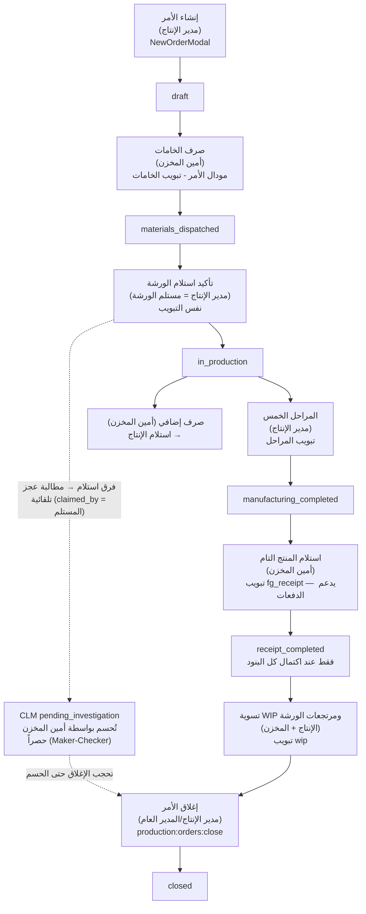
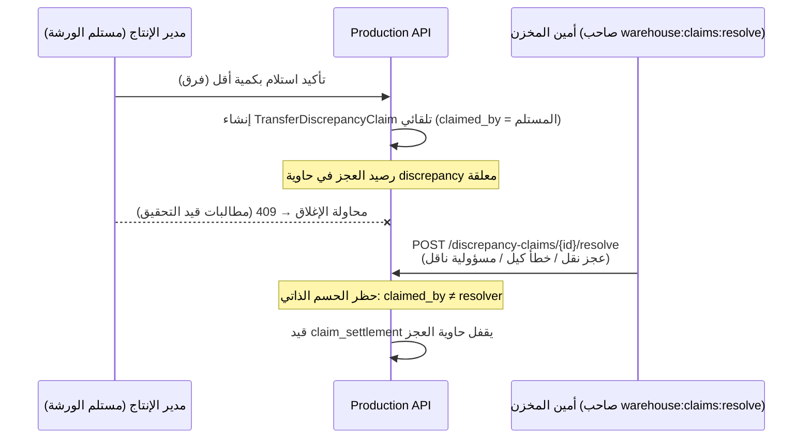
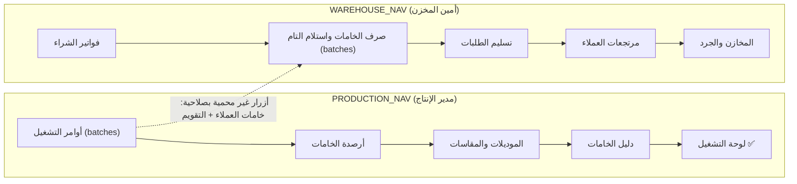

# Qema ERP — Phase 4.5 / 4.5.1: Production UX & Workflow Consolidation Audit

> **نطاق:** تدقيق قراءة فقط (Read-Only). لا تعديلات على الكود أو قاعدة البيانات أو الإعدادات.
> **الفرع الحالي:** `feat/payment-allocations`
> **تاريخ التدقيق:** 2026-11-15
> **المدقق:** Antigravity Agent (Phase 4.5) + Agent التسوية والتحقق (Phase 4.5.1)
>
> **تحديث 4.5.1:** هذه النسخة تتضمن تحققًا فعليًا من كل النتائج غير المؤكدة في تدقيق 4.5 الأصلي،
> مع تصحيح النتائج الخاطئة، وتحديد «مؤكد مقابل غير مؤكد» لكل بند، ومواصفة معمارية نهائية
> (مساحات العمل، مساحة تفاصيل الأمر، مصنّع/للغير، لوحة مدير الإنتاج). كل نتيجة مثبتة بمرجع
> ملف وسطر من الكود الفعلي.

---

## 1. الملخص التنفيذي

### المشكلة الجوهرية
وحدة الإنتاج **تعمل بشكل صحيح من منظور Backend** — محرك إنتاج موحّد يخدم التصنيع الداخلي وCMT
عبر نفس النماذج والخدمات (`service.py`, `demand_service.py`, `customer_materials.py`) — لكن تجربة
المستخدم تعاني من **تكتل وظيفي** و**ثغرات واجهة** موثقة أدناه:

1. **`OrderDetailModal.tsx`** (~2,176 سطر): يجمع في modal واحد تبويبات الخامات والمراحل والعيوب
   واستلام التام وتسوية WIP والإغلاق والتكاليف والصرف الإضافي والمرتجعات.
2. **`ProductionOrdersView.tsx`** (~513 سطر): قائمة أوامر + شريط مراحل + تصفية + 3 أزرار modals
   لا علاقة اثنين منها بأوامر التشغيل (خامات العملاء، التقويم والاختناقات).
3. **ثغرات واجهة مؤكدة:** Demand Pool الغائب كليًا، ومطالبات عجز الاستلام (Maker-Checker)
   الغائبة كليًا من الواجهة رغم اكتمال Backend وصلابه.

### النتائج الرئيسية (بعد تحقق 4.5.1)
| الخطورة | المشكلة | الحالة |
|---------|---------|--------|
| 🔴 حرجة | `OrderDetailModal` god-modal بـ ~2,176 سطر يجمع 10+ workflows | ✅ مؤكد |
| 🔴 حرجة | واجهة Demand Pool / Aggregation **غائبة كليًا** رغم اكتمال Backend والتحقق منه | ✅ مؤكد |
| 🔴 حرجة (جديدة) | مطالبات عجز الاستلام (`TransferDiscrepancyClaim`): تُنشأ تلقائيًا في Backend، **تحجب الإغلاق**، ولا يوجد **أي** سطح واجهة لعرضها أو حسمها — حتى صندوق المهام لا يعرضها | ✅ مؤكد (تصحيح نتيجة 4.5 التي قالت إن المودال يعرضها) |
| 🟠 عالية | عداد المراحل «X من 5» يعطّل: `completed / 5` لا يُحصي المراحل المتخطّاة ولا يعدل المقام | ✅ مؤكد (`ProductionOrdersView.tsx:372-374`) |
| 🟠 عالية | زرا «خامات العملاء» و«تقويم واختناقات» غير محميين بصلاحية ويظهران لأمين المخزن أيضًا | ✅ مؤكد (`ProductionOrdersView.tsx:304-321`) |
| 🟡 متوسطة | قسم «نمط التصنيع والعمالة والتكاليف» (٣) مطوي أسفل `NewOrderModal` بعد بنود المنتجات | ✅ مؤكد (`NewOrderModal.tsx:416-431`) |
| 🟡 متوسطة | ربط سندات خامات العملاء بأوامر التشغيل مدعوم في Backend (`order_id` على سطر السند) لكن الواجهة لا تعرضه ولا تتيح تحديده | ✅ مؤكد (Backend: `customer_materials.py:89-104` / Frontend: غائب) |
| 🟡 متوسطة | استهلاك خامات العميل يُخصم من **أي** سطر أمانة مطابق (عميل+صنف) لا من السطر المرتبط بالأمر، وعداد السطر (`quantity_consumed`) لا يتحرك مع الصرف الآلي — انحراف محتمل بين سجل الحركات وعدادات السندات | ✅ مؤكد (`customer_materials.py:355-384`) |
| ⬇️ مصححة | «مدير الإنتاج لا يرى لوحة التشغيل»: **غير صحيح**. مدير الإنتاج يملك `reports:view` (`permissions.py:182`)، و`PRODUCTION_NAV` يتضمن `dashboard` (`App.tsx:219`)، و`ROUTE_PERMISSIONS['dashboard'] = ['reports:view']` — الوصول متاح وبيانات اللوحة مصدّرة من `/reports/summary` المصرّح بـ `reports:view` | ✅ مصحح |
| ⬇️ مصححة | «استلام التام قد يعرض اكتمل مع كميات متبقية»: **غير صحيح**. الواجهة تعرض عمود «المتبقي» لكل بند، وشارة الاكتمال الخضراء تظهر فقط عندما يضبط Backend الحالة `receipt_completed` وهي لا تُضبط إلا عند استلام **كامل** بنود الأمر | ✅ مصحح (`OrderDetailModal.tsx:1581-1621`, Backend `production.py:1801-1805`) |

### المسار المقترح
بناء **مساحة عمل تفاصيل أمر تشغيل مخصصة** (Order Details Workspace) بأقسام تشغيلية مركزة
تحكمها حالة الأمر، بدل modal واحد متداخل؛ وبنائين سطحين واجهة لقدرتين جاهزتين في Backend
(Demand Pool، مطالبات العجز)؛ وتنظيم التنقل في **6 مساحات وظيفية**.

---

## 2. مصفوفة التحقق — مؤكد مقابل غير مؤكد (Phase 4.5.1)

| # | نتيجة التدقيق الأصلي | نتيجة التحقق | الدليل |
|---|---------------------|--------------|--------|
| V1 | Demand Pool: Backend غير مؤكد الاكتمال | ✅ **مؤكد اكتماله**: أهلية (طلبات `open`/`partially_delivered`)، كمية غير مخططة = المطلوب − المخطط (سجلات `ProductionOrderDemand` + ربط legacy مباشر)، استبعاد البنود المخططة كليًا، توافق الموديل+المقاس، معاينة BOM بالقطعة مقابل رصيد مخزن الخامات (bucket عام) وكميات العجز، منع التجميع المزدوج بإعادة حساب المخطط داخل قفل صفوف `with_for_update()`، إنشاء ذري (أمر + كل سجلات التخصيص في معاملة واحدة)، تتبع `fulfilled_quantity` لكل عميل | `demand_service.py:55-480` |
| V2 | Demand Pool: Frontend غائب | ✅ مؤكد — لا توجد أي إشارة إلى `demand-pool`/`aggregate` في `apps/web/src` | grep شامل |
| V3 | مدير الإنتاج لا يصل للوحة التشغيل | ❌ **مصحح**: يملك `reports:view` ويدخل `dashboard` والبيانات كله من endpoints مصرّح بها | `permissions.py:171-183`, `App.tsx:219,292`, `reports.py:141-144` |
| V4 | مطالبات العجز تُعرض في المودال | ❌ **مصحح**: لا يوجد أي استدعاء في الواجهة لـ `/discrepancy-claims` إطلاقًا؛ تُنشأ تلقائيًا عند تأكيد الاستلام بفرق (`service.py:720-737`)، تحجب الإغلاق (`production.py:2434-2438`)، والحسم يحتاج `warehouse:claims:resolve` (أمين المخزن/المدير العام) مع حظر حسم صاحب المطالبة نفسه (`service.py:825-829`) | grep + قراءة الكود |
| V5 | `discrepancy_signoff` قد يتجاوز Maker-Checker | ✅ **مؤكد أنه لا يتجاوزها**: الحقل مخصص **فقط** للمسار القديم (فروقات legacy **بدون أي مطالبات**)؛ وجود مطالبة معلّقة يحجب الإغلاق برسالة 409 صريحة بغض النظر عن الـ checkbox؛ الـ checkbox لا يُسوّي أي رصيد مخزني — الحسم فقط هو الذي يقفل حاوية `discrepancy` بقيد `claim_settlement` | `production.py:2440-2452,2517-2522`, `service.py:838-855` |
| V6 | استلام التام الجزئي يعرض «اكتمل» خطأً | ❌ **مصحح**: عمود «المتبقي» محسوب لكل بند؛ الحالة `receipt_completed` فقط عند اكتمال **كل** البنود؛ الاستلام الجزئي يُرجع `receipt_status='partial'` ويُبقي الأمر قيد الإنتاج | `OrderDetailModal.tsx:1594-1656`, `production.py:1769-1823` |
| V7 | ربط خامات العملاء بالأوامر غير موجود | ⚠️ **جزئي**: Backend يدعم `order_id` اختياريًا على سطر السند مع تحقق من وجوده (`customer_materials.py:89-104`)؛ الواجهة لا تعرضه ولا تتيح إدخاله، والاستهلاك يُخصم بمطابقة (عميل+صنف) لا بالسطر المرتبط بالأمر | `customer_materials.py:89-104,355-384` |
| V8 | صلاحية التراجع عن مرحلة متاحة لأمين المخزن | ❌ **مصحح**: التراجع يحتاج `production:stages:manage` (مدير إنتاج/مدير عام فقط)؛ الواجهة تعرض التحكم بناءً على `canRollback` | `production.py:1450-1455` |
| V9 | إنشاء الأمر المجمع يرتبط بـ `ProductionOrderDemand` | ✅ مؤكد — يُنشأ الأمر ببند واحد `factory_brand` بلا عميل، وتُحفظ حصص كل عميل كـ `ProductionOrderDemand`، ويُفكك استلام التام تلقائيًا إلى سلات `private_label:{customer_id}` حسب الحصص | `demand_service.py:392-436`, `production.py:1689-1747` |
| V10 | إنشاء الأمر المجمع محمي من الإرسال المزدوج | ⚠️ **محمي بقاعدة العمل لا بـ Idempotency**: المسار بلا `Idempotency-Key` (بخلاف إنشاء الأمر والاستلام)، لكن إعادة الحساب داخل قفل الصفوف ترفض الطلب المكرر بـ 409 لأن الكميات تصبح مخططة | `demand_service.py:328-376`, `production.py:807-815` |

---

## 3. جرد الشاشات والمكونات الحالية

### 3.1 الشاشات والمسارات
| المسار (`activeNav`) | المكون | المسؤولية | يراه من |
|---------------------|--------|-----------|---------|
| `batches` | `ProductionOrdersView` | قائمة أوامر التشغيل + 3 modals (الأمين المخزن يراها باسم «صرف الخامات واستلام التام») | PM, WM, GM |
| `dashboard` | `OperationsBoard` | KPIs حية + شبكة أوامر + مخطط مراحل + تدفق نقدي (كلها من `/reports/summary` + قائمة الأوامر) | GM, FM, **PM** |
| `warehouse-raw` | `MainWarehouseView` | أرصدة مخزن الخامات | WM, PM, GM |
| `master-data` | `MasterDataView` | الموديلات والمقاسات والبيانات الأساسية | PM, GM |
| `warehouse-catalog` | `CatalogManagementView` | دليل الخامات والأصناف | PM, WM, GM |
| `inbox` | `TaskInboxView` | صندوق مهام **مُشتق من العميل** (الحالات + الصلاحيات) مع deep-links إلى تبويبات المودال | الجميع |

### 3.2 مكونات وحدة الإنتاج
| المكون | الحجم | المسؤوليات | الحالة |
|--------|-------|-----------|--------|
| `ProductionOrdersView.tsx` | 513 سطر | قائمة الأوامر، شريط مراحل، تصفية (الكل/دورك/قيد التنفيذ/مكتملة)، launcher لـ 3 modals | ✅ يعمل |
| `OrderDetailModal.tsx` | ~2,176 سطر | 10+ workflows في modal واحد بتبويبات | ✅ يعمل، ⚠️ ضخم جدًا |
| `NewOrderModal.tsx` | ~526 سطر | إنشاء أمر (داخلي + للغير CMT في نموذج واحد مع حقول مشروطة) + معاينة BOM حية | ✅ يعمل |
| `CustomerMaterialsModal.tsx` | ~690 سطر | أمانات العملاء: سندات استلام + إرجاع + أرصدة مجمعة (عميل×صنف) | ✅ يعمل، ⚠️ لا يعرض ربط الأمر |
| `BottleneckCalendarModal.tsx` | ~420 سطر | تحليل الاختناقات + تقويم المصنع | ✅ يعمل |
| `ExtraIssuePanel.tsx` | ~435 سطر | صرف إضافي (مضمّن في تبويب الخامات) | ✅ يعمل |
| `WorkshopReturnsPanel.tsx` | ~259 سطر | مرتجعات الورشة (مضمّنة في تبويب wip) | ✅ يعمل |
| `orderWorkflow.ts` | ~145 سطر | منطق الحالات و«الخطوة التالية / دورك» و`blockedReason` | ✅ يعمل |
| `productionApi.ts` | ~1,100 سطر | كل استدعاءات API | ✅ يعمل، ⚠️ بلا دوال Demand Pool أو Claims |
| `taskInboxApi.ts` | ~700 سطر | اشتقاق المهام من الأوامر حسب الصلاحيات | ✅ يعمل، ⚠️ لا يشتق مهام حسم المطالبات |

### 3.3 ما يفتقده Backend فعليًا (لا يفترض وجوده في الواجهة)
- **لا شيء جوهري** لدورة الإنتاج الأساسية: إنشاء/صرف/استلام ورشة/مراحل/استلام تام/تسوية/إغلاق، تجميع الطلبات، أمانات العملاء، الهالك 1.5%، مطالبات العجز — كلها منفذة ومختبَرة.
- فجوة Backend ثانوية: حماية Idempotency لمسار التجميع (انظر V10).

---

## 4. مخططات سير العمل الحالية

### 4.1 دورة أمر التشغيل الكاملة


### 4.2 تدفق Maker-Checker لمطالبات العجز (جديد — غير مُصوَّر في الواجهة)


### 4.3 مسار التنقل الحالي

> **مشكلة مؤكدة:** زرا «خامات العملاء والأمانات» و«تقويم واختناقات التشغيل» في شريط أدوات
> `ProductionOrdersView` **بلا شرط صلاحية** — يظهران لأمين المخزن رغم أنهما لا يخصانه
> (`ProductionOrdersView.tsx:304-321`). المقارنة: زر «أمر تشغيل جديد» محمي بـ `canCreateOrder`.

---

## 5. مواصفة Factory Production مقابل CMT (تصنيع داخلي مقابل للغير)

### 5.1 المقارنة الوظيفية — المحرك المشترك
> **مبدأ مثبت:** نمطا التصنيع يمران بنفس المحرك: نفس نموذج `ProductionOrder`، نفس مراحل التشغيل
> الخمس، نفس تدفق الصرف/الاستلام/التسوية/الإغلاق. التخصيص يتم عبر حقول وليس بفروع كود مستقلة:
> `manufacturing_type` على الأمر، `supplied_by` على سطر الخامة، `product_type`/`customer_id` على بند المنتج،
> وحاوية مخزنية (`customer_deposit:{id}` مقابل الرصيد العام). **لا يُنشأ نظام إنتاج ثانٍ.**

| البُعد | تصنيع داخلي (`internal`) | تشغيل للغير (`external` / CMT) | الدليل |
|-------|--------------------------|-------------------------------|--------|
| **الإنشاء** | `manufacturingType=internal`؛ العميل اختياري | `manufacturingType=external` + عميل إلزامي (`mfgValid`) | `NewOrderModal.tsx:73,176,205-206` |
| **ملكية الخامات** | رصيد المصنع العام (`bucket=None`) بتكلفة WAC | سلات أمانة العميل `customer_deposit:{id}` بتكلفة **صفرية** (ليست أصول المصنع) | `service.py:482-516,544-551`, `customer_materials.py:110-128` |
| **حركة الخامات** | صرف من المخزن الرئيسي → WIP مع قيد مالي | نفس مسار الصرف، لكن الخصم من سلة العميل؛ عجز صرف يمنع الترحيل برسالة صريحة (أمانة/مصنع) | `service.py:477-521,568-587` |
| **التنفيذ** | المراحل الخمس متطابقة | متطابقة — لا فرع تنفيذ منفصل | نفس `update_stage` |
| **التكلفة** | خامات + عمالة + غير مباشرة (WAC + قيود) | **خامات العميل مستثناة من تكلفة المصنع**؛ تكلفة المستلزمات من المصنع فقط + عمالة (بالقطعة/بالساعة) + غير مباشرة | `customer_materials.py:468-487` |
| **الهالك** | قاعدة المصنع | سقف 1.5% افتراضي (`allowed_waste_pct`) مع حساب الكمية/القيمة الزائدة **دون غرامة تلقائية** (MFG-DEC-05) | `customer_materials.py:386-409` |
| **ملكية المنتج التام** | `bucket_reference="factory_brand"` | `bucket_reference="private_label:{customer_id}"` — يُبنى تلقائيًا عند الاستلام | `production.py:1748-1766`, `finished_goods_bucket` |
| **التسليم** | رصيد تام عام → يُخصم عند تسليم العملاء | رصيد تام في سلة العميل → تسليم لا يمس رصيد العملاء الآخرين | سجل الحركات المخزنية |
| **أمانات العملاء** | غير ذات صلة | سندات استلام (CMR) + إرجاع (CRET) بتحقق من الرصيد الفعلي بالسلة | `customer_materials.py:55-311` |

### 5.2 فجوات تتبع CMT الفعلية (بعد التحقق — دون افتراض نقص)
| الفجوة | الوصف | الأثر |
|--------|-------|-------|
| **CT-1** | `order_id` على سطر سند الاستلام مدعوم في Backend لكن الواجهة لا تعرضه ولا تتيح تحديده عند تسجيل السند، ولا تُظهره في قائمة الأرصدة | يصعب ربط السند بأمر محدد من الواجهة |
| **CT-2** | تسجيل الاستهلاك يخصم من **أي** سطر أمانة نشط مطابق (عميل+صنف) بترتيب الاسترجاع، لا من السطر المرتبط بالأمر | التتبع على مستوى الأمر صحيح (عبر `ProductionOrderMaterial.actual_*`) لكن التتبع على مستوى سطر السند تقريبي |
| **CT-3** | الصرف الآلي (dispatch) يخصم **سجل الحركات** لسلة العميل لكنه لا يحدّث عدادات سطر السند (`quantity_consumed`)؛ العدادات تتحرك فقط عند إدخال «تسجيل الاستهلاك» يدويًا | انحراف محتمل بين رصيد السلة المخزني وعدادات السندات حتى إدخال السجل |
| **CT-4** | لا توجد شاشة «تسوية خامات أمر CMT» تجمع: المستهلك/الهالك/المرتجع لكل خامة عميل في الأمر مع سقف 1.5% — الحساب موجود في Backend (`log_order_material_consumption`) لكن واجهته دفعة واحدة داخل المودال الضخم | خطوة إغلاق CMT غير واضحة للموظف |

> تظل **سلسلة المصير النهائي** سليمة: الإرجاع يتحقق من الرصيد الفعلي بالسلة (`stock_balance`)، والإغلاق يشرط
> تصفير رصيد WIP المخزني فعليًا — لا اعتماد على نصوص تقريرية.

### 5.3 مواصفة تكيّف الواجهة حسب نمط التصنيع (مقترح)
- **الإنشاء:** رفع «نمط التصنيع» ليكون **القسم الأول** في `NewOrderModal`؛ اختيار «للغير» يفتح اختيار
  العميل فورًا ويُظهر تلميح «سيُخصم من أمانة العميل — سقف هالك 1.5%» ويُخفي حقول تكلفة الخامات
  التفصيلية للتصنيع الداخلي.
- **البطاقة والرأس:** شارة ملونة ثابتة (لون/أيقونة) في بطاقة القائمة **ورأس** مساحة تفاصيل الأمر:
  «تشغيل للغير — العميل: X — خامات أمانة» مقابل «تصنيع داخلي».
- **تبويب الخامات:** لخامات `supplied_by=customer` إظهار عمود «المصدر: أمانة العميل» مع رصيد السلة
  الحالي للصنف، وتعطيل إدخال تكلفة يدوية.
- **التسوية والإغلاق:** في أوامر للغير، قسم «مصير خامات العميل» يعرض المستهلك/الهالك (مع نسبة
  مقارنة بالسقف 1.5%)/المرتجع لكل خامة من `log_order_material_consumption`، وزر إرجاع الفائض للعميل.

---

## 6. هيكل التنقل المقترح النهائي — مساحات العمل الست

> **مبدأ:** فصل وظيفي، لا ست صفحات منفصلة بالضرورة. مساحات العمل تُلبي هيكل التنقل؛
> بعضها صفحة قائمة، وبعضها قسم ضمن صفحة قائمة، وواحدة منها هي مساحة تفاصيل الأمر (القسم 7).

| مساحة العمل | المحتوى | السطح المقترح | الحالة الحالية |
|------------|---------|---------------|----------------|
| **A. أوامر التشغيل** | قائمة + إنشاء + تفاصيل + طلبات العملاء وتخصيصاتها + أولويات وحالات | `batches` (موجود) + مساحة تفاصيل الأمر الجديدة | موجود؛ التفاصيل تحتاج إعادة هيكلة |
| **B. التخطيط ومجمع الطلبات (Demand Pool)** | بنود طلبات غير مخططة، تجميع متوافق، معاينة خامات وعجز، تخصيصات كل أمر | **جديد** `DemandPoolView` ضمن `batches` أو صفحة مستقلة (قرار Q5) | Backend جاهز، Frontend غائب |
| **C. حركة الخامات** | صرف، تأكيد استلام ورشة، فروقات ومطالبات عجز، مرتجعات ورشة، WIP | ضمن مساحة تفاصيل الأمر (قسم الخامات) + **قسم مطالبات العجز** (سطح جديد) | الموجود متكدس داخل المودال؛ المطالبات غائبة |
| **D. التنفيذ** | المراحل الخمس، تأخيرات وتخطٍ وتراجع، اختناقات، تقويم المصنع | قسم «التنفيذ» في مساحة التفاصيل + التقويم/الاختناقات كمدخل تنقل مستقل (نقل من شريط الأدوات) | موجود لكن متكدس ومخفياً كزرين |
| **E. الإنتاج التام والتسليم** | استلام التام بالدفعات، تفكيك تلقائي لسلات العملاء، رصيد تام المصنع/العملاء، جهوزية التسليم | قسم استلام التام في مساحة التفاصيل + مخزن التام القائم | موجودة الأسس؛ العرض الموحد لسلات الملكية يحتاج تحسين |
| **F. تقارير الإنتاج** | أداء المراحل، استهلاك فعلي، هالك وفروقات، أرصدة WIP، مدد المراحل | `dashboard` + `BottleneckCalendarModal` الآن؛ موسّعة تدريجيًا بعد Phase 5 | جزئية (performance/summary + bottleneck APIs جاهزة) |

### التنقل المقترح لمدير الإنتاج
```
PRODUCTION_NAV (مقترح):
├── 🏠 الرئيسية · مهامي
├── 🧵 أوامر التشغيل (batches) — محور العمل اليومي
│     [داخل الصفحة] تجميع طلبات العملاء (Demand Pool)
├── 📊 لوحة التشغيل (dashboard) — رفعها لمرتبة ثانية
├── 📦 خامات العملاء والأمانات — نقلها من شريط أدوات الأوامر
├── ⏱️ تقويم واختناقات التشغيل — نقلها من شريط أدوات الأوامر
├── 📦 أرصدة الخامات (warehouse-raw)
├── 👕 الموديلات والمقاسات (master-data)
└── 📚 دليل الخامات (warehouse-catalog)
```
### التنقل المقترح لأمين المخزن
```
WAREHOUSE_NAV (مقترح):
├── 🏠 الرئيسية · مهامي  ← تُضاف مهام حسم مطالبات العجز هنا
├── 🧾 فواتير الشراء والاستلام
├── 🧵 صرف الخامات واستلام التام (batches) — بدون أزرار الأمانات والتقويم
├── 🚚 تسليم طلبات العملاء
├── ↩️ مرتجعات العملاء
├── 📦 المخازن والجرد (خامات / تام / جرد)
└── 📖 دليل الاستخدام
```

---

## 7. مساحة تفاصيل أمر التشغيل المخصصة (بديل المودال الضخم)

> **الهدف:** ليست «تقسيم المودال إلى 4 ملفات مع بقاء التجربة مكتظة»، بل **سطح تفاصيل مخصص**
> بمقاطع تشغيلية يتحكم في ظهورها وضع الأمر ودور المستخدم، مع الحفاظ التام على الـ deep-links.

### 7.1 الهيكل
`OrderDetailsWorkspace` (صفحة/سطح بدل modal)، به رأس ثابت + مقاطع تُبنى حسب الحالة:

- **الرأس الثابت (معرف دائمًا):** رقم الأمر، الموديل والمقاسات والكميات، شارة نمط التصنيع
  (داخلي / للغير + العميل)، الحالة الحالية، **«الإجراء المتوقع التالي / دورك الآن»** من
  `orderWorkflow.nextStep` مع `blockedReason` عندما يكون محظورًا، ونسخة BOM.
- **مقطع: الخامات والحركة (C)** — قائمة الخامات (المخطط/المرسل/المستلم/الفروقات)؛ أزرار حسب
  الصلاحية: صرف (WM) / تأكيد استلام الورشة (PM، بصيغة صارف≠مستلم)؛ الصرف الإضافي؛
  **قائمة مطالبات العجز المرتبطة بالأمر مع حالتها** (قراءة للجميع).
- **مقطع: التنفيذ (D)** — بطاقات المراحل الخمس بالحالة والمدد والتأخيرات وأسباب التخطي والتراجع
  (`production:stages:manage`)، والعيوب.
- **مقطع: الإنتاج التام (E)** — جدول الاستلام بالدفعات (المستهدف/المستلم سابقًا/المرفوض/المتبقي)
  عند `warehouse:finished_goods:receive`.
- **مقطع: التسوية والإغلاق (C+W)** — ملخص WIP، مصير الخامات، مرتجعات الورشة، مطالبات العجز
  المعلقة كحاجز إغلاق صريح، نموذج الإغلاق (`production:orders:close`) مع حقل
  `discrepancy_signoff` **للمسار القديم فقط** (عندما لا توجد مطالبات إطلاقًا).
- **مقطع: التخصيصات (A+B)** — لأوامر التجميع: جدول `ProductionOrderDemand` لكل عميل
  (المخصص/المستوفى/المتبقي/النسبة) من `/orders/{id}/demands`.

### 7.2 الحفاظ على الروابط العميقة
`taskInboxApi.ts` يبني `focus: { orderId, orderTab }` ويفتح المودال على تبويب محدد — أي سطح جديد
يجب أن يحافظ على نفس العقد (`NavFocus` من `@/lib/navigation`) بحيث تبقى روابط صندوق المهام
القديمة تعمل، مع إعادة توجيه معرّفات التبويبات القديمة (`materials/stages/fg_receipt/wip`) إلى المقاطع الجديدة.

---

## 8. التجربة المقترحة حسب الدور

### 8.1 مدير الإنتاج (`production_manager`)
| الصلاحية | الوظيفة | الدليل |
|---------|---------|--------|
| `production:orders:view/create/manage` | عرض/إنشاء/إدارة الأوامر | `permissions.py:171-179` |
| `production:wip:receive` | تأكيد استلام الورشة | — |
| `production:stages:manage` | تسجيل المراحل الخمس والتراجع | — |
| `production:templates:manage` | الموديلات وBOM | — |
| `production:returns:resolve` | قرار تسوية مرتجعات الورشة | — |
| `production:orders:close` | إغلاق الأمر | — |
| `inventory:view`, `catalog:view`, `reports:view` | أرصدة + دليل + لوحة التشغيل | — |

**لا يملك:** `warehouse:dispatch`, `warehouse:finished_goods:receive`, `warehouse:claims:resolve`,
`warehouse:returns:receive` — أي لا يصرف، ولا يستلم التام، ولا يحسم مطالبات عجز استلامه هو
(Maker-Checker مُفرَض في `service.py:825-829`).

**الواجهة المقترحة:** الرئيسية = قائمة «دورك الآن» مرتبة بالأولوية → فتح مساحة تفاصيل الأمر على
المقطع المطلوب مباشرة؛ لا يرى أزرار الصرف ولا استلام التام؛ الأمانات والتقويم في التنقل لا في شريط الأوامر.

### 8.2 أمين المخزن (`warehouse_manager`)
يملك: `warehouse:dispatch`, `warehouse:finished_goods:receive`, `warehouse:returns:receive`,
`warehouse:claims:resolve`, `production:orders:view`, `inventory:*`, `catalog:*`, `suppliers:*`.
**الواجهة:** يرى الأوامر فقط من زاوية الصرف والاستلام التام واستلام المرتجعات **وحسم المطالبات**
(مهما جديدة في صندوق المهام)؛ يُخفى عنه زرا الأمانات والتقويم؛ لا يرى أزرار المراحل/العيوب/الإغلاق.

### 8.3 المدير العام (`general_manager`)
كل الصلاحيات؛ يبدأ من لوحة التشغيل؛ يرى كل الأوامر؛ يملك حسم المطالبات أيضًا (لكن ليس المطالبات
التي رفعها هو — الحظر الذاتي على الجميع).

### 8.4 الفني/القاص (`cutting_technician`)
**مؤكد:** غير موجود كدور رسمي في `permissions.py`. الأدوار الرسمية أربعة فقط. أي تسجيل مراحل
يتم بدور `production_manager` أو `general_manager`. (قرار Q4 معلق.)

---

## 9. مواصفة لوحة مدير الإنتاج

### 9.1 الأسئلة الثمانية — الوضع المُتحقَّق منه
| السؤال | الوضع الحالي | الحكم |
|-------|-------------|-------|
| أوامر نشطة؟ | بطاقات الأوامر + `dashboard` | ✅ |
| متأخرة/مهددة؟ | `expected_delivery_at` على الأمر؛ `blockedReason` في `nextStep` موجودة برمجيًا لكن عرضها ضعيف | ⚠️ يحتاج تمييز بصري |
| اختناقات؟ | `/production/bottleneck-analysis` + التقويم جاهزة لكنها دفينة في modal | ⚠️ |
| أوامر تحتاج خامات؟ | حالة `draft` + `orderWorkflow` | ⚠️ غير مجمع في مكان واحد |
| تحويلات تنتظر إجراء؟ | صندوق المهام يشتقها من الحالة + الصرف المعلق (`_pending_dispatchers`) | ✅ |
| مطالبات عجز لم تُحسم؟ | **Backend كامل؛ لا سطح واجهة إطلاقًا** | ❌ |
| دفعات تحتاج انتباه؟ | أوامر `in_production` + صرف إضافي بالطريق | ✅ جزئي |
| ماذا أفعل الآن؟ | «دورك: …» لكل أمر — متقن | ✅ |

### 9.2 المواصفة المقترحة
> ملاحظة معمارية: `dashboard` (OperationsBoard) موجود ويصل لمدير الإنتاج — لا يُبنى dashboard
> جديد من الصفر؛ تُضاف **قسم مهام مدير الإنتاج** (Production Manager Action Panel) كأول قسم في
> اللوحة، أو سطح مستقل إذا قرر المالك ذلك، مُغذى من APIs **موجودة** كلها:

```
┌──────────────────────────────────────────────────────────────────────┐
│ KPI1: أوامر «دورك» (الآن)          KPI2: مطالبات عجز لم تُحسم        │
│ KPI3: أوامر متأخرة عن التسليم      KPI4: مراحل بها اختناق           │
│ KPI5: أوامر بانتظار خامات/صرف إضافي KPI6: مرتجعات ورشة تنتظر قرار     │
├──────────────────────────────────────────────────────────────────────┤
│ شريط المراحل: القص/التشطيب/الكباسين/الكي/التعبئة + عداد أوامر لكل    │
├──────────────────────────────────────────────────────────────────────┤
│ جدول العمل المطلوب: أمر · الإجراء المتوقع · سبب الحجب إن وجد · أولوية │
└──────────────────────────────────────────────────────────────────────┘
```
- **مصادر البيانات (كله موجود):** `GET /production/orders`، `GET /production/discrepancy-claims?status=pending_investigation` (مصرّح بـ `production:orders:view`)، `GET /production/performance/summary`، `GET /production/bottleneck-analysis`، `/demand-pool`، `reportsApi.getSummary`.
- **منطق التنبيه:** متأخر = `expected_delivery_at` منتهية والحالة ليست `closed`؛ اختناق = مراحل بمدد تجاوزت `STANDARD_STAGE_DURATIONS_MINUTES`؛ عجز = مطالبات `pending_investigation`.
- **Drill-down:** كل KPI يضغط إلى قائمة مصفاة، وكل صف إلى مساحة تفاصيل الأمر على المقطع المعني.
- **يُستثنى منها:** إجراءات المخزن (صرف/استلام تام) وحسم المطالبات — تُعرض كتنبيه «بأمسية أمين المخزن» دون زر تنفيذ، حفاظًا على Maker-Checker.
- **لا مخططات زخرفية:** اللوحة الحية `/reports/summary` تبقى للسياق المالي العام؛ قسم المهام هو التركيز.

---

## 10. تدقيق السيناريوهات (أ–ط) — مُحدَّث بالتحقق

### أ. إنشاء أمر داخلي متعدد المنتجات
مسار: أوامر التشغيل → «أمر تشغيل جديد» (2 نقرة) → `NewOrderModal`. معاينة BOM تلقائية ممتازة؛
شرط `can_create = requirements.can_create` صحيح. **المشكلة المؤكدة:** قسم «نمط التصنيع» (٣) أسفل
النموذج بعد بنود المنتجات (`NewOrderModal.tsx:416`) — في الداخلي لا ضرر، لكنه يلغى الفائدة الترتيبية
للنمط كمدخل أول. **المقترح:** القسم ٢ مباشرة بعد بيانات العميل/الغرض.

### ب. إنشاء أمر CMT لعميل يورد الخامات
نفس النموذج مع `external` + عميل إلزامي (`mfgValid`). **فجوة التشغيل:** لا يوجد ربط ظاهر بين
الإنشاء وسند أمانة العميل — الموظف لا يرى رصيد أمانة العميل للخامة داخل النموذج (الرصيد يُفحص لاحقًا
عند الصرف برسالة عجز). **المقترح:** عند اختيار «للغير»، عرض رصيد أمانة العميل الحالي لصنف السطر (API أرصدة موجود).

### ج. تجميع طلبات عملاء متوافقة مع حفظ ملكية كل عميل
**Backend مؤكد الاكتمال** (V1)؛ **Frontend غائب تمامًا** (V2). الموظف حاليًا لا يستطيع إتمام هذا
السيناريو إطلاقًا من الواجهة. ملكية كل عميل محفوظة عبر `ProductionOrderDemand` والتفكيك التلقائي
لسلات `private_label:{id}` عند الاستلام (`production.py:1708-1747`). **المقترح:** `DemandPoolView`
(القسم 6/B) بمعاينة خامات قبل التجميع، وأمر مُنشأ من التجميع يعرض قسم التخصيصات (7.1).

### د. مراجعة متطلبات الخامات وتحديد العجز
المعاينة داخل `NewOrderModal` ممتازة (can_create + أسباب). للطلبيات المجتمعة المعاينة ضمن
`/demand-pool/preview` جاهزة. **فجوة:** لا شاشة «متطلبات المواد» مستقلة تعرض احتياج عدة أوامر
مخططة معًا — مقبولة للمرحلة الحالية، تُعالج ضمن Workspace B لاحقًا.

### هـ. صرف الخامات وتأكيد استلام الورشة
3 نقرات؛ فصل الصارف عن المستلم مفروض (`_pending_dispatchers` + `!dispatchedByMe`)؛ الفروقات
تسجل تلقائيًا. **تدقيق 4.5 الأصلي كان سليمًا هنا.** التحسين: فاصل بصري بين قسم الصرف وقسم
الاستلام في نفس المقطع.

### و. تسجيل مطالبة عجز وحسمها بالأدوار الصحيحة
**اكتشاف 4.5.1 الجوهري:** المطالبة تُنشأ تلقائيًا عند الاستلام بفرق (لا إدخال يدوي)، **تحجب
الإغلاق** برسالة 409، والحسم يحتاج أمين المخزن/المدير العام مع حظر الحسم الذاتي — **لكن لا يوجد أي
سطح واجهة لعرض المطالبات أو حسمها**، وصندوق المهام لا يشتق مهامًا لها، وصاحب المطالبة (مدير
الإنتاج) لا يرى حتى أنها معلقة إلا برسالة فشل عند محاولة الإغلاق. **هذا أعلى أولوية تنفيذ بجوار Demand Pool.**

### ز. متابعة المراحل وتحديد التأخيرات
تبويب المراحل: تسجيل/إكمال/تخطي (بسبب TIME-DEC-03)/تأخير (TIME-DEC-04)/تراجع (`production:stages:manage`).
**مشكلة مؤكدة:** عداد القائمة `completed/5` يعطّل مع التخطي (4 من 5 حتى لو الأمر فعليًا مكتمل بمرحلة متخطاة).
تأخير تحميل `wipSummary` حتى فتح تبويب wip — يُحل ضمن إعادة هيكلة مساحة التفاصيل.

### ح. استلام التام والتحقق من التخصيص التلقائي
**مصحح (V6):** الواجهة تعرض «المتبقي» لكل بند وتدعم الدفعات؛ شارة الاكتمال تظهر فقط عند الاكتمال
الفعلي؛ أمر التجميع يُفكك تلقائيًا لسلات العملاء. **تحسين مقترح:** بعد الاستلام، إظهار سطر «توزيع
الاستلام: عميل X كميته…» من سطور `FinishedGoodsReceiptLineRead.bucket_reference` ليطمئن الموظف
أن التخصيص حدث، وعرض تقدم الاستلام الجزئي في بطاقة القائمة.

### ط. تسليم كل عميل من رصيده دون المساس برصيد الآخرين
الخصم من سلة `private_label:{customer_id}` للعميل المعني حصرًا في سجل الحركات؛ شاشة
`warehouse-finished` تعرض الأرصدة. **مقبول حاليًا**؛ التحسين هو تجميع العرض حسب الملكية بوضوح.

---

## 11. مشاكل UX مرتبة حسب الخطورة (محدثة 4.5.1)

### 🔴 حرجة
| # | المشكلة | الدليل | الأثر |
|---|---------|--------|-------|
| C1 | `OrderDetailModal` ~2,176 سطر يجمع 10+ workflows | `OrderDetailModal.tsx` | صيانة + إدراك |
| C2 | Demand Pool: Backend مكتمل والواجهة غائبة | V1/V2 | ميزة غير قابلة للاستخدام |
| C3 | مطالبات العجز: غير معروضة، غير قابلة للحسم من الواجهة، غير مُشتقة في صندوق المهام، مع ظهورها كرسالة 409 عند الإغلاق فقط | V4 | سير عمل Maker-Checker معطّل عمليًا |

### 🟠 عالية
| # | المشكلة | الدليل | الأثر |
|---|---------|--------|-------|
| H1 | عداد المراحل «X من 5» لا يحترم التخطي | `ProductionOrdersView.tsx:372-374` | بيانات مضللة |
| H2 | زرا الأمانات والتقويم بلا حماية صلاحية في شريط أدوات مشترك مع المخزن | `ProductionOrdersView.tsx:304-321` | ارتباك دور |
| H3 | عرض مطالبات الأمر داخل مساحة التفاصيل غائب (رغم وجود endpoint لكل أمر) | `production.py:1370-1390` | شفافية |
| H4 | `wipSummary` لا يُحمَّل إلا عند فتح تبويب wip | `OrderDetailModal.tsx` | بطء خطوة الإغلاق |

### 🟡 متوسطة
| # | المشكلة | الدليل |
|---|---------|--------|
| M1 | قسم نمط التصنيع مطوي أسفل `NewOrderModal` | `NewOrderModal.tsx:416` |
| M2 | `BottleneckCalendarModal` يجمع وظيفتين (تقويم + اختناقات) في modal منفصل عن الأوامر | — |
| M3 | عدم عرض ربط سندات أمانة العميل بالأوامر (CT-1) | `customer_materials.py:89-104` |
| M4 | انحراف محتمل عدادات السندات vs سجل الحركات حتى إدخال سجل الاستهلاك (CT-3) | `customer_materials.py:355-384` |
| M5 | لا مؤشر تقدم استلام جزئي في بطاقة القائمة (موجود داخل المودال فقط) | — |

### 🟢 منخفضة
| # | المشكلة |
|---|---------|
| L1 | لا عرض لمسار تدقيق الأمر (closure_log نصي فقط) |
| L2 | مدير الإنتاج يرى أرصدة الخامات كاملة بينما تحتاج أرصدة أوامره |
| L3 | `BomEditor.tsx` (~18.6k سطر) يستحق مراجعة مستقلة خارج 4.5 |

**نتائج 4.5 الأصلية المصححة:** «مدير الإنتاج لا يرى لوحة التشغيل» (غير صحيح — V3)، «استلام الجزئي
يعرض اكتمل خطأً» (غير صحيح — V6)، «المودال يعرض المطالبات» (غير صحيح — V4)، «تراجع المرحلة متاح
لأمين المخزن» (غير صحيح — V8).

---

## 12. خارطة التنفيذ التدريجية (معدلة 4.5.1)

> الترتيب: (1) تنظيم التنقل والمساحات، (2) تبسيط الإنشاء/التفاصيل، (3) وضوح مصنّع/للغير،
> (4) لوحة مدير الإنتاج، (5) المساحات التشغيلية، (6) اتساق الواجهة. **كل المهام أدناه UI-Only
> ما لم يُذكر خلاف ذلك — Backend جاهز لكل منها.** لا يتضمن أي عمل Phase 5 (المشتريات/التخطيط المتقدم).

### T1 — إصلاحات عاجلة غير مكسِرة (UI-Only)
| بند | الملفات | التفاصيل | معايير القبول |
|-----|---------|----------|----------------|
| T1.1 عداد المراحل | `ProductionOrdersView.tsx:372-374` | المقام = 5 − المتخطّاة، البسط = المكتملة | أمر بمرحلة متخطاة يعرض `X من Y` صحيحًا |
| T1.2 حماية زرين بالصلاحية | `ProductionOrdersView.tsx:304-321` | `{hasPermission('production:orders:manage') && …}` أو مرئي للأدوار الأربعة عدا المخزن | أمين المخزن لا يرى الزرين؛ PM/GM يريانهما |
| T1.3 رأس CMT مميز | `OrderDetailModal.tsx` (مؤقتًا حتى T3) | شارة/شريط «تشغيل للغير — العميل X» أعلى المودال | واضح لكل أوامر external |
| T1.4 رفع قسم نمط التصنيع | `NewOrderModal.tsx:416` | القسم ٣ → القسم ٢ | نمط التصنيع قبل بنود المنتجات |

**اختبارات الانحدار المشتركة:** `npm run build`، `production.test.tsx`، فحص بصري لدورة كاملة.

### T2 — سطح مطالبات العجز (UI-Only، أولوية قصوى)
- **الملفات:** `productionApi.ts` (إضافة `fetchDiscrepancyClaims`, `resolveDiscrepancyClaim`)،
  `OrderDetailModal.tsx` (لوحة مطالبات الأمر + إظهارها كحاجز إغلاق صريح بدل رسالة 409 خام)،
  `taskInboxApi.ts` (اشتقاق مهمة «حسم مطالبة» لأصحاب `warehouse:claims:resolve` عند وجود
  مطالبات `pending_investigation`).
- **الأدوار:** WM/GM حسم؛ PM/GM/WM عرض.
- **معايير القبول:** مطالبة معلقة تظهر في مودال الأمر بالحالة والمبلغ؛ صندوق مهام أمين المخزن
  يعرضها؛ محاولة حسم ذاتي تُظهر رسالة الحظر من الخادم؛ بعد الحسم يُرفع حاجز الإغلاق.
- **انحدار:** `test_transfer_discrepancy_claims.py`, `test_wip_lifecycle.py` (لا تغيير Backend).

### T3 — واجهة Demand Pool (UI-Only)
- **الملفات:** `productionApi.ts` (دوال pool/preview/aggregate/demands)، `DemandPoolView.tsx` (جديد)،
  `App.tsx` (مسار + مدخل تنقل ضمن PRODUCTION_NAV).
- **الأدوار:** PM (عرض+تجميع)، GM؛ القراءة متاحة لأصحاب `customers:orders:view`.
- **معايير القبول:** عرض البنود غير المخططة مع المتبقي لكل بند؛ اختيار بنود متوافقة (نفس
  الموديل+المقاس فقط)؛ معاينة الخامات والعجز قبل التجميع؛ الأمر المنشأ يعرض تخصيصات العملاء؛
  محاولة تجميع كمية أكبر من المتبقي تُظهر رسالة 409 الخادم.
- **انحدار:** `test_demand_aggregation.py`, `test_task06_e2e_acceptance.py`.

### T4 — إعادة هيكلة مساحة تفاصيل الأمر (UI Refactor — أكبر مهمة)
- **الملفات:** `OrderDetailModal.tsx` (تقليص) → مكونات جديدة: `OrderDetailsWorkspace`،
  `OrderMaterialsSection`، `OrderStagesSection`، `OrderFinishedGoodsSection`،
  `OrderClosureSection`، `OrderDemandsSection`؛ الحفاظ على عقد `NavFocus/orderTab` في
  `@/lib/navigation` و`taskInboxApi.ts`.
- **لا تغيير Backend.** كل استدعاءات API تبقى كما هي.
- **معايير القبول:** كل مهام الصندوق تفتح المقطع الصحيح؛ ظهور المقاطع محكوم بالحالة+الصلاحية؛
  لا يفقد أي workflow قائم (صرف/استلام/مراحل/تام/تسوية/إغلاق/صرف إضافي/مرتجعات).
- **انحدار:** `production.test.tsx`, `taskInboxApi.test.ts`, `ExtraIssuePanel.test.tsx`, دورة e2e يدوية كاملة.

### T5 — وضوح مصنّع/للغير + تتبع CMT (UI-Only)
- **الملفات:** `CustomerMaterialsModal.tsx` (عمود/فلتر «أمر التشغيل» + إدخال order_id في نموذج
  السند — الـ Backend يدعمه)، `OrderDetailModal/Workspace` (قسم مصير خامات العميل بعرض
  `excess_waste_qty/excess_waste_cost` مقابل سقف 1.5%)، `NewOrderModal` (تلميح رصيد أمانة العميل عند اختيار للغير).
- **قرارات مصاحبة (تحتاج اعتمادًا):** D3 وD4 أدناه إن أريد تغيير سلوك الخصم/الإلزام.

### T6 — قسم مهام مدير الإنتاج في لوحة التشغيل (UI-Only)
- **الملفات:** `OperationsBoard.tsx` + مكون جديد `ProductionActionPanel` + `productionApi.ts` (ربط
  bottleneck/performance/claims). المصادر: القسم 9.2.
- **معايير القبول:** الـ KPIs الستة تظهر بأعداد صحيحة؛ كل KPI يفتح قائمة مصفاة؛ لا أزرار صرف/
  استلام تام/حسم مطالبات لمدير الإنتاج.

### T7 — تنظيم التنقل النهائي (UI-Only، بعد T1–T3)
- **الملفات:** `App.tsx` (PRODUCTION_NAV/WAREHOUSE_NAV + مسارات)، `ProductionOrdersView.tsx` (إزالة
  الزرين من الشريط). يتضمن نقل «لوحة التشغيل» لمرتبة ثانية وإدخالَي الأمانات والتقويم.

### T8 — تحسينات اتساق الواجهة (UI-Only، متدرجة)
حالات فارغة/تحميل موحدة، رسائل خطأ عربية موحدة من تفاصيل 409 الخادم، قرارات جداول كثيفة،
استجابة الشاشات الضيقة — بلا قالب إداري عام وبلا مساس بالهوية البصرية القائمة.

### ما لا يتضمنه 4.5 صراحةً
- أي Backend إلزامي: **D3/D4** فقط إن اعتُمدا (انظر §13).
- تقارير الإنتاج المتخصصة الموسعة (Workspace F الكامل) → بعد Phase 5.
- `BomEditor` refactor → مهمة مستقلة خارج هذا النطاق.

---

## 13. المخاطر والتبعيات والقرارات المطلوبة

### 13.1 مخاطر تقنية
| المخاطرة | الاحتمالية | التأثير | التخفيف |
|---------|-----------|---------|---------|
| فقدان deep-links عند إعادة هيكلة المودال (T4) | متوسطة | عالٍ | الحفاظ على عقد `NavFocus/orderTab` + إعادة توجيه معرفات التبويبات القديمة |
| Demand Pool UI تتعارض مع أوامر legacy إذا اختلفت طريقة الحساب | منخفضة | عالٍ | الحساب موحّد في `_get_planned_quantities` (V1) — لا حساب مزدوج في الواجهة |
| لوحة المهام المشتقة من العميل (taskInbox) تعرض مطالبات محسومة بعملية قديمة | منخفضة | متوسط | مصدر المطالبات من endpoint حي لا من حالة الأمر وحدها |
| أزدياد حجم `OrderDetailModal` قبل اكتمال T4 | مؤكدة | متوسط | T2/T3 تُبنى كمكونات قابلة للنقل إلى مساحة التفاصيل لاحقًا |

### 13.2 تبعيات خارج النطاق
| التبعية | النطاق |
|--------|-------|
| ربط طلبات العملاء الجديدة بواجهة العملاء مع Demand Pool | جزء من T3 (قراءة pool متاحة لأصحاب `customers:orders:view` أصلاً) |
| Idempotency-Key لمسار التجميع | تحسين Backend صغير، اختياري (V10) — يُقترح مع T3 لكنه غير مطلوب له |
| تقارير الإنتاج المتخصصة | Phase 5+ |

### 13.3 قرارات تتطلب اعتماد المالك
| # | القرار | الخيارات | الحالة بعد التحقق |
|---|-------|---------|-------------------|
| **D1** | اعتماد أن `discrepancy_signoff` يبقى **للمسار القديم فقط** (فروقات بلا مطالبات) ولا يتجاوز Maker-Checker أبدًا | (أ) اعتماد الوضع الحالي كما هو — موصى به. (ب) إزالة الـ checkbox كليًا والاشتراط دائمًا عبر مطالبة (تغيير Backend) | ✅ الحقيقة التقنية مثبتة (V5)؛ المطلوب اعتماد الخيار |
| **D2** | هل المراحل الخمس إلزامية كافة أم تُهيأ لكل موديل في BOM؟ | (أ) الإلزام مع تخطٍ بسبب (الحالي). (ب) تكوين مراحل لكل موديل | غير محسوم (كما في 4.5 Q2) |
| **D3** | هل يُصبح «تسجيل الاستهلاك» **شرطًا لإغلاق** أوامر للغير (لمزامنة عدادات السندات مع سجل الحركات — CT-3/CT-4)؟ | (أ) نعم (تغيير Backend بسيط في شروط الإغلاق + واجهة). (ب) يبقى اختياريًا كما هو | جديد — يحتاج قراراً |
| **D4** | هل يُجعل ربط سند أمانة العميل بأمر تشغيل **إلزاميًا** عند إنشاء السند؟ | (أ) اختياري كما في Backend. (ب) إلزامي (تغيير Backend صغير) | جديد — يحتاج قراراً |
| **D5** | موضع Demand Pool: صفحة مستقلة في التنقل أم قسم داخل أوامر التشغيل؟ | (أ) صفحة مستقلة (موصى به لوضوح مساحة العمل B). (ب) قسم داخل `batches` | غير محسوم (Q5) |
| **D6** | إضافة دور `cutting_technician` مستقبلًا؟ | كما في Q4 | غير محسوم |
| **D7** | استلام جزئي عند الحاجة إلى `under_production_reason`: توثيق أن الفحص المرفوض يُحتسب عجزًا إنتاجيًا عند الإغلاق (سلوك Backend الحالي مع مستوى الأمر) | (أ) اعتماد السلوك الحالي. (ب) استثناء المرفوض بالفحص من الحساب (تغيير Backend) | جديد — يحتاج قراراً |

---

## الملحق أ: مصادر الحقيقة المفحوصة (4.5.1)

| الملف | النطاق المفحوص | الغرض |
|------|----------------|-------|
| `apps/api/app/modules/production/demand_service.py` | كامل (480 سطر) | V1: اكتمال Demand Pool |
| `apps/api/app/api/v1/endpoints/production.py` | 783-860 (demand endpoints)، 1370-1445 (claims)، 1627-1833 (FG receipt)، 2380-2555 (close) | الصلاحيات والحالات والشروط |
| `apps/api/app/modules/production/service.py` | 793-872 (resolve claim)، 460-609 (dispatch/confirm) | Maker-Checker + حركة الأمانات |
| `apps/api/app/modules/production/customer_materials.py` | كامل | V7/V8 + الهالك 1.5% + التكلفة |
| `apps/api/app/core/permissions.py` | 100-200 | مصفوفة الأدوار |
| `apps/web/src/App.tsx` | 180-300 (NAV + ROUTE_PERMISSIONS) | V3: وصول مدير الإنتاج |
| `apps/web/src/features/production/ProductionOrdersView.tsx` | 280-400 | H1/H2 + عداد المراحل |
| `apps/web/src/features/production/OrderDetailModal.tsx` | 1572-1691 (fg_receipt)، 830-860 + 1840-1930 (close)، 1400-1520 (stages) | V6 + closeForm |
| `apps/web/src/features/production/NewOrderModal.tsx` | 73-206, 416-431 | نمط التصنيع |
| `apps/web/src/features/inbox/taskInboxApi.ts` | قِطع الاشتقاق | غياب مهام المطالبات |
| `apps/web/src/features/operations-board/OperationsBoard.tsx` + `CashFlowChart.tsx` | مصادر البيانات | V3: كل بيانات اللوحة من `/reports/summary` |
| grep شامل | `discrepancy-claims`, `demand-pool`, `aggregate` في `apps/web/src` | V2/V4: غياب الواجهتين |

---

*وثيقة Phase 4.5 + 4.5.1 — قراءة فقط. لا تعديلات في هذه المرحلة.*
