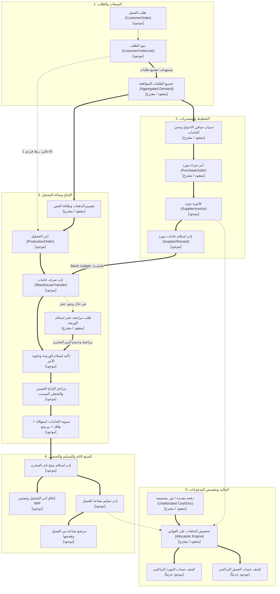

# تقرير التدقيق الشامل للوضع الراهن لدورة الإنتاج والمالية والمخازن والمبيعات
# Qema ERP — Production & Finance Comprehensive Current-State Audit (Phase 0)

> **طبيعة الوثيقة:** مراجعة تدقيقية استقصائية للوضع الفعلي القائم (Read-Only Audit)  
> **تاريخ الإعداد:** 2026-11-15  
> **المرجعية البرمجية:** كود المشروع الفعلي في `apps/api/` و`apps/web/`، والـ Migrations، وقواعد البيانات، وسجلات التدقيق  
> **حالة التنفيذ:** **تدقيق فقط — لم يتم إجراء أي تعديل على الكود أو البيانات أو البيئة**

---

## 1. الملخص التنفيذي (Executive Summary)

أُجريت هذه المراجعة الشاملة بناءً على فحص دقيق وشامل لكافة مسارات النظام البرمجية من واجهات المستخدم (Frontend) مروراً بنقاط النهاية وخدمات المنطق التجاري (Backend Services) ونماذج قاعدة البيانات (Database Models) وترحيلات Alembic وصولاً إلى قيود الأستاذ العام ودفاتر المخزون والنقدية (Stock & Cash Ledgers).

### النتائج الأساسية للتدقيق:
1. **وجود بنية تحتية محاسبية ومخزنية قوية ومتماسكة جزئياً:** يتميز النظام بوجود دفاتر أستاذ غير قابلة للتعديل أو المسح (Append-Only Ledgers) لكل من المخزون (`StockLedgerEntry`) والنقدية (`CashLedgerEntry`) والأستاذ العام (`JournalEntry`)، مدعومة بمحرك لمنع التكرار (`Idempotency Engine`) وأقفال تزامن تمنع الأرصدة السالبة (`lock_stock_balance`).
2. **انفصال هيكلي حاد بين الخزينة العامة وحسابات الموردين والعملاء:** 
   - سندات الصرف والقبض المسجلة مباشرة من شاشة الخزينة العامة (`CashDocument`) **لا تحتوي على أي حقل لربطها بالمورد أو العميل** (`supplier_id` أو `customer_id`).
   - في المقابل، فإن مدفوعات الموردين (`SupplierPayment`) وتحصيلات العملاء (`CustomerPayment`) **مقيدة حصراً وبشكل إلزامي بوجود فاتورة شراء محددة أو طلب بيع محدد**.
   - هذا الانفصال هو **السبب الجذري لخلل سيناريو "شركة الأمل"**؛ حيث تسجل الدفعة النقدية في الخزينة كمصروف عام دون أن تظهر إطلاقاً في كشف حساب المورد، ولا توجد أي آلية برمجية لتخصيصها أو ربطها لاحقاً.
3. **غياب دورة المشتريات المعيارية (Purchase Orders):** لا توجد في النظام جداول أو نماذج لأوامر الشراء (`PurchaseOrder`). التعامل مع المورد يبدأ مباشرة من "فاتورة الشراء"، مما يحرم إدارة الإنتاج من تخطيط احتياجات الخامات وإصدار طلبات توريد بناءً على عجز أوامر التشغيل.
4. **عزل خامات العملاء (التصنيع للغير - CMT) عن دورة حركة المخازن:** 
   - تم بناء وحدة خامات العملاء (`customer_materials.py`) بجداول منفصلة كلياً (`CustomerMaterialReceipt` و`CustomerMaterialReceiptLine`) **لا تُنشئ أي قيود في دفتر أستاذ المخزون العام (`StockLedgerEntry`)**.
   - نتيجة لذلك، عندما يبدأ أمر تشغيل خارجي وتُصرف خاماته، تفحص دالة الصرف (`dispatch_order_materials`) رصيد المخزن الرئيسي العام؛ فتفشل الحركة لعدم وجود رصيد، أو تُخصم أقمشة المصنع خطأً لصالح تشغيل العميل!
5. **الاعتماد على حساب وهمي شامل الصلاحيات (`general_manager`):**
   - تم تصميم إجراءات حرجة (مثل اعتماد عجز النقل، وإغلاق أوامر التشغيل، وتعديل مدد المراحل) لترتبط بحساب `general_manager` التجريبي، في حين أن الهيكل الوظيفي الفعلي للمصنع يعتمد على: **مدير الإنتاج، أمين المخزن، المدير المالي، وأصحاب المصنع**.
6. **غياب إمكانية تجميع طلبات العملاء (Demand Aggregation) وتخطيط الدفعات:**
   - أمر التشغيل يرتبط بحقل اختياري لسطر طلب عميل واحد فقط (`customer_order_line_id`). لا يمكن تجميع عدة طلبات لعملاء مختلفين في أمر تشغيل واحد، ولا يمكن تقسيم طلب كبير إلى دفعات تشغيلية مرتبطة بنفس الطلب مع الاحتفاظ بسلسلة النسب والتتبع.

---

## 2. البنية المعمارية والوحدات القائمة (Architecture & Existing Modules)

### أ. وحدات الواجهة الخلفية (Backend Modules):
| الوحدة (Module) | المسار (Path) | المسؤولية الوظيفية | الحالة التشغيلية |
| :--- | :--- | :--- | :--- |
| **Identity & RBAC** | `apps/api/app/modules/identity/`<br>`apps/api/app/core/permissions.py` | المستخدمون، الأدوار الأربعة المعتمدة، ومصفوفة الصلاحيات الصارمة (Deny-by-Default). | IMPLEMENTED & VERIFIED |
| **Catalog** | `apps/api/app/modules/production/` (دمجاً مع الكتالوج) | دليل الأصناف والخامات، وحدات القياس، دورة اعتماد الأصناف، والفرز والتصنيف. | IMPLEMENTED & VERIFIED |
| **Production** | `apps/api/app/modules/production/` | الموديلات والمقاسات، قوالب BOM، أوامر التشغيل، المراحل الخمس، وتسوية خامات الورشة. | IMPLEMENTED BUT INCOMPLETE |
| **Inventory** | `apps/api/app/modules/production/` (مدمج في الليدجر) | المخازن الثلاثة، أذون التحويل، وقيود حركة المخزون وحساب الأرصدة. | IMPLEMENTED & VERIFIED |
| **Customers** | `apps/api/app/modules/customers/` | بيانات العملاء، طلبات البيع، التسليمات، المرتجعات، والتحصيلات المرتبطة بالطلبات. | IMPLEMENTED BUT INCOMPLETE |
| **Finance** | `apps/api/app/modules/finance/` | الحسابات النقدية، سندات الخزينة، فواتير الموردين، مدفوعات الموردين، ودليل الحسابات والأستاذ العام. | IMPLEMENTED BUT INCOMPLETE |
| **Reports** | `apps/api/app/modules/reports/`<br>`apps/api/app/api/v1/endpoints/reports.py` | قائمة الدخل، الميزانية، كشوف حسابات العملاء والموردين والخزينة، وتقارير الإدارة. | IMPLEMENTED & VERIFIED |

### ب. شاشات الواجهة الأمامية (Frontend Views):
- **الإنتاج:** `ProductionOrdersView.tsx`, `OrderDetailModal.tsx`, `NewOrderModal.tsx`, `BomEditor.tsx`, `CustomerMaterialsModal.tsx`.
- **المخازن:** مدمجة ضمن `ProductionOrdersView` (الصرف والاستلام)، وسجل الجرد `StocktakeView.tsx`، ودليل الأصناف `CatalogManagementView.tsx`.
- **العملاء:** `CustomersView.tsx`, `CustomerAccountPage.tsx`, `CustomerDeliveriesView.tsx`, `CustomerReturnsView.tsx`.
- **المالية والموردون:** `TreasuryView.tsx`, `ReceiptsDisbursementsView.tsx`, `SupplierPurchasingView.tsx`, `SuppliersView.tsx`, `PaymentsCollectionsView.tsx`, تقارير `FinancialReportsView.tsx`.

---

## 3. التحقيق في سيناريو المورد الفعلي (شركة الأمل)

### وقائع السيناريو:
- تم تسجيل سند صرف نقدي بقيمة 5,500 ج.م لصالح "شركة الأمل" في شاشة الخزينة.
- تم تسجيل فاتورة مورد بقيمة 5,500 ج.م لصالح "شركة الأمل".
- ظهرت الفاتورة في كشف حساب المورد كمستحق، بينما لم تظهر الدفعة، وظل رصيد المورد دائنًا بكامل المبلغ.
- تعذر على المستخدم ربط الدفعة بالفاتورة أو تسويتها.

### نتائج الفحص والتحليل البرمجي للسيناريو:

```
[مستند صرف بالخزينة: 5,500 ج.م] ──► CashDocument (source_system=None, supplier_id=NULL)
                                       │
                                       ├─► CashLedgerEntry: -5,500 ج.م من الخزينة (1010)
                                       └─► JournalEntry: Dr 5300/5400 (مصروفات عامة) / Cr 1010
                                       (لا يوجد أي أثر في حساب المورد 2100!)

[فاتورة المورد: 5,500 ج.م] ───────► SupplierInvoice ──► استلام مخزني (GRN)
                                       │
                                       ├─► StockLedgerEntry: +5,500 ج.م خامات
                                       └─► JournalEntry: Dr 1210 (مخزون) / Cr 2100 (موردون)
                                       
[كشف حساب المورد] ───────────────► يستعلم فقط من: SupplierInvoice + SupplierPayment
                                       النتيجة: يظهر الاستحقاق (+5,500) ولا تظهر دفعة الخزينة إطلاقاً!
```

### الإجابة الدقيقة عن أسئلة التحقيق:
1. **أين تسجل الدفعة؟**  
   سُجلت في جدول `cash_documents` كحركة صرف عامة (`document_type = 'expense'`).
2. **هل تنشئ حركة في Cash Ledger؟**  
   **نعم.** عند اعتماد المستند من الخزينة، ينشأ سطر في `cash_ledger_entries` يخصم 5,500 ج.م من حساب الخزينة (`1010`).
3. **هل تنشئ حركة في حساب المورد؟**  
   **قطعاً لا.** جدول `cash_documents` لا يحتوي أصلاً على عمود `supplier_id`. القيد المحاسبي المنشأ يرحل إلى حساب المصروفات العمومية (`5300` أو `5400`) بدلاً من حساب الموردين (`2100`).
4. **هل يمكن تخصيصها لفاتورة؟**  
   **غير مدعوم نهائياً.** لا توجد في النظام نقطة نهاية (Endpoint) أو شاشة أو جدول وسيط يتيح ربط مستند نقدي عام (`CashDocument`) بفاتورة مورد (`SupplierInvoice`).
5. **هل توجد آلية للدفعات المقدمة والزائدة للمورد؟**  
   **غير مدعومة إذا لم تكن هناك فاتورة قائمة.** دالة `create_supplier_payment` تشترط تمرير `invoice_id` غير فارغ (`nullable=False`). لا يمكن للمصنع إثبات دفعة مقدمة لتاجر قماش لتثبيت سعر بضاعة لم تصدر فاتورتها بعد.
6. **هل التخصيص يسجل حركة نقدية جديدة بالخطأ؟**  
   **نعم وبشكل كارثي.** إذا حاول المستخدم "تصحيح" الوضع بالدخول إلى شاشة فواتير الموردين والضغط على زر "طلب سداد" على الفاتورة، فإن النظام سينشئ `CashDocument` جديداً تماماً؛ وعند اعتماده ستُخصم 5,500 ج.م إضافية من الخزينة، مما يؤدي إلى **ازدواج الصرف الدفتري (Double Cash Deduction)** بقيمة إجمالية 11,000 ج.م!
7. **ماذا يحدث لو سبقت الفاتورة الدفعة أو العكس؟**  
   - إذا سبقت الفاتورة وتم السداد من **داخل شاشة الفاتورة**: يعمل النظام محاسبياً بشكل صحيح (Dr 2100 / Cr 1010).  
   - إذا سبقت الدفعة النقدية الفاتورة (أو سُجلت من شاشة الخزينة العامة): ينفصل المساران تماماً وتضيع العلاقة.
8. **هل توجد نفس المشكلة في حسابات العملاء والتحصيلات؟**  
   **نعم تماماً وبنفس الدرجة.** جدول `customer_payments` يشترط وجود `order_id` إلزامي. أي سند قبض يُسجل من الخزينة العامة لا يربط بالعميل، ويُقيد كإيرادات مبيعات عامة (4100/4200) دون أن يخفض مديونية العميل في كشف حسابه.

---

## 4. تدقيق وحدات دورة التشغيل والإنتاج

### A. المبيعات وطلبات العملاء (Customer Orders & Sales)
* **النماذج والجداول:** `CustomerOrder`, `CustomerOrderLine`, `CustomerDelivery`, `CustomerDeliveryReturn`, `CustomerPayment`.
* **الحالة:** `IMPLEMENTED BUT INCOMPLETE`
* **المسارات والخدمات:** `apps/api/app/api/v1/endpoints/customers.py`, `apps/api/app/modules/customers/`.
* **الفحص الميداني:**
  1. **أنماط الطلب:** يدعم النظام نمطين: جاهز للتسليم (`ready_goods`) وتصنيع خاص (`custom_manufacturing`).
  2. **ربط المخزون والتسليم:** عند التسليم (`CustomerDelivery`)، تُخصم البضاعة من مخزن التام (`finished_goods`) مع تقييد الحاوية: `private_label:{customer_id}` للإنتاج الخاص، و`factory_brand` لمنتجات المصنع.
  3. **علاقة الطلب بالإنتاج (Gaps):**
     - المسار `POST /{customer_id}/orders/{order_id}/production-orders` يسمح بإنشاء أمر تشغيل انطلاقاً من سطر طلب عميل واحد فقط.
     - **لا يمكن تجميع طلبين أو أكثر** لموديل متطابق في أمر تشغيل واحد.
     - إذا طُلب إنتاج لملء المخزون الداخلي دون طلب عميل، يمكن إنشاؤه عبر مسار الإنتاج العام `POST /orders`، ولكن هذا المسار العام لا يسمح لاحقاً بتخصيص قطع منه لطلبات عملاء محددة.

### B. الإنتاج والموديلات والتشغيل (Production Lifecycle)
* **النماذج والجداول:** `Product`, `ProductVariant`, `ProductionTemplate`, `ProductionTemplateVersion`, `ProductionTemplateLine`, `ProductionOrder`, `ProductionOrderItem`, `ProductionOrderMaterial`, `ProductionStageEvent`, `ProductionMaterialReconciliation`.
* **الحالة:** `IMPLEMENTED BUT INCOMPLETE`
* **الفحص الميداني:**
  1. **المقاسات وقوائم المواد (BOM):** قوالب الخامات مرتبطة بـ `variant_id` محدد، وتدعم الإصدارات المتعددة (`BOM-DEC-01`). التعديل ينشئ إصداراً نشطاً جديداً ويؤرشف السابق دون المساس بالأوامر القديمة (ممتاز).
  2. **المراحل الخمس:** (قص، تقفيل، كباسين وأزرار، كي، تعبئة) تنشأ افتراضياً. ميزة **تخطي المرحلة (`TIME-DEC-03`)** مطبقة برمجياً بمسار `/skip` وتطلب سبباً إلزامياً وتوثق هوية المتخطي.
  3. **تسجيل الاستهلاك والتسوية:** المسار `POST /orders/{order_id}/material-reconciliations` يتيح لمدير الإنتاج تسجيل المستهلك والهالك والمرتجع يدوياً مع منع تجاوز رصيد الورشة الفعلي.
  4. **الفجوات التشغيلية (Gaps):**
     - **حجز الخامات (Material Allocation):** عند إنشاء أمر التشغيل بحالة `draft`، لا يتم حجز الخامات دفترياً. قد يتفاجأ المصنع عند لحظة الصرف بعدم توفر الخامات المطلوبة.
     - **تقسيم الدفعات (Batch Sizing):** لا توجد آلية لاحتساب طاقة طاولة القص أو تقسيم الأمر إلى دفعات (Batches / Cutting Markers) بموجب معايير مدخلة من أصحاب المصنع.

### C. المخازن ودورة تحت التشغيل (Inventory & WIP Lifecycle)
* **النماذج والجداول:** `Warehouse`, `StockLedgerEntry`, `WarehouseTransfer`, `WarehouseTransferLine`.
* **الحالة:** `IMPLEMENTED & VERIFIED` (مع وجود فجوة في معالجة عجز النقل)
* **الفحص الميداني:**
  1. **المخازن الثلاثة:** `main_raw_materials` (خامات)، `work_in_progress` (تشغيل)، `finished_goods` (تام).
  2. **دورة الصرف والاستلام:** صرف الخامات يدرج قيد طريق (`in_transit`). تأكيد استلام الورشة يخصم من الطريق ويدرج في الورشة بسلة الأمر `bucket_reference = order:{id}`.
  3. **عجز استلام الورشة:** يثبت كفرق نقل دفتري (`receipt_discrepancy`) ولا يدخل رصيد الورشة.
  4. **الفجوة الحرجة في حسم العجز:**
     - وفق الكود الحالي (`close_production_order:2116`)، يُشترط تفعيل خيار `discrepancy_signoff: true` عند إغلاق الأمر.
     - حالياً يمتلك مدير الإنتاج صلاحية الإغلاق؛ مما يمكنه من إسقاط العجز الذي أثبته بنفسه دون الرجوع لأمين المخزن، مخالفاً بذلك قاعدة فصل المسؤوليات وحسم أمين المخزن للعجز.

### D. المشتريات وحسابات الموردين (Purchasing & Suppliers)
* **النماذج والجداول:** `Supplier`, `SupplierInvoice`, `SupplierInvoiceLine`, `SupplierReceipt`, `SupplierPayment`.
* **الحالة:** `IMPLEMENTED BUT INCOMPLETE`
* **الفحص الميداني:**
  1. **غياب دورة أوامر الشراء (No POs):** لا يوجد كيان لأمر الشراء (`PurchaseOrder`). الشراء يبدأ من فاتورة المورد، مما يعزل المشتريات عن خطة الإنتاج.
  2. **الاستلام الجزئي والفواتير:** مسار `POST /supplier-invoices/{id}/receive` يدعم الاستلام الجزئي المتعدد بدقة، وكل استلام يولد `SupplierReceipt` وقيد ليدجر مخزني وقيد استحقاق للمورد بقيمة المستلم الفعلي (Dr 1210 / Cr 2100).
  3. **الفجوة الحرجة:** لا توجد إمكانية لتسجيل دفعات مقدمة عامة للموردين، ولا توجد إمكانية لمعالجة مرتجعات المشتريات للمورد بعد استلامها (`Supplier Purchase Returns / Credit Notes`).

### E. المالية والخزينة والأستاذ العام (Finance & General Ledger)
* **النماذج والجداول:** `CashAccount`, `CashDocument`, `CashLedgerEntry`, `Account`, `JournalEntry`, `JournalEntryLine`.
* **الحالة:** `IMPLEMENTED BUT INCOMPLETE`
* **الفحص الميداني:**
  1. **الخزينة والحسابات النقدية:** يدعم النظام حسابات الخزينة الرئيسية (`treasury`)، والعهد المؤقتة (`petty_cash`)، والبنك (`bank`).
  2. **دورة الموافقات ومنع التكرار:** جميع السندات المنشأة من غير المدير المالي تبقى معلقة حتى تعتمد من شاشة الخزينة. محرك `Idempotency` يمنع تكرار الحركة عند إعادة الإرسال.
  3. **الفجوة المحاسبية الكبرى:** غياب جدول الحسابات الوسيطة أو تسوية المدفوعات غير المخصصة (`Unallocated Payments / Advance Ledger`)، مما يجعل الخزينة العامة تعمل كـ "جزيرة معزولة" عن حسابات الموردين والعملاء.

---

## 5. مصفوفة الصلاحيات وفصل المسؤوليات (Permissions & RBAC)

تم فحص مصفوفة الأدوار المعتمدة في `apps/api/app/core/permissions.py`:

| الدور في النظام | الوصف في الكود | المطابقة مع الواقع الفعلي لمصنع القمة | الفجوة المكتشفة |
| :--- | :--- | :--- | :--- |
| **`general_manager`** | دور تجريبي شامل لكل الصلاحيات | **غير موجود كوظيفة فعلية بالمصنع**؛ العمل يدار بواسطة الملاك ومديري الأقسام. | إسناد اعتمادات حاسمة له (مثل حسم العجز والإغلاق) يعطل تشغيل المصنع اليومي في غياب هذا الحساب. |
| **`production_manager`** | أوامر التشغيل، استلام الورشة، المراحل، التسوية، الإغلاق | **مطابق ميدانياً** (مسؤول صالة التشغيل والقص). | يمتلك حالياً صلاحية `production:orders:close` التي تتيح له إقرار عجز استلام الخامات بنفسه (كسر مبدأ منع الاعتماد الذاتي). |
| **`warehouse_manager`** | صرف الخامات، استلام التام، تسليم العملاء، استلام الموردين، الجرد | **مطابق ميدانياً** (أمين المخازن). | مستبعد حالياً من مراجعة طلبات عجز استلام خامات الورشة المرسلة من مدير الإنتاج؛ حيث تُقفل الأوامر دونه. |
| **`finance_manager`** | الخزينة والاعتماد، الرواتب، التسعير، فواتير الشراء، واعتماد الجرد | **مطابق ميدانياً** (المدير المالي/المحاسب). | لا يمتلك مساراً لتسوية السندات النقدية العامة وربطها بالموردين والعملاء، وتنقصه شاشة توزيع الدفعات المقدمة. |

---

## 6. خريطة تدفق المستندات والبيانات (Document & Entity Relationship Map)

توضح الخريطة التالية المسار المتكامل لحركة البيانات، مع تمييز **المسارات القائمة فعلياً `[موجود]`** عن **المسارات المفقودة أو المقترحة `[مفقود / مقترح]`**:



---

## 7. تصنيف حالة الوظائف الحالية (Detailed Capability Status)

| الوظيفة / المتطلب | التصنيف (Status) | الملفات ونقاط النهاية المعنية | الدليل البرمجي والملاحظات |
| :--- | :---: | :--- | :--- |
| **تحديد المقاسات والموديلات وقوالب BOM** | `IMPLEMENTED & VERIFIED` | `apps/api/app/modules/production/bom.py`<br>`/api/v1/production/models` | قوالب متعددة الإصدارات مرتبطة بالمقاسات مع احتساب الاحتياج المعياري. |
| **المراحل الخمس وتخطي غير المنطبق** | `IMPLEMENTED & VERIFIED` | `apps/api/app/modules/production/service.py`<br>`POST /orders/{id}/stages/{name}/skip` | تطبيق قرار `TIME-DEC-03` بتسجيل سبب التخطي وتوثيق الفاعل. |
| **استلام خامات الورشة وفصل عجز النقل** | `IMPLEMENTED & VERIFIED` | `apps/api/app/modules/production/service.py`<br>`POST /orders/{id}/receive` | عجز النقل يُقيد في موقع `discrepancy` ولا يدخل رصيد الورشة إطلاقاً. |
| **تسوية خامات الورشة وتصفير الرصيد** | `IMPLEMENTED & VERIFIED` | `apps/api/app/api/v1/endpoints/production.py`<br>`POST /orders/{id}/material-reconciliations` | تسجيل دقيق للمستهلك والهالك والمرتجع ومنع تجاوز الرصيد المتبقي. |
| **إرجاع الفائض لمخزن الخامات** | `IMPLEMENTED & VERIFIED` | `apps/api/app/api/v1/endpoints/production.py`<br>`POST /orders/{id}/returns/{t_id}/receive` | المرتجع يخرج بالطريق ولا يدخل رصيد الخامات إلا بعد فحص أمين المخزن. |
| **استلام المنتج التام ومردودات المبيعات** | `IMPLEMENTED & VERIFIED` | `apps/api/app/api/v1/endpoints/customers.py`<br>`POST /deliveries/{id}/returns` | فحص المرتجعات وعزل التالف وإعادة الصالح لمخزن التام مع القيود المحاسبية. |
| **تخصيص الدفعات النقدية العامة على الفواتير** | `NOT IMPLEMENTED` | `apps/api/app/modules/finance/models.py`<br>`CashDocument`, `SupplierPayment` | غياب كامل لآلية ربط سند الصرف العام بفاتورة المورد (سبب مشكلة الأمل). |
| **الدفعات المقدمة دون وجود فاتورة/طلب** | `NOT IMPLEMENTED` | `apps/api/app/modules/finance/service.py`<br>`SupplierPayment`, `CustomerPayment` | الحقل `invoice_id` و`order_id` إلزامي وغير فارغ (`nullable=False`). |
| **أوامر الشراء وإدارة طلبات التوريد (PO)** | `NOT IMPLEMENTED` | لا توجد ملفات أو نماذج لأوامر الشراء | الشراء يبدأ من الفاتورة مباشرة ولا يوجد ربط بين عجز المواد والشراء. |
| **تجميع طلبات العملاء في تشغيل موحد** | `NOT IMPLEMENTED` | `apps/api/app/modules/production/models.py`<br>`ProductionOrder.customer_order_line_id` | يدعم فقط سطر طلب عميل واحد ولا يمكن تجميع الطلبات المتوافقة. |
| **خامات التصنيع للغير في الليدجر المخزني** | `IMPLEMENTED BUT INCOMPLETE` | `apps/api/app/modules/production/customer_materials.py` | مسجلة كحركة أمانات بجداول مستقلة دون قيود `StockLedgerEntry` مما يعطل الصرف. |
| **مراجعة وحسم عجز الاستلام بواسطة أمين المخزن** | `NOT IMPLEMENTED` | `apps/api/app/api/v1/endpoints/production.py`<br>`close_production_order` | العجز يسقطه من يغلق الأمر مباشرة دون طلب رسمي موجه لأمين المخزن لمراجعته. |
| **تقسيم الإنتاج لدفعات حسب طاقة طاولة القص** | `NOT IMPLEMENTED` | `apps/api/app/modules/production/service.py` | لا توجد معايير مدخلة لتقسيم كمية الأمر على دفعات أو باترونات قص محددة. |

---

## 8. الأخطاء البرمجية المكتشفة والمخاطر الهيكلية (Bugs & Risks)

1. **خلل ازدواجية الصرف النقدي (Double-Deduction Vulnerability):**  
   - إذا سُجل سند صرف عام في الخزينة، ثم طُلب سداد نفس الفاتورة من شاشة الموردين لإغلاق المستحق عليها دفترياً، يقوم النظام بخصم المبلغ مرتين من الخزينة.
2. **فشل صرف خامات التصنيع للغير (CMT Dispatch Deadlock):**  
   - دالة `dispatch_order_materials` تفحص `StockLedgerEntry` في مخزن الخامات. وحيث إن استلام خامات العميل في `customer_materials.py` لا يدرج قيد ليدجر، يفشل صرف خامات أمر التشغيل بـ `409 لا يمكن صرف الخامات لعدم كفاية الرصيد`.
3. **تضليل تقارير المصروفات بسبب مدفوعات الموردين المسجلة بالخزينة:**  
   - كل سند صرف لمورد يسجل من شاشة الخزينة مباشرة يُرحل خطأً إلى حساب المصروفات العمومية والإدارية (`5300`/`5400`)، مما يُضخّم بند المصروفات في قائمة الدخل ويشوه صافي الأرباح ويُظهر مديونية الموردين على غير حقيقتها.
4. **تجاوز رقابة أمين المخزن على عجز النقل:**  
   - إمكانية قيام مدير الإنتاج باعتماد فروقات استلام الورشة (`discrepancy_signoff`) دون محضر رسمي معتمد من أمين المخزن الذي قام بالصرف.

---

## 9. المكتسبات البرمجية الواجب الحفاظ عليها (Features to Preserve)

أثناء إعادة التنظيم الهيكلي، **يُحظر المساس بالوظائف المتقنة التالية**:
1. **محرك عدم التكرار (`Idempotency Engine`):** الترويسة `Idempotency-Key` وبصمة الطلب المشفرة في كافة العمليات المالية والمخزنية.
2. **سجل الليدجر التاريخي المحصن (`Append-Only Ledgers`):** حظر التعديل والحذف المباشر والاعتماد الحصري على القيود المعاكسة (`Compensating Entries`).
3. **معمارية المراحل التتابعية وتخطيها المسبب (`TIME-DEC-03`):** إمكانية إرجاع المرحلة السابقة وتخطي المراحل غير المنطبقة مع حفظ أسباب التخطي وهوية الفاعل.
4. **شروط إغلاق أوامر التشغيل الصارمة:** اشتراط تصفير سلة خامات الورشة دفترياً ومخزنياً وعدم السماح بالإغلاق النصي الوهمي.
5. **معمارية مركز التقارير المالية والإدارية (Reports Hub):** التبويبات الأربعة الجديدة المنفصلة في القائمة الجانبية (قائمة الدخل، الميزانية، كشوف الحسابات، تقارير الإدارة).

---

## 10. دورة العمل المستهدفة المعتمدة (Recommended Target Workflow)

تتكامل دورة العمل المستهدفة لتحقيق متطلبات أصحاب المصنع السبعة كالتالي:

```
[1. طلبات العملاء المتوافقة] 
        │
        ▼ (محرك التجميع)
[2. أمر تشغيل مجمع / دفعة إنتاجية] ◄── [أو أمر إنتاج مباشر لملء المخزون]
        │
        ▼ (BOM المقاسات واحتساب العجز)
[3. صافي احتياج الخامات] ──► [طلب توريد / أمر شراء مورد PO]
        │                           │
        │                           ▼ (توريد الخامات وفحصها)
        │                 [4. فاتورة المورد + إذن استلام المخزن GRN]
        │                           │
        ▼                           ▼
[5. حجز الخامات وصرفها من مخزن الخامات للورشة]
        │
        ├──► [في حال وجود عجز استلام: يُرسل طلب مراجعة لأمين المخزن للحسم]
        ▼
[6. صالة الإنتاج: المراحل الخمس (مع إمكانية تخطي غير المنطبق بقرار معتمد)]
        │
        ▼
[7. تسوية الخامات: استهلاك فعلي + هالك معتمد (1.5% للغير) + إرجاع الفائض]
        │
        ▼
[8. استلام المنتج التام بمخزن التام] ──► [إغلاق أمر التشغيل وتصفير WIP]
        │
        ▼
[9. تسليم طلبات العملاء الأصلية وفواتير البيع ومردودات المبيعات]
        │
        ▼
[10. تسوية المدفوعات والتحصيلات: محرك تخصيص الدفعات المقدمة والربط بالخزينة]
```

---

## 11. خطة التنفيذ المقترحة في مراحل صغيرة متتابعة (Implementation Plan)

تمت مراجعة خطة المراحل المقترحة وإعادة ضبط أولوياتها وترتيبها بناءً على الاعتماديات التقنية والمحاسبية المكتشفة:

### المرحلة 1: تسوية حسابات الموردين والعملاء وتخصيص الدفعات (Financial Settlement & Allocation Engine)
* **الهدف:** حل مشكلة "شركة الأمل" نهائياً، وفك الارتباط الإلزامي بين الدفعات النقدية ووجود الفاتورة، وبناء محرك التخصيص.
* **المخرجات:**
  1. إضافة `supplier_id` و`customer_id` اختياريين إلى جدول وموديل `CashDocument`.
  2. إنشاء جدول وسيط لتخصيص المدفوعات `payment_allocations` يربط الدفعة النقدية (سواء كانت دفعة مقدمة أو صرفاً عاماً) بفاتورة مورد أو طلب عميل محدد.
  3. دعم الدفعات المقدمة وغير المخصصة (`Unallocated / Advance Payments`)، مع إمكانية تجزئة الدفعة الواحدة على أكثر من فاتورة دون تكرار الخصم من الخزينة.
  4. تحديث كشوف حسابات الموردين والعملاء لتعكس الدفعات غير المخصصة كأرصدة دائنة/مدينة معلقة.
* **معايير القبول (Acceptance Criteria):**
  - تسجيل سند صرف بقيمة 5,500 ج.م لمورد دون تحديد فاتورة، فيظهر رصيد دائن للمورد بمبلغ 5,500 ج.م في كشف حسابه فوراً.
  - عند إنشاء فاتورة لاحقة بنفس القيمة، يضغط المحاسب على "تخصيص الدفعة المعلقة"، فتُسوى الفاتورة دون أي حركة خصم نقدية إضافية في الخزينة.

### المرحلة 2: تكامل خامات التصنيع للغير (CMT) مع دفاتر المخزون
* **الهدف:** حل مشكلة فشل صرف خامات العملاء وتمكين المصنع من تشغيل الخامات الموردة أو المشتراة لحساب العميل.
* **المخرجات:**
  1. إدراج قيود `StockLedgerEntry` في مخزن الخامات الرئيسي عند استلام خامات العميل بحاوية عهدة `bucket_reference = f"customer_deposit:{customer_id}"`.
  2. تمكين دالة الصرف `dispatch_order_materials` من التعرف على خامات العميل وصرفها بسلاسة دون تعارض مع خامات المصنع الخاصة.
  3. تطبيق قاعدة الهالك المعتمدة (1.5%) وحساب الهالك الزائد تلقائياً وفق القاعدة المتفق عليها.
* **معايير القبول:**
  - استلام قماش مورد من عميل بسند CMR، وظهوره في رصيد خامات العميل بالليدجر.
  - صرف القماش لأمر تشغيل خارجي بنجاح وخصمه من سلة العميل حصراً.

### المرحلة 3: حسم عجز استلام الورشة بين مدير الإنتاج وأمين المخزن
* **الهدف:** سحب صلاحية إسقاط العجز من الحساب التجريبي (`general_manager`) وإسناد المراجعة والحسم لأمين المخزن.
* **المخرجات:**
  1. عند وجود فرق استلام في الورشة، ينشئ النظام "طلب مراجعة عجز استلام" (`TransferDiscrepancyClaim`).
  2. يظهر التنبيه والطلب في لوحة أمين المخزن للمراجعة الميدانية والبت فيه (قبول العجز كخطأ قياس/نقل، أو رفضه وتكليف الناقل/المخزن به).
  3. ربط إغلاق أمر التشغيل بقرار حسم أمين المخزن المعتمد بدلاً من خيار الإسقاط الذاتي لمدير الإنتاج.
* **معايير القبول:**
  - استلام الورشة 515 م من أصل 520 م يصدر طلباً معلقاً لأمين المخزن.
  - لا يمكن لمدير الإنتاج إغلاق الأمر حتى يبت أمين المخزن في الطلب ويسجله كعجز نقل معتمد.

### المرحلة 4: تجميع طلبات العملاء وتخطيط الاحتياجات (Demand Aggregation & Planning)
* **الهدف:** تمكين المصنع من دمج طلبات العملاء المتوافقة في تخطيط إنتاجي واحد مع حفظ نسب كل عميل.
* **المخرجات:**
  1. جدول ربط متعدد الأطراف `production_order_demands` يربط أمر التشغيل بأكثر من `customer_order_line_id` مع تحديد الكمية المخصصة لكل طلب.
  2. شاشة تجميع الطلبات المتوافقة حسب (الموديل، المقاس، اللون، ونوع القماش).
  3. استخراج تقرير صافي احتياج الخامات المجمع لمقارنته بالرصيد المتاح.
* **معايير القبول:**
  - دمج طلب للعميل (أ) بـ 50 قطعة وطلب للعميل (ب) بـ 70 قطعة لنفس الموديل والمقاس في أمر تشغيل موحد بـ 120 قطعة.
  - عند استلام المنتج التام، يتم تفكيك الكميات المستلمة وتوزيعها تلقائياً على سلات التسليم الخاصة بالعميلين كلٌّ بحصته.

### المرحلة 5: أوامر الشراء وربط المشتريات باحتياجات الإنتاج (Purchase Orders Workflow)
* **الهدف:** تنظيم دورة الشراء من خلال أوامر شراء رسمية (POs) تصدر عند وجود عجز في الخامات.
* **المخرجات:**
  1. نماذج وجداول أوامر الشراء `PurchaseOrder` و`PurchaseOrderLine`.
  2. تحويل عجز خامات أمر التشغيل بضغطة زر إلى مسودة أمر شراء موجهة للمورد.
  3. ربط استلام فواتير الموردين بأوامر الشراء المفتوحة ومتابعة المتبقي للتوريد.
* **معايير القبول:**
  - توليد أمر شراء لخام قماش مع عجز 200 م، واستلام فاتورة شراء جزئية عنه بـ 150 م وإثبات بقاء 50 م قيد التوريد.

### المرحلة 6: تقسيم الإنتاج لدفعات وضبط مدد المراحل المعيارية (Batch Allocation & Stage Timing)
* **الهدف:** دعم تقسيم الأوامر الكبيرة لدفعات تشغيلية وفق قدرة طاولة القص والباترونات، وتعديل مدد التشغيل بواسطة الإدارة.
* **المخرجات:**
  1. واجهة ضبط معايير طاولة القص والقدرة الاستيعابية لكل دفعة دون قيم مفروضة مسبقاً.
  2. إمكانية تقسيم أمر التشغيل المجمع إلى أوامر دفعات تابعة (Sub-Batches) تتقاسم نفس الخامات المستلمة.
  3. واجهة مرنة لأصحاب المصنع لإدخال وتعديل الأزمنة المعيارية للمراحل الخمس لكل موديل.
* **معايير القبول:**
  - تقسيم أمر تشغيل لـ 500 جلابية إلى 5 دفعات متتالية سعة كل منها 100 جلابية، وتتبع إنجاز كل دفعة على خطوط الصالة بشكل منفصل.

### المرحلة 7: استلام المنتج التام والتسليم المجمع وإغلاق الدورة
* **الهدف:** إكمال الدورة اللوجستية والتجارية وضمان التصفير الكامل لكافة الحسابات.
* **معايير القبول:**
  - اكتمال تسليم المنتجات التامة للعملاء، وتخصيص التحصيلات، وإصدار كشوف الحسابات المتوازنة بنسبة 100%.

### المرحلة 8: المراجعة النهائية الشاملة واختبارات التكامل الميداني (End-to-End Verification)
* **الهدف:** تشغيل دورة تجريبية واقعية متكاملة لجميع الحالات (تصنيع داخلي، تصنيع للغير، تجميع طلبات، استلام بفروقات، دفعات مقدمة).

---

## 12. أهم 5 معوقات وقرارات تمنع بدء التنفيذ فوراً

قبل كتابة أي كود في المرحلة التنفيذية الأولى، يلزم تثبيت وحسم القرارات الخمسة التالية:

1. **اعتماد تصميم جدول تخصيص المدفوعات (`payment_allocations`):**  
   هل يتم اعتماد جدول وسيط مستقل يربط `CashDocument` بكل من `SupplierInvoice` أو `CustomerOrder` مع دعم تعدد التخصيص (سند واحد يغطي فواتير متعددة، أو فاتورة واحدة تسدد بعدة سندات)؟ *(يوصى بشدة باعتماد هذا الحل المعماري لأنه يحافظ على ثبات دفاتر النقدية القائمة ويحل المشكلة جذرياً)*.
2. **آلية استيعاب خامات التصنيع للغير (CMT) في دفتر أستاذ المخزون:**  
   هل نعتمد قيد خامات العميل في المخزن الرئيسي مع تمييزها برمز عهدة خاص (`bucket_reference = customer_deposit:{id}`) لمنع خلطها بأصول المصنع، بما يتيح لدوال الصرف الاعتيادية التعامل معها دون أخطاء؟
3. **صلاحية مراجعة وحسم عجز الاستلام (Discrepancy Resolution):**  
   تأكيد إلغاء شرط اعتماد حساب `general_manager` التجريبي، واستبداله بدورة رسمية ثنائية: **مدير الإنتاج يرفع طلب العجز ◄ أمين المخزن يراجع ويفصل في العجز بالموافقة أو التحميل**.
4. **طريقة تجميع طلبات العملاء (Demand Aggregation Architecture):**  
   اعتماد كسر الارتباط الأحادي (`1:1`) بين أمر التشغيل وسط السطر، واستبداله بجدول وسيط لتوزيع كميات الدفعة الإنتاجية على سطور طلبات العملاء المتوافقة.
5. **معايير تقسيم الدفعات والباترون:**  
   تأكيد أن النظام لن يفرض أي حد أقصى للدفعة برمجياً، بل يتيح لمدير الإنتاج إدخال حجم الدفعة (`batch_size`) يدوياً عند كل تخطيط بناءً على طول طاولة القص وعدد طبقات القماش (الرصّة).

---

## 13. التوصية التنفيذية للمرحلة القادمة

> [!IMPORTANT]
> **التوصية الحاسمة:**  
> البدء فوراً بـ **المرحلة الأولى (Phase 1): «محرك تخصيص وتسوية حسابات الموردين والعملاء والدفعات المقدمة»**.  
> **السبب:** هذه المرحلة تمثل العصب المالي والتجاري الأكثر إلحاحاً؛ حيث إن الخلل المالي الراهن (كما في حالة شركة الأمل) يعطل ثقة المستخدم في أرقام كشوف الحسابات والخزينة، كما أن إصلاحها لا يمس خطوط الإنتاج الحالية ويمكن إنجازه واختباره وتأمينه كخطوة أولى مستقلة وآمنة تماماً.

---
**نهاية تقرير التدقيق — في انتظار مراجعة واعتماد التقرير والقرارات الخمسة من جانبكم قبل الانتقال للبدء في Phase 1.**

