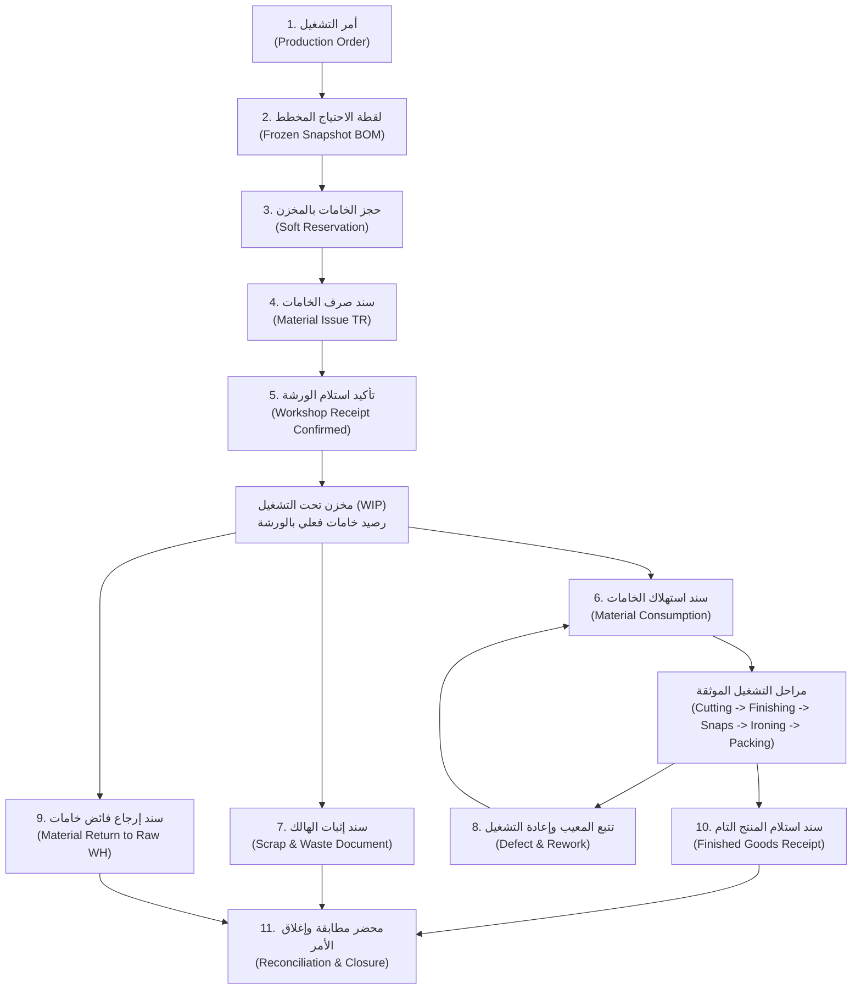

# مراجعة معمارية وتصميم دورة تتبع الإنتاج والمخزون
# Qema ERP — Production & Inventory Traceability Architecture Review

**تاريخ المراجعة:** 2026-11-01  
**طبيعة الوثيقة:** استكشاف معماري وتصميم هندسي (Discovery & Design Document)  
**النطاق:** دورة الإنتاج والمخازن، حركات الأستاذ (Stock Ledgers)، المعالجة الآمنة للأخطاء (Error Recovery)، ومنظومة التتبع الكامل (Full Traceability).

---

## 1. البنية المعمارية الحالية (Current Architecture)

تم فحص الكود الفعلي، ونماذج البيانات (ORM Models)، ومسارات الـ API، والخدمات التشغيلية المطبقة في النظام، وفيما يلي تفصيل المكونات الحقيقية الموجودة بالفعل:

### أ. مسارات النماذج والملفات والجداول

```
apps/api/
├── app/
│   ├── modules/
│   │   ├── production/
│   │   │   ├── models.py      --> الجداول: production_orders, production_order_items, production_defects,
│   │   │   │                     production_order_materials, warehouse_transfers, warehouse_transfer_lines,
│   │   │   │                     stock_ledger_entries, production_stage_events, production_stage_history,
│   │   │   │                     catalog_items, catalog_item_revisions, catalog_approval_history,
│   │   │   │                     warehouses, units, item_categories, production_templates
│   │   │   ├── schemas.py     --> عقود البيانات لطلبات واستجابات الإنتاج والمخازن
│   │   │   └── service.py     --> منطق الأعمال: صرف المواد، استلام الورشة، تحديث وتراجع المراحل
│   │   ├── customers/
│   │   │   ├── models.py      --> customer_orders, customer_deliveries, customer_delivery_returns
│   │   │   └── ...
│   │   ├── finance/
│   │   │   ├── models.py      --> cash_accounts, cash_documents, cash_ledger_entries, supplier_invoices
│   │   │   └── service.py     --> إنشاء واعتماد مستندات الخزينة
│   │   └── identity/
│   │       └── models.py      --> roles, permissions, role_permissions, user_roles
│   └── api/v1/endpoints/
│       ├── production.py      --> endpoints: orders, dispatch, receipt, stages, rollback, finished-receipt
│       ├── inventory.py       --> endpoints: stock, ledger
│       ├── customers.py       --> endpoints: deliveries, returns (with compensating ledger entries)
│       └── finance.py         --> endpoints: cash documents, supplier receipts
```

### ب. المخازن التشغيلية الثلاثة المعتمدة
النظام يعتمد في [apps/api/app/modules/production/models.py](file:///d:/Qema%20Project/apps/api/app/modules/production/models.py#L27) ثلاثة مخازن ثابتة:
1. `main_raw_materials`: مخزن الخامات والمستلزمات الرئيسي.
2. `work_in_progress`: مخزن تحت التشغيل (أرضية الورشة وعمليات التصنيع).
3. `finished_goods`: مخزن المنتج التام والتجهيز للتسليم.
(إضافة إلى `machinery` لمستلزمات وماكينات المصنع).

### ج. دورة الحركة المطبقة فعليًا لأمر التشغيل
1. **إنشاء أمر التشغيل (`ProductionOrder`):**
   - ينشئ الأمر بحالة `draft`.
   - تُحسب كميات الخامات نسبياً بناءً على كميات القالب المرجعي وتُجمد في جدول `production_order_materials` كلقطة مستقلة لحمايتها من أي تعديل مستقبلي للقوالب.
2. **صرف الخامات (`dispatch_order_materials`):**
   - يفحص توفر الرصيد في `main_raw_materials` عبر تجميع `stock_ledger_entries`.
   - ينشئ مستند تحويل `WarehouseTransfer` بحالة `in_transit`.
   - يسجل قيدين في دفتر الأستاذ:
     - قيد سالب (`-quantity`) برمز `location_type = 'warehouse'` في `main_raw_materials`.
     - قيد موجب (`+quantity`) برمز `location_type = 'in_transit'` بدون تحديد مخزن.
   - تتحول حالة الأمر إلى `materials_dispatched`.
3. **تأكيد استلام الورشة (`confirm_warehouse_receipt`):**
   - يؤكد أمين المخزن/مسؤول التشغيل الاستلام الفعلي للبنود.
   - يسجل الفروقات إن وجدت (`discrepancy_quantity`) دون مسح السجل.
   - ينشئ قيود الأستاذ:
     - قيد سالب من `in_transit`.
     - قيد موجب بالكمية المقبولة في مخزن تحت التشغيل `work_in_progress`.
     - قيد منفصل لسلة الفروقات `location_type = 'discrepancy'` إن وُجد عجز أو زيادة.
   - تتحول حالة المستند إلى `received_confirmed` وأمر التشغيل إلى `in_production`.
4. **مراحل الإنتاج الخمس (`update_production_stage`):**
   - تتابع تسلسلي إلزامي: القص ➔ التشطيب ➔ الكبسولة ➔ الكي ➔ التعبئة (`cutting` ➔ `finishing` ➔ `snap_installation` ➔ `ironing` ➔ `packing`).
   - يسجل كل انتقال في `production_stage_events` مع قيد تاريخي في `production_stage_history`.
   - عند اكتمال `packing` يتحول أمر التشغيل إلى `completed`.
5. **استلام المنتج التام بمخزن التام (`receive_finished_goods`):**
   - متاح في `POST /orders/{order_id}/finished-receipt`.
   - ينشئ قيد أستاذ موجب في `finished_goods` مع ربطه بكود المنتج التام المعياري (`FG-VAR-*`) وسلة الماركة (`factory_brand` أو `private_label:{customer_id}`).

---

## 2. تقييم قدرات التتبع والاسترداد الحالية (Existing Traceability Evaluation)

تم إجراء تدقيق دقيق للمنظومة الحالية وفقاً لمعايير التتبع المعمارية الإحدى عشرة:

| القدرة المعمارية | الحالة الحالية في الكود | التقييم المعماري والتفاصيل الفعلية |
|---|---|---|
| **Actor Identity** | متوفرة بقوة (Strong) | كل حركة أو مستند يسجل معرّف الفاعل (`created_by`, `dispatched_by`, `received_by`, `actor_id`) المستخرج حصرًا من JWT Claims الموثقة (`sub`). |
| **Timestamp** | متوفرة بقوة (Strong) | جميع الحقول الزمنية تستخدم `DateTime(timezone=True)` مع دالة موحدة `utc_now()` لحفظ توقيت الخادم الدقيق عالميًا دون خلط بالمناطق الزمنية المحلية. |
| **Before / After Snapshots** | جزئية (Partial) | مطبقة بنجاح في حوكمة الكتالوج `catalog_approval_history` (`before_snapshot`, `after_snapshot`) وفي مراحل الإنتاج `production_stage_history` (`from_status`, `to_status`). **غائبة** تماماً عن حركات المخزون والمستندات المالية (لا يوجد حفظ لرصيد ما قبل وما بعد الحركة). |
| **Business Document** | جزئية (Partial) | متوفرة لمستندات: التحويل (`TR-YYYY-XXXX`), الأوامر (`ORD-XXXX`), مستندات الخزينة (`CSH-YYYYMMDD-XXXX`), تسليمات العملاء (`DEL-YYYY-XXXX`), ومرتجع التسليم (`RET-YYYY-XXXX`). **غائبة** عن: استلام المنتج التام (يسجل قيد ليدجر مباشرة برقم الأمر دون جدول مستند مستقل)، استهلاك الخامات، الهالك، ومرتجع الورشة. |
| **Correlation & Lineage** | جزئية (Partial) | الربط سليم بين: طلب العميل ➔ أمر التشغيل ➔ سند التحويل ➔ قيود الأستاذ المرتبطة بسطر التحويل (`transfer_line_id`). **لكن هناك انقطاع جوهري:** لا يوجد ربط بين المواد التي استلمتها الورشة والمنتج التام الناتج عنها داخل مخزن WIP. |
| **Immutable History** | جزئية (Partial) | قيود الأستاذ `stock_ledger_entries` و `cash_ledger_entries` و `production_stage_history` تعتمد تصميم الإضافة فقط (Append-Only) ولا تتيح الـ APIs أي تعديل أو حذف. **ولكن:** لا توجد Triggers في قاعدة البيانات تحمي جداول الليدجر من الحذف المباشر (مثل التريجر الموجود في `catalog_approval_history`). |
| **Reversal & Recovery** | مجزأة (Fragmented) | متوفرة في: التراجع عن مرحلة الإنتاج (`reopen_last_completed_stage`)، ومرتجع تسليمات العملاء (`CustomerDeliveryReturn`). **غير متوفرة إطلاقاً في:** سندات تحويل وصرف الخامات، استلام المنتج التام، أو إلغاء أمر تشغيل بعد صرف خاماته. |
| **Atomicity** | متوفرة بقوة (Strong) | العمليات تنفذ داخل جلسات SQLAlchemy `AsyncSession` مع Commit موحد في نهاية المعاملة، مما يمنع إنشاء قيود أستاذ يتيمة عند فشل أي خطوة. |
| **Idempotency** | غير متسقة (Inconsistent) | مطبقة باحترافية في `CustomerDeliveryReturn` عبر عمود `idempotency_key`، وفي مستندات الخزينة عبر `source_system` + `source_reference`. **غائبة تماماً** عن صرف الخامات (`dispatch_order_materials`)، تأكيد الاستلام، واستلام المنتج التام؛ مما يعرض النظام لتكرار العمليات عند انقطاع الاتصال. |
| **Concurrency Control** | جزئية (Partial) | استخدام `with_for_update()` موجود على مستوى أمر التشغيل وسند التحويل وخزينة النقدية، ولكنه **غائب عن التحقق من رصيد الصنف** في الأستاذ؛ مما يسمح بحدوث سباق تزامن (Race Condition) عند سحب صنف واحد لأمرين في نفس اللحظة. |
| **Investigation / Forensics** | محدودة (Constrained) | يمكن للمراجع تتبع خروج الخامة من المخزن ودخولها لمخزن WIP. ولكن بمجرد وصول الخامة لمخزن WIP تصبح داخل **"صندوق أسود"** لا يمكن معرفة ما تم قصه أو استهلاكه أو إتلافه منه تاريخياً. |

---

## 3. الفجوات المعمارية المؤكدة (Identified Gaps)

بناءً على فحص الكود الحقيقي فقط ودون تخمين:

### الفجوة 1: انعدام دورة استهلاك خامات التشغيل في مخزن WIP (The WIP Black Hole)
- **التصنيف:** 🔴 **Blocker**
- **الواقع الفعلي:** عند صرف الخامات، تودع في مخزن `work_in_progress` عبر قيد `receipt_warehouse`. وعند إنتاج واستلام المنتج التام في `finished_goods` عبر `receive_finished_goods`، يتم إضافة رصيد المنتج التام فقط.
- **الخلل:** **لا يوجد في النظام أي كود أو جدول أو إجراء يخصم الخامات من مخزن `work_in_progress`.** تظل الخامات تتراكم كأرصدة وهمية في مخزن تحت التشغيل إلى الأبد، ولا يمكن معرفة تكلفة الدفعة الفعلية أو جرد مخزن التشغيل.

### الفجوة 2: غياب مستند استلام المنتج التام المستقل (Missing Finished Goods Receipt Entity)
- **التصنيف:** 🟡 **Pilot Risk**
- **الواقع الفعلي:** مسار `POST /orders/{order_id}/finished-receipt` يقوم بتحديث حالة أمر التشغيل وإضافة سطر في `stock_ledger_entries` يضع `reference_doc_id = order.id` مباشرة.
- **الخلل:** لا يوجد جدول مستقل باسم `production_finished_receipts` برقم مستند وتاريخ وفاحص ومرفقات وجودة وربط تسلسلي. في حال تم استلام الأمر على دفعات جزئية (مثلاً: 50 قطعة ثم 50 قطعة)، تفتقر القيود إلى مستند أصلي يوثق محضر كل استلام.

### الفجوة 3: انعدام كيانات تسجيل الهالك وإعادة التشغيل (No Scrap / Waste / Rework Tracking)
- **التصنيف:** 🟡 **Pilot Risk**
- **الواقع الفعلي:** يوجد جدول `production_defects` لتسجيل العيوب الوصفية ومسؤوليتها وحالتها، ولكنه معزول تماماً عن حركة المخزون (`StockLedgerEntry`).
- **الخلل:** لا يمكن إثبات خروج خامات تالفة (Scrap) من مخزن WIP، ولا يمكن تتبع المواد الإضافية المستهلكة في معالجة العيوب (Rework)، مما يؤدي لخلل دائم في معادلة اتزان المواد.

### الفجوة 4: غياب آلية إرجاع الخامات الفائضة من الورشة إلى مخزن الخامات (No Workshop Material Return)
- **التصنيف:** 🟡 **Pilot Risk**
- **الواقع الفعلي:** إذا صرف أمر التشغيل 100 متر قماش، واستهلكت الورشة 90 متراً فقط وأرادت إعادة 10 أمتار للمخزن الرئيسي، لا يوجد مسار أو مستند في النظام يتيح هذا الإرجاع.
- **الخلل:** إجبار المستخدمين على ترك الفائض بالورشة أو عمل تسويات جرد غير مبررة بالمخزن الرئيسي.

### الفجوة 5: غياب آلية إلغاء/عكس سندات التحويل وأوامر التشغيل المصروفة (No Transfer Reversal Mechanism)
- **التصنيف:** 🔴 **Blocker**
- **الواقع الفعلي:** في حال تم صرف خامات بالخطأ لأمر تشغيل، أو أُلغي أمر التشغيل بعد الصرف، لا توجد أي طريقة برمجية لعكس سند التحويل (`WarehouseTransfer`) أو إعادة الخامات إلى `main_raw_materials` بأثر تراجعي موثق.

### الفجوة 6: غياب مفاتيح منع التكرار (Idempotency Keys) في العمليات الحرجة
- **التصنيف:** 🔴 **Blocker**
- **الواقع الفعلي:** مسار صرف الخامات `dispatch_order_materials` ومسار استلام المنتج التام `receive_finished_goods` لا يستقبلان ولا يتحققان من `Idempotency-Key`.
- **الخلل:** في حال ضغط المستخدم مرتين بسبب بطء الشبكة في المصنع أو انقطاع الاتصال ثم استعادته، قد يتم استدعاء إجراءات موازية تؤدي إلى تكرار صرف خامات أو قيد استلامات مضاعفة قبل قفل السجل.

### الفجوة 7: غياب حماية قاعدة البيانات على جداول الليدجر (No DB Triggers on Stock Ledgers)
- **التصنيف:** 🟡 **Pilot Risk**
- **الواقع الفعلي:** جدول `catalog_approval_history` محمي بتريجر PostgreSQL يمنع الـ `UPDATE` والـ `DELETE`. بينما جدولا `stock_ledger_entries` و `cash_ledger_entries` لا يحتويان على هذا التريجر ويعتمدان فقط على عدم كتابة مسارات تعديل بالـ API.

---

## 4. التصميم المقترح لدورة تحت التشغيل (Proposed WIP Lifecycle)

لتأسيس تتبع كامل وقابلية مراجعة واسترداد (Full Traceability & Recoverability)، نقترح اعتماد دورة تشغيلية متكاملة تتكون من 11 خطوة مستندية محكمة:



### تفصيل المستندات والقيود والمسؤوليات لكل خطوة:

| الخطوة | المستند المنشئ | المخزن المتأثر | نوع القيد في الأستاذ (`StockLedgerEntry`) | المنفذ / المعتمد | حالات المستند | آلية التصحيح والعكس |
|---|---|---|---|---|---|---|
| **1. أمر التشغيل** | `ProductionOrder` (`ORD-YYYY-XXXX`) | لا يوجد | لا قيود مخزنية | المشرف / المدير العام | `draft` ➔ `materials_dispatched` ➔ `in_production` ➔ `completed` ➔ `closed` | الإلغاء مسموح فقط طالما في حالة `draft` |
| **2. خطة الاحتياج** | `ProductionOrderMaterial` | لا يوجد | لا قيود مخزنية | النظام آلياً من القالب | مجمدة (`snapshot`) | تعديل يدوي في الـ draft فقط قبل الصرف |
| **3. حجز الخامات** | `MaterialReservation` (سجل افتراضي) | `main_raw_materials` | لا يخصم الرصيد الفعلي، بل يخفض "الرصيد القابل للصرف" | النظام آلياً عند اعتماد الأمر | `active` ➔ `fulfilled` ➔ `released` | فك الحجز آلياً عند إلغاء الأمر |
| **4. صرف الخامات** | `MaterialIssueTransfer` (`TR-YYYY-XXXX`) | `main_raw_materials` ➔ `in_transit` | سالب من الخامات (`dispatch_source`)، موجب بالطريق (`dispatch_transit`) | أمين مخزن الخامات | `in_transit` ➔ `received` ➔ `cancelled` | في حالة الخطأ قبل الاستلام: سند عكسي (`TR-REV`) يعيد الخامات لمخزنها |
| **5. استلام الورشة** | `WorkshopReceipt` (`WR-YYYY-XXXX`) | `in_transit` ➔ `work_in_progress` | سالب من الطريق، موجب بالورشة، وقيد مستقل للفروقات | مسؤول الورشة / أمين المخزن | `confirmed` / `with_discrepancy` | محضر فرق استلام موثق يمنع إخفاء الفاقد |
| **6. استهلاك التشغيل** | `MaterialConsumption` (`CON-YYYY-XXXX`) | `work_in_progress` | **سالب من خامات WIP** (`wip_consumption`) بربط مباشر مع أمر التشغيل ومرحلة العمل | مشرف المرحلة / مدير الإنتاج | `draft` ➔ `posted` | سند استهلاك عكسي تسووي (`CON-REV`) بمرجع المستند الأصلي وسببه |
| **7. إثبات الهالك** | `ScrapDocument` (`SCR-YYYY-XXXX`) | `work_in_progress` | **سالب من خامات WIP** برمز (`wip_scrap`) وسلة (`scrap_normal` أو `scrap_abnormal`) | مراقب الجودة / المدير العام | `draft` ➔ `approved` | قيد تسوية عكسي موثق بلجنة جودة |
| **8. إعادة التشغيل** | `ReworkOrder` (`RWK-YYYY-XXXX`) | `work_in_progress` | لا قيود إلا إذا استلزم صرف خامات إضافية من المخزن الرئيسي | مسؤول الجودة / المشرف | `open` ➔ `resolved` | تسجيل تكلفة الإصلاح ومسؤوليتها |
| **9. إرجاع الفائض** | `MaterialReturnTransfer` (`MRT-YYYY-XXXX`) | `work_in_progress` ➔ `main_raw_materials` | سالب من الورشة، موجب بمخزن الخامات الرئيسي (`return_to_raw`) | مسؤول الورشة / استلام أمين الخامات | `in_transit` ➔ `accepted` | فحص فني لجودة الخامة المرتجعة قبل الإيداع |
| **10. استلام التام** | `FinishedGoodsReceipt` (`FGR-YYYY-XXXX`) | `finished_goods` | موجب برصيد المنتج التام (`finished_goods_receipt`) برقم الموديل | أمين مخزن التام / مراقب الجودة | `draft` ➔ `verified` ➔ `stocked` | سند فحص وعكس استلام (`FGR-REV`) يعزل القطع المعيبة |
| **11. مطابقة وإغلاق** | `ProductionClosureReconciliation` (`CLR-YYYY-XXXX`) | لا يوجد | فحص اتزان نهائي: المنصرف = المستهلك + الهالك + المرتجع | المدير العام والمدير المالي | `pending_reconcile` ➔ `closed` | وثيقة تدقيق نهائية لا يمكن فتحها إلا بقرار إدارة عليا |

---

## 5. تحليل سيناريوهات التحقيق والمعالجة الآمنة (Investigation & Recovery Scenarios)

تم اختبار التصميم المقترح ذهنيًا على السيناريوهات الواقعية الثمانية المعقدة في بيئة المصنع:

### السيناريو 1: تم صرف كمية خامات أكبر من المطلوبة (Over-issue)
- **كيف نكتشف المشكلة؟**
  مقارنة `dispatched_quantity` في سند التحويل بـ `planned_quantity` المجمدة في أمر التشغيل. يُظهر التقرير انحرافاً موجباً (`Variance > 0`).
- **كيف نحدد سببها والفاعل؟**
  فحص حقل `dispatched_by` في `WarehouseTransfer` وسجلات التوقيت وملاحظات سند الصرف.
- **كيف نعالجها بأمان دون محو التاريخ؟**
  1. إذا كانت الخامة الزائدة ما زالت بالورشة ولم تُقص: إصدار **سند إرجاع خامات ورشة (`MaterialReturnTransfer`)** بالكمية الزائدة لتعود لمخزن الخامات بقيد موجب رسمي.
  2. إذا كان الصرف مقصوداً لتعويض عيوب خامة سابقة: تسجيل ملحق صرف إضافي (`Supplementary Issue`) معتمد من مدير الإنتاج يوضح سبب التباين.

### السيناريو 2: الورشة أكدت استلام كمية أقل من المصروف (Under-receipt Discrepancy)
- **كيف نكتشف المشكلة؟**
  أمين مخزن الورشة يسجل `received_quantity` أقل من `dispatched_quantity`.
- **كيف نحدد سببها؟**
  النظام الحقيقي مطبق فيه بالفعل إنشاء قيد `location_type = 'discrepancy'` بالفرق تلقائياً.
- **كيف نعالجها بأمان؟**
  لا يتم تعديل قيد الصرف الأصلي؛ بل يظل الفرق معلقاً في حساب عجز التحويل (`Transit Discrepancy Bucket`). يتم تشكيل لجنة تحقيق: إن ثبت فقدانها في النقل يُحمّل الفاقد للمتسبب، وإن كان خطأ عدّ يتم عمل محضر تصحيح استلام إلحاقي.

### السيناريو 3: تم تسجيل استهلاك خامات خاطئ (Erroneous Material Consumption)
- **كيف نكتشف المشكلة؟**
  إجمالي استهلاك القماش المسجل للأمر يتجاوز أو يقل بشكل شاذ عن ناتج القص والتجميع الفعلي.
- **كيف نعالجها بأمان دون تعديل السجل الأصلي؟**
  يُحظر تعديل مستند الاستهلاك الأصلي `CON-001`. يتم إنشاء **مستند تسوية استهلاك عكسي (`Consumption Reversal / Adjustment`)** يشار فيه إلى رقم المستند الأصلي `CON-001`، ويحتوي على فروق التصحيح السالبة أو الموجبة مع إلزامية حقل `reason` وهوية المعتمد.

### السيناريو 4: تم تسجيل الهالك مرتين (Duplicate Scrap Registration)
- **كيف نكتشف المشكلة؟**
  معادلة الاتزان الكلي لأمر التشغيل تُظهر عجزاً غير مبرر في رصيد خامات الورشة (المستهلك + الهالك يتجاوز إجمالي المستلم).
- **كيف نعالجها؟**
  كل سند هالك له معرّف ومفتاح منع تكرار (`Idempotency Key`). إذا سُجل سندان مستقلان بخطأ بشري: يُنشأ **سند إلغاء هالك معتمد (`Scrap Annulment Voucher`)** يعكس القيد السالب بإيداع الكمية المكررة مرة أخرى في رصيد WIP للدفعة، مع توثيق رقم السند المكرر والفاعل.

### السيناريو 5: استلام منتج تام بكمية خاطئة بمخزن المنتج التام (Erroneous FG Receipt)
- **كيف نكتشف المشكلة؟**
  محضر الاستلام يثبت 120 قطعة بينما أمر التشغيل كان مستهدفاً 100 قطعة، أو رصيد مخزن التام الفعلي لا يطابق الدفتر.
- **كيف نعالجها بأمان؟**
  يُمنع التعديل على قيد الأستاذ السابق. يتم إنشاء **سند تصحيح استلام منتج تام (`Finished Goods Receipt Correction`)** بقيد سالب للقطع الزائدة، وربطها بسلة فحص وتدقيق (`quarantine_inspection`) لمنع تسليمها للعملاء حتى انتهاء التحقيق ومطابقة قصاصات الورشة.

### السيناريو 6: إلغاء أمر تشغيل بعد تنفيذ حركات صرف واستلام بالورشة (Cascading Cancellation)
- **كيف نعالج المسألة بأمان دون أخطاء يتيمة؟**
  النظام يرفض الحذف تماماً (`DELETE CASCADE` محظور على مستوى القيود المالية والمخزنية).
  **خطوات الإلغاء المعماري الآمن:**
  1. تحويل حالة أمر التشغيل إلى `cancelled_pending_settlement`.
  2. حصر جميع المواد الموجودة حالياً في الورشة التابعة لهذا الأمر عبر كشف أرصدة WIP.
  3. إنشاء سند إرجاع مواد إجباري (`Mandatory Return Transfer`) لنقل كافة المواد غير المستهلكة من مخزن WIP إلى مخزن الخامات الرئيسي.
  4. تسجيل المواد المستهلكة جزئياً أو التالفة في سند هالك/تصفية تشغيل.
  5. عند وصول رصيد WIP الخاص بالأمر إلى الصفر تماماً، تتحول حالة أمر التشغيل إلى `cancelled_and_closed`.

### السيناريو 7: انقطاع الاتصال وإعادة إرسال طلب الصرف (Network Timeout / Double Dispatch)
- **كيف نكتشف المشكلة ونمنعها مسبقاً؟**
  فرض معمارية **Idempotency-Key**:
  يرسل المتصفح ترويسة `Idempotency-Key: uuid` مع كل طلب صرف.
  الخادم يخزن المفتاح داخل جدول المعاملات. عند إعادة إرسال نفس الطلب بعد انقطاع النت، يتعرف الخادم على المفتاح ويعيد نفس الاستجابة الأولى دون تكرار إنشاء سند التحويل أو قيود الأستاذ.

### السيناريو 8: مستخدمان نفذا عمليتين متزامنتين على نفس رصيد الصنف (Concurrent Stock Depletion)
- **كيف تمنع المعمارية فساد الأرصدة أو الرصيد السالب؟**
  تطبيق قفل تشاؤمي صارم (Pessimistic Locking) على مستوى صف الصنف والمخزن:
  ```python
  # القفل على مستوى رصيد الصنف في المخزن المعني
  stmt = (
      select(StockBalanceLock)
      .where(StockBalanceLock.item_id == item_id, StockBalanceLock.warehouse_id == wh_id)
      .with_for_update()
  )
  ```
  المعاملة الثانية ستنتظر إتمام المعاملة الأولى، ثم تحسب الرصيد الفعلي المتبقي، وإذا أصبح غير كافٍ ترفض العملية بـ `HTTP 409 Conflict` وتمنع انخفاض الرصيد تحت الصفر قطعياً.

---

## 6. متطلبات وضوابط سلامة البيانات (Data Integrity Requirements)

لضمان عدم حدوث أي ثغرات مالية أو مخزنية أثناء التشغيل، يجب أن تلتزم المعمارية بالضوابط التقنية التالية:

### 1. معادلات الاتزان الإلزامية (Conservation Invariant Equations)
يجب أن يتحقق النظام برمجياً ومن خلال تقارير المراجعة المستمرة من المعادلات الثلاث الآتية:

$$\text{إجمالي المنصرف من الخامات} = \text{المستلم بالورشة} + \text{فروق التحويل بالطريق (Discrepancy)}$$

$$\text{إجمالي المستلم بالورشة} = \text{الاستهلاك الفعلي المعتمد} + \text{الهالك المثبت} + \text{المرتجع لمخزن الخامات} + \text{الرصيد المتبقي بـ WIP}$$

$$\text{الكمية المستهدفة للمنتج التام} = \text{المنتج التام السليم المستلم} + \text{المعيب المرفوض نهائياً} + \text{عجز التشغيل غير المكتمل}$$

### 2. الحماية الصارمة من الحذف والتعديل على مستوى محرك قاعدة البيانات (Database-Level Immutability)
- إنشاء PostgreSQL Triggers على جدولي `stock_ledger_entries` و `cash_ledger_entries` لمنع عمليات `UPDATE` أو `DELETE` منعاً باتاً من أي مستخدم أو جلسة، أسوة بما تم إنجازه في جدول `catalog_approval_history`.
- أي تصحيح يجب أن يمر بإنشاء صفوف جديدة (`Compensating Entries`) تشير صراحة إلى `reversal_of_entry_id`.

### 3. التزام مفاتيح منع التكرار (Strict Idempotency Enforcement)
- إضافة عمود `idempotency_key` (مع فهرس فريد مشروط) على جميع جداول المستندات الرئيسية (`warehouse_transfers`, `finished_goods_receipts`, `material_consumptions`, `scrap_documents`).

### 4. حظر الحذف بالتسلسل (Prohibition of Cascade Delete on Financial/Inventory Documents)
- فرض `ondelete="RESTRICT"` على كافة المفاتيح الأجنبية التي تربط الحركات المخزنية بأوامر التشغيل أو الأصناف، لضمان عدم إمكانية حذف أي سجل أب تترتب عليه قيود أستاذ.

---

## 7. القرارات المفتوحة المطلوب حسمها مع إدارة المصنع (Open Factory Decisions)

عملاً بتعليمات [AGENTS.md](file:///d:/Qema%20Project/AGENTS.md) بعدم افتراض قواعد عمل غير موثقة، فيما يلي المسائل التشغيلية الجوهرية التي لا يمكن كتابة كود لها دون قرار رسمي معتمد من إدارة مصنع القمة:

| رقم القرار | المسألة التشغيلية المفتوحة | الخيارات المطروحة للمصنع | الأثر المعماري والبرمجي |
|---|---|---|---|
| **DEC-TRC-01** | **طريقة إثبات استهلاك الخامات في الورشة** | **الخيار أ:** استهلاك آلي معياري محسوب عند اكتمال المراحل (Backflushing).<br>**الخيار ب:** تسجيل يدوي فعلي لما تم قصه واستهلاكه لكل دفعة بمستند مستقل. | الخيار (أ) أبسط تشغيلياً لكنه يخفي الفواقد الحقيقية؛ الخيار (ب) يعطي تتبعاً جراحياً دقيقاً لكنه يتطلب إدخال بيانات من مشرف الورشة. |
| **DEC-TRC-02** | **سياسة وحدود اعتماد الهالك (Scrap Policy)** | ما هي نسبة الهالك المقبولة طبيعياً في قص القماش وتلف الإكسسوارات؟ ومن يملك صلاحية اعتماد الهالك إذا تجاوز هذه النسبة؟ | تحديد هل يُسجل الهالك بواسطة مشرف الإنتاج مباشرة، أم يتطلب موافقة إلزامية من المدير العام إذا تجاوز حداً معيناً (مثل 2%). |
| **DEC-TRC-03** | **مصدر خامات إعادة التشغيل (Rework Materials)** | عند وجود عيب في مرحلة التشطيب أو الكبسولة واستلزم فك وتركيب خامات جديدة؛ هل تُسحب من رصيد WIP المتبقي أم يستلزم الأمر صرف خامات إضافية من المخزن الرئيسي؟ | تصميم دورة طلب خامات إضافية للأمر (`Supplementary Material Request`) بربط سببي مع تقرير العيوب `ProductionDefect`. |
| **DEC-TRC-04** | **إغلاق أوامر التشغيل عند عجز الكميات (Under-delivery Closure)** | إذا كان المطلوب 100 جلابية، ولكن بسبب تلفيات القماش أو عيوب التصنيع نتج 94 قطعة تامة فقط: هل يجوز إغلاق الأمر بناتج جزئي؟ ومن يعتمد الإغلاق؟ | إضافة مسار إغلاق استثنائي معتمد (`Force Close with Variance`) مع تحميل فرق التكلفة لحساب الخسائر التشغيلية. |
| **DEC-TRC-05** | **توقيت وتوصيف مرتجع الفائض من الورشة** | متى يُعاد القماش والإكسسوار الزائد لمخزن الخامات؟ هل مع نهاية كل وردية، أم عند الإغلاق النهائي لأمر التشغيل؟ وهل يُقبل مرتجع بواقي القماش المفتوح؟ | تحديد اشتراطات استلام المرتجع في مخزن الخامات (مثل: فحص نظافة الخامة وإعادة قياس أطوال الأقمشة). |
| **DEC-TRC-06** | **طبيعة كراتين وعبوات التعبئة والتغليف** | هل كراتين وعلب الجلابيب أصناف مخزنية يُقيد صرفها واستهلاكها بالقطعة، أم تعتبر مواد مستهلكة عامة لا تتطلب تتبعاً بالدفعة؟ | يؤثر على شجرة المواد وقوالب الـ BOM ومخزون مواد التعبئة. |

---

## 8. خطة التنفيذ المرحلية المقترحة (Implementation Roadmap)

نوصي بتنفيذ هذا التصميم عبر 4 مراحل صغيرة مرتبة بعناية وفق الأولوية ودون زعزعة استقرار النظام القائم:


### المرحلة A: التحصين الفوري وسلامة البيانات (Immediate Safety Hardening)
- **الأولوية:** عالية جداً (تمهيداً للإطلاق التجريبي Pilot).
- **المهام:**
  1. إضافة تريجرز PostgreSQL لمنع الـ UPDATE والـ DELETE على جدولي `stock_ledger_entries` و `cash_ledger_entries`.
  2. دعم ترويسة `Idempotency-Key` في كافة مسارات الصرف والتحويل والاستلام الحالية لمنع التكرار الشبكي.
  3. تفعيل الأقفال التشاؤمية (`with_for_update`) على فحص أرصدة الأصناف بالمخازن لمنع السباق التزامني.

### المرحلة B: مستندات استلام المنتج التام والعكس الآمن (FG Receipt & Safe Reversals)
- **الأولوية:** عالية (ضرورية للـ Pilot).
- **المهام:**
  1. إنشاء جدول وكيان مستقل لمستند استلام المنتج التام `production_finished_receipts` برقم مسلسل وتوقيت ومحضر فحص.
  2. بناء مسار إلغاء/عكس آمن لسند التحويل غير المستلم (`WarehouseTransfer Reversal`) يعيد الخامات لمخزنها الرئيسي بقيد تعويضي رسمي.

### المرحلة C: دورة استهلاك الورشة ومرتجع الخامات (WIP Consumption & Returns)
- **الأولوية:** متوسطة (ترتبط بحسم DEC-TRC-01 و DEC-TRC-05 مع المصنع).
- **المهام:**
  1. إنشاء نموذج ومسار `MaterialConsumption` لخصم الخامات المستهلكة فعلياً من مخزن `work_in_progress`.
  2. إنشاء نموذج ومسار `MaterialReturnTransfer` لإعادة الخامات الفائضة من الورشة إلى مخزن الخامات الرئيسي.
  3. ربط الاستهلاك بمراحل الإنتاج المنجزة.

### المرحلة D: الهالك ومحضر التسوية والإغلاق النهائي (Scrap, Variance & Final Closure)
- **الأولوية:** ما بعد الإطلاق التجريبي (Post-Pilot).
- **المهام:**
  1. إنشاء كيان ومسار `ScrapDocument` لتوثيق فواقد التشغيل وربطه بجدول العيوب `production_defects`.
  2. تطوير شاشة ومسار محضر التسوية الختامي لأمر التشغيل (`ProductionOrder Reconciliation & Closure`) الذي يقارن المخطط بالفعلي، ويوثق انحرافات التشغيل قبل قفل الأمر نهائياً.

---

## 9. الخلاصة والتوصية المعمارية (Architectural Summary)

1. **الوضع الراهن:** يمتلك Qema ERP نواة قوية وممتازة للتتبع تشمل هوية المستخدمين، التوقيت الموحد، دفتر الأستاذ غير القابل للتعديل بالـ API، وسندات تحويل الخامات بين المخازن بدقة مع لقطة احتياجات مجمدة ومراحل إنتاج متتابعة وموثقة تاريخياً.
2. **الخلل الجوهري المكتشف:** يكمن في وجود "صندوق أسود" داخل مخزن تحت التشغيل (WIP)؛ حيث تدخل الخامات إليه ولا تخرج منه برمجياً بأي قيد استهلاك أو هالك أو مرتجع، كما ينقص النظام مفاتيح منع التكرار وتأمين التعديل على مستوى قاعدة البيانات لدفاتر الأستاذ.
3. **خارطة الطريق:** التصميم المعماري المقدم في هذه الوثيقة يضع حلاً هندسياً شاملاً ومتوازناً، يضمن للمصنع التتبع الكامل لكل جرام قماش ومتر خيط من لحظة دخوله كمستند شراء وحتى تسليمه كمنتج تام للعميل، مع توفير آليات تحقيق وعكس تعويضية آمنة تحمي النظام من أي تلاعب أو أخطاء تشغيلية دون محو التاريخ.

