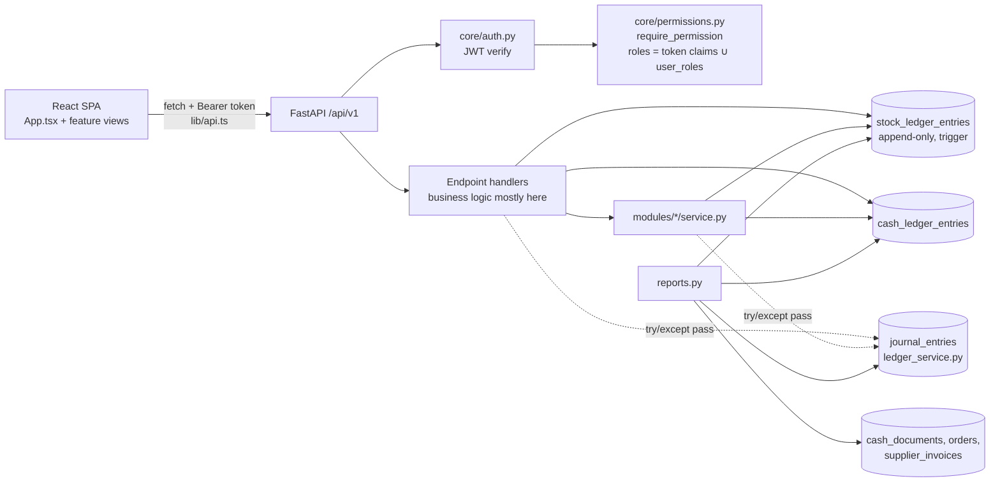

# QEMA ERP — Full Codebase Engineering Audit

> [!IMPORTANT]
> **وثيقة أرشيفية (2026-11-08):** هذا التدقيق كُتب قبل تحديثات 2026-11-09 و2026-11-10. كثير من بنوده
> الكبرى عُولجت بعدها (تشغيل CI للاختبارات الخلفية، ترحيل القيود داخل المعاملة دون ابتلاع الأخطاء،
> إزالة معادلات الرواتب المفترضة، قراءة الأدوار من جدول user_roles، إصلاح مرتجع العميل، فرض
> finance:cash:approve). يُقرأ لأغراض تتبع التاريخ فقط؛ مصادر الحقيقة الحالية هي
> `PRODUCT_REQUIREMENTS_AR.md` و`KNOWN_LIMITATIONS_AR.md` و`OPEN_DECISIONS_AR.md`.

- **Date:** 2026-11-08
- **Branch audited:** `feat/api-readiness-check`. HEAD is `1cdcb0c` plus a large uncommitted working tree: 49 modified files and 14 untracked paths, including migration `0016` and `ledger_service.py`.
- **Mode:** read-only. No application code, schema, migration, configuration or test file was changed, and no branch or commit was touched. The only file written is this report.

---

## 0. Method and how to read this report

- The lead reviewer mapped the repository, then ran five focused module reviews in parallel:
  - finance and the general ledger (GL);
  - inventory, catalog and stocktake;
  - production and payroll;
  - customers, reports and the task inbox;
  - authentication, role-based access control (RBAC), the frontend shell and CI.
- Every high-impact claim (all P0 items and most P1 items) was then **re-read by the lead reviewer in the source**. Line numbers below are checked against the current working tree.
- **Confirmed** means the code was read and proves the defect. **Confirmed (test)** means an executed test demonstrated it. **Suspected** means the defect is plausible from the code but depends on runtime conditions not observed.
- **No quality score is given.** There is no defensible way to collapse these findings into one number. Readiness is stated per workflow in §1 instead.
- **Coverage limits:** see §7.4.

---

## 1. Executive Summary

### Overall condition

The codebase is **well-intentioned and partly well-engineered at the infrastructure level**, but **unsound in its financial and manufacturing business logic**.

**What is genuinely good:**
- Strict test-database guards.
- An append-only stock ledger enforced by a database trigger.
- Advisory-lock-based negative-stock prevention.
- JWT validation with pinned algorithms.
- Hardened CORS.
- Sanitised 500 responses.
- Cash balances derived from a ledger rather than stored.

**What is bad**, each one verified in code:
1. **Two books that silently disagree.**
   - Treasury balances come from `cash_ledger_entries`. The trial balance, P&L and balance sheet come from `journal_entries`.
   - Payroll disbursement, petty-cash `/settle` and customer-delivery cost of goods sold (COGS) write to one book but not the other.
   - Every GL call is wrapped in `except HTTPException: pass`, so a missing account drops the GL entry while cash and stock commit anyway.
   - The financial statements cannot currently be trusted.
2. **The approval (maker-checker) control does not exist in practice.**
   - The only role that can approve cash documents (`finance_manager`) is explicitly exempted from the self-approval rule.
   - The developer's own acceptance test for this rule **fails** (§7).
   - The general manager holds `finance:cash:approve`, but no route checks that permission.
3. **Manufacturing cannot complete a real order lifecycle.**
   - Raw material moved into WIP is never consumed, so `/close` always returns 409 on real data.
   - Stages can be completed on a draft order, so finished goods can be received at zero cost without any material issue.
   - A multi-item order (normal for a clothing factory: several sizes) posts **all** finished goods into the **first** item's SKU and ownership bucket.
4. **Payroll computes real money from invented rules.** It uses hard-coded `/240`, `/30` and `×1.5` formulas, stores money as `Float`, makes no GL posting, and lets one person calculate and disburse. Disbursement is not concurrency-safe. `docs/OPEN_DECISIONS_AR.md` lists exactly these rules as unapproved.
5. **The privilege model will be exploitable the day Supabase auth is switched on.** Roles are read from `user_metadata`, which the end user can edit.
6. **Several user-facing workflows crash or dead-end:**
   - customer returns always return 500 (`TypeError`);
   - `/reports/accounts-receivable` always returns 500;
   - the stocktake UI cannot progress after "submit";
   - the task inbox never shows production tasks;
   - payroll is unreachable from the UI;
   - business error messages are replaced with generic ones, so operators cannot see *why* something was rejected.

### Structural readiness for supervised factory operation

| Workflow | Readiness |
|---|---|
| Catalog maintenance and approval | **Usable under supervision.** Watch the PATCH bypass (F-INV-07) and the GM-as-maker deadlock. |
| Production order creation, stage tracking, material dispatch and WIP receipt | **Usable under supervision, quantities only.** Stage-on-draft must be blocked operationally. |
| Finished-goods receipt | **Not ready.** Wrong SKU for multi-item orders; zero-cost receipts are possible. |
| Production order closure | **Not ready.** Cannot succeed with real data. |
| Customer orders and deliveries (stock side) | **Usable under supervision.** Locks and over-delivery checks are sound. |
| Customer returns | **Not ready.** Always 500 when priced. |
| Collections and receivables | **Not ready.** Three disagreeing receivable figures; no caps; no idempotency. |
| Treasury, custody, supplier payments | **Not ready for real money.** No effective maker-checker; custody can be closed while it still holds cash. |
| Stocktake | **Not ready via the UI.** Backend posting is sound but unusable without a freeze policy. |
| General ledger and financial statements | **Not ready.** Incomplete postings and swallowed errors. |
| Payroll | **Must not be used.** |
| Reports and dashboards | **Mixed.** Inventory report usable; several finance reports wrong or crashing; operations-board KPIs partly fabricated. |

**Verdict:** the system is **not structurally ready for a supervised pilot that touches money, payroll or production costing**. A narrowly scoped pilot is defensible only for catalog, production tracking (quantities, no costing, no closure) and dispatch/delivery quantities, with finance screens hidden and the GL treated as non-authoritative.

### Must be addressed before any wider deployment

The P0 items in §3, namely F-SEC-01, F-X-01, F-PRD-03 and F-PAY-01. Then the P1 approval, receivable and stocktake defects, CI that actually runs the backend tests, and a written decision on whether a GL is even in scope. `PRODUCT_REQUIREMENTS_AR.md:104` and `OPEN_DECISIONS_AR.md:126` exclude it, yet it is implemented in uncommitted migration 0016.

---

## 2. Repository Architecture Map

### 2.1 Technologies

| Layer | Stack |
|---|---|
| Backend | Python 3.12, FastAPI, SQLAlchemy 2 (async) with asyncpg, Pydantic v2, Alembic, PyJWT (JWKS) |
| Database | PostgreSQL 16 (docker compose for dev; a local instance on :5432 was observed) |
| Frontend | React 18, TypeScript, Vite 5, Vitest and Testing Library, optional Supabase JS client. No router library and no data-fetching library: hand-rolled state in `App.tsx`. |
| CI | GitHub Actions (`.github/workflows/ci.yml`): `api` and `web` jobs |
| Auth | Supabase JWT (RS256/ES256 via JWKS) **or** local dev HS256 tokens issued by `/auth/local-login` |

### 2.2 Repository inventory

Source size is about 37k lines, excluding lockfiles and CSS.

| Path | Responsibility | Important files | Condition |
|---|---|---|---|
| `apps/api/app/main.py`, `api/v1/router.py` | App entry, CORS, tracing, error handlers, router mount | — | Clean |
| `apps/api/app/core/` | config, auth (JWT), permissions (RBAC), errors, idempotency, tracing, migration guard | `permissions.py` (404), `auth.py` (294), `config.py` (216) | Good scaffolding. **Role resolution is unsafe** (F-SEC-01). Error handler hides business messages (F-X-05). |
| `apps/api/app/api/v1/endpoints/` | HTTP handlers. **Most business logic lives here.** | `catalog.py` (1668), `production.py` (1375), `reports.py` (1261), `customers.py` (1047), `finance.py` (871), `payroll.py` (420) | Fat handlers; FG receipt, close, delivery, return, custody settlement and payroll logic are all in handlers |
| `apps/api/app/modules/production/` | ORM for items, warehouses, stock ledger, orders, customers, employees and payroll (one 642-line `models.py`); production and stocktake services | `models.py`, `service.py` (994), `stocktake_service.py` (754) | "production" owns customers, employees and payroll models: unclear ownership |
| `apps/api/app/modules/finance/` | Cash accounts and documents, suppliers, GL (untracked) | `service.py`, `ledger_service.py` (untracked) | GL bolted on with keyword-based account selection |
| `apps/api/app/modules/customers/` | Orders, deliveries, returns, payments ORM and schemas | — | — |
| `apps/api/app/modules/identity/` | `user_roles` table | `models.py` | No admin API to manage it |
| `apps/api/alembic/versions/` | 16 linear migrations, 0001 to 0016 | `0016` untracked | Linear, no branch conflicts. Minor ORM drift (§3, F-DB-02). |
| `apps/api/tests/` | 22 test modules, about 237 tests, against a real Postgres test DB | `db_safety.py`, `conftest.py` | Strong DB-safety guard. GL tests mostly mock. CI cannot run them (F-CI-01). |
| `apps/api/scripts/` | Test-DB seeder, E2E dataset seeder (untracked) | — | E2E seed creates a **second** treasury (F-FIN-07) |
| `apps/web/src/App.tsx` | Shell, navigation, role-gated menu (843 lines) | — | Hand-copied permission map disagrees with backend (F-RBAC-02) |
| `apps/web/src/features/*` | Feature screens and per-feature API clients | Large views: `ItemDetailDrawer` (1448), `FinancialReportsView` (1289), `StocktakeDetailView` (1266), `OrderDetailModal` (1145), `ReportsView` (1124), `TreasuryView` (1033) | Real API calls, but `isDemo = !user \|\| roles.length===0` enables every action button for role-less users |
| `apps/web/src/features/operations-board/` | Chosen top-bar operations board | `mockData.ts` (types only) | Wrong status filters; derived and fabricated KPIs (F-PRD-10) |
| `apps/web/src/features/inbox/` | Task inbox (untracked) | — | Wrong statuses; swallowed errors (F-CUS-08) |
| `frontend/operations-board.html` | Static design reference | — | Tracked, intentional |
| `scratch/*.py` | Ad-hoc inspection scripts | — | **Tracked in git**, should not be |
| `docs/` | About 40 Arabic design, phase and report documents | — | Several reports claim completeness that the code contradicts |
| Not tracked (correctly) | `.env`, `apps/web/dist`, `qemma_api.egg-info`, root `node_modules` | — | Root `node_modules` is unexplained (no root `package.json`) |

### 2.3 Data flow

The dotted edges are the core architectural defect. The GL is a *best-effort side effect*, not part of the transaction contract, and reports read from **four** different sources of truth.

### 2.4 Authentication and authorization flow

1. The SPA obtains either a Supabase session token or a dev token from `POST /auth/local-login`. The dev token is a role picker with no credentials and an 8-hour expiry (`auth.py:165`).
2. `get_current_user` verifies the signature, issuer, audience and expiry (`core/auth.py:104-116`).
3. `require_permission(p)` resolves roles as the **union** of the token's `role`, `roles`, `user_roles`, `app_metadata.role(s)` and `user_metadata.role(s)` claims plus the DB `user_roles` table (`permissions.py:236-280`). It then maps roles to permissions through a static dictionary (`permissions.py:124-231`).
4. The frontend keeps its **own** hand-copied role-to-permission map (`AuthContext.tsx`) and reads roles from the token only.

### 2.5 Main business entities

- **Inventory:** `CatalogItem`, then `StockLedgerEntry`, keyed by (item, warehouse, location_type, bucket_reference). Balances are derived by SUM.
- **Production:** `ProductionOrder` has items, a materials snapshot, transfers, stage events and defects.
- **Sales:** `Customer` → `CustomerOrder` → lines → `CustomerDelivery` → `CustomerDeliveryReturn`; `CustomerPayment` (linked to an order only).
- **Cash:** `CashAccount` (treasury and petty cash) → `CashDocument` (income, expense, transfer; pending/approved/rejected) → `CashLedgerEntry`.
- **Purchasing:** `Supplier` → `SupplierInvoice` → lines and `SupplierPayment` (wraps a `CashDocument`).
- **GL:** `Account` → `JournalEntry` → `JournalEntryLine`.
- **Payroll:** `Employee`, `Attendance`, `PayPeriod`, `PayrollRun`.

---

## 3. Critical Findings

**Severity key:**
- **P0:** data loss, security compromise, financial corruption, or system-wide failure.
- **P1:** major workflow failure, authorization defect, or accounting/inventory inconsistency.
- **P2:** significant maintainability, reliability or usability issue.
- **P3:** minor.

All paths are relative to `apps/api/app/` unless they start with `apps/`, `.github/` or `docs/`.

### P0 — Critical

#### F-SEC-01 · P0 · Security / Authorization — Roles trusted from user-editable Supabase `user_metadata`
- **Location:** `core/permissions.py:259-269` (inside `get_user_roles`, used by every `require_permission`). Also see `permissions.py:278` (`except Exception:` swallows DB-role lookup failures).
- **What is wrong:**
  - Roles are read from `app_metadata` **and** `user_metadata`, and also from top-level `role`/`roles` claims.
  - They are unioned with DB roles, so a role in the DB can never *restrict* what the token claims.
- **Evidence:** `for meta_key in ("app_metadata", "user_metadata"): meta = claims.get(meta_key) … roles.add(r.strip().lower())`.
- **How it fails:**
  1. Supabase lets any signed-in user call `auth.updateUser({ data: { role: 'general_manager' } })`, which writes `user_metadata`.
  2. The next access token is legitimately signed by Supabase and passes every JWKS, issuer and audience check.
  3. The user now holds every GM permission.
- **Business impact:** any authenticated account, including any self-signup if signups are enabled, can approve stocktakes and catalog items, read payroll and treasury data, and post adjustments.
- **Fix direction:**
  - Resolve roles only from the `user_roles` table, or from server-controlled `app_metadata`.
  - Fail closed on DB errors.
  - Return effective roles and permissions from `/auth/me`, and drive the UI from that.
- **Status:** **Confirmed in code.** Exploitable when `SUPABASE_URL` is configured. The current local `.env` uses dev auth, so it is latent today.

#### F-X-01 · P0 · Financial integrity (cross-module) — Cash ledger and general ledger diverge; GL posting failures are silently swallowed
- **Location:**
  - Swallowed errors: `except HTTPException: pass` at `api/v1/endpoints/finance.py:328, 553, 736`, `customers.py:504, 851, 982`, `production.py:960, 1332`, `modules/production/service.py:578`.
  - Missing postings: `payroll.py` disburse (about lines 350-420; no `post_journal_entry` call); `finance.py` petty-cash `/settle` (about 614-664); `customers.py:483-505` (delivery posts only Dr1100/Cr4100). The grep for `"5100"` finds only the *return* credit (`customers.py:834`) and the P&L read (`reports.py:867`), never a debit.
- **What is wrong:**
  - The GL is not part of the transaction contract. Stock and cash movements commit even when their journal entry is rejected: missing or renamed account → HTTP 500 raised inside, unbalanced entry → 422, duplicate → 409.
  - Several flows never post to the GL at all.
- **Evidence:**
  - `customers.py:485` comment: `ترحيل قيود اليومية للتسليم: 1. تكلفة البضاعة المباعة COGS 2. استحقاق إيراد المبيعات` ("journal postings for delivery: 1. COGS 2. revenue recognition"). Only the revenue entry exists below it.
- **How it fails** (each case confirmed by tracing):
  - **Payroll disbursement:** treasury decreases, GL 1010 does not, and no salary expense is booked.
  - **Petty cash:** fund 3000, spend 1000, `/settle` 2000. The cash ledger shows the correct balances, but GL 1020 stays +3000 forever.
  - **Sales:** every sale credits revenue, but 1230 (finished goods) is never relieved and COGS is about 0. **Gross profit is overstated by the full cost of goods sold.**
  - **Missing account:** if any account code is missing in a fresh environment, stock and cash move with no GL trace and no error.
  - **Opening balances:** cash that existed before migration 0016 (or was seeded) has no GL counterpart.
- **Business impact:** the trial balance, P&L and balance sheet are wrong by construction and cannot be reconciled to treasury, which defeats the purpose of migration 0016.
- **Fix direction:**
  - Use one posting service that writes the cash or stock movement **and** its journal entry atomically, and never swallows a failure.
  - Add the missing COGS, payroll and settle entries.
  - Post opening balances.
  - Add a reconciliation check (GL 1010+1020 = Σ cash ledger; GL 1210/1220/1230 = Σ stock value).
  - First, decide whether the GL is in scope at all (see §10).
- **Status:** **Confirmed** (code re-read by lead reviewer).

#### F-PRD-03 · P0 · Inventory corruption — Finished goods of a multi-item order all land in the first item's SKU and bucket
- **Location:**
  - `modules/production/service.py:146-165`: the order header takes `product_id`/`variant_id` from the first item, and `target_quantity` is the sum across items.
  - `api/v1/endpoints/production.py:906`: `get_or_create_finished_goods_item(db, order.product_id, order.variant_id)`.
  - `production.py:911-916`: the bucket is taken from `order.order_items[0]`.
- **What is wrong:** finished-goods receipt is order-level, but orders are multi-item (sizes 56 to 64, factory-brand vs private-label).
- **How it fails:**
  - An order for 50 × size 56 and 50 × size 60 books 100 pieces of size 56 and zero of size 60.
  - Deliveries of size 60 are then refused, while size 56 shows phantom stock.
  - Private-label goods for customer B can land in the factory-brand bucket, or in customer A's bucket.
- **Business impact:** finished-goods stock is silently wrong in the normal case for a clothing factory, and ownership of private-label goods is corrupted.
- **Fix direction:**
  - Receive finished goods per `ProductionOrderItem` (variant plus bucket), with a cap and a cost per item.
  - Persist a finished-goods receipt document that records accepted and rejected quantities.
- **Status:** **Confirmed.**

#### F-PAY-01 · P0 · Payroll — Unapproved hard-coded pay rules, float money, no GL, single-actor disburse, double-pay race
- **Location:**
  - `api/v1/endpoints/payroll.py:260-271` (formulas).
  - `payroll.py:350-417` (disburse; `db.get(PayPeriod)` with no lock, status check at 359 before any lock).
  - All 10 routes use `require_permission("finance:manage")`.
  - `modules/production/models.py:469, 482, 506-511` (`Float` money).
  - Migration `0009`: no unique `(period_id, employee_id)`, no unique `(employee_id, attendance_date)`, no period-overlap constraint.
- **Evidence:**
  - `hourly_rate = round(emp.base_salary / 240.0, 2) if emp.base_salary > 0 else 25.0`
  - `daily_rate = … / 30.0 … else 200.0`
  - `overtime_amount = round(total_overtime_hours * hourly_rate * 1.5, 2)`
  - `net_amount = max(0.0, …)`
  - `finance:payroll:calculate` and `finance:payroll:disburse` are defined in `permissions.py`, but no route checks them.
- **How it fails:**
  - Real salaries are computed from rates the factory never approved (`docs/OPEN_DECISIONS_AR.md` §الرواتب, the payroll section).
  - A negative net is silently floored to 0.
  - Duplicate attendance rows double the deductions, and overlapping periods double the overtime.
  - Two concurrent disburse requests both pass the status check, and the second debits the treasury again. Its only backstop is the unique `(source_system, source_reference)` key on the cash document, which surfaces as a 500 if it triggers.
  - The disbursement creates a self-approved cash document and no GL entry.
- **Business impact:** wrong pay to real employees, possible double payment, no segregation of duties, GL drift. This also violates the AGENTS.md rule not to invent payroll rules.
- **Fix direction:**
  - Disable calculate and disburse until the rules are approved.
  - Then load the parameters from approved configuration.
  - Use `Numeric` and `Decimal`.
  - Map each route to its specific payroll permission and require a separate approver.
  - Lock the period row `FOR UPDATE` and re-check its status.
  - Add the unique and exclusion constraints.
  - Post Dr salaries / Cr 1010.
- **Status:**
  - Rules, float types, permissions and missing GL: **Confirmed.**
  - Race: **Confirmed by code reading, not reproduced.**
  - Note that the payroll UI currently cannot reach disburse (F-PAY-02), which is the only reason this has not been exercised.

### P1 — High

#### F-FIN-01 · P1 · Authorization / financial control — Maker-checker is void; GM cannot approve
- **Location:**
  - `modules/finance/service.py:158-164`.
  - `api/v1/endpoints/finance.py:117-125`: the decision route requires `finance:cash:manage`, which only `finance_manager` holds (`permissions.py:217`).
  - `finance:cash:approve` is granted to GM (`permissions.py:167`) but checked by **no** route.
- **Evidence:**
  - `is_finance_authority = bool(user_roles and user_roles.intersection({"finance_manager", "general_manager"}))`
  - `if not is_finance_authority and document.created_by == user_id: raise …`
  - The only role that can reach the route is exempt from the rule.
- **How it fails:**
  - One finance manager can do the whole chain alone: create supplier → create invoice → raise payment (allowed before receipt, up to `invoice_total`) → approve it. The treasury is debited and nobody else is involved.
  - The GM, who the docs name as approver, gets a 403.
- **Business impact:** no effective financial control over cash disbursement.
- **Fix direction:**
  - Gate the decision route on `finance:cash:approve`.
  - Enforce creator ≠ approver for every role until the factory decides otherwise (an open decision in `OPEN_DECISIONS_AR.md:117`).
  - Decide whether supplier payments may precede receipt.
- **Status:** **Confirmed (test).** `tests/test_task06_e2e_acceptance.py::test_01_auth_rbac_and_maker_checker` **fails**: it expects 409 and gets 200.

#### F-FIN-02 · P1 · Custody — Settlement can close a custody account that still holds cash, and self-approves
- **Location:** `api/v1/endpoints/finance.py:432-579`; the close is at about `:557`, and `approved_by = created_by` is at about `:505`.
- **What is wrong:**
  - `approved_expenses_amount` is supplied by the client and never reconciled with the actual ledger outflows.
  - The account is closed when the client-computed `remaining_unsettled_amount == 0`, regardless of its real ledger balance.
  - Earlier settlements are not subtracted from `original_custody_amount`.
- **How it fails:**
  1. A custody account is funded with 1000 and no expenses are recorded.
  2. The user declares expenses = 900 and returned = 100.
  3. The 100 is returned, and the account closes with **900 still on its ledger**.
  4. `/reports/summary` sums only *active* petty accounts, so the 900 disappears from the dashboard.
- **Business impact:** a direct path to conceal missing cash.
- **Fix direction:**
  - Derive expenses from the ledger.
  - Require ledger balance = returned + remaining.
  - Block closing while the balance is non-zero.
  - Require a second approver.
- **Status:** **Confirmed** (module review; route read).

#### F-FIN-03 · P1 · GL mapping — Petty-cash expenses credit the treasury account (1010) instead of petty cash (1020)
- **Location:** `modules/finance/service.py:242-254` (and the same pattern at `:79-91`).
- **Evidence:** the expense branch always posts `{"account_code": "1010", … "credit": document.amount}`, whatever `from_account.account_type` is. The transfer branch handles the account type correctly.
- **How it fails:** every custody expense approved through `/cash-documents` understates 1010 and overstates 1020.
- **Business impact:** the balance sheet's cash split is wrong.
- **Fix direction:** choose the credit account from the account type.
- **Status:** **Confirmed** (re-read).

#### F-FIN-04 · P1 · Approval bypass — `/finance/daily-expenses` auto-approves and accepts any account
- **Location:** `api/v1/endpoints/finance.py:684-740`.
- **What is wrong:**
  - It creates an already-approved document (`approved_by=current_user.id`).
  - It never checks that the account is a petty-cash account.
  - It always credits 1020.
  - `occurred_at` is supplied by the client, so it can be backdated.
- **How it fails:** passing the treasury id spends treasury cash with no approval and books the credit to the wrong GL account. No frontend calls this route, but it is live for `finance_manager`.
- **Fix direction:** restrict it to petty cash and route it through the pending → decision flow, or remove it.
- **Status:** **Confirmed** (module review).

#### F-FIN-05 · P1 · Purchasing — One receipt closes the invoice; over-receipt allowed; three different "payable" figures
- **Location:** `api/v1/endpoints/finance.py:268-333` (receive), `:247` (client-overridable `invoice_total`), `:356` (payment cap), `:158` (`balance_due`); `reports.py:134-140` (summary payables).
- **What is wrong:**
  - The status becomes `received` after the **first** receipt, so the rest of the invoice can never be received.
  - `received_quantity` is never compared with `invoiced_quantity`.
  - Payable is computed three ways:
    - the UI uses `invoice_total − paid`;
    - the dashboard uses Σ `invoice_total`, including invoices not yet received;
    - GL 2100 uses received value − payments.
  - `SupplierInvoiceLine` quantities are `Float`.
- **How it fails:**
  - Receiving 1000 m against 100 m invoiced inflates stock, 1210 and 2100.
  - If a payment is made before a short receipt, the overpayment is never flagged.
- **Business impact:** supplier liabilities are unknowable, and raw-material stock can be inflated.
- **Fix direction:**
  - Separate receipt documents with a partial status.
  - Cap each receipt at invoiced quantity minus already received.
  - Use one AP definition. The three-way-match rule is an open decision.
- **Status:** **Confirmed** (module review).

#### F-FIN-06 · P1 · Correctability — No reversal or cancellation for any financial document
- **Location:**
  - Statuses `reversed` (cash documents, journal entries) and `cancelled` (supplier invoices) exist in the CHECK constraints (migrations 0005, 0007, 0016), but no endpoint sets them.
  - `reversed_entry_id` is never written.
  - Customer orders have no cancel or edit endpoint either (`customers.py:385, 937` check `cancelled`, which is never set).
- **How it fails:** an approved mistake can only be corrected with direct SQL. That violates the project rule "لا تحذف أو تعدل مستند حركة معتمدًا بطريقة تمحو أثره" ("never delete or modify an approved movement document in a way that erases its trace").
- **Fix direction:** add documented reversal documents that post mirror entries.
- **Status:** **Confirmed.**

#### F-CUS-01 · P1 · Workflow crash — Priced customer returns always fail with HTTP 500
- **Location:** `api/v1/endpoints/customers.py:824-852` vs `modules/finance/ledger_service.py:43-53`.
- **Evidence:**
  - The call is `post_journal_entry(session=db, entry_date=date.today(), reference_type="customer_delivery_return", reference_id=return_doc.id, …)`.
  - The signature is `post_journal_entry(db, *, source_doc_type, source_doc_id, …)`.
  - This raises a `TypeError`, which `except HTTPException` does not catch.
- **How it fails:**
  - Any return with `unit_price > 0`, or with a positive average cost, returns a 500 and rolls back.
  - Once the call is fixed, both entries share the same `(source_doc_type, source_doc_id)`. The second (the revenue/receivable reversal) then gets a 409, which is silently swallowed.
  - The return also credits 5100 (COGS), which was never debited (see F-X-01).
- **Why tests pass:** `test_finished_goods_lifecycle.py` uses unpriced lines and a mocked cost lookup, so the journal call never runs.
- **Fix direction:**
  - Use the correct arguments.
  - Give the two entries distinct document types.
  - Remove the catch-all.
  - Add an endpoint-level test with priced lines.
- **Status:** **Confirmed** (re-read).

#### F-CUS-02 · P1 · Receivables — Discounts are ignored at revenue recognition; receivable figures disagree
- **Location:** `customers.py:486-489` (delivery revenue = Σ qty × unit_price, with no `discount_amount`), `customers.py:125-140` (account page: `total_amount − paid` with the discount), `reports.py:420-436` (statement: gross ordered value).
- **How it fails:**
  1. An order of 10,000 has a 1,000 discount.
  2. It is fully delivered and 9,000 is paid.
  3. The account page shows 0 due.
  4. GL 1100 shows 1,000 still owed, and revenue is overstated by 1,000.
  5. Before full delivery, all three receivable figures disagree.
- **Business impact:** customer balances cannot be trusted. Collections disputes are likely.
- **Fix direction:**
  - Use one receivable source: either a GL-derived or a customer subledger.
  - Allocate the discount at delivery.
  - The discount treatment itself is a business decision.
- **Status:** **Confirmed.**

#### F-CUS-03 · P1 · Report crash — `/reports/accounts-receivable` always returns 500
- **Location:** `api/v1/endpoints/reports.py:1076` (`Customer.is_active`), `:1087` (`CustomerPayment.customer_id`).
- **Evidence:**
  - The `Customer` model (`modules/production/models.py:448-458`) has `status` and no `is_active`.
  - `CustomerPayment` (`modules/customers/models.py:119-131`) has `order_id` only.
- **How it fails:** an `AttributeError` occurs at query build time, so the frontend AR tab (`FinancialReportsView.tsx`) is always broken. No test covers it.
- **Status:** **Confirmed** (re-read).

#### F-PRD-01 · P1 · Manufacturing — No production order can ever be closed with real data
- **Location:**
  - `modules/production/service.py:521` is the **only** writer of `bucket_reference=f"order:{order.id}"`. It writes positive quantities when WIP receives materials.
  - `api/v1/endpoints/production.py:1297-1310`: close requires that bucket to sum to 0, otherwise 409.
- **What is wrong:** no consumption, backflush or scrap movement ever drains the order's WIP bucket.
- **How it fails:** every real order stalls at `receipt_completed`. WIP raw-material quantities grow forever, while GL 1220 *is* credited at finished-goods receipt. The residual-WIP scrap branch is unreachable.
- **Why tests pass:** `test_wip_lifecycle.py` mocks a zero WIP balance.
- **Fix direction:** first decide **DEC-WIP-01** (backflush or actual consumption); then post consumption and remnant movements.
- **Status:** **Confirmed** (re-read).

#### F-PRD-02 · P1 · State machine — Stages can be completed on a draft order, producing zero-cost finished goods
- **Location:**
  - `modules/production/service.py:591-676`: `update_production_stage` never reads `order.status`; completing packing sets `manufacturing_completed`.
  - `production.py:877`: finished-goods receipt accepts that status.
  - The UI `OrderDetailModal.tsx` has no gate either.
- **How it fails:**
  1. Create an order.
  2. Click through all five stages without dispatching any material.
  3. Receive the finished goods: they post at unit cost 0.
  4. Dispatch is now blocked, because the status is no longer draft.
- **Business impact:** phantom finished goods, zero COGS, and skipped raw-material control.
- **Fix direction:**
  - Allow stage transitions only when the order is `in_production`.
  - Allow finished-goods receipt only after packing is complete and the materials receipt is confirmed.
- **Status:** **Confirmed** (module review).

#### F-PRD-04 · P1 · Costing — Finished-goods cost is materials-only and uses planned quantity and a diluted average cost
- **Location:**
  - `modules/production/service.py:553-562`: `total_material_cost = Σ mat.total_cost` (planned × average cost); `unit = total / target_quantity`.
  - `modules/finance/ledger_service.py:163-184`: the average-cost numerator filters `total_cost > 0`, but the denominator counts every positive quantity, including zero-cost stocktake surplus, WIP receipts and returns.
- **How it fails:**
  - The average cost is understated after any stocktake surplus.
  - WIP is charged the *planned* cost even when less material arrives.
  - When fewer pieces are produced than targeted, unit cost is understated and the difference lands in 5200, which is labelled direct labour.
  - Labour and overhead are never written. That is consistent with the scope decision, but the UI and reports present the result as "manufacturing cost".
- **Business impact:** COGS and finished-goods valuation are wrong, and the direction of the error depends on history.
- **Fix direction:**
  - Use one costing method applied on every inbound movement.
  - Base cost on the quantities actually received.
  - Label the figure as material cost only.
  - The valuation method is an **open decision**: `OPEN_DECISIONS_AR.md:126` says the system must not choose it. The code chose a WAC variant anyway.
- **Status:** **Confirmed.**
- **Note:** `service.py:554` sums **all** order materials on every transfer receipt. With a single dispatch per order that is correct today, but it would double-count once multiple transfers are allowed. **Suspected latent.**

#### F-INV-01 · P1 · Inventory integrity — Stocktake adjustments ignore buckets; finished-goods stock can go negative
- **Location:** `modules/production/stocktake_service.py:125-134` (the snapshot sums all buckets), `:556-586` (adjustments are written with a NULL bucket), `customers.py:435-446` (delivery checks only `factory_brand` or `private_label:{cust}`).
- **How it fails:**
  1. `factory_brand` holds 10 pieces.
  2. A count finds 7, and −3 is posted with a NULL bucket.
  3. Delivery still sees 10 in the bucket and ships 10. The warehouse total becomes −3.
  4. Surpluses become undeliverable.
  5. The stocktake book also counts goods awaiting return inspection as on hand.
- **Fix direction:** snapshot, count and adjust per (item, warehouse, bucket), or make buckets real locations. Add a guard against negative totals.
- **Status:** **Confirmed** (module review).

#### F-INV-02 · P1 · Frontend/backend contract — The stocktake UI dead-ends after "submit"
- **Location:**
  - Backend: `stocktake_service.py:341` (`status = "submitted"`), `:427` (line status `recount_required`).
  - Frontend: `apps/web/src/features/inventory/stocktakeApi.ts:48`, whose status union has no `submitted`. `StocktakeDetailView.tsx:435` shows approve and recount only for `under_review`.
  - `inventory.py:121` sets `needs_recount=(l.status == "needs_recount")`, which is never true.
- **How it fails:** after submit, no approve or recount action is shown, and recount lines are never highlighted.
- **Why tests pass:** the frontend tests mock `under_review` directly.
- **Fix direction:** one shared status enum, plus contract tests against real payloads.
- **Status:** **Confirmed** (re-read).

#### F-RBAC-01 · P1 · Segregation of duties — Producers confirm their own output; PM can close orders; finance figures reach PM
- **Location:**
  - `production.py:858`: finished-goods receipt uses `warehouse:confirm_receipt`, which PM also holds.
  - `production.py:1224`: close uses `production:orders:manage`. The GM-only `production:orders:close` permission is never used.
  - `reports.py:52-55`: `/reports/summary` requires only `reports:view`, which PM holds, but returns the treasury balance, petty-cash total, revenue, expenses and supplier payables.
  - Every other financial report requires `finance:reports:view`.
- **Business impact:**
  - The production manager can push their own output into finished goods and close orders.
  - Treasury figures are exposed outside finance.
- **Status:** **Confirmed** (module review).

### P2 — Medium

| ID | Category | Location | Problem and failure mode | Status |
|---|---|---|---|---|
| F-RBAC-02 | Frontend vs backend permissions | `apps/web/src/features/auth/AuthContext.tsx:27-115` vs `core/permissions.py:124-231`; `App.tsx:89,119,336-348`; `FinanceView.tsx:34`; `ReceiptsDisbursementsView.tsx:9,360` | Two hand-maintained role maps disagree. **Payroll is unreachable in the UI for every role.** No role sees the approve button in `FinanceView`. GM is told vouchers are "disbursed immediately" but gets a 403. WH is denied customers in the UI but allowed by the API. Users hit 403s or cannot find features. | Confirmed |
| F-RBAC-03 | Approval deadlock | `catalog.py:876-877, 1220`; `stocktake_service.py:389, 514` | Only GM can approve. If GM is also the maker, the item stays pending forever (the factory has a single GM). The policy is open (`OPEN_DECISIONS_AR.md:175`). | Confirmed (logic) |
| F-X-05 | Error handling | `core/errors.py:150-156`; consumer `apps/web/src/lib/api.ts:203-204` | Every `HTTPException.detail` is replaced by a generic status message. "Insufficient balance", "self-approval forbidden" and "exceeds remaining" all reach users as a generic conflict or forbidden. Operators cannot act on errors. | Confirmed (re-read) |
| F-SEC-02 | Configuration fails open | `core/config.py:17` (`app_env` defaults to `"development"`), `:153-158` (dev auth blocked only for production/prod/staging); `endpoints/auth.py:133-134`; `main.py` docs hidden only when `== "production"`; `db/session.py` `echo=(app_env=="development")` | If deployed with `APP_ENV` unset and `DEV_AUTH_ENABLED=true`, `POST /auth/local-login {"role":"general_manager"}` issues an 8-hour GM token with no credentials. If unset, SQL echo logs every statement and its values. If set to `prod`, Swagger is public. | Confirmed in code; impact depends on deployment |
| F-CI-01 | CI | `.github/workflows/ci.yml:57-69`; `apps/api/tests/conftest.py:17-23` | CI never sets `TEST_DATABASE_URL`, so conftest defaults it to `qemma_test_db`, which the CI Postgres service never creates or migrates. Migrations run *after* pytest and against the dev DB. DB-backed tests therefore cannot run in CI, and the migration and startup steps are skipped. Separately, the web job fails on lint (46 errors) and 4 failing tests (§7). **CI provides no protection today.** | Confirmed by reading; CI history not inspected |
| F-INV-03 | Stocktake operability | `stocktake_service.py:125-169` (snapshot at creation), `:532-543` (posting requires live = book) | There is no freeze and no re-snapshot. Any movement between opening and posting makes variance lines permanently unpostable. In a running factory this is almost always the case. | Confirmed |
| F-INV-04 | Stocktake controls | `stocktake_service.py:380, 389, 243, 45-63, 96-118` | A counter can approve their own counts. Approval is allowed while lines still need a recount. There is no row lock on count or review. Several sessions can be open per warehouse. `MAX+1` numbering races and produces a 500. | Confirmed |
| F-INV-05 | Valuation | `inventory.py:119-120,153`; `stocktake_service.py:556-586`; `reports.py:600`; `inventory.py:186` | Stocktake adjustments carry no cost and post no GL entry, and the UI shows a hard-coded cost impact of 0. Deactivated items that still hold stock vanish from valuation and counts. | Confirmed |
| F-INV-06 | Idempotency | `core/idempotency.py:64-71`; `inventory.py:404`; `StocktakeDetailView.tsx:289`; `productionApi.ts` | The lookup is keyed by `(operation_type, key)` only, and the resource is not compared. The stocktake-post hash excludes `stocktake_id`, so reusing a key replays A's result for B. The frontend generates a new key per click (`Date.now()`) or none at all, so retries are never deduplicated. | Confirmed |
| F-INV-07 | Catalog governance bypass | `catalog.py:684-745` | PATCH on an *approved* item can change `unit_id`, `item_type`, `is_consumable` and `is_active` with only manager permission and no history. `/deactivate` itself requires the approver. A unit change while orders or invoices reference the item mixes units in the ledger. The revision `base_fingerprint` is never checked at approval (`:1149, 1206-1275`), so stale revisions overwrite newer data. | Confirmed |
| F-INV-08 | Material receipt | `schemas.py:527`; `service.py:506-533`; migration 0006 `CHECK (quantity <> 0)` | Receiving 0 on a line breaks the CHECK and returns a 500 for the whole receipt. Receiving more than dispatched creates stock out of nothing (offset only by a negative discrepancy bucket). Unknown item ids are silently ignored. | Confirmed |
| F-INV-09 | Finished-goods UI | `apps/web/src/features/inventory/FinishedGoodsView.tsx:143-158, 205` | The variant balance lookup never matches the real item code `FG-VAR-{uuid}` or the name pattern, so every variant shows "out of stock". The "available" total mixes all buckets. | Confirmed |
| F-CUS-04 | Returns lifecycle | `customers.py:394-404, 784, 808-822`; `_order_payload` 76-156 | Returns are not netted in the remaining-to-deliver figure, so a returned order can never be re-delivered. Returned goods sit in `return_pending_inspection` with no endpoint to release or scrap them. The frontend has no return UI. | Confirmed |
| F-CUS-05 | Collections | `customers.py:926-989` | No cap against the balance, no lock and no idempotency, so a double click creates two receipts and two treasury entries. `bank_transfer` is booked into the cash treasury (1010). The JE date is "now" instead of `received_at`. Advances drive account 1100 negative. | Confirmed |
| F-CUS-06 | Pending deliveries | `customers.py:229-239` vs `435-446` | The list sums all buckets while delivery checks one bucket, so the UI enables Dispatch and the backend then returns 409. The GET also creates catalog items during a read. | Confirmed |
| F-FIN-07 | Multiple treasuries | `finance.py:37-47` (canonical id) vs `payroll.py:371`, `reports.py:72`, the customer-payment fallback ("first active treasury"); `scripts/seed_e2e_dataset.py` creates `MAIN-TREASURY-01` | Different flows draw from different treasuries in no fixed order, so balance checks fail or money lands in the wrong place. | Confirmed |
| F-FIN-08 | Free-text `source_system` | `modules/finance/schemas.py:15`; `service.py:217-228` | The generic endpoint can impersonate `customer_payment` (cutting GL 1100 with no `CustomerPayment` record) or pre-empt the payroll unique key, which later surfaces as a 500 on disburse. | Confirmed |
| F-FIN-09 | Inactive accounts | `service.py:181-184` | An approval can move cash into a custody account that has already been closed. | Confirmed |
| F-FIN-10 | `/settle` on an empty account | `finance.py:~639` | A zero-amount document violates `ck_cash_documents_amount_positive`, so an emptied account cannot be closed and the user gets a 500. | Confirmed |
| F-FIN-11 | GL classification | `service.py:80, 93, 230, 243`; `ledger_service.py` | The expense and revenue account is chosen by Arabic **keywords in the description** (`صيانة`, `تشغيل`, `إنتاج`, `مبيعات`). Owner capital is booked as revenue (4200). JE `entry_date` is always now while cash reports use `occurred_at`, so backdated documents fall into different periods. | Confirmed |
| F-RPT-01 | Report consistency | `reports.py:82-96, 231-247` vs `:815+` | The dashboards treat cash collections as revenue, while the P&L uses GL 4100 (recognised at delivery). The same screen family shows two different profit figures, and neither is correct (F-X-01). | Confirmed |
| F-PRD-05 | Production gaps | `production.py` and `service.py` | No cancel. Material dispatch happens only once (no partial or extra issue, e.g. for repair). `rejected_quantity` is not persisted and `accepted + rejected ≤ received` is checked only in the UI. Defects can be added to closed orders. A stage rollback reopens a **closed** order (`service.py:679-729`). Order number is `count(*)+1`, so concurrent creates collide with a 500. | Confirmed |
| F-PAY-02 | Payroll UI | `apps/web/src/features/payroll/PayrollConceptView.tsx:168`; `payrollApi.ts` | The disburse button needs status `calculated`, which the backend never sets. There is no UI to create employees, attendance or periods. Labels include `on_leave`, which the backend does not accept. | Confirmed |
| F-PRD-10 | Operations board shows invented figures | `apps/web/src/features/operations-board/OperationsBoard.tsx` (status filters about l.120, 193, 207); `production.py:995-1064` | It filters on `in_progress` and `pending`, which are not order statuses, so the "running orders" count is always 0. "Done pieces" = target × stages/5, a fabricated figure. Deliveries are hard-coded to `[]`. The performance endpoint returns constant `overall_cycle_avg_hours=8.5`, `delayed=0` and fixed stage durations **presented as measured KPIs**. | Confirmed |
| F-CUS-08 | Task inbox | `apps/web/src/features/inbox/taskInboxApi.ts:136,208,224` and every `catch {}` | It filters production orders on `confirmed` and `in_progress`, which never occur, so the production manager's inbox is always empty. Failed fetches show "no tasks" with no error. Lists are fetched in full up to three times. No customer tasks. Untracked and untested. | Confirmed |
| F-DATA-01 | Numeric types | `modules/production/models.py:223-511` (quantities and payroll as `Float`); `SupplierInvoiceLine` quantities as `Float`; all report and response schemas `float(...)`; frontend `Number()` sums | Quantities and all payroll money use binary floats. Costs are Decimal, but quantity × cost mixes the types. Rounding drift and inexact equality checks follow (e.g. `remaining_wip != 0.0`). | Confirmed |
| F-ARCH-01 | Fat handlers and duplicated balance logic | `catalog.py` (1668), `production.py` (1375), `customers.py`, `finance.py`; balance `SUM` reimplemented in about 7 places with different bucket filters (`service.py:373`, `stocktake_service.py:66,125`, `inventory.py:187`, `customers.py:435`, `production.py:885`, `reports.py:605`) | Business rules live in HTTP handlers with no service layer, and each copy of the balance query filters differently. F-INV-01 and F-CUS-06 come directly from this. | Confirmed |
| F-GOV-01 | Scope governance | migration `0016` and `modules/finance/ledger_service.py` (both **untracked**); `docs/PRODUCT_REQUIREMENTS_AR.md:104-105`; `OPEN_DECISIONS_AR.md:126` | A general ledger, chart of accounts and costing were implemented although the product scope explicitly excludes general accounting, and the decision log states those approvals "do not represent approval of general accounting or ledger entries". `AGENTS.md` requires written approval. | Confirmed |
| F-GOV-02 | Working-tree hygiene | git status | 63 changed or untracked paths, including a schema migration, sit uncommitted on a branch named `feat/api-readiness-check` that is unrelated to most of them. Losing or partially committing this tree would be costly, and review is impossible at this size. | Confirmed |

### P3 — Low

| ID | Location | Problem |
|---|---|---|
| F-SEC-03 | `core/auth.py:104` | A synchronous `PyJWKClient` fetch runs inside an async dependency. Unknown `kid` values can trigger blocking fetches (once Supabase is enabled). **Suspected.** |
| F-SEC-04 | `AuthContext.tsx` (dev token), `lib/supabase.ts` (`persistSession`) | Bearer tokens are kept in localStorage, and `index.html` has no CSP. |
| F-SEC-05 | `core/migration_guard.py`, `tests/db_safety.py` | Error messages interpolate the full DB URL, including the password, on malformed-URL or guard failures, so it can be printed to CI or console output. |
| F-SEC-06 | `endpoints/auth.py:100-106` | `/auth/config` returns `app_env` to unauthenticated callers. There is no rate limiting anywhere. |
| F-DB-01 | migrations 0012, 0015, 0016 | `ON DELETE CASCADE` on approval history, stocktake audit logs and `journal_entry_lines`. The journal tables have **no immutability trigger**, unlike the stock ledger. The stock-ledger trigger does not block `TRUNCATE`. |
| F-DB-02 | ORM vs migrations | Several CHECKs and indexes exist only in migrations (`StockLedgerEntry` CHECKs, `ix_journal_entries_source`, `ix_cash_ledger_account_id`), so autogenerate would propose dropping them. There is no unique `(source_doc_type, source_doc_id)` on journal entries; duplicate prevention is check-then-insert. |
| F-RPT-02 | `reports.py:59-69, 229, 336, 709, 832` | Periods are rolling UTC windows (e.g. "monthly" = the last 30 days), not Cairo calendar periods. There is no date-to filter and no pagination, and queries are N+1 per account and item. |
| F-FE-01 | multiple views | `isDemo = !user \|\| roles.length===0` enables every action for an authenticated user without roles. The backend still enforces, so the result is a stream of 403s. `SupplierPurchasingView.tsx:279-283` shows "paid and posted" when the payment is still pending. |
| F-REPO-01 | `scratch/*.py` | Ad-hoc scripts are tracked in git. A root `node_modules` exists with no root `package.json`. |

---

## 4. Module-by-Module Assessment

### Auth and RBAC
- **Works:**
  - JWT signature, algorithm, issuer, audience and expiry are enforced.
  - The dev-token issuer is separate and the secret length is validated.
  - Every non-system route has a `require_permission` dependency. **No state-changing route is unprotected.**
  - Denials are logged with the request id.
- **Incomplete:**
  - No user or role administration API (`admin:users:manage` is unused).
  - No per-warehouse scoping, although each of the three warehouses has its own custodian in the requirements.
- **Fragile:**
  - Role resolution (F-SEC-01).
  - Permissions that are defined but never checked: `finance:cash:approve`, `finance:payroll:*`, `production:orders:close`/`create`, `catalog:*`, `pricing:manage`.
- **Duplicated:** the frontend role map (F-RBAC-02).
- **Risky to change:** `permissions.py` is imported by every endpoint, and tests override `get_current_user` globally.

### Catalog and taxonomy
- **Works:**
  - Dual status (classification and approval) with a DB CHECK enforcing "active ⇒ approved".
  - Revision workflow and maker ≠ checker on approval.
  - Ledger-reference guards before structural edits.
- **Incomplete:** governance is bypassable through PATCH; revision fingerprint not validated (F-INV-07).
- **Fragile:** 1668-line handler file; the guard logic is copied three times.
- **Risky to change:** the item codes `FG-VAR-…` generated in production are relied on implicitly by the frontend (and broken there, F-INV-09).

### Inventory and stock ledger
- **Works:**
  - Append-only ledger enforced by trigger (0014) and tested on Postgres.
  - Sorted advisory locks for (item, warehouse) on dispatch, delivery, finished-goods receipt and stocktake post.
  - Source-document references on every row.
  - Balances derived, never stored.
- **Incomplete:**
  - No manual receipt or issue, opening balance, or inter-warehouse transfer.
  - No WIP consumption.
  - Buckets are a string convention, not a modelled concept.
- **Fragile:**
  - Non-negative stock is not a DB constraint. It depends on every writer remembering the lock, and the lock silently does nothing on non-Postgres (`service.py:~324`).
  - Float quantities.
  - Seven copies of the balance query.

### Stocktake
- **Works:** double-post prevention (`FOR UPDATE` plus a status check); a live balance check at posting.
- **Broken or fragile:**
  - The UI contract (F-INV-02).
  - No freeze (F-INV-03).
  - Weak controls (F-INV-04).
  - No valuation or GL (F-INV-05).
  - Bucket-blind (F-INV-01).

### Production and WIP
- **Works:**
  - Order creation with a frozen material snapshot.
  - Strict stage sequence, with a single-step rollback that requires a reason and keeps history.
  - Dispatch with locks and a shortage check (per the 2026-10-30 decision).
  - Finished-goods receipt capped at target under a row lock.
  - Backend idempotency support.
- **Broken:**
  - Closure (F-PRD-01).
  - Stage-on-draft (F-PRD-02).
  - Multi-item finished goods (F-PRD-03).
  - Costing (F-PRD-04).
- **Incomplete:** cancel; partial or extra issue; scrap movements; the close UI (no frontend calls `/close` or `/wip-summary`).
- **Duplicated:** finished-goods receipt and close are large handler blocks; WIP and received-goods sums are repeated three times; the stage list is redefined at `production.py:136`.

### Customers and sales
- **Works:**
  - Delivery locks the order, item and bucket, and blocks over-delivery and negative stock.
  - Over-return is blocked per delivery line.
  - Return idempotency with a request fingerprint is well done.
  - Order validation (variant matches product, discount ≤ total).
- **Broken:**
  - Priced returns (F-CUS-01).
  - Receivable figures (F-CUS-02).
  - AR report (F-CUS-03).
  - Re-delivery after a return (F-CUS-04).
- **Incomplete:** cancel or edit order; return disposition; refund or credit note; credit limit; price lists (`pricing:manage` not enforced, so WH can set any price or 100% discount).

### Finance: treasury, custody and supplier purchasing
- **Works:**
  - `decide_cash_document` locks the document and accounts in sorted order, checks the balance, and blocks a second decision.
  - Supplier-payment creation locks the invoice and caps pending plus approved amounts.
  - Unique `(source_system, source_reference)`.
  - Correct transfer and supplier-payment GL mapping.
- **Broken:**
  - Maker-checker (F-FIN-01).
  - Custody settlement (F-FIN-02).
  - Petty GL mapping (F-FIN-03).
  - Daily-expense bypass (F-FIN-04).
  - Receiving (F-FIN-05).
  - Reversals (F-FIN-06).
- **Fragile:** keyword-based GL; several treasuries in use.

### General ledger
- **Works:**
  - `post_journal_entry` enforces debit = credit and non-zero totals.
  - DB CHECKs enforce one side per line and non-negative amounts.
  - Trial balance and balance sheet read the GL correctly.
- **Broken:**
  - Incomplete posting coverage and swallowed errors (F-X-01).
  - No immutability (F-DB-01).
  - No period close.
  - No reconciliation.
  - Out of approved scope (F-GOV-01).

### Payroll
- **Works:** basic CRUD; a single commit per request; a treasury balance check (without a lock).
- **Everything else** is unsafe or unapproved (F-PAY-01, F-PAY-02).

### Reports and dashboards
- **Works:**
  - No SQL injection: the only `text()` call is parameterised.
  - The inventory report has no cost leakage.
  - Trial balance and balance sheet are correct relative to the GL.
- **Broken:**
  - AR (F-CUS-03).
  - Cash-vs-accrual contradictions (F-RPT-01).
  - Finance data in `/summary` exposed to PM (F-RBAC-01).
  - Fabricated performance KPIs (F-PRD-10).
  - UTC rolling windows.

### Frontend shell
- **Works:**
  - Real API calls across features; `mockData.ts` is imported for types only.
  - Loading, error and empty states are present in most views.
  - The token is attached only to the API origin.
  - No secrets in `VITE_*`.
- **Broken or fragile:**
  - The 843-line `App.tsx` doing routing, navigation and permission gating by hand.
  - A duplicated permission map.
  - `isDemo` fail-open.
  - Generic error messages (caused by F-X-05).
  - 46 lint errors, many of them `any` in production and stocktake views.

---

## 5. Cross-Module Problems

1. **Multiple sources of truth for money.**
   - Treasury comes from `cash_ledger_entries`.
   - Statements come from `journal_entries`.
   - Dashboards come from `cash_documents`.
   - Receivables come from order lines (without returns), order totals (with discount), or the GL (delivered value without discount).
   - Payables come from `invoice_total` or received value.

   None of these is reconciled to the others (F-X-01, F-CUS-02, F-FIN-05, F-RPT-01).
2. **Inventory and GL divergence.**
   - WIP quantity is never relieved, but GL 1220 is.
   - Finished-goods stock is relieved on delivery, but GL 1230 never is.
   - Stocktake moves quantity with no value and no GL.
   - Stock-ledger WIP rows have zero cost while GL WIP holds the cost.
3. **Inconsistent approval architecture.**
   - Cash: one role, self-approval allowed.
   - Catalog and stocktake: GM only, with self-approval blocked, which deadlocks when GM is the maker.
   - Payroll and daily expenses: no approval at all.
   - Custody settlement and customer collections: self-approved.
   - Production close and finished-goods receipt: no separation from the producer.
4. **Frontend and backend permission disagreement.** Two maps maintained by hand (F-RBAC-02), plus a frontend that reads roles only from the token while the backend unions token and DB roles.
5. **Status enum drift across layers.**
   - Stocktake: `submitted` and `recount_required` vs the UI's `under_review` and `needs_recount`.
   - Production: `in_production` vs the board and inbox's `in_progress`, `pending` and `confirmed`.
   - Payroll: `calculated` is never set.
   - Attendance: `on_leave` vs `late`.

   There is no shared enum and no contract test. This is the single most common cause of the "screen does nothing" defects.
6. **The bucket concept is implicit.** Ownership and inspection state live in a free-text `bucket_reference`, with seven balance queries that filter it differently.
7. **Unclear module ownership.** `modules/production/models.py` owns customers, employees, payroll, items and the stock ledger. Finance imports production models, customers endpoints import finance's ledger, and reports import everything. Changes ripple unpredictably.
8. **Errors are swallowed in both directions.** The backend swallows GL failures and the error handler swallows business messages. The frontend inbox swallows fetch failures. Failures become invisible at every layer.

---

## 6. Security Findings

### Confirmed vulnerabilities (in code)

| ID | Severity | Summary | Exploitability today |
|---|---|---|---|
| F-SEC-01 | P0 | Privilege escalation through `user_metadata` roles | Latent until Supabase auth is configured, then trivial |
| F-FIN-01 | P1 | Single-actor cash disbursement (maker-checker void) | Live: any `finance_manager` |
| F-PAY-01 | P0 | Single-actor payroll calculate and disburse with no approval | Live via API (UI blocked) |
| F-FIN-02, F-FIN-04 | P1 | Custody settlement can hide cash; daily expense bypasses approval | Live via API for `finance_manager` |
| F-RBAC-01 | P1 | Producer confirms own output; treasury figures exposed to PM | Live |

### Potential risks (depend on deployment or configuration)

- **F-SEC-02:** fail-open `APP_ENV` gives credential-less GM tokens if dev auth is left enabled on a server; SQL echo logs data values.
- **F-SEC-03:** blocking JWKS fetch can be triggered by forged `kid` values.
- **F-SEC-04:** localStorage tokens with no CSP (XSS → token theft).
- **F-SEC-05:** DB password printed in guard error messages.
- **No rate limiting** on any endpoint.

### Verified as sound
- Algorithm pinning (RS256/ES256 for Supabase, HS256 only for the local issuer).
- Required `exp`, `iss`, `aud` and `sub` claims.
- CORS rejects `*` and `null` with explicit methods and headers.
- Request-id sanitisation.
- 500s and validation errors do not leak exception text or input values.
- No tokens in logs.
- No secrets in `VITE_*` variables.
- `.env` is not tracked; `.env.example` has placeholders only.
- No raw SQL interpolation found.
- No file-upload endpoints exist, so there is no upload attack surface.
- No password storage: the local login is a role picker, gated by environment.

### Not verified
- Dependency CVEs: `npm audit` and `pip-audit` were not run (network and tooling).
- Supabase project settings (signup enabled, RLS): there is no access to the project.

---

## 7. Testing and Verification Report

### 7.1 Executed

All runs were against the local, isolated test database `qemma_test_db` on localhost. It was already migrated to `20261106_0016`, which a read-only query confirmed. The `db_safety` guard requires a localhost host and a database name containing "test". **Note:** running the suite inserts test rows into that disposable test DB. No dev or production database was touched.

| Command (cwd) | Result |
|---|---|
| `TEST_DATABASE_URL=postgresql+asyncpg://…@localhost:5432/qemma_test_db .venv/Scripts/python.exe -m pytest tests/ -q -p no:cacheprovider -rfEs` (`apps/api`) | **236 passed, 1 failed, 0 skipped, 0 deselected** (99 s). Failed: `test_task06_e2e_acceptance.py::test_01_auth_rbac_and_maker_checker`, expected 409 on self-approval and got 200 (F-FIN-01). 2 RuntimeWarnings (an un-awaited `Connection._cancel`). |
| `npx vitest run --config vitest.config.ts` (`apps/web`) | **9 files: 8 passed, 1 failed. 65 tests: 61 passed, 4 failed**, all in `src/features/navigation.test.tsx`: "renders dropdown groups for Warehouses and Finance in Sidebar", "navigates to Finished Goods warehouse view", "navigates to Finance sub-pages…", "hides financial reports from sidebar when authenticated as warehouse_manager". They cannot find the `الخزنة` (treasury) and `تقرير أرصدة المخزون` (stock-balance report) buttons, or an architecture banner text, so the tests and the current navigation have diverged. |
| `npx tsc --noEmit` (`apps/web`) | No errors reported |
| `npx eslint . --report-unused-disable-directives --max-warnings 0` (`apps/web`) | **46 errors** (mostly `no-explicit-any` and unused variables in `StocktakeDetailView.tsx`, `OrderDetailModal.tsx`, `NewOrderModal.tsx` and the tests). The CI `web` job would fail. |

### 7.2 Not executed
- `npm run build`: it writes `dist/`. Type-checking was run instead.
- `alembic upgrade` or `downgrade`: they would mutate a database. Migration correctness was assessed by reading.
- The GitHub Actions run history: `gh` is not available.
- Dependency vulnerability scans.
- Browser or UI checks against a running app. Frontend findings come from code reading and unit tests.
- Concurrency tests. Every race listed is from code reading, not reproduction.

### 7.3 Test-suite quality
- **Strong:**
  - Real-Postgres tests for ledger immutability, advisory-locked negative-stock prevention, catalog governance and DB-safety guards.
  - Route-level authorization denial tests.
- **Weak:**
  - `test_financial_posting.py` "workflow" tests call `post_journal_entry` directly or with mocks, and hand-post a `customer_delivery_cogs` entry that the real endpoint never creates. **No test asserts the GL output of a real endpoint.**
  - The WIP close success path mocks a zero WIP balance (F-PRD-01).
  - The returns test uses unpriced lines and a mocked cost lookup (F-CUS-01).
  - Frontend stocktake tests mock statuses that the backend never emits (F-INV-02).
  - `test_payroll.py` has 4 tests and none covers the formulas, concurrency or overlap.
- **Missing entirely:**
  - `/reports/accounts-receivable` and `/reports/customer-statement`.
  - Multi-item finished-goods receipt.
  - Stage progression on a draft order.
  - Stocktake bucket interactions.
  - Custody settlement with fabricated expenses.
  - Partial and over-receipt from suppliers.
  - Concurrent disburse, payment or collection.
  - Idempotency key reuse across resources.
  - Trial balance vs cash-ledger reconciliation.
  - Any test for the task inbox.
  - Any frontend contract test against real API payloads.
- **CI:** the backend suite cannot run in CI as configured (F-CI-01), so the 236 passing tests protect nothing on push.

### 7.4 Coverage of this audit
- **Inspected:** all backend endpoints, services, models and migrations; core modules; CI; the test infrastructure; the frontend feature modules for finance, inventory, catalog, production, customers, reports, inbox, operations board, payroll and auth; `App.tsx`; `lib/api.ts`.
- **Only lightly or not inspected:**
  - `MachineryView.tsx` and `WarehouseGuideView.tsx`.
  - The CSS files: RTL layout was not visually verified.
  - `frontend/operations-board.html`.
  - Most of the 40 documents in `docs/`, which were used only for scope and decision cross-checks.
  - `scripts/seed_e2e_dataset.py`, apart from its treasury creation.

---

## 8. Technical Debt Inventory

| Debt | Cost of leaving it |
|---|---|
| Business logic in HTTP handlers (`catalog.py`, `production.py`, `customers.py`, `finance.py`, `payroll.py`) | Every rule change touches 1000+ line files. Rules cannot be reused across endpoints or tested without HTTP, and duplication grows (seven balance queries already). |
| GL as a best-effort side effect | Every new flow will repeat the `try/except pass` pattern, and the books will diverge further. |
| No shared status enums or API contract | The "button does nothing" class of defects recurs with every change. |
| Hand-copied permission map in the frontend | Every permission change needs two edits, and they will keep drifting. |
| Float quantities and payroll money | Rounding drift and inexact zero checks. The later migration to Numeric gets harder as data accumulates. |
| Buckets as free text | Ownership and inspection logic is spread across string formats. |
| `modules/production/models.py` as a catch-all | Unclear ownership; circular conceptual dependencies between finance, production and customers. |
| Non-functional CI | Regressions reach `main` unnoticed. |
| 40 phase and report documents that claim completeness | New contributors, and AI assistants, trust the docs over the code. Several documents describe behaviour that is broken. |
| Defined-but-unused permissions (`finance:cash:approve`, `finance:payroll:*`, `production:orders:close`, `catalog:*`, `pricing:manage`) | They give a false sense of segregation of duties. |
| Generic error responses | Support cost: every rejection needs a developer to read the logs. |
| Large uncommitted working tree | Risk of loss; impossible to review; the migration may be applied in some environments and not others. |

---

## 9. Recommended Remediation Roadmap

### Immediate blockers (before anyone uses money, payroll or costing screens)
1. **F-SEC-01:** stop trusting `user_metadata` and token role claims. Use DB roles only, and fail closed.
2. **Commit hygiene (F-GOV-02):** split the working tree into reviewable commits on correctly named branches, so that migration 0016 is not applied anywhere in an unreviewed state.
3. **Scope decision (F-GOV-01):** decide whether the GL is in scope.
   - If **not**, hide the GL reports and treat the GL as non-authoritative.
   - If **yes**, fix F-X-01 first: atomic posting, no swallowed errors, the missing COGS, payroll and settle entries, opening balances, and a reconciliation check.
4. **Disable payroll calculate and disburse (F-PAY-01)** until the rules are approved.
5. **Maker-checker (F-FIN-01):** gate the decision route on `finance:cash:approve`, remove the role exemption, and enforce creator ≠ approver. Close the custody-settlement (F-FIN-02) and daily-expense (F-FIN-04) bypasses.
6. **Fix CI (F-CI-01):** create and migrate the test DB before pytest, then fix the 46 lint errors and the 4 navigation tests, so that checks actually gate merges.

### Before a supervised pilot
- **Production:**
  - Status guards on stages and finished-goods receipt (F-PRD-02).
  - Per-item finished-goods receipt (F-PRD-03).
  - A WIP consumption rule and a working close (F-PRD-01). This depends on DEC-WIP-01.
- **Customers:**
  - Fix returns (F-CUS-01).
  - One receivable definition (F-CUS-02).
  - AR report (F-CUS-03).
  - Collection cap, lock and idempotency (F-CUS-05).
- **Stocktake:**
  - Fix the UI status contract (F-INV-02).
  - Bucket-aware adjustments (F-INV-01).
  - A freeze policy (F-INV-03).
  - Counter ≠ approver (F-INV-04).
- **Error messages:** pass through safe business errors (F-X-05).
- **Permissions:** serve effective permissions from `/auth/me` and delete the frontend map (F-RBAC-02). Fix the PM close, finished-goods receipt and summary exposure (F-RBAC-01).
- **Dashboards:** remove fabricated KPIs from the operations board and performance endpoint, or label them as targets (F-PRD-10). Fix the inbox status filters (F-CUS-08).

### Before production deployment
- Reversal documents for every financial and stock document (F-FIN-06).
- Supplier partial receipt and the AP definition (F-FIN-05).
- Resolve a single treasury everywhere (F-FIN-07).
- Whitelist `source_system` (F-FIN-08).
- Move quantities and payroll to `Numeric` (F-DATA-01).
- Bind idempotency to the resource; generate keys per user intent (F-INV-06).
- Close the catalog PATCH bypass (F-INV-07).
- Strict `APP_ENV` enum; no dev auth off-loopback; SQL echo behind a separate flag (F-SEC-02).
- Journal immutability trigger; remove the cascades on audit and history tables (F-DB-01).
- Cairo-local calendar periods in reports (F-RPT-02).
- Endpoint-level GL assertion tests, concurrency tests, and frontend contract tests.

### Long-term architecture
- Extract a domain service layer per module (inventory movements, cash posting, sales) and make handlers thin.
- Introduce a single "movement posting" abstraction that writes the stock or cash ledger **and** the journal in one transaction, with reconciliation reports.
- Model ownership buckets and inspection state as first-class locations.
- Generate frontend types and enums from the OpenAPI schema.
- Split `modules/production/models.py` by bounded context: inventory, production, sales, HR.

**Dependencies between these steps:**
- F-X-01 depends on the GL scope decision.
- F-PRD-01 depends on DEC-WIP-01.
- F-PRD-04 depends on the valuation-method decision.
- F-PAY-01 depends on the payroll rules.
- F-FIN-01 depends on the maker-checker policy.

Do not start these until the corresponding decision in §10 is made.

---

## 10. Questions Requiring Business Decisions

These are only the decisions the code cannot settle by itself. Each one blocks the finding noted.

1. **Is a general ledger in scope?** The product docs exclude it; the code (uncommitted) implements it. → F-GOV-01, F-X-01
2. **Maker-checker policy for cash:**
   - Must creator ≠ approver always hold?
   - Who approves: GM, finance manager, or either?
   - Is there an amount threshold?
   - May the GM approve a document the GM created?

   → F-FIN-01, F-RBAC-03 (`OPEN_DECISIONS_AR.md:117, 175`)
3. **Payroll rules:** how hours and days are valued, overtime multiplier, absence and delay deductions, advances, rounding, and who approves disbursement. → F-PAY-01
4. **WIP material consumption method:** backflush on finished-goods receipt vs logged actual consumption, and what happens to remnants and residual WIP at closure. → F-PRD-01 (DEC-WIP-01, -03, -07)
5. **Inventory valuation method:** weighted average, FIFO, or standard cost. Is a manufacturing cost of materials only acceptable, or must labour and overhead be allocated? → F-PRD-04, F-INV-05
6. **Revenue recognition and receivables:**
   - Is revenue recognised at delivery or at invoicing?
   - How do order discounts apply to partial deliveries?
   - Are advance payments allowed, and how are overpayments and credit balances settled?

   → F-CUS-02, F-CUS-05
7. **Bank vs cash:** should bank transfers go to a bank account (1030) rather than the cash treasury? → F-CUS-05
8. **Supplier purchasing:** may payment precede receipt? Is partial receiving allowed? Is the payable recognised on invoice or on receipt? → F-FIN-05
9. **Stocktake:** should movements be frozen during a count, or should variance be computed against count-time balances? May a counter approve? → F-INV-03, F-INV-04
10. **Return disposition:** who inspects returned goods, and what are the outcomes (restock, scrap, rework)? → F-CUS-04
11. **Warehouse custody:** is each of the three warehouses restricted to its own custodian, as the requirements suggest? → RBAC scoping
12. **Production closure and finished-goods confirmation:** may the production manager close orders and confirm finished-goods receipts, or must the warehouse or GM? → F-RBAC-01
13. **Pricing authority:** who may set unit prices and discounts on customer orders? (`pricing:manage` exists but is not enforced.) → F-CUS (pricing)

---

*End of report. No fixes were applied. The audit's only side effect is test rows written to the disposable `qemma_test_db` by the executed test suite.*
