# دليل استخدام نظام Qema ERP — مصنع القمة للملابس

**الإصدار:** نسخة التسليم التجريبي · نوفمبر 2026
**لمن هذا الدليل:** صاحب المصنع، المدير العام، أمين المخزن، مسؤول الإنتاج، المدير المالي.

> الصور في هذا الدليل لقطات حقيقية من شاشات النظام، أُخذت من نسخة الاختبار ببيانات تجريبية (أسماء مثل «جلابية اختبار» و«مورد اختبار» ليست بيانات حقيقية). الأرقام والأسماء عندك ستختلف، لكن الشاشات والأزرار نفسها.

---

## 1. مقدمة

### ما هو Qema ERP؟
نظام واحد يدير دورة العمل اليومية في المصنع: من شراء الخامات واستلامها، إلى تشغيل الإنتاج، إلى استلام المنتج التام وتسليمه للعميل، مع الخزينة والرواتب والتقارير. كل موظف يدخل بحسابه ويرى ما يخص دوره فقط.

### ما العمليات التي يديرها؟

| المجال | ما يتم فيه |
|---|---|
| البيانات الأساسية | الموردون، العملاء، الموديلات والمقاسات، مستلزمات التصنيع، الموظفون، دليل الأصناف |
| المشتريات | فواتير الشراء، استلام الخامات بالمخزن، طلبات سداد الموردين |
| المخازن | مخزن الخامات، مخزن تحت التشغيل (الورشة)، مخزن المنتج التام، الجرد |
| الإنتاج | أوامر التشغيل، صرف الخامات، المراحل، العيوب، المرتجعات، التسوية والإغلاق |
| المبيعات والتسليم | طلبات العملاء، أوامر التشغيل المرتبطة بها، التسليم، المرتجعات من العميل |
| المالية | الخزينة والاعتمادات، سندات القبض والصرف، العهد، الرواتب، التقارير |

### كيف ترتبط الإدارات ببعضها؟
العملية تنتقل من شخص لآخر، ولا يكمل أحد خطوة ليست من دوره:

1. **أمين المخزن** يسجل فاتورة الشراء ويستلم الخامات ← يزيد رصيد مخزن الخامات.
2. **مسؤول الإنتاج** ينشئ أمر التشغيل ← النظام يحسب الخامات المطلوبة.
3. **أمين المخزن** يصرف الخامات للأمر ← تصبح «في الطريق للورشة».
4. **مسؤول الإنتاج** يؤكد استلامها بالورشة ← تبدأ المراحل.
5. بعد المراحل **أمين المخزن** يستلم المنتج التام ← يدخل مخزن المنتج التام.
6. **أمين المخزن** يسلّم طلب العميل، و**المدير المالي** يسجل التحصيل.
7. كل حركة نقدية تُعتمد في **الخزينة** بواسطة شخص غير الذي أنشأها.

### البيانات الأساسية والمعاملات التشغيلية
- **البيانات الأساسية**: معلومات ثابتة تُعدّ مرة وتُستخدم كثيراً (المورد، العميل، الموديل، الصنف، الموظف). تعديلها لا يغيّر ما سُجل قبلها.
- **المعاملات التشغيلية**: أحداث يومية (فاتورة، استلام، صرف، تحصيل). المعاملة المعتمدة لا تُمحى؛ الخطأ يُصحح بمستند جديد.

### الدخول إلى النظام
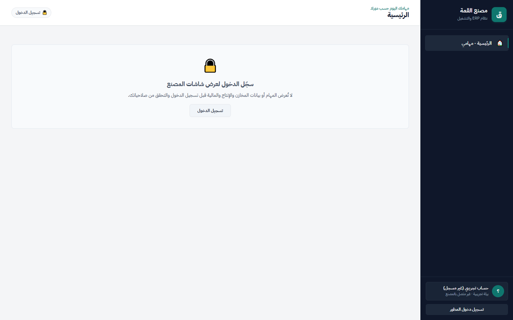
*الصورة 1: قبل الدخول لا تظهر أي بيانات. اضغط «تسجيل الدخول» وأدخل البريد وكلمة المرور التي سلّمها لك مسؤول النظام.*

بعد الدخول تظهر القائمة الجانبية على اليمين حسب دورك، وفي أسفلها اسمك وزر «إدارة الجلسة / الخروج».

---

## 2. الأدوار والصلاحيات

يوجد في النظام أربعة أدوار فقط. الصلاحية يتحقق منها الخادم في كل عملية؛ إخفاء زر عنك يعني أن العملية ليست من دورك، وليس خطأ.

### المدير العام
- **يرى:** كل الشاشات (لوحة التشغيل، المشتريات، المخازن، أوامر التشغيل، المبيعات والتسليم، المالية، البيانات الأساسية).
- **يقوم بـ:** اعتماد أصناف دليل الأصناف وإيقافها، اعتماد نتائج الجرد وترحيلها، اعتماد المستندات المالية التي أنشأها غيره، متابعة التقارير.
- **ينتظر غيره في:** أي مستند أنشأه بنفسه؛ لا يعتمده بنفسه رغم صلاحياته الكاملة (مثلاً سند صرف أنشأه، أو صنف أنشأه، أو كشف رواتب أعدّه).

### أمين المخزن
- **يرى:** الرئيسية، فواتير الشراء والاستلام، صرف الخامات واستلام التام، تسليم طلبات العملاء، المخازن والجرد، دليل الأصناف، الموردون والموديلات (عرض)، دليل الاستخدام.
- **يقوم بـ:** تسجيل فواتير الشراء واستلام الخامات، صرف الخامات لأوامر التشغيل، استلام المنتج التام، فحص واستلام مرتجعات الورشة، تسليم طلبات العملاء، إنشاء جلسات الجرد والعد، إضافة أصناف وتصنيفات للدليل وتقديمها للاعتماد، إضافة الموردين، «طلب سداد كامل المستحق» للمورد.
- **ينتظر غيره في:** اعتماد الصنف الجديد (المدير العام)، اعتماد الجرد (المدير العام)، تأكيد استلام الخامات بالورشة (مسؤول الإنتاج)، اعتماد السداد (الخزينة).
- **لا يرى:** أرصدة الخزينة، مبالغ مستحقات الموردين، الرواتب، أسعار البيع.

### مسؤول الإنتاج
- **يرى:** الرئيسية، أوامر التشغيل، أرصدة الخامات، الموديلات والمقاسات، دليل الأصناف (عرض)، لوحة التشغيل.
- **يقوم بـ:** إضافة الموديلات والمقاسات وإيقافها، تعريف مستلزمات التصنيع لكل مقاس، إنشاء أوامر التشغيل، تأكيد استلام الخامات بالورشة، تسجيل مراحل التصنيع والعيوب، تسوية خامات الورشة وقرار المرتجعات، إغلاق الأمر.
- **ينتظر غيره في:** صرف الخامات واستلام المنتج التام (أمين المخزن).
- **لا يرى:** المالية والخزينة والرواتب، ولا يضيف أصنافاً جديدة للدليل.

### المدير المالي
- **يرى:** الرئيسية، الخزينة والاعتمادات، العملاء والطلبات والتحصيل، مستحقات الموردين، سندات القبض والصرف، العهد، الرواتب، التقارير، البيانات الأساسية (الموردون، العملاء، الموظفون).
- **يقوم بـ:** إدارة العملاء وطلبات البيع والأسعار، تسجيل التحصيلات، طلبات سداد الموردين، سندات القبض والصرف والتحويل، العهد، إعداد كشوف الرواتب، اعتماد المستندات المالية التي أنشأها غيره.
- **لا ينتظر أحداً:** لا توجد جهة اعتماد فوقه؛ كل مستند مالي ينشئه (سند، دفعة مورد، تحصيل، مصروف عهدة، تسوية عهدة، صرف رواتب) **يُعتمد ويُرحّل لحظة حفظه**، فراجع المبلغ قبل الحفظ. ويعتمد هو المستندات التي يرسلها غيره (طلبات سداد أمين المخزن ومستندات المدير العام).
- **لا يرى:** شاشات المخازن وأوامر التشغيل.

### قواعد الاعتماد
- **مستندات المدير المالي تُعتمد عند الحفظ مباشرة** (قرار المصنع: لا جهة اعتماد فوقه). إذا كان الرصيد لا يكفي يُرفض الحفظ كله ولا يبقى مستند معلق. أي خطأ بعد الحفظ يُصحح بمستند عكسي.
- **مستندات غيره** (طلب سداد كامل المستحق من أمين المخزن، أو سند أنشأه المدير العام) تبقى «بانتظار الاعتماد» حتى يعتمدها المدير المالي من «الخزينة والاعتمادات». منشئها لا يعتمدها بنفسه.
- من **صرف** الخامات من المخزن لا يستطيع تأكيد **استلامها** في الورشة.
- كشف رواتب أعدّه أو قدّمه غير المدير المالي لا يعتمده من أعدّه.

### جدول مختصر: من ينفذ كل خطوة؟

| الخطوة | المنفذ | من يكملها بعده |
|---|---|---|
| إضافة صنف للدليل | أمين المخزن | المدير العام يعتمده |
| تعريف موديل ومستلزماته | مسؤول الإنتاج | — |
| فاتورة شراء واستلام | أمين المخزن | الخزينة تعتمد السداد |
| إنشاء أمر تشغيل | مسؤول الإنتاج | أمين المخزن يصرف |
| صرف الخامات | أمين المخزن | مسؤول الإنتاج يؤكد الاستلام |
| مراحل التصنيع والعيوب | مسؤول الإنتاج | — |
| استلام المنتج التام | أمين المخزن | — |
| مرتجع خامات من الورشة | مسؤول الإنتاج (التسوية) | أمين المخزن يفحص ويستلم |
| إغلاق أمر التشغيل | مسؤول الإنتاج | — |
| طلب بيع وتحصيل | المدير المالي | — (التحصيل يُعتمد عند حفظه) |
| تسليم طلب العميل | أمين المخزن | — |
| جرد | أمين المخزن | المدير العام يعتمد ويرحّل |
| كشف الرواتب | المدير المالي | — (الصرف يُعتمد عند تقديمه) |

---

## 3. الصفحة الرئيسية وصندوق المهام

كل دور يبدأ من «الرئيسية · مهامي». السؤال في أعلى الصفحة: **«ما المطلوب منك اليوم؟»**.

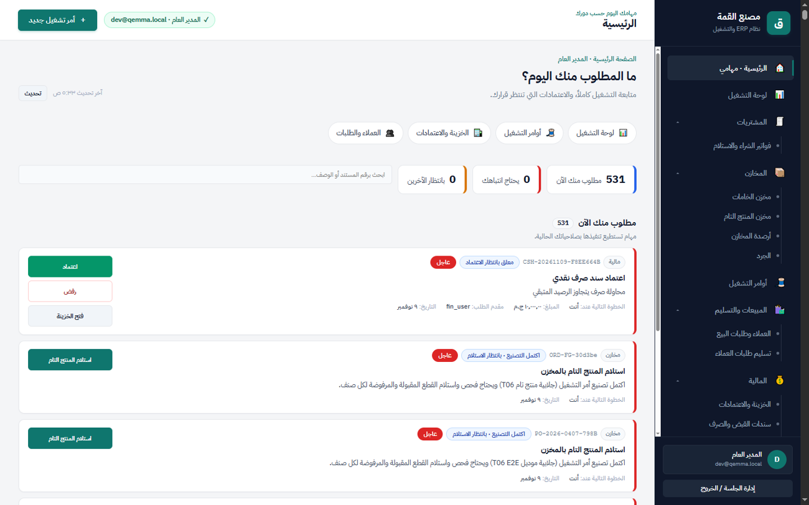
*الصورة 2: الصفحة الرئيسية. في الأعلى اختصارات للشاشات الأكثر استخداماً، ثم ثلاثة عدادات، ثم بطاقات المهام وكل بطاقة فيها زر الإجراء مباشرة.*

### الأقسام الثلاثة

| القسم | معناه | ماذا تفعل |
|---|---|---|
| **مطلوب منك الآن** | خطوات تستطيع تنفيذها بصلاحيتك الآن | اضغط زر البطاقة (مثل «اعتماد» أو «استلام المنتج التام») |
| **يحتاج انتباهك** | أمور متوقفة أو فيها مشكلة تخص عملك (مثل عجز أو قرار معلق) | افتح المستند واقرأ السبب |
| **بانتظار الآخرين** | مستندات أنشأتها أو شاركت فيها وتنتظر شخصاً آخر | لا شيء مطلوب منك؛ تابع فقط |

- كل بطاقة تعرض: نوع المستند ورقمه، حالته، «الخطوة التالية عند»، التاريخ، وشارة «عاجل» إن وُجدت.
- مربع البحث يبحث برقم المستند أو الوصف. زر «تحديث» يعيد تجميع المهام.
- الضغط على زر البطاقة يفتح المستند على الخطوة المطلوبة مباشرة.

**الفرق المهم:** البطاقة في «مطلوب منك الآن» تعني أن التنفيذ بيدك. البطاقة في «بانتظار الآخرين» تعني أنك أنهيت دورك وأن الخطوة التالية عند شخص آخر (مثلاً سند أنشأته وينتظر الاعتماد).

| أمين المخزن | مسؤول الإنتاج | المدير المالي |
|---|---|---|
| 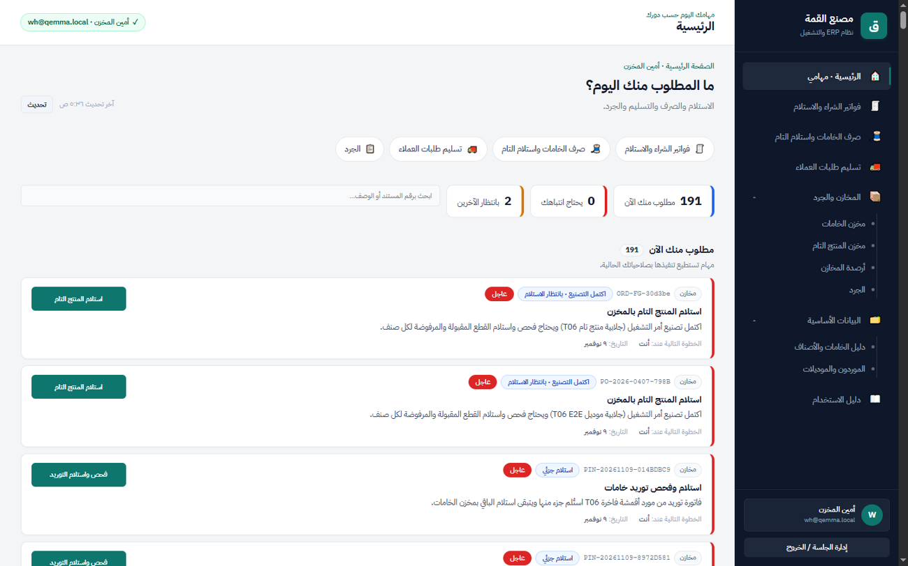 | 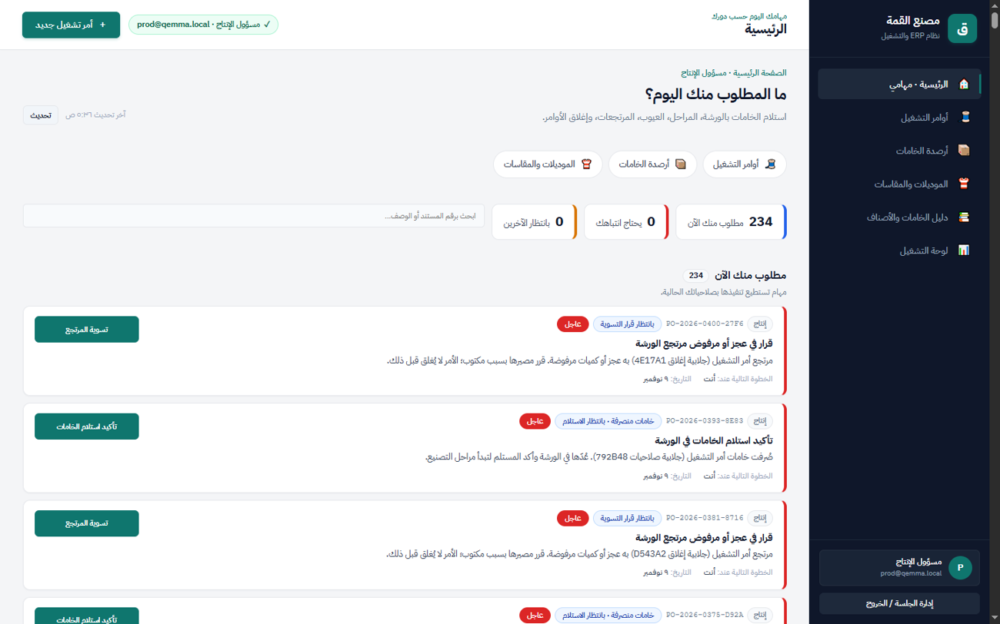 | 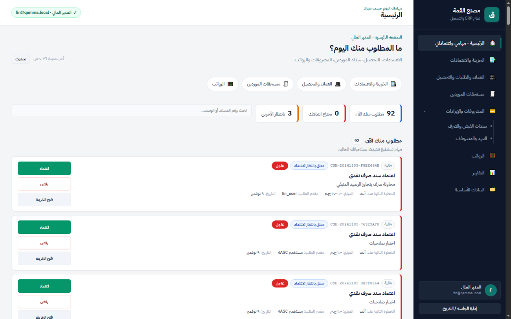 |

*الصورة 3: الصفحة الرئيسية لكل دور: أمين المخزن يرى الاستلامات والصرف، مسؤول الإنتاج يرى تأكيد الاستلام وقرارات المرتجعات، المدير المالي يرى الاعتمادات.*

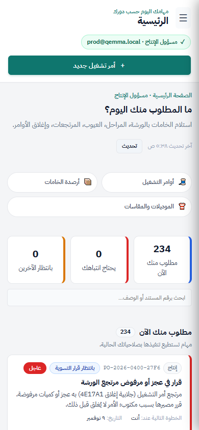
*الصورة 4: الواجهة على الهاتف. البطاقات والعدادات تترتب عمودياً.*

---

## 4. دليل البداية: إعداد المصنع لأول مرة

اتبع الترتيب التالي؛ كل خطوة تعتمد على ما قبلها.

1. مراجعة المستخدمين وأدوارهم (مع مسؤول النظام).
2. دليل الأصناف: التصنيفات ثم الأصناف واعتمادها.
3. الموردون والعملاء.
4. الموديلات والمقاسات.
5. مستلزمات التصنيع لكل مقاس.
6. الأرصدة الافتتاحية (المخزون والخزنة).
7. الموظفون ونظام أجر كل منهم.

### 4.1 دليل الأصناف (الخامات والمستلزمات)
**المكان:** القائمة ← البيانات الأساسية ← «دليل الخامات والأصناف».
**من:** أمين المخزن يضيف ويقدّم، المدير العام يعتمد ويوقف. مسؤول الإنتاج والمدير المالي للعرض.

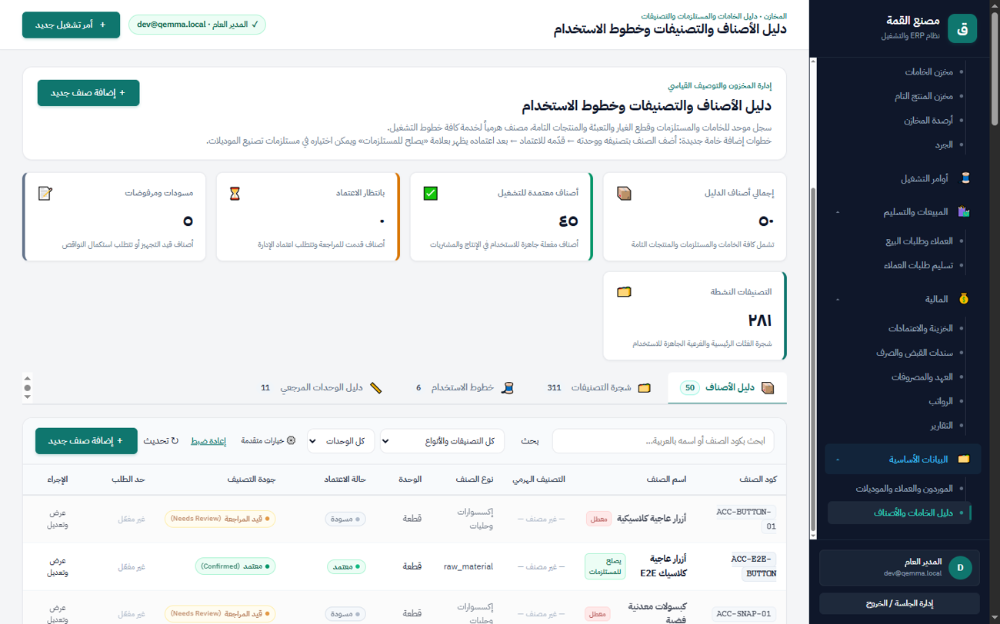
*الصورة 5: دليل الأصناف. في الأعلى خطوات إضافة خامة جديدة، ثم عدادات، ثم تبويبات (دليل الأصناف، شجرة التصنيفات، خطوط الاستخدام، دليل الوحدات المرجعي)، ثم البحث والتصفية والجدول.*

**التصنيفات (رئيسي وفرعي):**
1. افتح تبويب «شجرة التصنيفات».
2. «＋ إضافة تصنيف رئيسي»، أو «فرعي» بجانب تصنيف قائم لإضافة تصنيف تحته.
3. يمكن تعديل التصنيف أو تعطيله؛ الحذف يُرفض إذا كان مرتبطاً بأصناف أو تصنيفات فرعية.

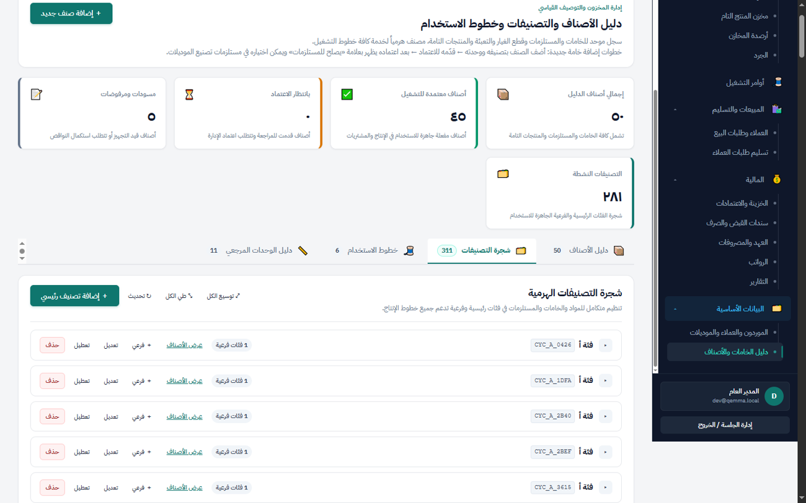
*الصورة 6: شجرة التصنيفات مع أزرار الإضافة والتعديل والتعطيل لكل تصنيف.*

**إضافة صنف جديد:**
1. اضغط «＋ إضافة صنف جديد».
2. املأ: كود الصنف (فريد، بالإنجليزية)، اسم الصنف بالعربية، نوع الصنف التشغيلي، الوحدة الأساسية، التصنيف.
3. اختياري: حد إعادة الطلب (صفر = بلا تنبيه)، والمواصفات (العرض، الوزن، الطول، القطر)، وخطوط الاستخدام.
4. احفظ ← يُحفظ الصنف **مسودة**.

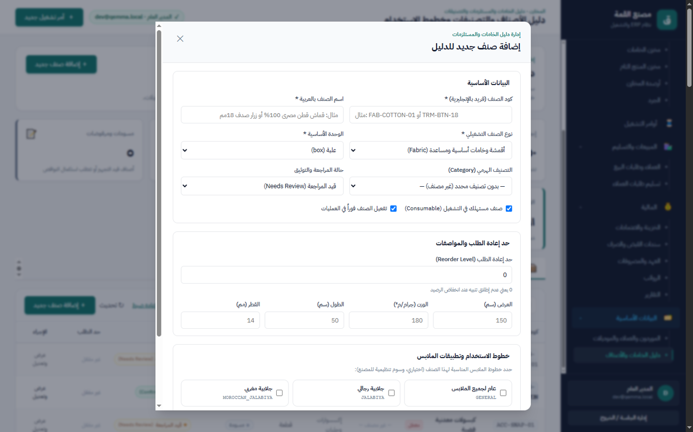
*الصورة 7: نموذج إضافة صنف. الحقول المعلّمة بنجمة إلزامية. الأرقام الرمادية داخل الحقول أمثلة فقط.*

**المراجعة والاعتماد:**
1. افتح الصنف من الجدول ← «تقديم للمراجعة والاعتماد» ← حالته «قيد الاعتماد».
2. المدير العام يفتحه ← «اعتماد» أو «رفض» مع السبب.
3. الصنف المعتمد يُعدَّل عبر «طلب تعديل» يعتمده المدير العام؛ لا يتغير مباشرة.

**إيقاف صنف أو إعادة تفعيله:** من نافذة تفاصيل الصنف (المدير العام). الصنف الموقوف يظهر بعلامة «معطل» ولا يُستخدم في عمليات جديدة؛ حركاته السابقة تبقى.

**أي الأصناف تصلح لمستلزمات التصنيع؟** الصنف الذي يظهر بجانبه علامة **«يصلح للمستلزمات»**: معتمد، ونشط، وليس منتجاً تاماً. غير ذلك لا يظهر في محرر المستلزمات.

**وحدات القياس:** تبويب «دليل الوحدات المرجعي» وتبويب «المخازن والوحدات والخامات» في البيانات الأساسية **للعرض فقط**؛ لا يمكن إضافة وحدة من الواجهة حالياً (راجع القيود المعروفة).

### 4.2 الموردون والعملاء والموظفون
**المكان:** القائمة ← البيانات الأساسية ← «الموردون والعملاء والموديلات» (اسم البند يختلف قليلاً حسب الدور).

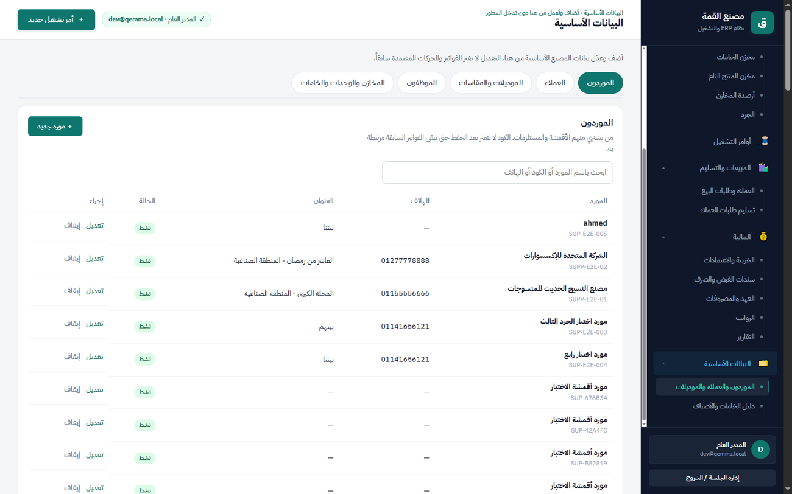
*الصورة 8: البيانات الأساسية. التبويبات: الموردون، العملاء، الموديلات والمقاسات، الموظفون، المخازن والوحدات والخامات. يظهر لكل دور ما يخصه فقط.*

- **مورد جديد:** «＋ مورد جديد» ← الكود (ثابت بعد الحفظ) والاسم والهاتف والعنوان. «إيقاف» يخفيه من الفواتير الجديدة. (أمين المخزن، المدير المالي، المدير العام)
- **عميل جديد:** تبويب «العملاء» ← «＋ تسجيل عميل». (المدير المالي، المدير العام)
- **موظف جديد:** تبويب «الموظفون» ← «＋ موظف جديد» ← البيانات ونظام الأجر: «راتب شهري» أو «أجر يومية» مع القيمة. (المدير المالي، المدير العام)

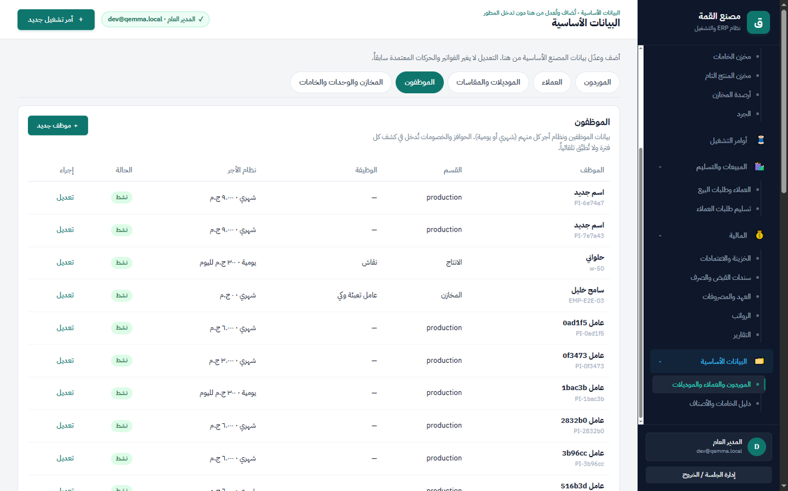
*الصورة 9: قائمة الموظفين مع نظام الأجر لكل موظف.*

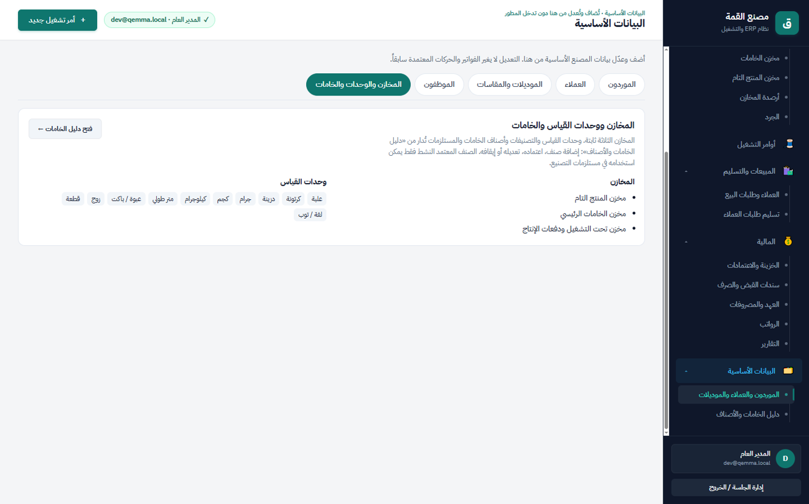
*الصورة 10: تبويب المخازن والوحدات: المخازن الثلاثة ووحدات القياس المتاحة (للعرض).*

### 4.3 الموديلات والمقاسات
**المكان:** البيانات الأساسية ← تبويب «الموديلات والمقاسات» (عند مسؤول الإنتاج: بند «الموديلات والمقاسات» في القائمة).
**من:** مسؤول الإنتاج والمدير العام يديرون؛ أمين المخزن يعرض فقط.

**إضافة موديل:**
1. «＋ موديل جديد».
2. كود الموديل (رمز قصير ثابت)، اسم الموديل، وصف مختصر (اختياري).
3. المقاسات أرقاماً مفصولة بفاصلة (مثل: 56، 58، 60) والموسم (صيفي/خريفي/شتوي). المقاس الحرفي (مثل XL) يُكتب عند إضافة مقاس واحد، أو لاحقاً من «إدارة المقاسات».
4. «حفظ ثم تعريف المستلزمات» ← يفتح محرر المستلزمات مباشرة.

**ما تعرضه بطاقة الموديل:**
- حالة الموديل: «جاهز للتشغيل»، «ينقصه مستلزمات»، «بلا مقاسات»، أو «موقوف».
- شريط «مستلزمات التصنيع: 3 من 5 مقاس».
- كل مقاس بعلامة: ✓ له مستلزمات، ! بدون مستلزمات، ⏸ موقوف. الضغط على المقاس يفتح مستلزماته.
- أعلى القائمة: تنبيه بعدد المقاسات بدون مستلزمات، وبحث، وتصفية (الكل / تحتاج مستلزمات / موقوفة).

**التعديل والإيقاف:**
- «تعديل»: الاسم والوصف (الكود ثابت).
- «＋ مقاسات»: إضافة مقاسات جديدة.
- «إدارة المقاسات»: إيقاف مقاس أو تفعيله وتعديل المقاس الحرفي. المقاسات لا تُحذف لأنها مرتبطة بحركات سابقة.
- «إيقاف» / «تفعيل» الموديل بعد تأكيد. الموديل أو المقاس الموقوف لا يظهر في أوامر التشغيل الجديدة، والأوامر السابقة لا تتأثر.

> ملاحظة: إيقاف الموديلات والمقاسات وعرض حالة المستلزمات على البطاقة يحتاجان تحديث قاعدة البيانات الخاص بهذه النسخة (راجع «القيود المعروفة»). لهذا لا توجد صورة لبطاقات الموديلات في هذا الدليل.

### 4.4 مستلزمات التصنيع (BOM)
مستلزمات التصنيع هي قائمة الخامات التي تحتاجها **القطعة الواحدة** من مقاس معين. منها يحسب النظام احتياجات أي أمر تشغيل تلقائياً.

**الدخول:** من بطاقة الموديل ← «مستلزمات التصنيع» (أو «استكمال المستلزمات» إذا كان ينقصه شيء)، أو بالضغط على مقاس.

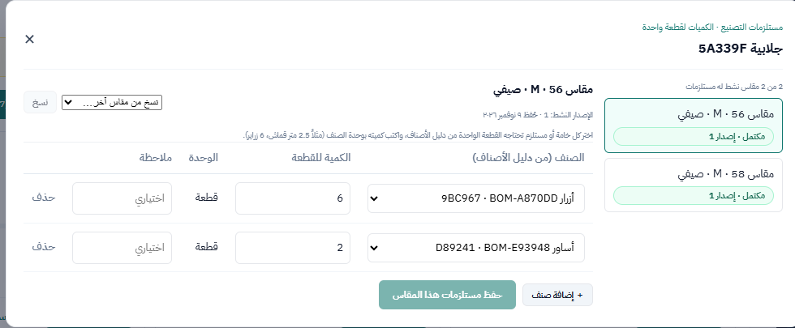
*الصورة 11: محرر المستلزمات. يميناً قائمة المقاسات وحالة كل مقاس («مكتمل · إصدار 1» أو «بدون مستلزمات»). يساراً أصناف المقاس المختار والكمية للقطعة والوحدة.*

**الخطوات:**
1. اختر المقاس من القائمة اليمنى.
2. «＋ إضافة صنف» ← اختر الصنف من دليل الأصناف (مقسمة حسب النوع).
3. اكتب **الكمية للقطعة الواحدة** بوحدة الصنف (مثلاً 2.5 متر قماش، 6 زراير). الوحدة تظهر تلقائياً.
4. كرر لكل صنف. «حذف» لإزالة سطر قبل الحفظ.
5. «حفظ مستلزمات هذا المقاس».

**نسخ مستلزمات مقاس لمقاس آخر:** اختر المقاس الجديد ← «نسخ من مقاس آخر…» ← اختر المقاس المصدر ← «نسخ» ← عدّل الكميات (المقاس الأكبر يستهلك قماشاً أكثر غالباً) ← احفظ.

**ما يمنعه النظام:** صنف مكرر في نفس المقاس، كمية صفر أو سالبة، صنف موقوف أو غير معتمد، منتج تام. الخطأ يظهر بجانب السطر نفسه.

**معنى الإصدار:** كل حفظ يُنشئ **إصداراً جديداً** (إصدار 1، 2، 3…) ويُؤرشف السابق. أوامر التشغيل القائمة تحتفظ بالمستلزمات التي أُنشئت بها؛ الإصدار الجديد يُستخدم في الأوامر الجديدة فقط.

**ما زال ناقصاً؟** المحرر يعرض «X من Y مقاس نشط له مستلزمات»، وبعد كل حفظ يظهر رابط «المقاس التالي بدون مستلزمات».

### 4.5 الأرصدة الافتتاحية
النظام **لا يحتوي شاشة «رصيد افتتاحي»**. الطريقة المعتمدة:
- **المخزون:** جرد افتتاحي كامل لكل مخزن (الفصل 8): يُعد الموجود فعلياً، ويعتمد المدير العام النتائج ويرحّلها فتصبح الأرصدة مساوية للمعدود.
- **الخزنة:** المدير المالي يعدّ النقدية الموجودة فعلاً، ثم يسجل من «سندات القبض والصرف» سند قبض على «الخزنة الرئيسية» بالمبلغ وبوصف «رصيد افتتاحي». يُعتمد فور حفظه ويظهر رصيداً للخزنة. لو هناك أكثر من مبلغ (نقدية + عهد قائمة) يُسجل لكل منها سند واضح.

---

## 5. دورة التشغيل الكاملة

### أ. المشتريات واستلام الخامات
**المكان:** «فواتير الشراء والاستلام» (أمين المخزن، المدير العام) أو «مستحقات الموردين» (المدير المالي).

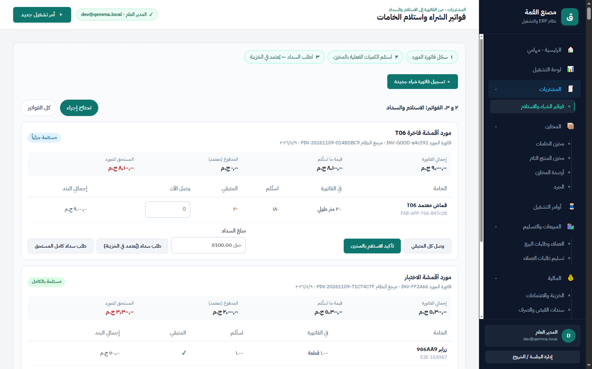
*الصورة 12: أعلى الشاشة الخطوات الثلاث: ١ سجّل فاتورة المورد، ٢ استلم الكميات الفعلية بالمخزن، ٣ اطلب السداد ويُعتمد في الخزينة. لكل فاتورة: الإجمالي، قيمة ما استُلم، المدفوع، المستحق.*

1. **إضافة المورد** من البيانات الأساسية (إن لم يكن موجوداً).
2. **تسجيل الفاتورة:** «＋ تسجيل فاتورة شراء جديدة» ← المورد ورقم فاتورته ← «＋ إضافة البند» لكل صنف بالكمية والسعر ← حفظ.
3. **الاستلام:** في بطاقة الفاتورة أدخل في عمود «وصل الآن» الكمية التي وصلت فعلاً (أو «وصل كل المتبقي») ← «تأكيد الاستلام بالمخزن». يمكن الاستلام على دفعات، ولا يُقبل أكثر من المتبقي.
4. بعد التأكيد يزيد رصيد مخزن الخامات فوراً، وتصبح الفاتورة «مستلمة جزئياً» أو «مستلمة بالكامل».
5. **مراجعة الرصيد:** «مخزن الخامات» ← «عرض الحركات» بجانب الصنف.
6. **طلب السداد:**
   - المدير المالي: «طلب سداد (يُعتمد في الخزينة)» بمبلغ محدد.
   - أمين المخزن: «طلب سداد كامل المستحق» دون أن يرى المبالغ.
7. **الاعتماد:** سداد المدير المالي يُخصم من الخزنة فور حفظه. طلب أمين المخزن يبقى معلقاً حتى يعتمده المدير المالي من «الخزينة والاعتمادات»، وعند الاعتماد فقط يُخصم المبلغ.

### ب. المبيعات وطلب العميل
**المكان:** «العملاء وطلبات البيع» (المدير العام) أو «العملاء والطلبات والتحصيل» (المدير المالي).

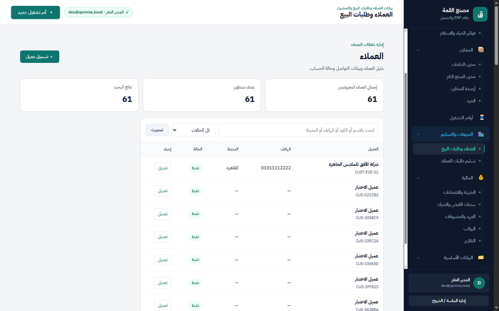
*الصورة 13: قائمة العملاء مع البحث والحالة. افتح العميل للدخول إلى حسابه وطلباته.*

1. **إضافة العميل:** «＋ تسجيل عميل».
2. افتح حساب العميل ← **«＋ طلب جديد»**.
3. أضف البنود: الموديل والمقاس والكمية والسعر («＋ إضافة صنف آخر» لبند إضافي).
4. تابع حالة الطلب وبنوده من حساب العميل: المطلوب، المسلم، المتبقي، المديونية.
5. **أمر تشغيل للطلب:** زر «＋ أمر تشغيل» بجانب البند ينشئ أمر تشغيل مرتبطاً بالطلب، يستخدم مستلزمات المقاس تلقائياً.

### ج. إنشاء أمر التشغيل
**المكان:** «أوامر التشغيل» ← «＋ أمر تشغيل جديد» (مسؤول الإنتاج، المدير العام).

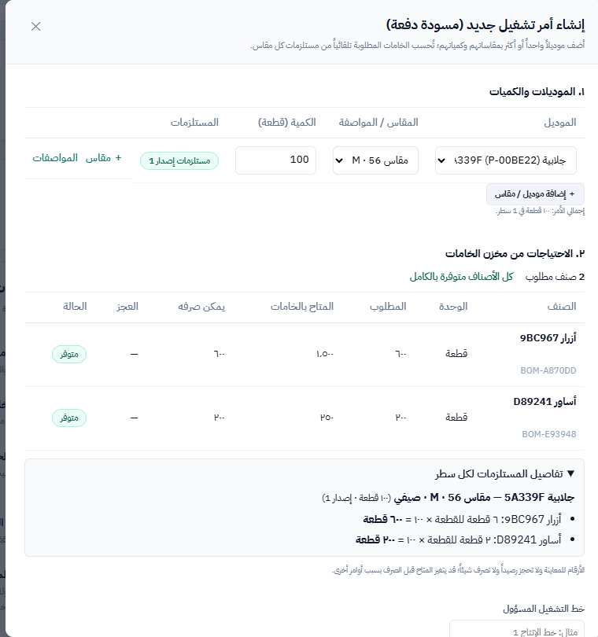
*الصورة 14: إنشاء أمر تشغيل. القسم ١ أسطر الموديلات والكميات. القسم ٢ الاحتياجات من مخزن الخامات: الصنف، الوحدة، المطلوب، المتاح، يمكن صرفه، العجز، والحالة. أسفلها «تفاصيل المستلزمات لكل سطر».*

1. في السطر الأول اختر **الموديل** ثم **المقاس** ثم اكتب **الكمية**.
2. لإضافة مقاس آخر لنفس الموديل: «＋ مقاس» بجانب السطر. لموديل آخر: «＋ إضافة موديل / مقاس».
3. «المواصفات» (اختياري): نوع التصنيع (إنتاج المصنع / تصنيع لعميل)، القماش ولونه ووزنه ومساحته، ملاحظات.
4. النظام يجلب **مستلزمات المقاس** تلقائياً ويعرض بجانب كل سطر «مستلزمات إصدار N».
5. راجع **جدول الاحتياجات**: الأصناف مجمعة حسب الصنف ووحدته من كل الأسطر.
   - «متوفر»: الرصيد يكفي.
   - «عجز · يوقف الصرف»: الرصيد أقل من المطلوب.
6. أدخل خط التشغيل المسؤول والملاحظات ← **«إنشاء أمر التشغيل»**.

**متى يُمنع الإنشاء؟** إذا كان مقاس في الأمر بدون مستلزمات (أو موقوفاً)، يظهر «لا يمكن الإنشاء: مستلزمات التصنيع ناقصة لـ…» مع أسماء المقاسات ويبقى الزر معطلاً.

**العجز لا يمنع الإنشاء**، لكن الصرف لن يتم حتى يكتمل الرصيد.

**أمر التشغيل ≠ صرف الخامات:** إنشاء الأمر لا يخصم ولا يحجز أي رصيد. الأرقام المعروضة معاينة لحظية؛ أمر آخر قد يستهلك الرصيد قبل الصرف. الخصم الفعلي يحدث فقط عندما يصرف أمين المخزن.

### د. صرف الخامات إلى تحت التشغيل (الورشة)
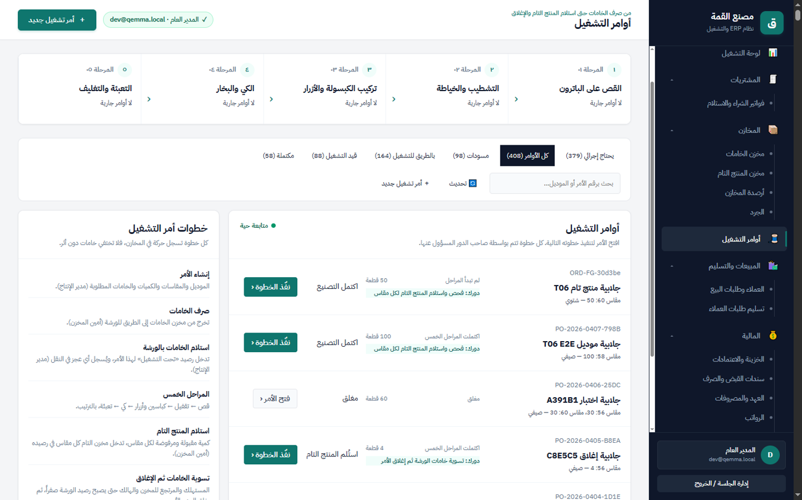
*الصورة 15: أوامر التشغيل. في الأعلى المراحل الخمس، ثم تصفية (يحتاج إجراء، كل الأوامر، مسودات، بالطريق للتشغيل، قيد التشغيل، مكتملة)، ولكل أمر حالته و«دورك: …» وزر «نفّذ الخطوة» أو «فتح الأمر».*

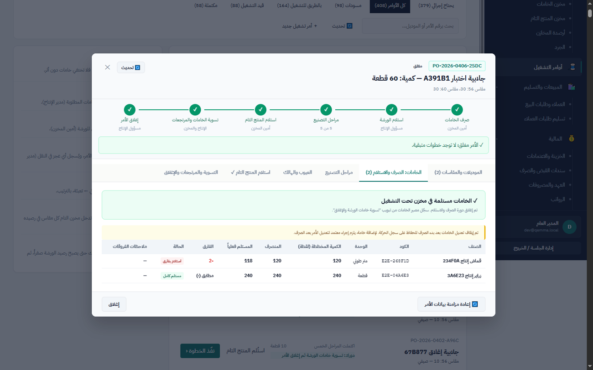
*الصورة 16: تفاصيل الأمر. شريط الخطوات الست (صرف الخامات، استلام الورشة، مراحل التصنيع، استلام المنتج التام، تسوية الخامات والمرتجعات، إغلاق الأمر) ومن المسؤول عن كل خطوة، ثم التبويبات.*

1. **أمين المخزن:** يفتح الأمر (حالته «بانتظار صرف الخامات») ← تبويب «الخامات: الصرف والاستلام» ← «صرف الخامات (بالطريق) ←». إذا كان الرصيد غير كافٍ يظهر اسم الخامة والمتاح والمطلوب ولا يتم الصرف.
2. تصبح الحالة **«خامات في الطريق للورشة»**، وتظهر للمسؤول في «مطلوب منك الآن»: «تأكيد استلام الخامات في الورشة».
3. **مسؤول الإنتاج:** يسجل الكمية المستلمة فعلياً لكل خامة (من صفر حتى المنصرف) وسبب الفارق إن وُجد ← «✓ تأكيد استلام الخامات وتسجيل الفروقات».
4. لا يستطيع من صرف الخامات تأكيد استلامها؛ تظهر له رسالة «أنت من صرف هذه الخامات؛ بانتظار تأكيد استلامها…».
5. الفرق بين المنصرف والمستلم يُسجل «فارق» ولا يُمحى السجل.

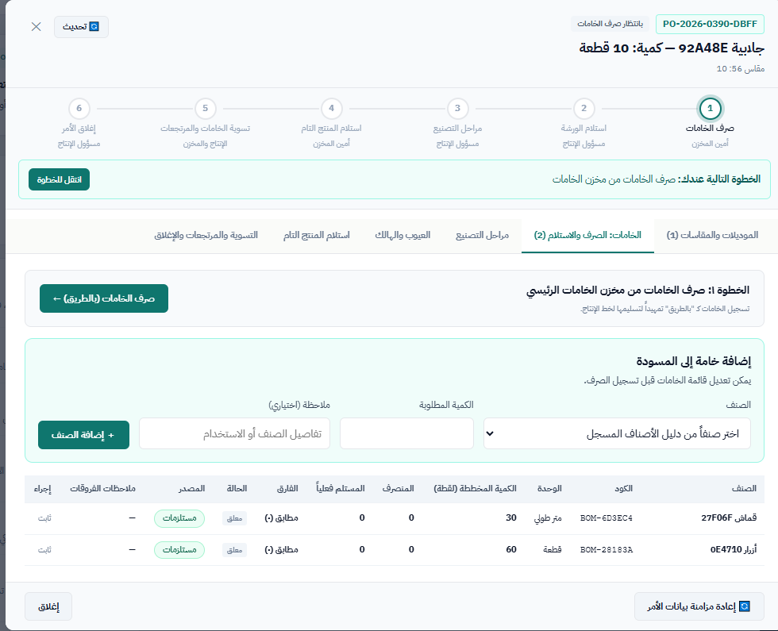
*الصورة 17: تبويب الخامات في أمر مسودة: «الخطوة ١: صرف الخامات»، وجدول الخامات: المخطط، المنصرف، المستلم، الفارق، الحالة، و«المصدر» (مستلزمات / يدوي). بنود المستلزمات مكتوب عليها «ثابت» ولا تُحذف.*

### هـ. تنفيذ الإنتاج
**المراحل** (تبويب «مراحل التصنيع»): القص على الباترون ← التشطيب والخياطة ← تركيب الكبسولة والأزرار ← الكي والبخار ← التعبئة والتغليف. الترتيب إلزامي، ولا تبدأ المراحل قبل تأكيد استلام الخامات. يمكن التراجع عن آخر مرحلة مكتملة مع كتابة السبب.

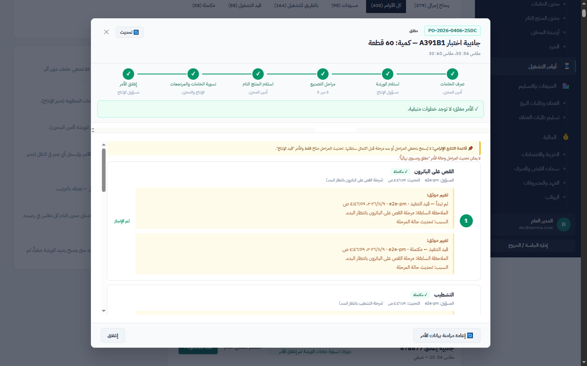
*الصورة 18: مراحل التصنيع مع سجل كل مرحلة ومن نفذها ومتى.*

**العيوب والهالك:** تبويب «العيوب والهالك» ← «تسجيل العيب» (مسؤول الإنتاج) بالمرحلة والوصف. تكلفة الإصلاح وصفية فقط ولا تدخل في التكلفة.

**تسوية خامات الورشة والمرتجعات** (تبويب «التسوية والمرتجعات والإغلاق»):
1. يظهر رصيد كل خامة في الورشة.
2. مسؤول الإنتاج يسجل لكل خامة: المستهلك فعلياً، المرتجع للمخزن، التالف. المجموع لا يتجاوز الرصيد.
3. المرتجع يخرج «في الطريق» للمخزن، و**أمين المخزن** يفحصه: «تأكيد فحص واستلام المرتجع» بالكمية السليمة وحالتها.
4. إذا كان هناك عجز أو كميات مرفوضة، يظهر لمسؤول الإنتاج «قرار في عجز أو مرفوض» ← «تسجيل قرار التسوية».

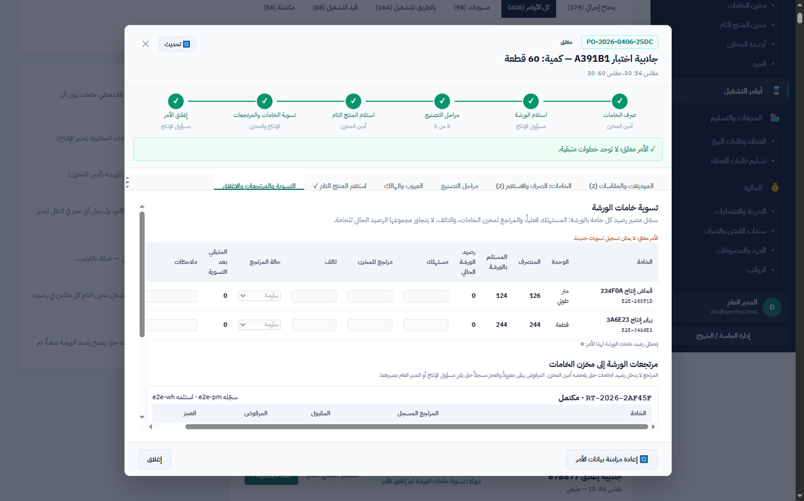
*الصورة 19: تسوية خامات الورشة: لكل خامة المنصرف والمستلم بالورشة والمستهلك والمرتجع والتالف، وتحتها مرتجعات الورشة إلى مخزن الخامات وحالتها.*

**شروط إغلاق الأمر:** اكتمال المراحل، استلام المنتج التام، تصفير رصيد الورشة بالتسوية، وتسوية كل المرتجعات. زر الإغلاق يبقى معطلاً مع ذكر السبب ما لم تكتمل الشروط. إذا كانت الكمية المستلمة أقل من المطلوب يُطلب كتابة السبب.

**مستلزمات الأمر المحفوظة:** في تبويب «الموديلات والمقاسات» يظهر قسم «مستلزمات التصنيع المحفوظة في الأمر»: لكل سطر الأصناف والكمية للقطعة وإجمالي السطر وإصدار المستلزمات، ثم «إجمالي احتياجات الأمر» مقارناً بالمخطط والمنصرف والمستلم.

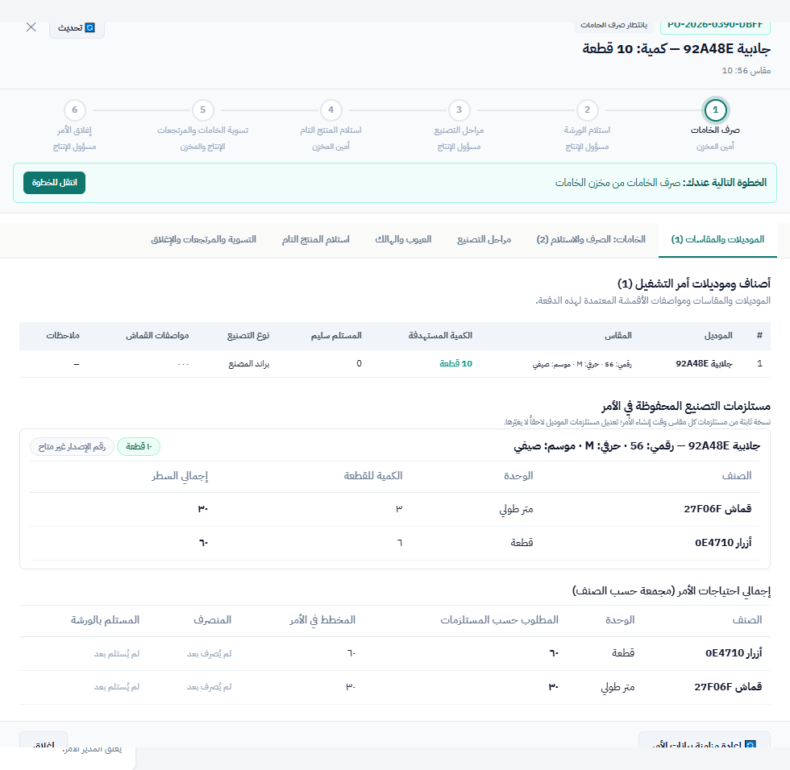
*الصورة 20: المستلزمات المحفوظة في الأمر. هذه نسخة ثابتة من وقت الإنشاء؛ تعديل مستلزمات الموديل بعد ذلك لا يغيّرها. «لم يُصرف بعد» تعني أن الصرف لم يتم.*

### و. استلام المنتج التام
1. بعد آخر مرحلة تصبح الحالة **«اكتمل التصنيع»** وتظهر لأمين المخزن مهمة «استلام المنتج التام بالمخزن».
2. أمين المخزن يفتح الأمر ← تبويب «استلام المنتج التام» ← لكل مقاس: الكمية المقبولة والكمية المرفوضة ← «تأكيد استلام المنتج التام».
3. المقبول يدخل **مخزن المنتج التام** لكل مقاس على حدة (لا تختلط المقاسات). الحالة تصبح «استُلم المنتج التام».
4. بعدها يكمل مسؤول الإنتاج التسوية والإغلاق.

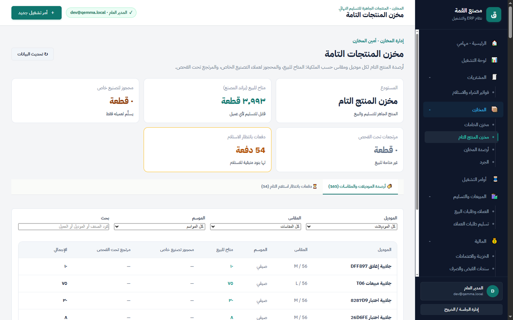
*الصورة 21: مخزن المنتجات التامة: المتاح للبيع، المحجوز لتصنيع خاص، ودفعات بانتظار الاستلام، ثم أرصدة كل موديل ومقاس.*

### ز. تسليم العميل والتحصيل
**التسليم (أمين المخزن):** «تسليم طلبات العملاء».

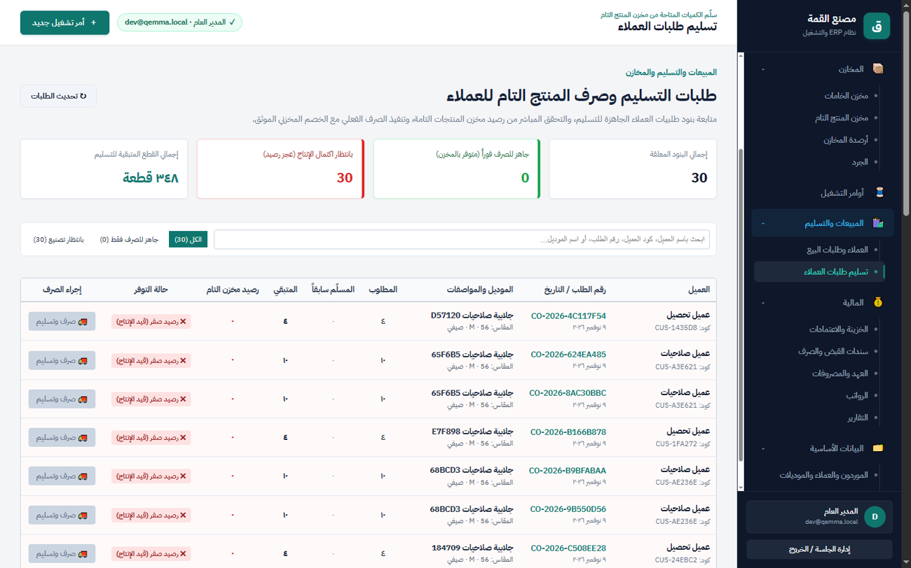
*الصورة 22: طلبات التسليم: لكل بند المطلوب والمسلم والمتبقي ورصيد مخزن التام وحالة التوفر. «صرف وتسليم» يتاح عندما يتوفر رصيد.*

1. اختر البند ← «صرف وتسليم» ← الكمية المسلمة واسم المستلم. التسليم الجزئي مسموح.
2. «المتاح للتسليم» هو ما يملكه هذا الطلب فعلاً (منتج المصنع أو إنتاج خاص لهذا العميل).
3. **مرتجع من عميل:** لا توجد شاشة لتسجيله حالياً (راجع القيود المعروفة).

**التحصيل (المدير المالي):** حساب العميل ← الطلب ← «＋ تسجيل تحصيل مالي». يُعتمد فور حفظه ويُضاف للخزنة ويُخصم من مديونية العميل. لا يُقبل تحصيل أكبر من المتبقي.

> التسليم حركة مخزنية، والتحصيل حركة مالية. تسجيل التسليم لا يعني أن المبلغ حُصّل.

---

## 6. الإدارة المالية

### الخزينة والاعتمادات — مكان الاعتماد الوحيد
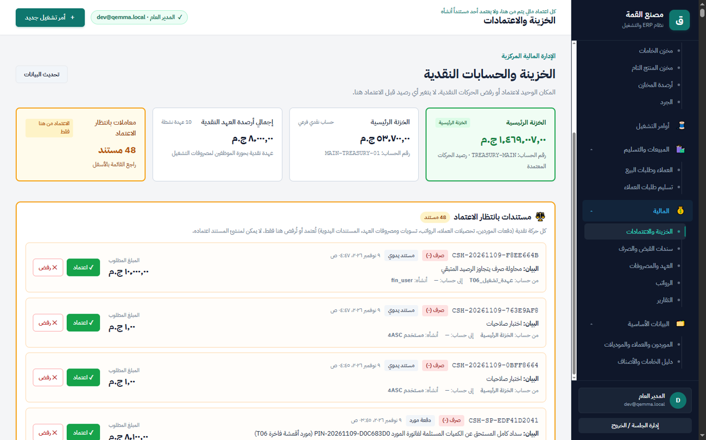
*الصورة 23: الخزينة. أعلاها أرصدة الخزنة الرئيسية والفرعية والعهد وعدد المعاملات بانتظار الاعتماد، ثم قائمة «مستندات بانتظار الاعتماد» بزرَي «اعتماد» و«رفض».*

- القائمة تجمع: دفعات الموردين، تحصيلات العملاء، المصروفات، التحويلات، تسويات العهد، كشوف الرواتب.
- **«اعتماد»** يغير الرصيد فوراً ومرة واحدة. **«رفض»** يحتاج سبباً.
- مستندات المدير المالي لا تظهر هنا لأنها تُعتمد عند حفظها؛ القائمة لما يرسله غيره. لا يظهر زر الاعتماد على مستند أنشأته أنت.

### سندات القبض والصرف والتحويل
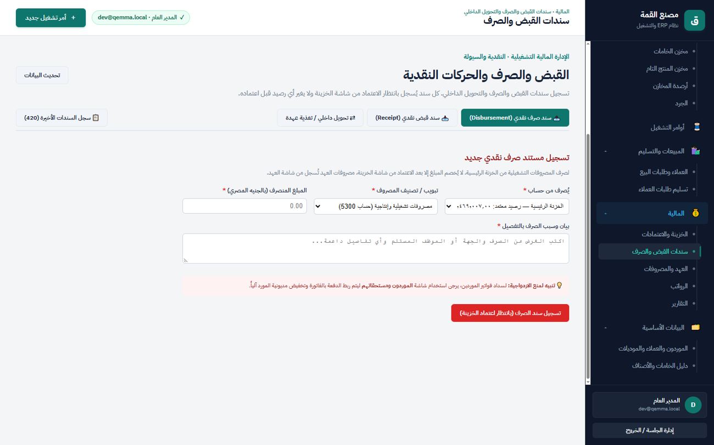
*الصورة 24: سندات القبض والصرف: أزرار «سند صرف نقدي»، «سند قبض نقدي»، «تحويل داخلي / تغذية عهدة»، و«سجل السندات الأخيرة».*

اختر نوع السند ← الحساب والمبلغ والتبويب والبيان ← تسجيل. سند المدير المالي يُعتمد ويحرك الرصيد فوراً؛ سند المدير العام يبقى «بانتظار الاعتماد» حتى يعتمده المدير المالي.

### العهد
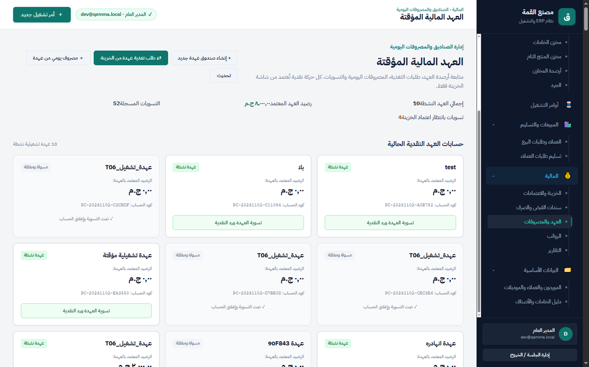
*الصورة 25: العهد النقدية: لكل عهدة رصيدها وحالتها، وأزرار تسجيل المصروف وطلب التغذية وتسوية العهدة.*

1. إنشاء عهدة ← تغذيتها بتحويل من الخزنة (يُعتمد).
2. تسجيل مصروفات العهدة (تُعتمد).
3. «تسوية العهدة ورد النقدية»: أدخل النقدية التي يردها صاحب العهدة الآن فقط؛ النظام يحسب المتبقي.
4. بعد اعتماد رد كامل الرصيد تُغلق العهدة. لا تُغلق وفيها أموال غير مسواة.

### الرواتب
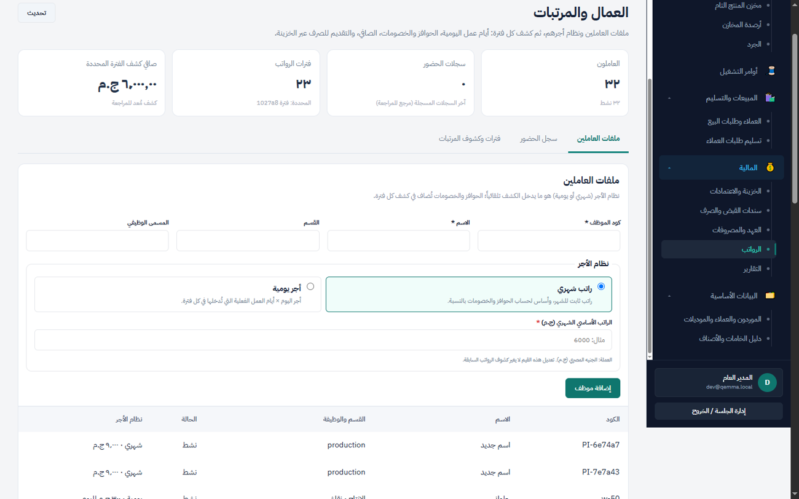
*الصورة 26: العمال والمرتبات: ملفات العاملين ونظام الأجر (راتب شهري أو أجر يومية)، ثم الحضور، ثم «فترات الرواتب وكشوف الصرف».*

1. ملفات العاملين: نظام الأجر والقيمة لكل موظف.
2. «إنشاء الفترة» ← افتح كشف الفترة.
3. لموظف اليومية: أدخل أيام العمل ← «حفظ الأيام».
4. الحوافز والخصومات: «إضافة البند» لكل موظف (مبلغ ثابت، نسبة، أو كمية × سعر) مع السبب. النظام لا يطبق أي حافز أو خصم تلقائياً.
5. «مراجعة وتقديم للصرف» ← عند المدير المالي يُصرف فوراً وتصبح الفترة «مصروفة» ويُخصم الصافي من الخزنة.
6. «تنزيل Excel» و«طباعة القسيمة» / «طباعة / حفظ PDF» للتصدير.

### التقارير
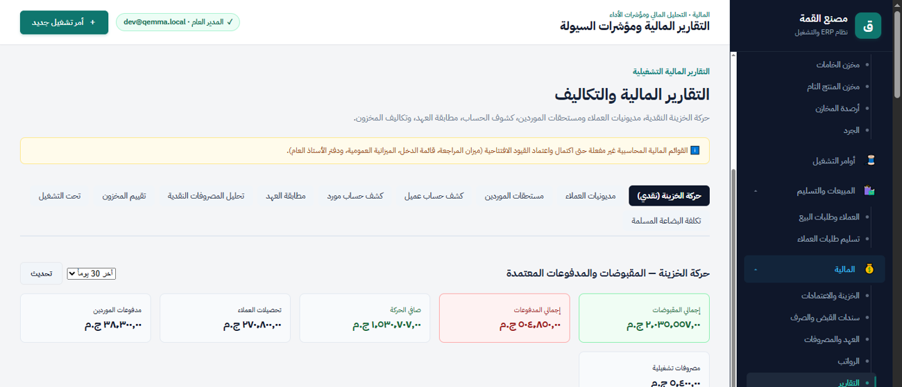
*الصورة 27: التقارير المالية والتكاليف: حركة الخزينة، مديونيات العملاء، مستحقات الموردين، كشف حساب عميل/مورد، مطابقة العهد، تحليل المصروفات، تقييم المخزون، تحت التشغيل، تكلفة الأوامر.*

> القوائم المحاسبية الرسمية (ميزان مراجعة، قائمة دخل، ميزانية) **غير متاحة**. التقارير المعتمدة تشغيلية.

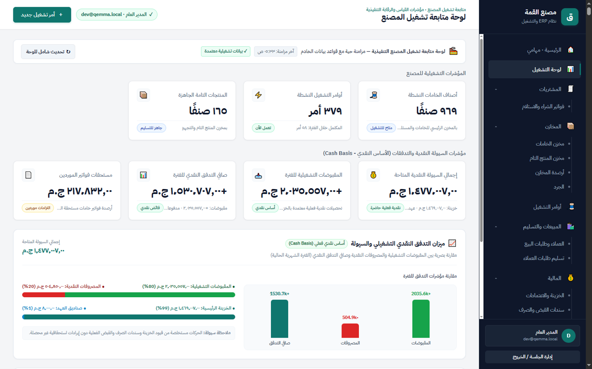
*الصورة 28: لوحة التشغيل (المدير العام ومسؤول الإنتاج): أصناف الخامات، أوامر التشغيل النشطة، المنتجات التامة، ومؤشرات السيولة.*

---

## 7. المخازن والجرد

### المخازن الثلاثة
| المخزن | ماذا فيه | كيف يدخل إليه | كيف يخرج منه |
|---|---|---|---|
| مخزن الخامات الرئيسي | الأقمشة والإكسسوارات ومواد التعبئة | استلام فاتورة شراء، مرتجع من الورشة، جرد | صرف لأمر تشغيل، جرد |
| مخزن تحت التشغيل (الورشة) | خامات أوامر قيد التصنيع | تأكيد استلام الورشة | الاستهلاك والمرتجع والتالف في التسوية |
| مخزن المنتج التام | الجلابيات الجاهزة لكل موديل ومقاس | استلام المنتج التام من أمر التشغيل | تسليم العميل |

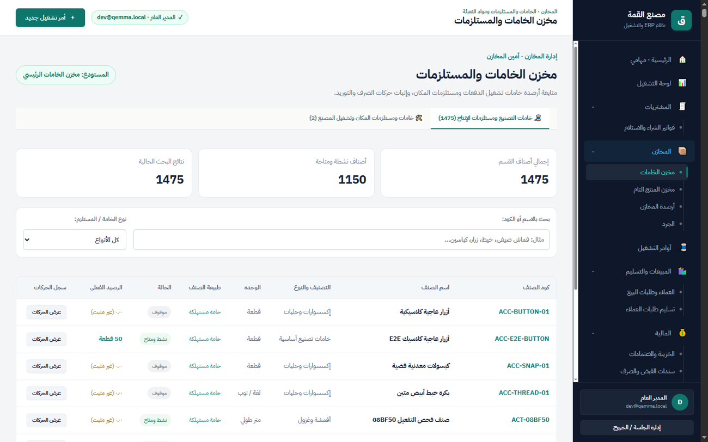
*الصورة 29: مخزن الخامات والمستلزمات: عدد الأصناف، البحث، والجدول (الكود، الاسم، التصنيف، الوحدة، الحالة، الرصيد الفعلي، «عرض الحركات»).*

**مصطلحات الرصيد:**
- **الرصيد الفعلي:** الموجود في المخزن حسب سجل الحركات.
- **المتاح:** الرصيد الفعلي في مخزن الخامات القابل للصرف الآن.
- **يمكن صرفه:** الأقل بين المطلوب والمتاح.
- **العجز:** المطلوب ناقص المتاح.

**سجل الحركة:** كل رصيد ناتج عن حركات مسجلة (استلام، صرف، مرتجع، تسوية جرد). لا يوجد تعديل رقم يدوي؛ التصحيح يتم بجرد معتمد.

### الجرد
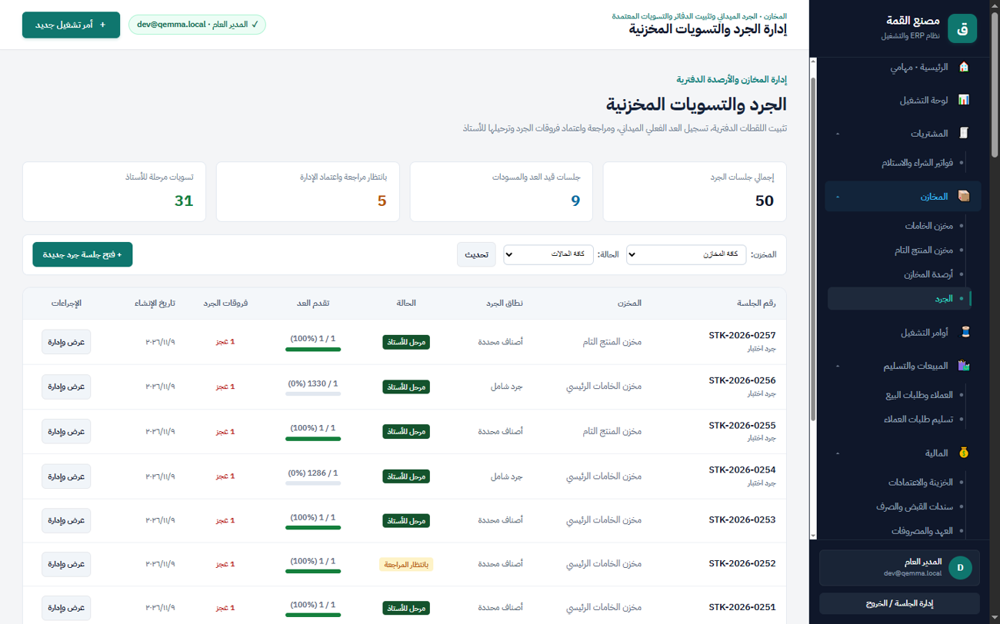
*الصورة 30: الجرد والتسويات المخزنية: الجلسات وحالاتها، و«+ فتح جلسة جرد جديدة».*

1. **أمين المخزن:** «+ فتح جلسة جرد جديدة» ← المخزن ← جرد كامل أو أصناف محددة.
2. «بدء العد الميداني» ← أدخل الكمية المعدودة لكل صنف (زر «نافد (0)» للصفر) ← «رفع للاعتماد والمراجعة».
3. **المدير العام:** يراجع (الكل، المطابق، العجز، الزيادة، غير معدود) ← «اعتماد نتائج الجرد» أو «طلب إعادة عد» أو «رفض النتائج».
4. بعد الاعتماد: «ترحيل التسويات للأستاذ» ← الأرصدة تساوي المعدود.
5. **مهم:** لا تُجرِ صرفاً أو استلاماً على الأصناف المعدودة قبل الترحيل؛ أي حركة متداخلة تمنع الترحيل وتتطلب جلسة جديدة.

---

## 8. حالات النظام

| الحالة كما تظهر | أين | معناها |
|---|---|---|
| مسودة | الأصناف، الجرد | محفوظ ولم يُقدَّم بعد؛ يمكن تعديله |
| قيد الاعتماد / بانتظار المراجعة | الأصناف، الجرد | قُدّم وينتظر المدير العام |
| معتمد / معتمدة | الأصناف، الجرد، الخزينة | اكتمل الاعتماد |
| مرفوض | الأصناف، المستندات المالية | رُفض مع سبب مكتوب |
| معلق بانتظار الاعتماد / بانتظار اعتماد الخزينة | المستندات المالية والتحصيلات | لم يتغير أي رصيد بعد |
| معتمد وخُصم من الخزنة | المستندات المالية | الرصيد تغير |
| بانتظار صرف الخامات | أمر التشغيل | أُنشئ الأمر وينتظر أمين المخزن |
| خامات في الطريق للورشة | أمر التشغيل | صُرفت وتنتظر تأكيد الورشة |
| قيد التصنيع | أمر التشغيل | المراحل جارية |
| اكتمل التصنيع | أمر التشغيل | ينتظر استلام المنتج التام |
| استُلم المنتج التام | أمر التشغيل | ينتظر التسوية والإغلاق |
| مغلق | أمر التشغيل، العهد، الفترات | انتهى ولا يقبل تغييراً |
| بانتظار الاستلام بالمخزن | الفواتير، المرتجعات | وصلت حركة وتنتظر أمين المخزن |
| مقدم للصرف · بانتظار اعتماد الخزينة | كشف الرواتب | أُعد ويُنتظر اعتماده |
| مصروف | كشف الرواتب | اعتُمد الصرف |
| ملغي | الجرد | أُلغيت الجلسة |
| موقوف / معطل | الموردون، الأصناف، الموديلات والمقاسات | لا يُستخدم في عمليات جديدة؛ السجلات القديمة باقية |

---

## 9. الأخطاء الشائعة وحلولها

| ما يراه المستخدم | السبب | الإجراء الصحيح |
|---|---|---|
| «لا يمكن الإنشاء: مستلزمات التصنيع ناقصة لـ…» | مقاس في الأمر بلا مستلزمات معرّفة أو موقوف | مسؤول الإنتاج يعرّف مستلزماته من «الموديلات والمقاسات»، أو احذف السطر |
| «عجز · يوقف الصرف» في الاحتياجات | رصيد مخزن الخامات أقل من المطلوب | يمكن إنشاء الأمر، لكن اشترِ واستلم الخامة قبل الصرف |
| الصرف مرفوض مع اسم الخامة والمتاح | الرصيد لا يكفي وقت الصرف | استلام الخامة أولاً ثم الصرف |
| لا يظهر زر «اعتماد» | أنت منشئ المستند، أو الاعتماد ليس من دورك | يعتمده شخص آخر مخوّل؛ تجده في «بانتظار الآخرين» |
| لا أستطيع تأكيد استلام الخامات بالورشة | أنت من صرفها، أو الاستلام من مهام مسؤول الإنتاج | يؤكدها مسؤول الإنتاج أو مستخدم آخر مخوّل |
| زر إغلاق الأمر معطل | مرحلة لم تكتمل، أو المنتج التام لم يُستلم، أو رصيد بالورشة، أو مرتجع غير مسوّى | اقرأ الأسباب تحت الزر وأكمل الخطوة الناقصة |
| الصنف لا يظهر في محرر المستلزمات | الصنف مسودة أو غير معتمد أو موقوف أو منتج تام | قدّمه للاعتماد ليعتمده المدير العام، أو أعد تفعيله |
| «أحد أصناف هذه المستلزمات موقوف أو غير معتمد» | صنف في مستلزمات المقاس أُوقف بعد تعريفها | استبدله في المحرر واحفظ إصداراً جديداً |
| الموديل أو المقاس لا يظهر في أمر جديد | الموديل أو المقاس موقوف | أعد تفعيله من «الموديلات والمقاسات» |
| شاشة أو تبويب لا يظهر لي | ليس ضمن صلاحيات دورك | اطلبه من المدير العام إن كان من عملك |
| «لا يملك حسابك صلاحية…» | محاولة فتح بيانات خارج دورك | نفس ما سبق |
| رُفض ترحيل الجرد | تغير رصيد صنف بعد فتح الجلسة | ألغِ الجلسة وافتح جلسة جديدة |
| التحصيل مرفوض | المبلغ أكبر من المتبقي على الطلب | سجّل المبلغ الصحيح |
| الاستلام مرفوض | الكمية أكبر من المتبقي في الفاتورة | أدخل ما وصل فعلاً فقط |
| «انتهت مهلة الاتصال بالخادم» في تقرير | التقرير ثقيل أو الاتصال بطيء | اضغط «تحديث» أو «إعادة المحاولة» بعد قليل |
| رصيد العميل بالسالب | رصيد دائن للعميل (دفع أكثر أو أعاد بضاعة بعد الدفع) | راجع كشف حساب العميل |

---

## 10. مصطلحات النظام

| المصطلح | بالعربية | مثال من المصنع |
|---|---|---|
| BOM | مستلزمات التصنيع | جلابية مقاس 56 تحتاج 2.5 متر قماش و6 زراير وأسورتين للقطعة |
| Catalog Item | صنف في دليل الأصناف | «قماش قطن أبيض» بكود ووحدة «متر طولي» |
| SKU | كود المقاس | كل مقاس/موسم لموديل له كود مستقل يُولّده النظام |
| WIP | تحت التشغيل (الورشة) | خامات أمر صُرفت واستُلمت بالورشة ولم تُستهلك بعد |
| Stock Ledger | سجل حركة المخزون | كل استلام وصرف ومرتجع يُسجل سطراً ولا يُمحى |
| Snapshot | نسخة ثابتة | مستلزمات الأمر كما كانت يوم إنشائه |
| Maker-Checker | المُنشئ لا يعتمد | طلب سداد أرسله أمين المخزن يعتمده المدير المالي (مستندات المدير المالي نفسه تُعتمد عند الحفظ) |
| Production Order | أمر التشغيل (دفعة) | 100 جلابية مقاس 56 + 80 مقاس 58 في أمر واحد |
| Goods Receipt | استلام بضاعة | تأكيد وصول 300 متر قماش من فاتورة مورد |
| Stock Count | الجرد | عد فعلي للمخزن ومطابقته بالرصيد |
| Treasury | الخزينة | الخزنة الرئيسية والفرعية والعهد وكل اعتماد نقدي |

---

## 11. للمزيد
- **القيود المعروفة:** `docs/KNOWN_LIMITATIONS_AR.md` — ما لا يتيحه النظام حالياً.
- **قائمة تجهيز المصنع:** `docs/ADMIN_HANDOVER_CHECKLIST_AR.md`.
- داخل النظام لأمين المخزن: بند «دليل الاستخدام» في القائمة.
