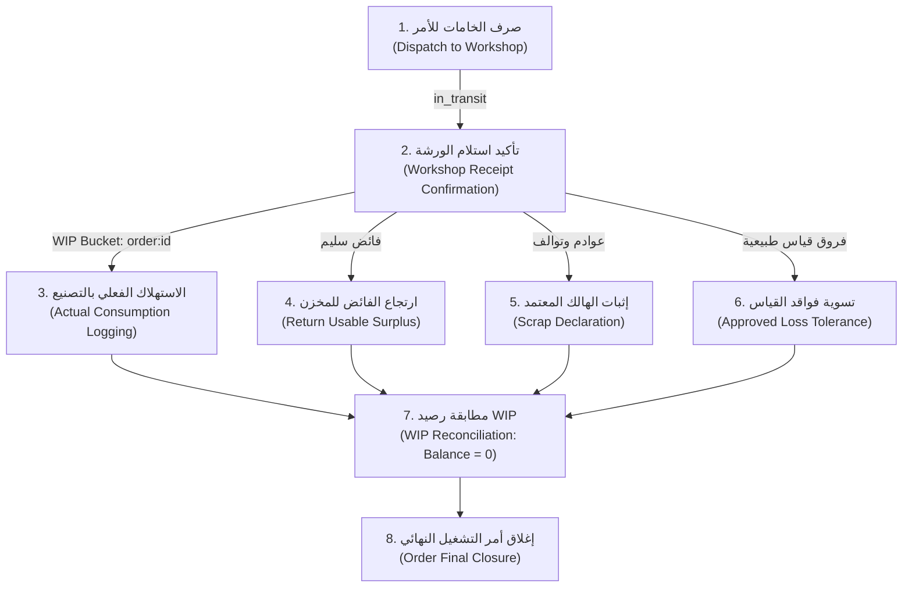

# مواصفة وتصميم دورة استهلاك خامات التشغيل (WIP Consumption & Lifecycle Design)
## Qema ERP — Phase 4 Engineering Specification

**المشروع:** نظام إدارة الإنتاج والمخازن ERP لمصنع القمة للملابس  
**المرحلة:** المرحلة 4 — جاهزية التشغيل التجريبي (Pilot Readiness)  
**المحطة:** Task 04: WIP Consumption Engineering Foundation  
**التاريخ:** 2 نوفمبر 2026  
**الحالة:** مواصفة معمارية معتمدة مع تجميد القرارات المعلقة بالمصنع  

---

## 1. الهدف المعماري ونطاق العمل

يهدف هذا التصميم إلى إرساء الأسس الهندسية المتينة لدورة حياة المواد الخام داخل خطوط الإنتاج والورشة (Work-in-Progress - WIP)، وتحديد قواعد الفصل الصارم بين:
1. **الخامات المنصرفة من مخزن الخامات الرئيسي:** مواد خرجت بمستند تحويل رسمي وتوجد حالياً بحالة "بالطريق" (`in_transit`).
2. **الخامات المستلمة فعلياً بالورشة:** مواد دخلت ذمة أمر التشغيل المحدد بحاوية مستقلة (`bucket_reference = f"order:{order.id}"`).
3. **الخامات المستهلكة فعلياً في التصنيع:** مواد تحولت إلى منتجات تامة عبر مراحل التشغيل الفنية.
4. **الخامات الصالحة المتبقية (الفائض القابل للاستخدام):** أقمشة أو مستلزمات سليمة يلزم إرجاعها إلى مخزن الخامات الرئيسي بمستند رسمي.
5. **الهالك الصناعي وعوادم التشغيل (Scrap & Loss):** فواقد قص أو تشغيل تالفة لا تصلح للاستخدام، وتتطلب إثباتاً مستندياً معتمداً.
6. **الخامات تحت التحقيق والتسوية (Reconciliation):** فروق قياس أو عجز يستلزم قراراً إدارياً معتمداً من إدارة المصنع.

---

## 2. المبادئ غير القابلة للتفاوض (Non-Negotiable Constraints)

- **حظر استهلاك BOM التلقائي دون قرار مصنعي صريح:**  
  قائمة المواد (BOM) ونسب القوالب المعيارية هي **مرجع تخطيطي لتقدير الاحتياجات**، وليست دليلاً على الاستهلاك الفعلي. لا يُسمح للنظام بخصم الخامات آلياً (Backflushing) دون توقيع واستلام فعلي (وفقاً للقرار `DEC-WIP-01`).
- **حظر اختراع سياسات مالية أو مصنعية:**  
  النظام لا يفترض نسب هالك مقبولة، ولا هوامش تسامح للقص، ولا قواعد لإعادة تدوير العوادم، ولا مستويات توقيع إدارية نيابة عن المصنع (وفقاً للقرارات `DEC-WIP-02` إلى `DEC-WIP-07`).
- **حظر الإغلاق الصوري مع وجود رصيد WIP معلق:**  
  لا يجوز تحويل أمر التشغيل إلى حالة `closed` ما دام له رصيد خامات معلق في WIP لم يُسوَّ محاسبياً ومخزنياً بقيود أستاذ حقيقية (`remaining_wip == 0.0`). المبررات النصية لا تُعد بديلاً عن حركات المخزون.
- **حصانة قيود الأستاذ (Stock Ledger Immutability):**  
  كل حركة خامات تُثبت بقيد غير قابل للتعديل أو المسح (`stock_ledger_entries`) محمي بمشغّل قاعدة البيانات (PostgreSQL Trigger).

---

## 3. دورة حياة الخامات التشغيلية (The 8 Conceptual Events)

### الحدث 1: صرف المواد إلى الورشة (Dispatch to Workshop)
- **المصدر:** مخزن الخامات والمستلزمات الرئيسي (`main_raw_materials`).
- **الوجهة:** بالطريق (`location_type = 'in_transit'`) برقم سند التحويل (`bucket_reference = transfer.id`).
- **الحركات في دفتر الأستاذ:**
  - قيد سالب من مخزن الخامات: `quantity = -planned_quantity` (`entry_type = 'dispatch_source'`).
  - قيد موجب بالطريق: `quantity = +planned_quantity` (`entry_type = 'dispatch_transit'`).
- **الضوابط:** قفل رصيد الخامات في المخزن الرئيسي (`lock_stock_balance`)، ومنع الصرف في حال عدم كفاية الرصيد الفعلي.

### الحدث 2: تأكيد استلام الورشة (Workshop Receipt Confirmation)
- **المصدر:** بالطريق (`in_transit`).
- **الوجهة:** مخزن التشغيل بالورشة بحاوية معزولة تخص أمر التشغيل حصراً (`bucket_reference = f"order:{order.id}"`).
- **الحركات في دفتر الأستاذ:**
  - قيد سالب من بضاعة بالطريق: `quantity = -dispatched_quantity` (`entry_type = 'receipt_transit'`).
  - قيد موجب بمخزن التشغيل لسلة الأمر: `quantity = +received_quantity` (`entry_type = 'receipt_warehouse'`).
  - قيد فروقات إن وجد عجز بالاستلام: `quantity = -discrepancy` (`entry_type = 'receipt_discrepancy'`).
- **الضوابط:** قفل رصيد الصنف، وتسجيل مستند التحويل المعتمد برقم سند التحويل الفعلي.

### الحدث 3: الاستهلاك الفعلي في خطوط الإنتاج (Actual Material Consumption)
- **المصدر:** سلة الأمر بالورشة (`bucket_reference = f"order:{order.id}"`).
- **الوجهة:** مستهلك في الإنتاج (خارج أرصدة المخزون الدفتري).
- **الحركات المستهدفة:**
  - قيد استهلاك يخصم من سلة الأمر: `quantity = -consumed_qty` (`entry_type = 'wip_consumption'`).
- **الموقف الحالي:** **معلق بانتظار قرار المصنع (DEC-WIP-01 و DEC-WIP-02)** بشأن هل يُسجل الاستهلاك بالدفعة أم يومياً، ومن هو المسؤول المعتمد لتسجيله (مشرف القص أم مراقب الإنتاج).

### الحدث 4: إرجاع الفائض السليم إلى المخزن (Return Usable Surplus)
- **المصدر:** سلة الأمر بالورشة (`bucket_reference = f"order:{order.id}"`).
- **الوجهة:** مخزن الخامات الرئيسي (`main_raw_materials`).
- **الحركات المستهدفة:**
  - قيد خصم من سلة أمر التشغيل: `quantity = -returned_qty` (`entry_type = 'wip_return_source'`).
  - قيد إضافة لمخزن الخامات الرئيسي: `quantity = +returned_qty` (`entry_type = 'wip_return_destination'`).
- **الموقف الحالي:** **معلق بانتظار قرار المصنع (DEC-WIP-03 و DEC-WIP-04)** بشأن اشتراطات قبول فضلات الأقمشة وأطوال التوب المقبولة لإعادتها للمخزن.

### الحدث 5: إثبات الهالك المعتمد (Scrap Declaration)
- **المصدر:** سلة الأمر بالورشة (`bucket_reference = f"order:{order.id}"`).
- **الوجهة:** سجل عوادم الإنتاج التالفة (`location_type = 'scrap'`).
- **الحركات المستهدفة:**
  - قيد خصم من سلة أمر التشغيل: `quantity = -scrap_qty` (`entry_type = 'wip_scrap'`).
- **الموقف الحالي:** **معلق بانتظار قرار المصنع (DEC-WIP-05)** بشأن سقف الهالك المسموح به والمستوى الإداري المخول باعتماده.

### الحدث 6: تسوية فواقد القياس المسموحة (Approved Loss Tolerance)
- **المصدر:** سلة الأمر بالورشة (`bucket_reference = f"order:{order.id}"`).
- **الوجهة:** تسوية قياس معتمدة.
- **الحركات المستهدفة:**
  - قيد تسوية يخصم الفارق: `quantity = -loss_qty` (`entry_type = 'wip_loss_tolerance'`).
- **الموقف الحالي:** **معلق بانتظار قرار المصنع (DEC-WIP-05)** بشأن تحديد نسبة السماحية المقبولة في قياس الأقمشة.

### الحدث 7: مطابقة رصيد أمر التشغيل (WIP Reconciliation)
- يتم استعلام صافي الرصيد لجميع حركات الأمر:
  $$\text{Net WIP} = \sum \text{StockLedgerEntry.quantity} \quad \text{where } \text{bucket\_reference} = \text{'order:'} + \text{order.id}$$
- **الشرط الحتمي:** يجب أن يصبح $\text{Net WIP} == 0.0$ تماماً.

### الحدث 8: إغلاق أمر التشغيل النهائي (Production Order Final Closure)
- **الشرط الحتمي:**
  1. اكتمال كافة مراحل التشغيل الفنية الخمس (`stages_completed`).
  2. عدم وجود تحويلات معلقة بالطريق (`in_transit`).
  3. اعتماد كافة فروقات الاستلام بالورشة إن وجدت (`discrepancy_signoff`).
  4. استلام المنتج التام أو اعتماد مبرر العجز الإنتاجي (`under_production_reason`).
  5. رصيد خامات تحت التشغيل صفر تماماً ($\text{remaining\_wip} == 0.0$).
- **الحالة الناتجة:** يتحول الأمر رسمياً إلى `status = 'closed'` وتُثبت بيانات الإغلاق نهائياً دون إمكانية التعديل.

---

## 4. الحصانة المعمارية وقواعد المعاملات (Transaction Integrity)

1. **قفل الموارد المتسلسل (Deterministic Locking):**  
   أي عملية تقرأ أو تعدل رصيد خامات تلتزم باستدعاء `lock_stock_balance(session, item_id, warehouse_id)` بترتيب أبجدي تصاعدي للأصناف (`sorted by item_id`) لمنع حدوث Deadlocks.
2. **منع الأرصدة السالبة (No Negative Stock):**  
   أي حركة خصم من سلة الأمر تتحقق أولاً من أن الرصيد الحالي لسلة الأمر كافٍ لتغطية الكمية المخصومة:
   $$\text{Available WIP} \ge \text{Deduction Quantity}$$
3. **منع التكرار (Idempotency Protection):**  
   كل مسار تشغيلي يدعم ترويسة `Idempotency-Key` ويُدار عبر `execute_idempotent_operation` لضمان عدم تكرار قيد الحركات المخزنية عند تذبذب الشبكة.
4. **الذرية التامة (Atomicity):**  
   تتم الحركات المخزنية الدفترية وتحديثات حالة الأمر ضمن نفس المعاملة (`AsyncSession Transaction`)؛ إما أن تنجح كافة القيود وتُعتمد معاً، أو يتم التراجع عنها بالكامل (`Rollback`).

---

## 5. مصفوفة القرارات المعلقة والعمليات المتاحة حالياً

| العملية | الحالة في النظام | المبرر والمعيار الفني |
|---|---|---|
| **صرف خامات للأمر** | **مفعلة وتعمل بالكامل** | مبنية على أستاذ المخزون، وقفل التزامن، ونقل البضاعة إلى `in_transit`. |
| **تأكيد استلام الورشة** | **مفعلة وتعمل بالكامل** | تنقل البضاعة من `in_transit` إلى مخزن التشغيل وتخصصها لسلة الأمر (`order:{id}`). |
| **حظر الإغلاق مع وجود WIP** | **مفعلة وتعمل بالكامل** | تمنع الإغلاق الصوري وترفض الأمر ما لم يكن رصيد WIP صفراً حقيقياً. |
| **استهلاك الخامات التلقائي (BOM)** | **محظورة ومجمدة تماماً** | معلقة بانتظار اعتماد المصنع للقرار `DEC-WIP-01`. |
| **إثبات الهالك الصناعي المستندي** | **مجمدة بانتظار سياسة المصنع** | معلقة بانتظار اعتماد المصنع للقرار `DEC-WIP-05`. |
| **ارتجاع الفائض لمخزن الخامات** | **مجمدة بانتظار سياسة المصنع** | معلقة بانتظار اعتماد المصنع للقرارين `DEC-WIP-03` و `DEC-WIP-04`. |
| **تسوية فواقد القياس التلقائية** | **محظورة تماماً** | لا توجد نسب تسامح مفترضة دون قرار خطي من إدارة المصنع. |

---

## 6. الخلاصة

البنية الهندسية لتحت التشغيل (WIP) مكتملة ومحمية بصلابة، وتعزل كل دفعة إنتاجية بحاوية بيانات مستقلة، وتمنع الإغلاق غير المستوفي، مع إبقاء العمليات المعتمدة على قرارات المصنع غير المحسومة مغلقة بأمان ودون أي سلوك تخميني.

